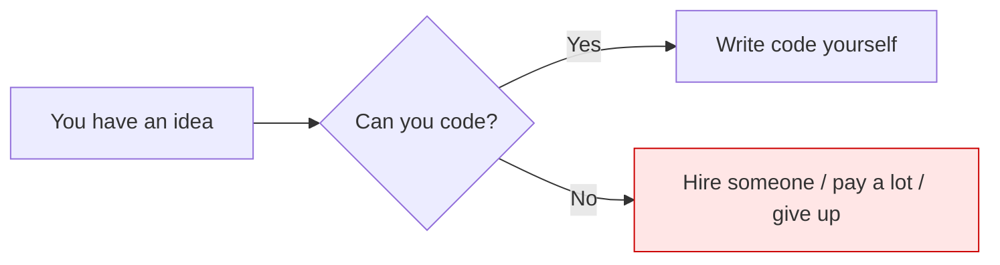
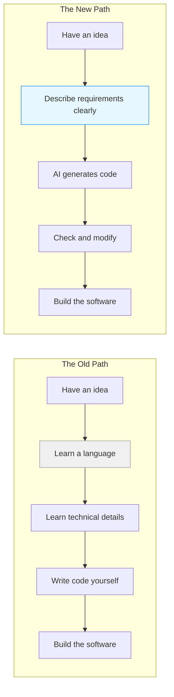

# Chapter 1: The Era When Everyone Can Build Software

> This chapter answers one question: why can someone who has never written code build software now? The answer is not "you should learn to code too" — it's that "programming" itself has changed.

## What You'll Learn in This Chapter

- Why software development used to be a very high barrier
- What AI has changed — and what it hasn't
- What "natural language programming" means
- How it differs from traditional programming, and when each fits
- AI is not magic: what it can and can't do
- How an ordinary person (Lin Xiaoman, a florist) built her own software

### Opening: Lin Xiaoman's Problem

Lin Xiaoman runs a small flower shop at the entrance of her neighborhood. She has a nagging problem: every customer order is written in a notebook — who, what flowers, when to deliver. The notebook gets thicker and harder to flip through. Once, she forgot to send flowers to a regular customer before Mother's Day, and the customer was upset for days.

"If only I had an app to remember all this for me," she thought, "one that would remind me when a date is coming up."

A few years ago, she had only two choices: pay thousands of dollars to have someone build it, or learn to program herself — a language called Python or JavaScript, for months or even years. She wanted neither.

Today, she sits at her computer and types to AI:

> "I want a little tool for my flower shop that records each customer's order — what flowers, phone number, delivery date — and reminds me when the date is near. I don't know how to program, so please guide me step by step."

Ten minutes later, a working page appears on screen. This isn't magic, and she didn't suddenly learn programming. This is what this book will teach you.

## 1.1 Software Development Used to Be a Technical Barrier

In the past, software was built like this: someone who understood technology used a language computers understand (like Python or Java) to write down, step by step, "do this, then do that." The computer followed these instructions exactly. These written instructions are **code**, and the process of writing them is **programming**.

The problem is that a computer's language is very different from a human's. It demands absolute precision: one missing symbol or misplaced comma and the program may not run. So to build software, you had to spend a long time learning a programming language — its grammar, rules, and countless technical details.

This created a barrier:

- **Time barrier**: reaching a useful level often took months to a year or two.
- **Thinking barrier**: you had to learn to think like a computer — break things into precise, step-by-step commands.
- **Trial-and-error barrier**: when something broke, the error message was a wall of confusing English, painful to debug.

The result was that most people with software ideas — people like Lin Xiaoman — were locked out. They had the idea but not the ability to build it. "People who can build software" and "people who need software" were two different groups.



## 1.2 Why AI Changed Software Development

The biggest change AI brings can be summed up in one sentence: **computers can finally understand human natural language.**

You no longer need to translate your idea into a computer language. You can tell AI what you want directly in Chinese (or any language you're comfortable with), and AI does the work of turning it into running code.

Here's an analogy. In the past, to build a house you had to mix the mud, lay the bricks, and wire the electricity yourself — because the workers couldn't understand you, only you could do it. Now a team that understands everything shows up, and you just say "I want a home with two bedrooms, facing south, with a balcony," and they plan and build it for you. You go from "the person doing the work" to "the person who makes clear what you want."

That's the essence of the change: **the bottleneck moved from "can you write it" to "can you describe it clearly."**

Concretely, AI now does these things you used to have to do yourself:

- Translate your ideas into code
- Remember the grammar and rules of various programming languages
- Generate interface elements: pages, buttons, tables
- Help analyze causes when you make mistakes
- Modify things you've already built, on your request

## 1.3 What Is Natural Language Programming

**Natural language programming** is a way of building software in which you describe the software you want in the language you speak and write every day (natural language), and AI turns it into a genuinely running program.

It has three characteristics:

1. **You use human language, not computer language.** You say "make a table to record customer flower orders," not a string of `create table orders (...)`.
2. **You're responsible for thinking it through; AI is responsible for building it.** Your core job is to describe requirements, judge the result, and request changes; AI's job is to generate the code.
3. **It takes shape through repeated conversation.** Software isn't finished by one sentence. You say something, AI responds, you go back and forth, adjusting until it looks like what you want.

To be clear: natural language programming is **not** "one sentence produces a perfect app." It's more like you and AI building something together — you define requirements and check the result, AI does the building.

## 1.4 How It Differs from Traditional Programming

The two don't "replace" each other; they're two different ways of working, each suited to different situations.

| Aspect | Traditional Programming | Natural Language Programming |
|---|---|---|
| What you write | Code in a computer language | Descriptions in a human language |
| Who writes the code | You | AI |
| Core skill | Grammar, algorithms, technical details | Define requirements, describe clearly, judge results |
| Best for | Low-level systems, peak performance, safety-critical | Small/medium tools, internal systems, prototypes, personal apps |
| Time to start | Months to years | Days to weeks |
| Where precision comes from | You ensure every line is right | You describe clearly; AI ensures implementation |

A useful analogy: traditional programming is cooking a dish yourself, from chopping to seasoning. Natural language programming is being the head chef — telling your assistant "chop it finer, less salt, sprinkle some scallions at the end" — and doing the tasting and adjusting yourself.

For software like Lin Xiaoman's flower shop helper, an expense tracker, or a customer list, natural language programming is more than enough — and much faster. For software where a tiny error is catastrophic (aircraft control systems, bank transaction cores), traditional programming's rigor is still needed. This book focuses on the former.

## 1.5 AI Is Not Magic: What It Can and Can't Do

Being honest about AI's limits matters more than hyping it up.

**What AI is good at:**

- Turning clear requirements into running code
- Generating common features: pages, forms, lists, search, calculations
- Modifying existing things according to your description
- Explaining code, analyzing errors, giving suggestions

**What AI is not good at:**

- **Reading your mind.** Anything you don't say clearly, it has to guess — and guesses are often wrong. That's why "describing things clearly" is your most important skill.
- **Finishing a complex large system in one shot.** The bigger and vaguer the request, the more likely the result drifts off target. So break it up and go step by step (covered in detail in Chapter 7).
- **Making decisions for you.** What to build, what it should look like, which feature matters most — those judgments are yours.
- **Guaranteeing 100% correctness.** AI makes mistakes, changes the wrong thing, and "forgets" earlier requirements. So you need to check, test, and correct promptly (Parts IV and V are dedicated to this).

Remember this: **AI is a very capable partner that does exactly what you say — and makes mistakes.** Your skill shows up in how well you direct it.

## 1.6 From "Learning a Programming Language" to "Learning to Direct AI"

This diagram sums up the central shift of the whole book:



Notice how the focus of your work changes:

- No longer "memorizing syntax" but "**describing requirements clearly**" (Part II)
- No longer "writing every line yourself" but "**breaking big problems into small tasks**" (Chapter 7)
- No longer "debugging every line yourself" but "**describing symptoms and letting AI diagnose**" (Part V)
- No longer "done when it's built" but "**continuously modifying and iterating**" (Parts IV and VI)

This is exactly what this book teaches systematically. It's not scattered "prompt tricks" — it's a complete set of abilities for going from idea to software.

## 1.7 A Real Example of an Ordinary Person Building Software

Let's finish Lin Xiaoman's story to give you an overall sense of the journey. In every part that follows, you'll see similar real dialogues.

**Step 1: Say the idea (Part II)**

> **Lin Xiaoman:** I want a little tool for my flower shop that records customer orders and reminds me when a date is coming up.
>
> **AI:** Great. To build something that fits your needs, a few questions: what customer information should we record? How many days ahead should the reminder be? Will you use this on a computer, or also want to check it on your phone?
>
> **Lin Xiaoman:** Name, phone number, what flowers, and the delivery date. Remind me one day ahead. Mostly on the computer, but occasionally on my phone.

**Step 2: AI designs and builds (Part III)**

Based on this description, AI plans the pages (a customer list, a "new order" form) and what data to store, then generates them step by step. Lin Xiaoman doesn't need to understand how the code works — she only needs to see "is this what I wanted?"

**Step 3: Modification (Part IV)**

> **Lin Xiaoman:** In the list I want to see "days until delivery" directly, without clicking in. Also change the reminder color to red — it's too pale, I can't see it.
>
> **AI:** Got it. I'll add a "days remaining" column to the list and make the reminder text red and bold. I'll only change the order list page, nothing else.

**Step 4: Debugging and testing (Part V)**

Lin Xiaoman notices one date is wrong. She sends a screenshot and describes it: "I entered May 10, but the list shows June 10." AI investigates step by step, finds the date-handling problem, and fixes it.

**Step 5: Publish and iterate (Part VI)**

Finally, AI helps her put the software online so both phone and computer can open it. After using it a while, she gradually adds features like "look up a customer's past orders" and "batch reminders before holidays." The software grew slowly — it wasn't perfect all at once.

This process is the skeleton of this book. **You don't need to become a programmer first — you just need to learn to walk this path.**

## Common Pitfalls

- **Pitfall: Expecting one sentence to produce a perfect app.** Why: AI only works with the information you give it, and one sentence can't hold a complete requirement. What to do: embrace "repeated conversation, gradual shaping" — build something simple first, then add to it.
- **Pitfall: Not daring to start because you don't understand the technical details.** Why: you don't need to understand code, only to describe and judge. What to do: start with the small example in 1.7, build something that runs first, and confidence will follow.
- **Pitfall: Treating AI like a search engine — one question and leave.** Why: software is "chatted" into existence, not "searched" into existence. What to do: treat it as a long-term partner, going back and forth many rounds on one requirement.
- **Pitfall: Assuming everything AI says is right.** Why: AI makes mistakes and misreads you. What to do: build the habit of "check after generating, test after using."

## Chapter Summary

- Building software used to have a high technical barrier, and AI is dramatically lowering it.
- Natural language programming = describe software in human language, let AI turn it into code, and you check the result.
- The core shift: from "learning to write code" to "learning to describe requirements clearly, break down problems, and direct AI."
- AI is capable but makes mistakes and can't read your mind — your judgment and expression matter most.
- The full journey from idea to software: describe the idea → AI designs and builds → modify → debug and test → publish and iterate.

## Practice Exercises

1. Think of a "if only I had a little tool" scenario from your life or work. Describe in three sentences what problem it would solve.
2. Find an AI chat tool you've used and give it the full scenario from exercise 1. See what questions it asks back — those questions are exactly the things a "requirement" needs to consider.
3. In your description, which parts were "clear to you but actually vague"?

## Copyable Instruction Templates

**Template 1: When starting a new project, have AI guide you step by step**

```text
I want to build a piece of software, but I don't know how to program at all. Please guide me through it step by step.

My idea is: [describe in plain language what you want to build and what problem it solves]

I'll answer your questions to help clarify the requirements. Please:
1. First ask me a few key questions to turn my idea into clear requirements;
2. Once requirements are clear, give me a simple, straightforward development plan;
3. Do only one step at a time, tell me the result after each, and wait for my confirmation before continuing.
```

**Template 2: Check whether AI's plan is sound**

```text
Regarding the plan you just gave me, please explain it in plain language:
1. What pages / parts will this software end up having?
2. What data will it store?
3. What do we do first?
4. What decisions do I still need to make?
Please avoid technical jargon — explain it using analogies.
```
