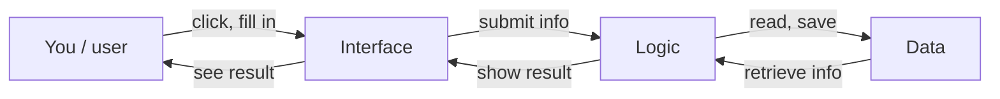
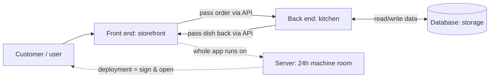

# Chapter 2: The Basic Principles of Natural Language Programming

> In the last chapter we learned that "everyone can build software." This chapter lifts the lid and takes a look inside: what exactly is software, and how does AI turn the words you type into it? Knowing a little about how things work inside will make you use it with much more confidence.

## What You'll Learn in This Chapter

- What software really is: it "automates a process"
- The three parts of any software: interface, data, and logic
- Roughly how AI turns natural language into code
- What front end, back end, and database are, with analogies to remember them
- What API, server, and deployment mean
- Why you don't need to master these technologies before you can build
- And why knowing a little about them still makes you more capable

### Opening: A Bunch of Words You Don't Understand Appear on Screen

Following the method in Chapter 1, Lin Xiaoman said a few things to AI, and a page that could actually record flower orders appeared on screen. She was delighted — then she saw AI reply:

> **AI:** The page is done. The front end is connected to the back end, the data will be stored in a database, and once you confirm I'll help you deploy it online.

Lin Xiaoman froze. "Front end? Back end? Database? Deploy? I don't understand a single one of these words. What on earth did I just build?"

Don't worry — this feeling is completely normal, for her and for you. It's like walking into a restaurant kitchen for the first time and hearing the chef shout "pass the order at the window," "restock the cold storage," and having no idea what's going on — even though the restaurant is running perfectly well. In this chapter we'll use "opening a shop" as our analogy and turn each of these words into a picture you can see. By the end you'll find that software isn't mysterious at all — it works almost exactly like the shops you deal with every day.

## 2.1 What Exactly Is Software

Don't start with words like "code" or "program." Think of a shop.

A shop that runs smoothly needs three things: a **storefront** that customers can see and walk into; a **ledger** recording who bought what and who owes money; and a set of **rules for working** — for example, "take payment before handing over the goods" and "count stock when you close for the day."

Software is really "a shop that runs automatically": **it turns a process that a person used to do step by step into something the machine does for you automatically.** Lin Xiaoman used to record orders in a notebook and remember delivery dates in her head — that was a "manual process." The software she wanted automates that process: orders get recorded, and when a date arrives it reminds her.

So software is not "a pile of code you can't read." Code is just the material used to build software — like bricks and cement for a house. What software really is, is "a tool that helps you do things automatically." What you care about is "can it record my orders and remind me," not "what bricks was it built with."

Remember this: **software = automating a process so you have less to worry about.**

## 2.2 The Three Parts of Software: Interface, Data, Logic

Take that shop apart and you'll see that every piece of software has three parts. Start with this comparison table:

| Part of software | What it is | Shop analogy | In Lin Xiaoman's tool |
|---|---|---|---|
| Interface (UI) | The part you see, click, and fill in | Storefront, window, menu, counter | The order list, the "new order" form |
| Data | The information software remembers | Ledger, customer roster | Names, phone numbers, flowers, delivery dates |
| Logic | The rules and steps software follows | The shop's working rules | "Remind me one day before delivery," "sort by date" |

- The **interface** — called interface or UI in English (think of it as "where the person and the software meet"). When you click a button, fill a form, or look at a list, you're dealing with the interface. It's the software's "face."
- **Data** is the information the software keeps for you. Think of data as a **ledger that organizes itself**: you don't have to flip through it — when you want something, one search brings it up.
- **Logic** is the part where software "uses its brain": what to do under what conditions. You can't see it, but it decides how smart the software is — for example, "if only one day remains before delivery, mark the reminder in red."

How do these three work together? Look at this diagram:



Put it in one sentence: **you operate on the interface, logic processes it, data is read and written, and the result is shown back on the interface.** Remember this loop — every concept that follows hangs off it.

## 2.3 How AI Turns Natural Language into Code

Now for the question Lin Xiaoman cares about most: how did the plain sentence she typed become a page on screen?

First, be clear about one thing: AI is not magic, and it doesn't "conjure" software out of thin air. What it does is something a lot like **translation**. You speak the "human language"; a computer only understands "computer language" (code). AI is like a translator fluent in both, translating the requirement you describe into line after line of code the computer can execute.

Here's an analogy. You tell a renovation crew, "I want a home facing south, with a balcony and a slightly bigger kitchen." The foreman doesn't start painting based on your exact words — he turns your description into a blueprint, then builds from the plan. AI does the same: it maps your description — "record flower orders, remind me when a date is near" — onto the countless code patterns it has learned (how to write a page, how to store a table, how to calculate a reminder), and assembles a program that runs.

Let's look at a real conversation, and you'll see how "not speaking human-speak → speaking human-speak" works:

**You:** I want a little tool to record flower orders — names, phone numbers, what flowers, and delivery dates, and remind me the day before. I don't know how to program.

**AI:** Great, let me confirm a few things before I start. 1) Should the reminder just turn red on the page, or pop up a window? 2) Will you use this only on a computer, or also on your phone? 3) Do you want to see past orders grouped by customer?

**You:** Turning red is fine. Mostly computer. Skip the past orders for now — too complicated.

**AI:** Got it. I'll build three things: ① a "new order" form; ② an order list showing days remaining; ③ a rule — when an order is one day from delivery, mark that row red. I'll do these three first and show you.

Notice what AI did: it **broke your fuzzy sentence into the three blocks of interface, data, and logic** (exactly what the last section covered), and deliberately cut "past orders" as too complicated for now. That's not AI being clever beyond its years — it's following the path of "make the requirement clear, break it small," which is the method this book teaches over and over.

AI can turn words into code because it has "seen" a huge amount of code and knows that "recording orders" usually corresponds to a data table, and "reminders" usually correspond to a bit of date-checking code. You don't need to understand these mappings — but knowing there is this step helps you grasp this: **the more clearly you speak, the more accurately it translates.**

## 2.4 What Are Front End, Back End, and Database

Now let's unpack the three words in AI's sentence. We'll use "opening a restaurant" as our analogy and explain them all at once:

- **Front end**: the part customers see and touch directly — the storefront, menu, waiters, tables and chairs. In software, it's the pages and buttons you can see and click. The order list and new-order form Lin Xiaoman sees are the front end.
- **Back end**: the part customers can't see, working behind the scenes — the kitchen washing, cooking, plating, and doing the accounts. In software, it handles the rules: judging dates, calculating reminders, checking whether what you filled in is valid.
- **Database**: the place things are stored — the restaurant's cold storage and shelves. In software, it's where your data is kept. Think of a database as a **super spreadsheet**: it can store many rows of records and search and sort them blazingly fast.

| Concept | Restaurant analogy | Role in software |
|---|---|---|
| Front end | Front of house, menu, waiters | The interface the user sees |
| Back end | The kitchen, doing the preparation | The invisible part that handles rules |
| Database | Cold storage, ledger cabinet | Where data is kept long-term |

Remember it in one line: **front end is the visible face, back end is the invisible brain, database is the ledger that remembers things.** They aren't three separate pieces of software, but three jobs within one piece of software — just as the front of house and the kitchen both belong to the same restaurant.

## 2.5 What Are API, Server, and Deployment

Three more words. Let's keep using the restaurant to make them clear:

**API (interface)** — picture the "pass-through window" between the waiter and the kitchen. The waiter (front end) can't charge into the kitchen (back end) and cook himself; he passes the order through the window, and the kitchen passes the dish back out. That "interface where orders and dishes are handed over according to rules" is the API. Its beauty is that as long as both sides follow the rules, the two ends do their own jobs without interfering. You can also think of it as a **wall socket** — any appliance with the right plug can connect and get power.

**Server** — a computer that stays on 24 hours a day, dedicated to hosting software and waiting for people to visit. Like the restaurant's "switchboard," it's ready whenever a customer walks in, day or night. Your software can't stay only on your own computer (when you shut it down, nobody else can open it); it has to live on a computer that's always on.

**Deployment** — the process of moving the finished software onto a server so it can be opened via a web address. In our analogy it's **opening for business**: the renovation is done, the shelves are stocked, the sign is hung, and customers can push the door open.

See the whole chain in this diagram, and you'll know where each word sits:



Now look again at AI's sentence — "the front end is connected to the back end, the data is stored in the database, and I'll deploy it online" — does it read like: the front of house and kitchen are connected by the pass window, the ledger is put in place, and the sign is hung to open for business? Much less scary, right?

## 2.6 Why You Don't Need to Master These Technologies First

At this point you might think: "These words still sound like a lot. Do I have to learn them all before I can start?"

The answer is: **absolutely not.** Think about it —

Do you need to learn how an engine is built before you drive to work every day? No. When you hire a crew to renovate your home, do you need to know how to lay bricks and run wires yourself? No. You only need to "say clearly what you want" and leave the rest to the professionals — or, today, to AI.

Lin Xiaoman is the perfect example. To this day she can't explain exactly what a "database" is, yet every flower order is safely stored; she doesn't know how "deployment" works, yet her tool opens on her phone just fine. **AI has taken over these technical details**: it decides how to store data, how to write the front and back ends, how to assemble the code. Your job is to be the person who "defines requirements, checks the result, and says what to change."

This is the central shift from Chapter 1: the bottleneck moved from "can you write it" to "can you describe it clearly." So don't wait until you've "finished studying" to start — **build something first, and understand it as you go.**

## 2.7 But Why Knowing a Little Still Helps

If you don't need to learn it first, was this chapter a waste? Of course not. "No need to master" and "know nothing" are two different things. Knowing a little gives you at least four benefits:

1. **You communicate more precisely with AI.** Once you know "front end" means the page and "data" means the information to store, you can say "add a days-remaining column to the front-end list" instead of vaguely saying "change that bit over there." AI understands, and there's less rework.
2. **You can see what AI is doing.** When it says "I changed the data model," you know it roughly altered the ledger structure, instead of blankly clicking "OK."
3. **You know where to look when something breaks.** If a page displays wrong, you can guess it's a front-end problem; if data is missing, you know to check storage. When Part V covers debugging, these concepts will help you describe problems.
4. **You make decisions with more confidence.** When AI offers two options, a little understanding of the principles lets you judge which suits your little shop better.

Here's an analogy: you don't need to learn how to repair a car, but knowing a bit of basic mechanics means you can tell the mechanic "it makes a clunking sound when I start moving," and you're less likely to be taken advantage of. We're learning these concepts not to turn you into an engineer, but to make you a **smart, hard-to-fool "client."**

## Common Pitfalls

- **Pitfall: Being scared off by jargon and thinking you must study it all first.** Why: these words are just names for things, not an entrance exam. What to do: follow the template and build something small first, then look up each term as you meet it — understanding comes much faster that way.
- **Pitfall: Treating "front end" and "back end" as two different pieces of software.** Why: they sound like separate things, but they're two jobs within one piece of software. What to do: think of the front of house and the kitchen of the same restaurant, and it clicks.
- **Pitfall: Thinking a database is something profoundly mysterious.** Why: the name is intimidating. What to do: treat it as a "super spreadsheet" that searches fast and holds many rows — much less mysterious.
- **Pitfall: Feeling that if you don't understand technology, you must accept whatever AI says.** Why: AI makes mistakes and misreads you. What to do: knowing a few basic concepts gives you the ability to check its results — exactly the point of 2.7.

## Chapter Summary

- Software is essentially "automating a process"; code is only the material, not the software itself.
- Software has three parts: interface (storefront), data (ledger), and logic (working rules), forming a loop.
- Front end is the visible face, back end the invisible brain, database the ledger; API is the pass window, server the 24-hour machine room, deployment hanging out the sign to open.
- AI is like a translator: it breaks your plain words into interface, data, and logic, then translates them into code — the clearer you speak, the more accurate the translation.
- You don't need to master technology first to build, but knowing a little helps you communicate precisely, debug faster, and decide with confidence.

## Practice Exercises

1. Using the "opening a restaurant" analogy, describe what the "front of house," "kitchen," and "storage" of your little tool would be.
2. Open a piece of software you already have (or the one you thought of in Chapter 1) and point out: what is interface, what is data, what is logic? (It's fine if you can't tell — take a guess first.)
3. Try explaining "deployment" to a non-technical friend in plain language, using the "opening a shop" analogy.

## Copyable Instruction Templates

**Template 1: Have AI explain what it built using the shop analogy**

```text
I don't understand technology at all. For the thing you just built, please explain it to me using the analogy of "opening a shop":
1. What is its "storefront" (the part I can see)?
2. What does its "ledger" (the stored data) record?
3. What are its "working rules" (the logic)?
4. What part of the shop do front end, back end, and database each correspond to?
Please avoid technical jargon — explain everything in terms of opening a shop.
```

**Template 2: Before starting, have AI sketch out the structure**

```text
Before you write any code, please tell me in the plainest language how this software will be divided:
1. What pages / interfaces will there be?
2. What data will be stored?
3. What judgment rules will there be (e.g. when to remind, how to sort)?
4. Draw the relationships between these parts using a simple diagram or table.
Let me confirm the structure matches what I have in mind before you start building.
```
