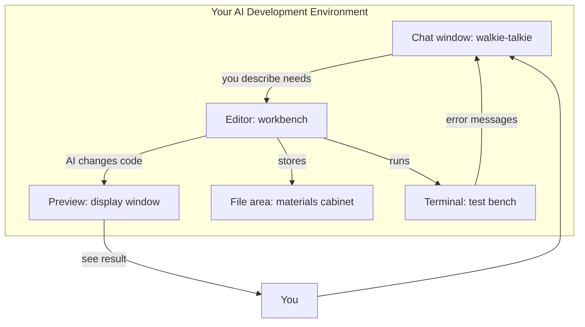
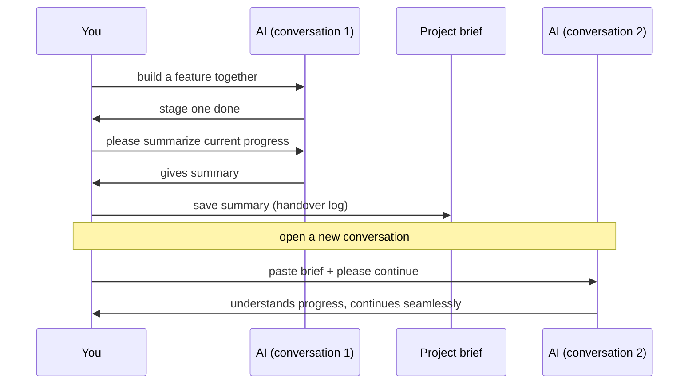

# Chapter 3: Meet Your AI Software Development Partner

> The last chapter lifted the lid off software. This chapter is about meeting the people — well, the "tools" — who actually do the work with you: what AI tools exist, how they differ, how to pick one that fits you, and how to turn it into a studio where you can work for the long haul.

## What You'll Learn in This Chapter

- The fundamental difference between AI chat tools and AI programming tools
- The main forms AI programming tools take, and who each suits
- How a complete beginner should pick a first development tool
- What an AI development environment is made of
- How to set up your own development workspace
- How to keep one project going across many conversations
- How to start your very first software project

### Opening: Lin Xiaoman's Tool-Picking Headache

Lin Xiaoman has two AIs. One is the chat assistant she uses for everyday questions and writing social-media posts; the other is a "webpage-generating" programming tool a friend recommended. She's stuck:

> **Lin Xiaoman:** I use the chat one for asking things — can I use it to build software too? What's this programming tool for? And there are so many names — app generators, code editors, plugins... it makes my head spin.

Her question is a good one. There are so many tools out there with similar-sounding names. What's the difference, and could picking the wrong one ruin everything?

Let me put your mind at ease: **the tool is just the place where work happens; what really decides success is whether you can describe your requirements clearly** (the heart of Chapter 2 and the whole book). Tools change and get replaced, but the skill — describing requirements clearly, breaking tasks small, checking the result — is universal. This chapter will make sense of tools for you, then get you to pick one and start. Don't spend forever choosing — doing is what matters.

## 3.1 AI Chat Tools vs. AI Programming Tools

Let's separate the two most common kinds first.

**AI chat tools** (such as general-purpose conversation assistants): you ask, they answer. They explain concepts, write copy, help you brainstorm, and some can even write a snippet of code for you. But they usually **cannot directly operate your project files or run your whole software**. In an analogy: they're like a **know-it-all consultant** — great at advice and ideas, but they don't do the work. You have to do it yourself based on what they say.

**AI programming tools**: these live inside your "project," can directly read, write, and change your files, can run the program, see errors, and show you the page. In an analogy: they're like a **construction crew with a toolbox** — you say what you want, and they actually build it and run it for you to see.

| Aspect | AI chat tool | AI programming tool |
|---|---|---|
| Main strength | Q&A, explanation, ideas, snippets | Read/write files, generate and run a whole project |
| Like what role | Consultant (talks) | Construction crew (acts) |
| Can it show your software running? | Usually not | Yes, with a preview |
| Good for building software from zero? | Good as a helper, for clarifying needs | Good for actually building |

A key test: **can it directly operate your project and show the software running?** If yes, it's a programming tool; if no, it's just a chat consultant. To build software, you'll ultimately need the latter. But the two work as partners — you can use a chat tool to think through requirements while using a programming tool to build them.

## 3.2 The Main Forms of AI Programming Tools

AI programming tools come in different shapes, roughly four forms. Use "eating" as an analogy and it's instantly clear:

1. **Conversational app builders** (platforms where "one sentence generates a webpage"): you describe in plain language and it produces a web app you can open and run. Analogy: **order and it's served** — say what you want, the kitchen plates it up. Friendliest for total beginners.
2. **AI code editors / IDEs** (integrated development environments, like editors with AI built in): like a professional workbench where AI helps you change a whole project, see files, and preview. Analogy: **a workbench with an AI assistant** — for people who want to see and change more.
3. **Plugin-style coding assistants**: installed into an editor you already have; as you write, it fills in. Analogy: **adding a smart helper to an old wrench** — better for those with some basics.
4. **Command-line AI tools**: in a black-and-white terminal window, you direct it to operate the project by conversation. Analogy: **directing construction over a walkie-talkie** — flexible but a bit higher-bar, more advanced.

| Form | Who it suits | One-line analogy | Beginner friendliness |
|---|---|---|---|
| Conversational app builder | Total beginners | Order and it's served | Highest |
| AI code editor / IDE | Beginner to advanced | Workbench with AI | High |
| Plugin-style assistant | Some basics | Old tool + helper | Medium |
| Command-line AI tool | Advanced users | Walkie-talkie direction | Lower |

For you (and Lin Xiaoman), starting with a "conversational app builder" or "an editor with AI" is the least stressful.

## 3.3 Choosing a Development Tool for Beginners

How to choose? Don't chase "the strongest" — chase "the one that fits you right now." Here are five practical criteria:

- **Can it communicate well in Chinese?** You describe needs and it explains problems in a language you know — that's most efficient.
- **Does it have a preview window?** Seeing the result immediately is a beginner's biggest source of confidence — change one line, see the change at once.
- **Can you run / publish with one click?** Skip environment setup; get it running first.
- **Can you paste an error straight back to it?** A good tool reads errors and helps you fix them — crucial for debugging (Part V).
- **Is the cost acceptable?** Many tools have free tiers; practice on free, upgrade when needed.

One more reminder: **don't fall into "choosing tools forever."** Tools change — today's best may be redesigned tomorrow. Pick one that meets the criteria above and use it earnestly for two weeks. If it doesn't fit, switch later — because your core skills (describe needs, break tasks, check results) are already inside you and will carry over to any tool.

## 3.4 What an AI Development Environment Is Made Of

Once you pick a tool, you'll see a "development environment." Don't be scared by the name — it's a **studio** with five common spots:

- **Editor**: where you write code and view files. Analogy: the studio's **workbench**.
- **Chat window**: where you talk to AI and give instructions. Analogy: the **walkie-talkie** for talking to the crew.
- **Preview window**: where the software's effect is shown; your page appears here. Analogy: the **display window** for clients.
- **File area**: your project files are listed here, like page files and data files. Analogy: the **materials cabinet**.
- **Terminal / run area**: where you run the program and see error messages. Analogy: the **test bench** for powering things up.



These five spots aren't always in one screen — sometimes they're on different tabs. But remember "walkie-talkie to say needs, workbench to change code, display window to see results, cabinet to store files, test bench to see errors" and you've got the key to a development environment.

## 3.5 How to Set Up Your Own Development Workspace

Now build your studio. Follow these steps:

1. **Register and log in** to your chosen tool — like renting a studio, first get the key.
2. **Create a new project** (some call it a "folder" or "workspace") and give it a clear name, like "Flower Shop Helper." Don't use "New Folder 1" — a name you won't recognize later.
3. **Write a "project brief."** This is the most important step. Create a text file (often called README or 说明.txt) and write in plain language: what this project is for, what features it has, and how far along it is. Why does it matter? Because next time you open a new conversation, AI won't remember what you talked about — this brief is its "memory."
4. **Get into the habit of saving and backing up.** Many tools save automatically, but still occasionally save a copy of important versions (Chapter VI covers versions and backups in detail).
5. **Keep files tidy.** Don't dump everything together; group by function so it's easy to find later.

See how Lin Xiaoman had AI write her first project brief:

**You:** I want to write a brief for this project so I can pick it up in a new conversation later. Please draft it for me.

**AI:** Sure, I'll draft one based on what we've done so far; you can edit it:

> # Flower Shop Helper · Project Brief
> - **Goal**: help the shop record flower orders and remind before the delivery date.
> - **Features done**: new order (name, phone, flowers, date); order list; mark red one day before delivery.
> - **Data**: each order stores name, phone, flowers, delivery date.
> - **Current status**: pages and reminder done, not yet published online.
> - **Next step**: test on phone after publishing.

**You:** Good, add one line — the reminder should only turn red, no pop-up; I don't want to disturb customers.

**AI:** Added to "Features done" and "Next step." From now on, whenever you open a new conversation, send me this brief and I can pick up right where we left off.

This brief is your project's "ID card + diary."

## 3.6 How to Keep a Project Going Across Conversations

Building software rarely finishes in one conversation — it usually takes many. Here's the catch: **AI "forgets."** If the conversation gets long, or you open a new one, it no longer remembers earlier chats. Technically this is called limited **context** — the information "currently in mind" between you, the user, and AI has a capacity limit.

What to do? Use a "handover." Think of a factory running three shifts: before leaving, you write a handover log so the next shift knows how far things got. Do the same:

1. **At the end of each stage, have AI summarize progress**, then save the summary into the project brief (the one from 3.5).
2. **When opening a new conversation, paste the brief to AI first**, then say "let's continue, here's the current progress." It's like handing the new worker the handover log.
3. **Write important decisions into files, not just the chat.** Something like "reminder only turns red, no pop-up" should go in the brief so it isn't lost.
4. **When the conversation is clearly long and AI starts talking nonsense, open a new conversation proactively** and hand over — don't push on.



With this "handover log" habit, your project won't go off the rails just because you switched conversations. This is the key reason many people lose track midway, and why this book keeps emphasizing "put information into files."

## 3.7 Start Your First Software Project

Put the first six sections together and you get a checklist you can start today. We'll use Lin Xiaoman's first day as an example:

**Step 1: Pick a tool.** She chose a conversational app builder that supports Chinese, has a preview, and runs with one click.

**Step 2: Set up the space.** Create project "Flower Shop Helper" and write the project brief.

**Step 3: Say the first small goal.** Note — she didn't start with "I want a whole customer management system." She asked for the smallest possible thing first:

**You:** I want the simplest page first: a form where I can fill in name, phone, flowers, and delivery date, and after I click save, a list below shows what I entered. Skip the reminder feature for now — let's just get this running.

**AI:** OK, let's build this minimal version first. I'll make a form and a list: you fill it in, click save, and the record appears in the list. I'll start now and show you a preview when done.

**Step 4: See the result, ask for changes.** When the page appears, she looks at it and says what to change.

**You:** It's up! The text in the list is too small — can you make it bigger? Also change the column order to: name, phone, flowers, date.

**AI:** Done: enlarged the list font and reordered columns as you asked. Nothing else changed — take another look.

**Step 5: Summarize and save.** At the end of the round, she has AI summarize progress and saves it into the brief, ready for the next handover.

That's it. **The goal of a first project isn't "perfection" — it's "getting it running."** Even a page where you can enter and list things is a huge leap from zero to one. Software grows slowly — Chapter 1's story of Lin Xiaoman proved it, and every part that follows will have you prove it again with your own hands.

## Common Pitfalls

- **Pitfall: Hopping between several tools, never going deep in any.** Why: the tool is just a carrier; the core is whether you can describe needs. What to do: settle on one, use it earnestly for two weeks, then decide whether to switch.
- **Pitfall: Thinking a fancier tool will make AI understand you.** Why: the problem is usually unclear requirements, not the tool. What to do: practice "speaking clearly and breaking big tasks small" — that's the real, transferable skill.
- **Pitfall: Keeping all important information only in chat history.** Why: chats get lost and AI forgets. What to do: write progress into the project brief each time so information lands in files.
- **Pitfall: The conversation is already long, AI is getting confused, but you keep pushing.** Why: you've exceeded the context capacity. What to do: open a new conversation promptly and hand over with the brief.
- **Pitfall: Wanting a big, all-in-one system for your first project.** Why: bigger means more drift and more chances to get stuck. What to do: start from "the smallest version that runs," then add features little by little.

## Chapter Summary

- An AI chat tool is a talking consultant; an AI programming tool is a hands-on crew; building software needs the latter, and the two can partner.
- Programming tools come in four forms; beginners should prefer "conversational builders" or "editors with AI" — order-and-it's-served is the easiest.
- A development environment is a studio: chat is the walkie-talkie, editor the workbench, preview the display window, file area the cabinet, terminal the test bench.
- Set up your workspace and write a "project brief" — the foundation of long-term development.
- Use the "handover log" method across conversations: summarize and save at the end of a stage, paste the brief at the start of a new one.
- The goal of a first project is "getting it running" — start from the smallest version, don't be greedy.

## Practice Exercises

1. Pick a tool that meets the criteria in 3.3, register, and create your first project with a clear name.
2. Write a "project brief" in plain language: what you want to build, what features it should have, how far along it is now.
3. Have AI generate the simplest page (e.g. a little form where you can enter a name and list names), and see it in the preview window.
4. At the end of that round, ask AI to summarize progress, and save it into the project brief for the next handover.

## Copyable Instruction Templates

**Template 1: Have AI draft or update the "project brief"**

```text
Please help me maintain a "project brief" so I can pick up in a new conversation later. Write it in plain language and include:
1. What this project is for;
2. What features are already done;
3. What data is being stored;
4. What's done so far and what's left;
5. What's planned next.
This is the first draft. My project idea is: [describe in plain language]. Please draft it; after each step I'll ask you to update it.
```

**Template 2: The "handover" when opening a new conversation**

```text
We worked on a project before. Here is its "project brief" and latest progress:

[paste your project brief here]

Please read the above first, then let's continue. What I want to do in this round is: [describe this round's goal].
If you can't pick up the thread or have questions, ask me first and confirm before you start.
```
