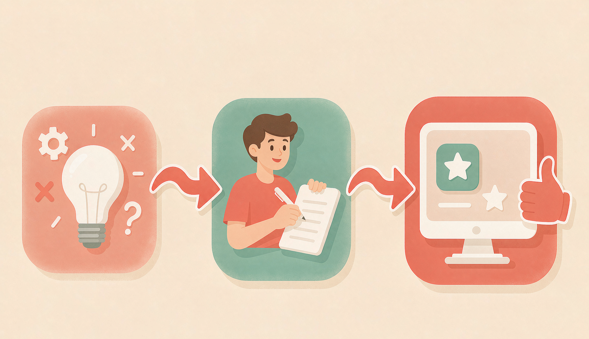
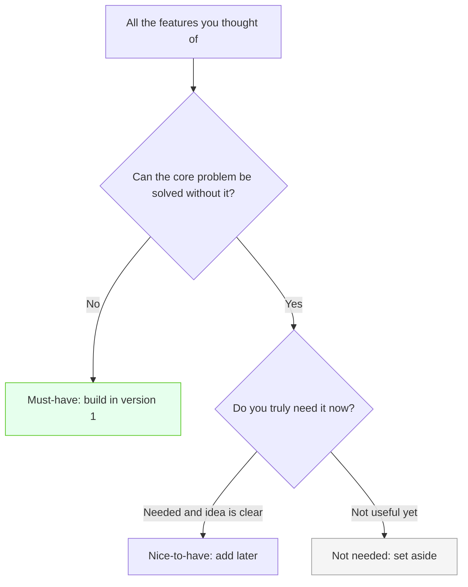

# Chapter 4: How to Turn an Idea into Software Requirements

> This chapter answers one question: you have a vague "I want to build an app" idea in your head, but it's fuzzy and hard to put into words — how do you turn it into clear requirements that AI can understand and actually build from?

## What You'll Learn in This Chapter

- The real difference between an idea and a requirement
- How to find software ideas from the small troubles in everyday life
- The three key questions that clarify any idea: what problem, for whom, what features
- How to tell "must-have" features from "nice-to-have" ones
- How to let AI ask *you* questions to complete your requirements



*Figure: The journey from idea to software*

### Opening: Lin Xiaoman's One Sentence Stumps AI

After reading Part One, Lin Xiaoman sits down at her computer, eager to build her flower shop helper. She thinks for a moment and types:

> **Lin Xiaoman:** Build me a piece of software for my flower shop.

AI replies quickly — but with questions she never thought about:

> **AI:** Great! To build something that fits your needs, a few questions:
> 1. What is this software mainly for — bookkeeping, recording orders, or displaying flowers?
> 2. Who will use it — only you, or staff and customers too?
> 3. What features do you want — add, search, reminders…?
> 4. Will you use it on a computer, or on your phone as well?

Lin Xiaoman is stunned. She has something in mind, but the moment she's asked, she realizes she hasn't actually figured anything out. "I… I want something that records customer flower orders," she manages after a long pause, "but I can't really say what else."

She's not alone. Almost everyone starting out gets stuck right here: **you have a feeling, but you don't yet have requirements.** This chapter teaches you to polish that feeling into requirements, step by step. Don't worry — we'll walk through it hand in hand.

## 4.1 An Idea Is Not a Requirement

Let's separate two words first. This is the most basic — and most important — pair of concepts in the book.

An **idea** is a vague notion in your head. It's often one sentence, full of "sort of," "maybe," and "roughly": "I want something that helps me record flower shop orders." An idea is *allowed* to be vague — it's just a starting point.

A **requirement** is what that notion becomes once you've made it clear: what problem it solves, who uses it, what features it has, what goes in, what comes out. A requirement is clear, specific, and something you can actually build from.

Think of it this way. An idea is like telling your family "I feel like eating something good tonight" — that's a feeling. A requirement is a recipe: what to buy, how much salt, what to cook first and what to stew next. A chef (AI) can't cook from "something good," but can follow a recipe.

| Aspect | Idea | Requirement |
|---|---|---|
| Form | One sentence, a feeling | A list, a clear description |
| How vague | Vague, "roughly," "sort of" | Specific, answers "what, how many, how calculated" |
| Can it be built from? | No — AI can only guess | Yes — AI can follow it |
| Example | "Make something to record flowers" | "Record customer name, phone, flowers, delivery date; remind me one day before delivery" |

So the first step in giving AI requirements isn't typing — it's asking yourself: **which parts of my idea are still "rough"?** Turn each "rough" into "exact," and the idea becomes a requirement.

## 4.2 Finding Software Ideas in Everyday Problems

Many people think you need a "tech inspiration" to build software. It's the opposite: **good software almost always comes from a real, everyday annoyance.**

Lin Xiaoman's idea grew out of exactly such an annoyance. Her customer orders were all recorded in a notebook that got thicker and harder to flip through; once, she forgot to send flowers to a regular customer before Mother's Day, and the customer was upset for days. That very trouble — " flipping through a dizzying notebook plus forgetting to send flowers" — sparked the thought, "if only I had an app."

You can use the same method to find ideas. Look for recurring "real troubles" in your life or work:

- Do you constantly forget or lose information? (orders, customers, expenses)
- Do dates and deadlines slip your mind? (reminders, due dates, birthdays)
- Do you do the same repetitive chore over and over? (filling the same form, sending the same notice)
- Do you struggle to keep numbers straight? (counting, summing, budgeting)

A simple test for whether an idea is worth building: **is the problem real, frequent, and genuinely annoying?** The more it's an "every day, genuinely frustrating" little trouble, the better fit it is for a small app. By contrast, ideas that merely "sound cool" but that nobody truly needs usually gather digital dust once built.

For Lin Xiaoman, "forgetting to send flowers" is real and frequent — so the flower shop helper is a genuinely worthwhile idea.

## 4.3 Making Clear What Problem the Software Solves

Once you have an idea, the first thing is to write one sentence: **who is this software for, and what trouble does it solve?**

This is a "problem statement." Its value is that it forces you to focus on the *problem* instead of piling up features. Lin Xiaoman first wrote "build a flower shop app" — that's not a problem, that's the thing she wants. Turned into a problem statement, it becomes:

> I run a neighborhood flower shop. Customer orders go in a notebook — slow, hard to read, and easy to miss. I also often forget which day to deliver. I need a tool that records every order clearly and reminds me when delivery day is near.

A good problem statement has three qualities:

1. **A specific person**: "a neighborhood flower shop owner," not a generic "user."
2. **A specific trouble**: "notebook is slow and easy to miss, forgot delivery day," not vague "poor management."
3. **A desired change**: "record orders clearly, remind on time" — this says what success looks like.

If you can't write such a sentence, you probably haven't thought it through. Don't force features yet — go back to real life and replay the scene that frustrated you: what exactly went wrong? What would you most want someone to do for you?

## 4.4 Making Clear Who the Users Are

Software is built for people. Different users can mean very different software. So the second question is: **who exactly will use this software?**

For Lin Xiaoman's helper, there are several possibilities:

- **Herself**: records orders and checks reminders daily — the main user.
- **Staff**: help enter orders, but may not need to see everything.
- **Customers**: if customers place their own orders, the software becomes a public-facing site — a completely different thing.

You see, just "who uses it" can send the software in totally different directions. So in this section, make a "user list": who will use it? What does each person do with it? Who uses it a lot, who only occasionally?

For a first version built by a beginner, a very practical tip: **design for the one main user first.** Lin Xiaoman's first version considers only herself — she enters and views everything alone. Once it's running smoothly, she can think about a staff login. Fewer users mean simpler software and a faster build.

You can also briefly describe the main user's traits: "Me, a flower shop owner, non-technical, mostly on a computer, occasionally glancing at my phone." This will be very useful when describing the software later.

## 4.5 Making Clear the Core Features

With the problem and users clear, next comes features. **Core features are the ones that directly solve the problem — the ones you can't do without.**

How do you find them? Go back to your problem statement and ask: "to solve this trouble, what's the minimum set of things the software must do for me?" Lin Xiaoman's trouble is "record orders + don't forget delivery day," so the core features almost write themselves:

| Core Feature | Problem It Solves |
|---|---|
| Add an order | Record customer flower orders, no more notebook |
| View order list | See all orders at a glance, no flipping through pages |
| Due-date reminder | Get reminded before delivery day, avoid forgetting to send |

Notice that each of these directly answers a trouble. That's the key to core features: **each one has a specific problem behind it.** If you can't answer "what problem does this solve?" about a feature, it's probably not core.

For a first version, Lin Xiaoman locks in these three core features. Don't be greedy — three solid features beat ten half-finished ones. That's the principle Chapter 7 on "breaking down features" will hammer home; for now, just hold onto the mindset.

## 4.6 Must-Have vs. Nice-to-Have Features

With core features in hand, you may start thinking "wouldn't it be nice if it could also…" — look up a customer's history, print order slips, auto-calculate monthly sales, attach flower photos. Should any of that go into the first version?

Now is the time to grade features. A simple set of labels is enough:

- **Must-have (in version 1)**: without it, the core problem isn't solved. Lin Xiaoman's add / view / remind fall here.
- **Nice-to-have (add later)**: better to have, but usable without. E.g., "look up a customer's past orders," "monthly sales totals."
- **Not needed yet (ignore for now)**: not currently useful, or the idea isn't mature. E.g., "customers order themselves," "print slips."



Why grade them? Because a beginner's biggest enemy is "wanting it all at once." The more features, the more AI has to do in one go, the more likely it is to err and drift — and the harder it is for you to check. Get a few must-have features built and in use first, then add nice-to-haves gradually, and the software will grow steadily.

Lin Xiaoman decides decisively: version 1 does only the three must-have things; everything else goes to a "later" list. That list isn't abandonment — it's a schedule.

## 4.7 From Vague Idea to Clear Requirements

Now string the steps together. Turning a vague idea into clear requirements is really answering a series of questions, turning every "rough" into "exact." You can go through this checklist item by item:

| Question to Answer | Lin Xiaoman's Answer |
|---|---|
| What problem does it solve? | Recording orders is slow and error-prone; forgot delivery day |
| Who is the main user? | Flower shop owner, non-technical, mostly on computer |
| Core features? | Add order, view list, due-date reminder |
| What info per order? | Customer name, phone, flowers, delivery date |
| How should reminders work? | One day ahead, shown prominently |
| Must-haves for version 1? | The three core features above |
| What's deferred? | History lookup, statistics, printing, etc. |

Once you've filled this table, the original "build me a flower shop app" has become a crystal-clear description. Compare:

- Vague idea: "Make something to record flowers."
- Clear requirement: "A tool for the flower shop owner that records each order's customer name, phone, flowers, and delivery date; shows all orders; and prominently flags orders one day before delivery. Version 1 does these three things; history lookup and statistics come later."

The right-hand paragraph is something AI can build from. **Turning an idea into requirements is essentially filling in this table.** You need zero technical knowledge — just honestly answer these questions.

## 4.8 Using AI to Complete Your Requirements

By now you might think: "what if I can't answer all these questions myself?" Good news — **you don't have to figure it all out alone; you can let AI ask you.**

AI is exceptionally good at one thing: asking follow-up questions. Give it a vague idea and tell it to play an "interviewer," drawing out the needed information one question at a time. You just answer honestly, and the requirements gradually take shape. Watch Lin Xiaoman and AI:

> **Lin Xiaoman:** I want a little tool for my flower shop that records customer flower orders and reminds me when a date is near. I don't know how to program, so don't use technical words — chat with me and ask questions to help me make my idea clear.
>
> **AI:** Let's talk. First question: what information do you want per order? Just the name, or also phone and address?
>
> **Lin Xiaoman:** Name, phone, what flowers, and the delivery date.
>
> **AI:** Got it. Second: this "reminder" — how far ahead should it remind you? One day, three days, or the same day? And how should the reminder appear?
>
> **Lin Xiaoman:** One day ahead is fine, shown in red on the page.
>
> **AI:** Third: who uses this, and where? Just you on a computer, or staff too, and do you want to check it on your phone?
>
> **Lin Xiaoman:** Version 1 is just me on the computer; I glance at my phone occasionally.
>
> **AI:** Great, let me organize your requirements into a paragraph — tell me if it's right:…

See the trick? Lin Xiaoman did exactly one thing right: **at the start she explicitly told AI "please ask me questions."** That one sentence turned AI from "a tool waiting for orders" into "a partner helping her think."

So when you can't figure something out, don't struggle alone. Throw your vague idea at AI, let it ask, and just answer. As you answer, the requirements appear.

## Common Pitfalls

- **Pitfall: Treating "build me an X app" as a requirement and telling AI to start.** Why: that sentence only says what to build, not what problem, for whom, or with what features — AI can only guess. What to do: spend a few minutes filling in the 4.7 checklist first.
- **Pitfall: Trying to build every feature in version 1.** Why: more features mean more errors and harder checking; a beginner often gives up after one failed attempt. What to do: use the 4.6 grading and build only two or three must-have features first.
- **Pitfall: Designing for "all possible users."** Why: more users mean more scattered requirements and more complex software. What to do: design for one main user in version 1 — usually yourself.
- **Pitfall: Thinking "I must think it all through before I start."** Why: requirements are never complete all at once; they clarify through back-and-forth with AI. What to do: write a rough version, let AI ask you questions, and fill it in as you talk.

## Chapter Summary

- An idea is a vague notion; a requirement is a clear, specific, buildable description — AI needs the latter.
- Good ideas come from real, frequent little troubles, not from things that merely "sound cool."
- Turning an idea into requirements means answering a series of questions: what problem, for whom, what features, what information.
- Grade features: version 1 does only a few must-have core features; nice-to-haves come later.
- When stuck, have AI play the interviewer and ask you questions — an easy way to complete your requirements.

## Practice Exercises

1. Think of a recurring "little trouble" from your life or work. Write one sentence stating who it solves a problem for and what the problem is (following the problem statement in 4.3).
2. List every feature you can imagine for that trouble, then sort them into "must-have / nice-to-have / not needed yet" using 4.6.
3. Open an AI chat tool, tell it your vague idea, and add "please interview me with questions to help turn my idea into clear requirements." Record its questions and your answers.
4. Using your record, fill in a table like the one in 4.7, then write a clear requirement paragraph that AI could build from.

## Copyable Instruction Templates

**Template 1: Let AI be the interviewer and turn your vague idea into requirements**

```text
I have a vague idea for a piece of software, but I haven't figured it out myself and I don't know how to program.
Please act like a patient interviewer — chat with me and ask me questions one step at a time,
without technical jargon, to help turn my idea into clear requirements.

My idea is: [say in plain language what you want to build and what trouble it solves]

Please ask only one question at a time and wait for my answer before the next one.
Once you have enough information, summarize the complete requirements in plain language for me to confirm.
```

**Template 2: Organize your idea into a requirements checklist for self-review**

```text
Based on my description below, organize my idea into a requirements checklist.
Use a table with these items and mark any gaps as "to be confirmed," telling me how to fill them in:
1. What problem the software solves;
2. Who the main user is and in what situation;
3. What the core features are;
4. What information each record must store;
5. Which features are must-haves for version 1;
6. Which features can be deferred.

My description is: [write down everything you've thought of — messy is fine]
```
