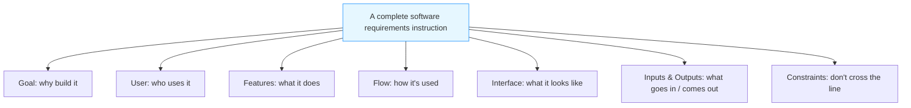

# Chapter 5: Learning to Describe Your Software to AI

> The last chapter helped you turn a vague idea into clear requirements. This chapter solves the next step: how to write those requirements as a description AI truly understands and can build from.

## What You'll Learn in This Chapter

- Why "one-sentence requirements" almost always make AI build the wrong thing
- The eight things a description of software must cover
- How to describe the goal, users, features, and operation flow
- How to describe the interface, inputs and outputs, and constraints
- How to assemble everything into one complete software requirements instruction

### Opening: Requirements Were Clear — But the Result Still Wasn't

Lin Xiaoman used Chapter 4's method to clarify her requirements. Full of confidence, she typed:

> **Lin Xiaoman:** Build me an app that records customer flower orders — I need to add orders, view a list, and get a reminder the day before delivery.

AI quickly produced a page. Lin Xiaoman opened it and froze: there was a page, but nothing like what she'd imagined — order info was crammed together, there was no "customer name" column, she couldn't tell where the reminder was, and though she wanted a Chinese interface, the buttons came out in English.

She was deflated. "But I said it clearly!" Actually, she'd made clear only one part — the *features*. She hadn't said a word about what the software should look like, how it should be operated, what it should display, or what rules it should follow. AI had to guess, and the result naturally missed.

It's like asking a renovation crew for "a two-bedroom apartment" but saying nothing about style, colors, or whether you want a balcony — if the result disappoints, you can't blame them. This chapter teaches you to complete the description — from "said the features" to "said everything."

## 5.1 Why One Sentence Is Rarely Enough

AI has a trait you met in Chapter 1: **it can't read your mind.** Whatever you don't write down, it has to guess — and its guesses usually differ from yours.

One sentence carries too little information. Take "build me an app that records flower orders" — hidden inside that short line are at least a dozen unanswered questions:

- What info per order? Name, phone, flower, date… or more?
- What order should the list use? Should it be searchable?
- Where do you click to "add an order"? What button after filling the form?
- What does a reminder look like? Red text? A pop-up? A separate page?
- Chinese interface or English? What style?
- Computer only, or phone too?

If you don't say, AI decides for you — and its decisions are rarely the ones you wanted. So when a one-sentence requirement goes wrong, it's not that AI is dumb — you just didn't give enough information.

A handy test: **read your description to a friend who knows nothing about it. If they still have a pile of questions, so will AI.** The goal of a description is that the other side — person or AI — can start without guessing.

## 5.2 How to Describe the Goal

The first block of a complete description is the **goal**: why build this software, and what problem it solves for whom.

The goal doesn't need to be long — a sentence or two is enough — but it's the "anchor" of the whole description. Once AI understands the goal, it has a basis for all the little decisions that follow. Lin Xiaoman might write:

> This is a small tool for a neighborhood flower shop owner, to help her record customer flower orders clearly and remind her before delivery day, avoiding missed records and forgotten deliveries.

Compare the two styles:

| Style | Example | Effect |
|---|---|---|
| Only says what to build | "Build an order management system" | AI doesn't know for whom or why, and tends to make a generic template |
| Says the goal | "For a flower shop owner, to record orders and remind her to deliver on time" | AI knows the priority is "complete records, good reminders" and tunes details accordingly |

The goal should say "for whom" and "what trouble." Then, when AI is torn between two options, it picks the one that better fits the goal. For example, it will know that a flashy homepage matters less than a prominent reminder — because the goal stresses "avoid forgetting to deliver."

## 5.3 How to Describe the Users

The second block is **users**: who will use the software, and what is their situation.

You already thought about users in Chapter 4; here you write it into the description. Focus on the user traits that will influence design:

- **Identity**: "flower shop owner," not a generic "user."
- **Skill level**: "completely non-technical" — crucial; AI will then keep the interface simple and the wording plain.
- **Setting**: "mostly on a desktop computer, occasionally checking the phone" — this decides whether AI bothers with mobile adaptation.
- **Frequency**: "every day" — this decides whether common features go in easy-to-reach spots.

Lin Xiaoman's version:

> The user is me, a neighborhood flower shop owner, completely non-technical. I mainly use a desktop computer, open it every day to record orders, and occasionally check reminders on my phone. Please use plain Chinese in the interface and prompts, with no jargon.

That last sentence — "use plain language in the interface and prompts" — is worth learning: **write your own limitations directly as requirements**, and AI will take care of them.

## 5.4 How to Describe Features

The third block is **features**: what the software should do. This is the most familiar block and the one you practiced in Chapter 4, but a few things matter when writing it into a description.

First, **list them one by one, don't merge into a sentence**. Numbered lines keep AI from missing any:

> 1. Add an order: enter customer name, phone, flowers, delivery date, then save.
> 2. View list: see all orders on one screen, sorted by delivery date soonest first.
> 3. Due-date reminder: the day before delivery, flag that order in red in the list.

Second, **for each feature say "trigger → action → result."** E.g., "click the 'Add Order' button → a form pops up → after clicking Save, the order appears in the list." This leaves almost nothing to guess.

Third, **give features clear names**. "Add Order" or "View List" is instantly clear to people and AI; avoid vague names like "Module 1" or "Feature A."

## 5.5 How to Describe the Operation Flow

The fourth block is **operation flow**: step by step, how does a user get something done?

Features and flow are different. Features say "what the software can do"; flow says "how a person uses it to finish a task." Saying "there's an Add Order feature" isn't enough — AI won't know what happens after the form is submitted. Write the flow and the software becomes smooth.

Lin Xiaoman describes the "Add Order" flow:

> I open the software → see the order list → click the "Add Order" button at the top right → a form pops up → I fill in name, phone, flowers, date → click "Save" → the form closes, the new order appears at the top of the list, and it says "Saved."

You can string steps with arrows or numbers, as above. AI follows this flow and the operation fits together tightly.


Why is flow so important? Because software is *used*, not *displayed*. A feature can be complete, but if the steps are choppy or clicks do nothing, it's awkward to use. Writing the flow means thinking through the user experience ahead of AI.

## 5.6 How to Describe the Interface

The fifth block is the **interface**: what the software looks like, what pages it has, and what's on each page.

Beginners often find interfaces hard to describe — "I can't draw." You don't need to draw; just explain in words. Three levels are enough:

1. **What pages exist**: "Two pages total: the order list page, and the add-order form (pops up on click)."
2. **What's on each page**: "On the list page, a title and an 'Add Order' button at the top; below, an order table with columns for name, phone, flowers, delivery date, reminder status."
3. **Style and language**: "Chinese interface, simple and clean style, slightly larger text, reminders in red."

Once Lin Xiaoman added this, AI's pages matched her imagination much better. Details like "slightly larger text" are especially worth stating — if you don't, AI uses tiny defaults; if you do, it caters to you.

One caution: **describe the first-version interface just enough, don't chase perfection.** Say clearly "what pages, what's on them, what style" — whether it's truly good-looking can be judged against the real thing later and tweaked then (that's Part Four, "Modification").

## 5.7 How to Describe Inputs and Outputs

The sixth block is **inputs and outputs**: what information the software receives, and what results it gives.

This is the most easily overlooked and most easily misunderstood block. Say "record orders" and AI might record name, phone, flower, date, notes, address — a whole list — while you only wanted four items. Writing inputs and outputs removes the ambiguity.

| Stage | What to Describe | Lin Xiaoman's Version |
|---|---|---|
| Input | What the user fills in, what each item is called, its format | "Four fields: customer name (text), phone (11-digit number), flowers (text), delivery date (pick year/month/day)" |
| Output | What the software displays, where it's stored, its format | "List shows all orders; orders due the next day show red 'Deliver tomorrow' in the reminder column" |

Writing the input **format** is especially valuable — "phone is an 11-digit number," "date is year/month/day" — so AI knows how to let you enter data and won't accept a format it later rejects.

The same goes for output: "red 'Deliver tomorrow'" is far clearer than "remind me." Whether the result is usable often comes down to these specific little words.

## 5.8 How to Describe Constraints

The seventh block is **constraints**: the rules the software must follow and the things it must not do.

Constraints are a "fence" you draw for AI, telling it where not to wander. Common constraints fall into these groups:

- **Language**: "All interface text and prompts in Chinese."
- **Platform**: "Version 1 only needs to open in a computer browser; no phone app needed."
- **Technical**: "I'm non-technical — use the simplest approach and don't make me install complicated things."
- **Scope**: "Version 1 is just the three features above; don't add others."
- **Style**: "Simple interface, larger text, nothing too flashy."

That last "scope constraint" is especially useful — it directly stops AI from adding features you never asked for. Lin Xiaoman's "version 1 is just these three functions, nothing else" is a very effective fence.

The trick: **say upfront whatever you're worried AI will get wrong.** Worried it'll be complicated? Say "simplicity first." Worried it'll add features? Say "don't add more." Worried you won't understand? Say "plain Chinese."

## 5.9 A Complete Software Requirements Instruction

Now put the eight blocks together into one complete instruction. Here's what it looks like — the very paragraph Lin Xiaoman finally sent to AI:

> **Goal**: A small tool for a neighborhood flower shop owner to record customer flower orders clearly and remind her before delivery day, avoiding missed records and forgotten deliveries.
>
> **User**: The flower shop owner herself, completely non-technical; mainly used in a computer browser, every day, with occasional phone checks. Interface and prompts in plain Chinese.
>
> **Features**:
> 1. Add order: fill in name, phone, flowers, delivery date, click Save;
> 2. View list: all orders on one screen, sorted by delivery date soonest first;
> 3. Due-date reminder: the day before delivery, flag the order in red in the list.
>
> **Operation flow**: Open → see list → click "Add Order" → fill in form → click "Save" → new order appears at the top of the list with a "Saved" message.
>
> **Interface**: Two screens (order list page, add-order form); on the list page, a title and "Add Order" button at the top, an order table below. Simple, clean style, slightly larger text, reminders in red.
>
> **Inputs**: name (text), phone (11-digit number), flowers (text), delivery date (pick year/month/day).
>
> **Outputs**: list shows all orders; the day before delivery shows red "Deliver tomorrow."
>
> **Constraints**: version 1 does only the three features above, nothing else; only needs to open in a computer browser; don't make me install complicated things.

These eight blocks — goal, user, features, flow, interface, inputs, outputs, constraints — together describe a software clearly. With this, AI barely needs to guess.



By now you may think: "eight blocks — I'll never remember them all." Don't worry — **you don't need to memorize**. The template below lists them all for you; you just fill in the blanks. Write a few and it becomes natural. In practice, you don't have to fill every block — write what comes to mind, then check against this diagram for gaps.

## Common Pitfalls

- **Pitfall: Describing only features, not flow or interface.** Why: features are only "what it can do"; flow and interface are "how it's used and what it looks like" — without them AI guesses. What to do: at least add the flow, interface, and constraints blocks.
- **Pitfall: Filling the description with adjectives like "nicer," "more convenient."** Why: these are too subjective for AI to act on. What to do: replace them with specifics — "larger text," "red reminder," "sort by date."
- **Pitfall: Forgetting language and platform constraints.** Why: without "Chinese," AI may give you an English interface; without "computer browser," it may build a phone app. What to do: write "Chinese, computer" into the constraints explicitly.
- **Pitfall: Afraid of seeming wordy, so you compress everything into one sentence.** Why: the words you save come back as rework. What to do: write in detail — the odds AI drifts off drop sharply.

## Chapter Summary

- One-sentence requirements carry too little information, so AI must guess — detailed descriptions mean less rework.
- A complete description has eight blocks: goal, user, features, operation flow, interface, inputs, outputs, constraints.
- The goal should say "for whom, what problem" — it's the basis for AI's detail decisions.
- Be specific: list features one by one, string the flow with arrows, say what pages and content the interface has, and state input/output formats.
- Constraints are the fence you draw for AI, preventing it from adding features, using English, or over-complicating.

## Practice Exercises

1. Take the requirements you wrote in Chapter 4's exercises and expand them into a complete description using the eight blocks. Which block was hardest to write? That's exactly where AI is most likely to drift.
2. Find all the adjectives in your description ("nice," "convenient," "simple") and replace each with a concrete, actionable phrasing.
3. Send the completed description to AI and see where the result differs from your imagination — that gap is what you need to describe in the next round.

## Copyable Instruction Templates

**Template 1: A complete software requirements description (just fill it in)**

```text
【Goal】Who it's for and what problem it solves:
[e.g., for a neighborhood flower shop owner, to record orders clearly and remind her to deliver on time]

【User】Who uses it, skill level, where, how often:
[e.g., the owner, non-technical, on a computer, every day]

【Features】List one by one, saying what's clicked and what happens:
1. [Feature 1]
2. [Feature 2]
3. [Feature 3]

【Operation Flow】String one task start to finish with arrows:
[Open] → [click where] → [fill what] → [click what button] → [see what result]

【Interface】What pages, what's on each, what style and language:
[e.g., list page + add form; Chinese; simple and clean; slightly larger text]

【Inputs】What to fill in and each field's format:
[e.g., name (text), phone (11 digits), date (pick year/month/day)]

【Outputs】What the software shows, where, in what format:
[e.g., list shows all orders; day before delivery shows red "Deliver tomorrow"]

【Constraints】Rules to follow and things not to do:
[e.g., Chinese only; only needs to open in a computer browser; version 1 does only the three features above, add nothing else]

Please reply in plain language without technical jargon.
```

**Template 2: Have AI check your description for missing items**

```text
Below is my software requirements description. Please check it against these eight items:
goal, user, features, operation flow, interface, inputs, outputs, constraints.
List anything unclear or missing, and tell me what information to add.

My description is:
[Paste your complete description here]
```
