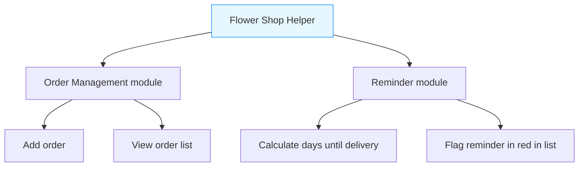
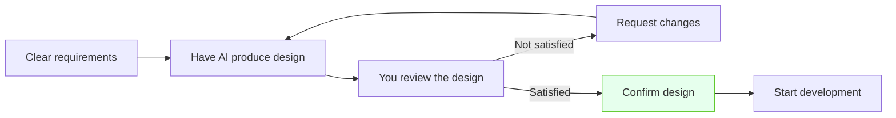

# Chapter 6: Letting AI Help You Design the Software

> Requirements are clear — so can you tell AI to start building? Not yet. This chapter teaches you to have AI produce a "design" first, just as you'd look at blueprints before laying bricks: confirm the design, then build.

## What You'll Learn in This Chapter

- What software design actually designs
- How to have AI plan features and break them into modules
- How to have AI design page structure, operation flow, and data
- How to have AI propose a technical approach — in language you understand
- How to review AI's design and confirm it before any coding begins

### Opening: Don't Lay Bricks Before Seeing the Blueprint

Lin Xiaoman sends the complete requirements from Chapter 5 to AI and is about to say "start building" — then she pauses. She has no idea what the software will look like, how it'll be divided, or where the data will go. If it goes sideways, won't that be a waste?

It's like building a house. You tell the crew "I want two bedrooms," but if they start laying bricks right away and you realize halfway that the kitchen is too small or the bedroom faces the wrong way, tearing it down is expensive. The smart move is: **ask for a design first** — see the floor plan, how the wiring runs — then start once you're happy.

Software is the same. Before any code is written, have AI explain "how it plans to build it" — what pages, what's on each page, what data it will store, how features are divided. That's **design**. Lin Xiaoman says to AI:

> **Lin Xiaoman:** I've written the requirements. Before we start, don't build anything yet — first tell me your design: what parts the software has, what pages, what data it will store. Use plain language; I'll start once I've confirmed.

This chapter teaches you how to do that, and how to understand the design AI gives you.

## 6.1 What Does Software Design Actually Design?

"Design" sounds grand, but it simply means: **before actually building, decide and write down what the software will be like.**

A software design mainly covers these things:

| Design Element | In Plain Language | House-Building Analogy |
|---|---|---|
| Feature plan | What the software will do | Which rooms the house has |
| Module breakdown | Grouping those tasks into chunks | Splitting into bedroom area, kitchen area, bathroom area |
| Page structure | What pages exist and what's on them | The layout and furniture of each room |
| Operation flow | How a person moves through it | The walking route from the front door to each room |
| Data structure | What information is stored and how | Where the furniture and appliances go, how they're categorized |
| Technical approach | What tools and methods to build it | Brick-and-mortar or steel frame, how the utilities run |

You don't need to design it yourself — **AI can do all of this.** Your job is to understand its design, judge "is this what I want?" and confirm or request changes. You're the "owner inspecting the blueprint," not the "engineer drawing it."

The good news: AI is excellent at producing designs. Give it clear requirements (the result of Chapter 5) and it will lay out all of the above. The bad news: it sometimes overlooks things or drifts, so sections 6.8 and 6.9 teach you to review and confirm.

## 6.2 Having AI Plan the Features

The first step of design is organizing the requirements into a **feature list**.

You already listed features in Chapter 5; here you have AI make it tidier and more complete — sorted by importance, with version-1 items flagged. Watch Lin Xiaoman ask:

> **Lin Xiaoman:** Based on my requirements, make me a feature list. Split it into "must do in version 1" and "do later," and describe each feature in one sentence. Give me a table.

> **AI:** Sure, here's the feature plan based on your requirements:
>
> | Feature | Description | Stage |
> |---|---|---|
> | Add order | Enter customer name, phone, flowers, delivery date, and save | Must, version 1 |
> | View order list | Show all orders on one screen, sorted by delivery date | Must, version 1 |
> | Due-date reminder | Flag the order in red the day before delivery | Must, version 1 |
> | Look up customer history | Enter a name and list all that customer's past orders | Later |
> | Monthly sales totals | Count orders and amounts per month | Later |

The value of this list is that it **makes the boundary of the software obvious at a glance.** Version 1 is the first three rows; the last two are parked. With this in hand, AI is far less likely to suddenly produce a feature you never asked for.

## 6.3 Having AI Break Software into Modules

With the feature list, the next step is grouping related features into **modules**.

A module is a set of features bundled because they're "the same kind of thing." Think of a flower shop divided into an "ordering area," a "stocking area," and a "delivery area," each handling one kind of work. Software is the same — group features and the structure becomes clear.

Lin Xiaoman's software might have these modules:



Why break into modules? For AI, "build an order management module" is easier to handle than "build a whole app"; for you, modules let you check and confirm one block at a time instead of facing a tangled mass. Chapter 7 takes this "breaking" idea to its limit.

You can simply tell AI: "Please group the features above into modules — tell me how many modules, what each handles, and show it as a structure diagram." It will produce something like the diagram above.

## 6.4 Having AI Design the Page Structure

Modules are about "how the back is divided"; page structure is about "what the user sees."

For a beginner, this is the part worth examining most closely — it directly decides what you see when you open the software. Have AI make three things clear:

1. **How many pages there are**;
2. **What's on each page** (title, button, table, input box…);
3. **How pages link to each other**.

Lin Xiaoman asks AI to design; the result:

> **AI:** Version 1 has two screens:
> 1. **Order list page** (the first screen on opening): title "Flower Shop Orders" and an "Add Order" button on top; below, an order table with columns "Name | Phone | Flowers | Delivery Date | Reminder." Sorted by delivery date soonest first.
> 2. **Add-order form** (pops up after clicking "Add Order"): four fields — name, phone, flowers, delivery date; with "Save" and "Cancel" buttons at the bottom.
> Navigation: click "Add Order" → form pops up → click "Save" → form closes, back to the list page, with the new order at the top.

Reading a description like this, you can practically "see" the software in your head. If anything differs from your imagination — say you want the reminder column first — raise it now; far easier than changing it after it's built.

## 6.5 Having AI Design the Operation Flow

Section 6.4 was "what pages look like"; this section is "how a person moves between pages to get something done."

An operation flow is a route map that strings a feature from start to finish. You wrote flows in Chapter 5; here you have AI make them fuller, especially the "if… then…" branches.

Take "due-date reminder": saying "flag in red" isn't enough — AI helps straighten out the logic:

> **AI:** The reminder flow:
> - Open the software → read all orders;
> - For each order, subtract "today" from "delivery date" to get days remaining;
> - If days remaining = 1, show red "Deliver tomorrow" in the Reminder column;
> - If days remaining = 0, show red bold "Deliver today";
> - If days remaining > 1 or negative, show no reminder.

A description with "if… then…" also makes the software's decision rules clear. When reviewing, ask: **do these rules fit my real situation?** Lin Xiaoman noticed that "no reminder for overdue orders" wasn't quite right — she wanted to know which ones were overdue and unsent, so she had AI add "if days remaining < 0, show gray 'Overdue.'" That's the value of catching issues at the design stage: **changing a sentence is far easier than changing finished code.**

## 6.6 Having AI Design the Data Structure

"Data structure" sounds technical but is easy to grasp: **what information the software must remember, and how that information is sorted and stored.**

Think of organizing a bookshelf: you group books by category. Software "recording orders" must likewise store information in organized categories. For Lin Xiaoman's app, the core is one "orders table" — each order is a row, each kind of information a column. Have AI list it:

> **Lin Xiaoman:** What data does this software need to store? Use a table: what each item is called, its type (text/number/date), and whether it's required.

> **AI:** One "orders table" is needed:

| Item | Type | Required? | Notes |
|---|---|---|---|
| Customer name | Text | Required | — |
| Phone | Number (11 digits) | Required | — |
| Flowers | Text | Required | Multiple kinds, separated by commas |
| Delivery date | Date | Required | Year/month/day |

That's all a "data structure" is — **one table, listing what each column is called, its type, and whether it's required.** You don't need to understand databases; just look at the table: "Is all this information what I want to record? Anything missing? Anything extra?" Lin Xiaoman noticed a missing "Notes" column and added a row: "Notes (text, optional)."

A first-version app usually has just one or two tables — very simple. Understanding this table is enough.

## 6.7 Having AI Propose a Technical Approach

Last comes the **technical approach**: the tools and methods AI plans to use.

This is the most technical block and the one that baffles beginners most. But you don't need to understand the technical details — just grasp three things:

1. **Do I need to install anything?** (simpler is better)
2. **Where will it run once built?** (computer browser? phone?)
3. **Is it safe, and easy to change later?**

Ask AI like this to force plain language:

> **Lin Xiaoman:** What method will you use to build this? Answer in words a complete non-technical person can understand, covering three points: do I need to install anything? Where do I open it once it's built? Is it easy to add features later? No technical jargon.

> **AI:** Simply put: you don't need to install anything. It will be a web page — open a web address in your computer browser and it works, just like reading any webpage. The data is stored on the computer. Later, if you want to add a feature, just tell me and I'll change it.

See — a technical approach explained in plain language is that simple. If AI's answer is full of words you don't know, just follow up with "please say that in plain language" and it will rephrase. **You have the right to demand it speak human.**

## 6.8 How to Review AI's Design

You can't accept AI's design wholesale — you need to review it. Don't worry: reviewing requires no technical skill, just asking yourself a few questions. Run through this checklist:

| Check | Question to Ask Yourself | Lin Xiaoman's Review |
|---|---|---|
| Goal alignment | Does this design solve my original problem? | Records orders, reminds — yes ✔ |
| Feature completeness | Are all my features here? Any extras? | All three present, no extras ✔ |
| Smooth flow | Following its steps, can I get things done? | Add-order flow is smooth ✔ |
| Enough data | Is all the info I need recorded? | Found "Notes" missing — added it |
| Suitable interface | Is the opening view what I imagined? | Want the reminder column first — requested |
| Simple and feasible | Does it make me install anything complex? | Nothing to install ✔ |
| Clearly explained | Anything I don't understand? | Asked AI to re-explain the technical part in plain words |

A particularly helpful mindset when reviewing: **be a picky customer.** Anything awkward, unclear, or different from your imagination — point it out and have AI change it. AI won't take offense, and changing a design is much cheaper than changing code — that's the whole point of designing before building.

## 6.9 Confirming the Design Before Development

Once reviewed and satisfactory, the last step is to **confirm** the design as the basis for development.

How? Have AI organize the final design into a "design confirmation sheet" and nod through it item by item. Lin Xiaoman does this:

> **Lin Xiaoman:** We've finished discussing the design. Please organize the final plan into a short confirmation sheet, listing: what pages and what's on each, what data we store, and which features are in version 1. I'll start only after I've confirmed it's all correct.

After AI gives the sheet, Lin Xiaoman reads it carefully, confirms "Notes added, reminder column moved up front, version 1 is just the three features," then replies: "Confirmed — let's start."

This step looks simple but is crucial. It's like a "contract" between you and AI:

- For you: a final chance to check before work begins — if you're not happy, it's still cheap to change.
- For AI: a clear basis to build from, so it's less likely to drift; and if it does drift, you know which line to correct.

Remember the rhythm: **clear requirements → design → review → confirm → then build.** Skipping design and going straight to building is the most common way beginners crash.



## Common Pitfalls

- **Pitfall: Skipping design and telling AI to build right away.** Why: discovering the direction is wrong halfway means expensive rework. What to do: insist on a design and confirm it before building, even if it's just one short round of chat.
- **Pitfall: Settling for a design you don't understand.** Why: the parts you don't understand are often hidden risks. What to do: follow up with "explain in plain language," or raise your doubts on the spot.
- **Pitfall: Reviewing only features, not data and flow.** Why: missing information and broken flows tend to surface late. What to do: check every item in the 6.8 checklist.
- **Pitfall: Treating AI's first design as final.** Why: designs are meant to be revised. What to do: feel free to nitpick and request changes; confirm only when satisfied.

## Chapter Summary

- Design means deciding what the software will be like before building — like looking at blueprints before laying bricks.
- Design covers feature planning, module breakdown, page structure, operation flow, data structure, and technical approach.
- AI can do all of it; your job is to understand, review, and confirm.
- Reviewing needs no tech skills — just a "picky customer" mindset: check goal alignment, feature completeness, smooth flow, and enough data.
- Confirm the design into a sheet before starting — it's the contract between you and AI.

## Practice Exercises

1. Take the complete requirements you wrote in Chapter 5 and have AI produce a design: feature list, modules, page structure, and data to store, each in a paragraph.
2. Play "picky customer" using the 6.8 checklist and review AI's design item by item; find at least two things you'd change or question.
3. Ask AI to explain its technical approach "in words a complete non-technical person can understand": do you need to install anything, where do you open it, is it easy to change later?
4. Organize the final design into a confirmation sheet, confirm it item by item, then decide whether to start building.

## Copyable Instruction Templates

**Template 1: Have AI produce a full design before you start**

```text
I have a software requirements description (below). Before I officially start,
please produce a design plan — do NOT write any code or start building yet.
Use plain language, no technical jargon, and explain:
1. Feature list: split into "must do in version 1" and "do later";
2. Module breakdown: how many chunks, and what each handles;
3. Page structure: what pages, what's on each, how they link;
4. Operation flow: step by step how a user uses it, including "if… then…" rules;
5. Data structure: what information to store — name, type, required or not for each;
6. Technical approach: do I need to install anything? Where do I open it? Easy to change later?
I'll review your design and request changes; I'll let you start only after I confirm.

My requirements are: [paste the complete requirements from Chapter 5 here]
```

**Template 2: Have AI organize the design into a confirmation sheet**

```text
Please organize the design we've agreed on into a short "design confirmation sheet,"
listing: ① what pages and what's on each; ② what data to store; ③ which features are in version 1.
After listing it, wait for my confirmation — we start development only after I confirm.

If anything in the design is unclear to you, or requires a decision from me,
please list it separately at the end of the sheet and ask me about it.
```
