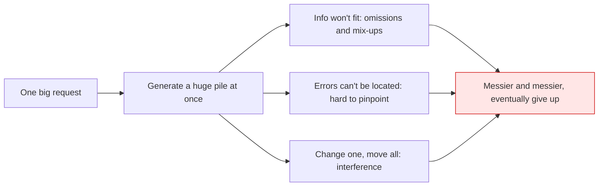
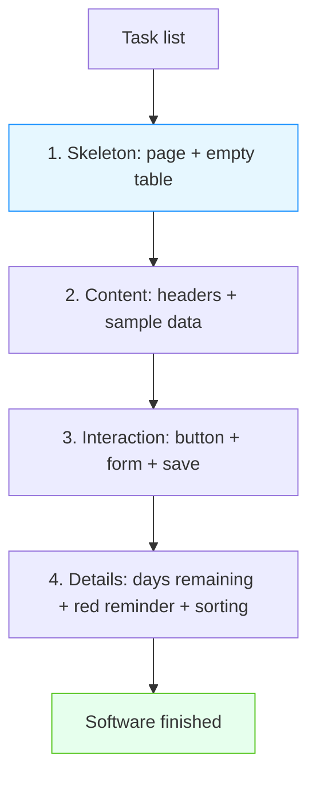

# Chapter 7: Learning to Break Down Features — Don't Have AI Do Everything at Once

> This is the most important chapter of Part Two. Requirements are clear and the design is confirmed — but if you try to have AI build the entire software in one shot, you'll most likely fail. This chapter teaches you to "break it down" — split the big goal into small tasks and go step by step.

## What You'll Learn in This Chapter

- Why trying to finish a big request in one go almost always fails
- What modular development is, and why it matters so much
- How to break software into pages, pages into components, and components into tasks
- How to build a development task list and order it well
- How to have AI finish the software one task at a time, steadily

### Opening: Doing It All at Once Leaves Pitfalls Everywhere

Once the design was confirmed, Lin Xiaoman excitedly told AI: "Great — now build the whole flower shop helper!" She figured that with such clear requirements and a confirmed design, AI should manage it in one go.

AI busied itself and indeed produced a big pile of stuff. Lin Xiaoman opened it: the pages were there, but one column was missing here, a button there didn't respond; she changed the reminder color and the order list stopped showing; she added a "Notes" field and the add-order form fell apart. Problems popped up like whack-a-mole — push one down, another appears. She fiddled all evening and only made it messier.

Then she changed tack: instead of asking for everything at once, she said "let's just do the order list page first, nothing else." When it was done and checked and fine, she said "now add the add-order feature"… checking and confirming every step. The result went smoothly, and in an hour or two she had something usable.

That contrast is the point of this chapter: **it's not that AI can't do it — you gave it too much at once, and neither of you can keep track.** Learning to break things down is the dividing line between "using AI" and "using AI well."

## 7.1 Why Large Requests Tend to Fail

Why does handing AI one huge request go wrong? Three reasons.

First, **information won't fit**. Cram every feature, page, and data item into one instruction and AI must hold and process too much at once — dropping and mixing things up becomes nearly inevitable. It's like asking someone to remember twenty things simultaneously; they'll forget a few.

Second, **errors can't be located**. When a huge pile is generated at once, you can't tell which part broke — was it wrong from the start, or did changing A break B? It's all tangled, like hunting for a thread in a knot.

Third, **changing one thing moves everything**. In a big block of code, parts are interconnected; ask AI to change a small spot and it may accidentally break another. Lin Xiaoman changing the reminder color and breaking the order list is exactly this.



Doing it in pieces avoids all three: give AI one small chunk at a time and it remembers it; when something breaks, it's within that chunk and easy to find; and changes rarely spill over. **Breaking down isn't extra work — it makes each step so simple it can hardly fail.**

## 7.2 What Is Modular Development

"Modular development" sounds professional, but it's something you already do: **split a big thing into pieces, build one piece at a time, then assemble them.**

You use this thinking everywhere in life:

- Lego: you don't sculpt a whole castle in one go — you click bricks together.
- Building a house: foundation, then walls, then utilities, then decoration — step by step.
- Writing an article: outline first, then paragraph by paragraph, then stitch together.

Software is the same. However big an app is, it's made of small pieces. Modular means deliberately separating those pieces first, then doing one at a time. Each piece finished and confirmed, then the next.

It's the extension of "splitting into modules" from the last chapter: in Chapter 6 you had AI group features into modules (order management, reminders…), which is "design-level chunking"; this chapter does "development-level chunking" — subdividing each module into small tasks and doing them one by one.

Remember: **even the biggest app is built from stacks of small tasks. Your job is to keep splitting until each step is obvious at a glance.**

## 7.3 Breaking Software into Pages

The first layer of breaking down is by **page**.

Users use software page by page. Lin Xiaoman's helper has two pages: the order list page and the add-order form. So the first split is:

- Step 1: build the skeleton of the "order list page";
- Step 2: build the "add-order form."

Why not both at once? Because a problem on one page stays on that page — easy to check, easy to fix. Tell AI "build the order list page first, don't touch the others," and it focuses on that page; the result is clean and easy for you to see.

Order matters too: **build the "first page you see when you open the app" first** (here, the order list). It's the face of the software and the landing spot for other pages. Stand it up first, and later additions have something to attach to.

## 7.4 Breaking Pages into Components

A page is still too big — split it one more layer into **components**.

A component is a small part of a page: a title, a button, an input box, a table, a line of reminder text. Like a wall in a house can be split into bricks, windows, and doors.

Break down the "order list page":

| Component | What It Is | Purpose |
|---|---|---|
| Page title | The words "Flower Shop Orders" on top | Tells the user where they are |
| Add button | The "Add Order" button at the top right | Click to open the add form |
| Order table | The table in the middle | Shows all orders |
| Column headers | Name / Phone / Flowers / Date / Reminder | Says what each column is |
| Reminder label | Red "Deliver tomorrow" text | Prominent flag for due orders |

At the component level you can give very specific instructions: "this round, just build the order list page's title and table — hold off on the button and reminder." AI does just that; the output is so small you can take it in at a glance and find problems instantly.

You don't have to memorize "component." **Just know this: a page can be split into smaller and smaller pieces, and the finer you split, the simpler and more controllable each instruction to AI becomes.**

## 7.5 Breaking Features into Tasks

Below components, you can split further into **tasks** — the smallest action that can be done in one step.

The "build the order table" component splits into a string of tasks:

1. Draw the outer frame of the table;
2. Add five column headers: name, phone, flowers, delivery date, reminder;
3. Make the table show one row of sample data;
4. Sort orders by delivery date soonest first.

A task's key traits: **explainable in one sentence, doable in one step, with a result you can see immediately.** If you need a long paragraph to explain a task, it isn't small enough — split it again.

At the task level, your instruction to AI becomes: "Please add five column headers to the order table: name, phone, flowers, delivery date, reminder. Don't do the sorting or reminder labels in this step." — clear, specific, tightly scoped; AI can hardly get it wrong, and you can check it the moment it's done.

## 7.6 How to Build a Development Task List

Once the software is split into tasks, write them into a **development task list** — and the whole build becomes "ticking off the list one item at a time."

Lin Xiaoman's list looks like this:

| # | Task | Page / Component | Status |
|---|---|---|---|
| 1 | Build order list page: title + empty table | List page | To do |
| 2 | Add five column headers to the table | List page / table | To do |
| 3 | Build the add-order form (four fields + Save/Cancel) | Add page | To do |
| 4 | After Save, the new order appears in the list | Both pages linked | To do |
| 5 | Calculate days remaining for each order | Reminder | To do |
| 6 | Show red "Deliver tomorrow" the day before delivery | Reminder | To do |
| 7 | Overall check and polish details | Everything | To do |

This list has three benefits:

1. **Nothing is missed**: everything to do is on paper, so no feature gets forgotten mid-build.
2. **Visible progress**: tick one off as you finish — you can see "where you are," which feels great.
3. **Easy focus**: at any moment you look only at the current item, undisturbed by later ones.

You can have AI generate this list for you (it's good at splitting tasks), then save it in your notes and work through it item by item.

## 7.7 How to Order the Tasks

With the list, in what order do you build? Doing it randomly wastes effort. A simple, reliable rule: **skeleton before flesh; see it before click it; trunk before twigs.**

Concretely:

1. **First the visible skeleton**: get the pages, title, and empty table in place. Seeing something when you open the app is the essential first step.
2. **Then fill in static content**: headers and sample data so the page starts to look like something.
3. **Then make it interactive**: buttons clickable, form fillable, list changes after saving.
4. **Finally the smart bits and details**: days remaining, red reminders, sorting.

Why this order? Because each step builds on the last: you need the empty table before adding headers, the form before talking about "clicking Save." And it lets you **see something after every step** — the moment you see it, you can judge whether it's right, and you feel secure.

Lin Xiaoman's list follows exactly this order (see 7.6: page skeleton, then form linkage, then reminders). You can have AI order yours: "please sort these tasks by 'skeleton before details, each step yields something visible.'"



## 7.8 Having AI Build the Software Step by Step

Finally, put it all together into a development rhythm: **one task at a time; check and confirm, then move to the next.**

Watch Lin Xiaoman work with AI:

> **Round 1**
> **Lin Xiaoman:** Let's do just step one: build the order list page, with the title "Flower Shop Orders" on top and an empty table below. Nothing else for now. Tell me when it's done.
> **AI:** Done — the order list page has the "Flower Shop Orders" title and an empty table below. Please open it and check.
> **Lin Xiaoman:** (looks) Yes, that's it. Next.
>
> **Round 2**
> **Lin Xiaoman:** Now add five column headers to the table: name, phone, flowers, delivery date, reminder. This round, only the headers — no data, no reminder logic yet.
> **AI:** Added the five headers. The list page now has the title, the empty table, and these five columns.
> **Lin Xiaoman:** Good, continue.
>
> **Round 3**
> **Lin Xiaoman:** Next, build the add-order form… (talking about only this one thing)

See the rhythm? Each round Lin Xiaoman does exactly three things: **say clearly what this round does, limit what it must not touch, and check and confirm when it's done.** AI handles one small chunk each time and can hardly err; even if it does, the problem stays inside that chunk, easy to find and fix.

Two habits in this rhythm matter most:

- **Limit scope**: every round say "this round does only X, don't touch anything else." It's the safety rope that stops AI from casually breaking other parts.
- **Confirm each step**: always check and confirm before moving on. Don't save up a pile of unchecked work — the earlier you find a problem, the easier it is to fix.

Is it slow? Round by round it looks that way, but it's actually fast. Because each step needs almost no rework, and the time one rework costs would cover ten steps. More importantly, you always know what the software looks like and where you are — that feeling of "everything under control" is the most valuable experience a beginner can have.

## Common Pitfalls

- **Pitfall: Trying to save time by having AI build the entire app in one go.** Why: information won't fit, errors can't be located, changing one thing moves everything. What to do: give one task at a time from the list; confirm before continuing.
- **Pitfall: Tasks too big, like "just build the reminder feature."** Why: it still contains calculating days, decision logic, and display — hard to debug. What to do: split until each task is "one sentence, one step."
- **Pitfall: No task list, building whatever comes to mind.** Why: easy to forget things, lose track of progress, and grow messy. What to do: list tasks first, tick one off as you finish.
- **Pitfall: Not checking each step, saving everything for the end.** Why: small problems pile into a big mess and you can't tell which step caused them. What to do: check and confirm immediately after each step, then move on.

## Chapter Summary

- A big request built in one go almost always fails: info won't fit, errors can't be located, one change moves everything.
- Modular development = split a big app into pieces, build one at a time; even the biggest app is a stack of small tasks.
- Breakdown has three layers: software into pages, pages into components, components into tasks.
- Manage progress with a development task list: nothing missed, visible progress, easy focus.
- Order: skeleton before details, see before click, trunk before twigs; each step should yield something visible.
- Development rhythm: one task at a time, limit scope, confirm when done, then move to the next.

## Practice Exercises

1. Take your own software design, break it into pages, then pick one page and break it into components, then break one component into tasks small enough to do in one step.
2. Write all the tasks into a list like 7.6, with four columns: number, task, part it belongs to, status.
3. Order your list using 7.7's principle and explain why a particular task comes first.
4. Following 7.8's rhythm, actually have AI do step one: one task only, limit everything else, check and confirm when done. Feel what "one small piece at a time" is like.

## Copyable Instruction Templates

**Template 1: Have AI break your software into a task list**

```text
Based on the software design below, please make me a "development task list,"
broken down as software → pages → components → tasks, with tasks fine enough to
be done in one step and yield a visible result.
Use a table with four columns: number, task, page/component it belongs to, status (mark all "To do").
Also sort the tasks by "skeleton before details, see it before click it."
Use plain language, no technical jargon.

My design is: [paste the confirmed design from Chapter 6 here]
```

**Template 2: The instruction to send AI for each round of step-by-step development**

```text
This round we do only one thing: [say in one sentence the task for this round].
Nothing else should be done or changed — in particular: [list the parts you're worried it might touch].
Please stop when this one thing is done, and tell me the result and the current state;
I'll check and confirm before we move to the next thing.
Please reply in plain language.
```
