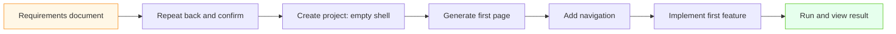
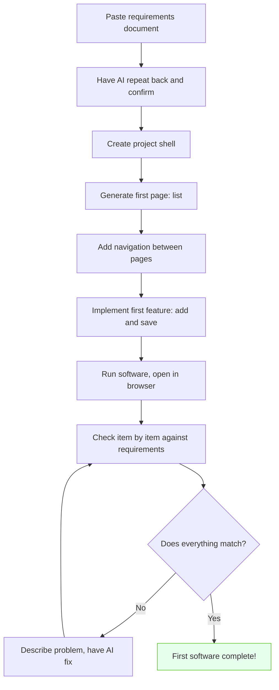

# Chapter 8: Letting AI Create Your First Piece of Software

> This chapter answers one question: the requirements are clear and the tasks are broken down — but how do you actually take the first step? Here you'll personally turn your first piece of software from "an idea on paper" into "something on screen you can open, click, and use."

## What You'll Learn in This Chapter

- How to turn a confirmed requirements document into your starting point
- What a "project" is, and how to have AI set up the empty shell
- How to have AI generate your first page and add navigation between pages
- How to implement your first genuinely usable feature
- How to run the software, view the result, and judge whether it's right
- How to complete a simple app from scratch, end to end


*Figure: You and AI are development partners*

### Opening: The Blueprint Is Ready — Where Does the First Shovel Go?

Lin Xiaoman spread the requirements document from Part Two on the desk, with the development task list from Chapter 7 beside it. The requirements were clear: record flower orders, remind her when a date is near. The tasks were broken down: build the order list page first, then the add-order form, then the reminders.

But she stared at the blank chat box, unsure what to type. She felt a flutter of nerves: "I understand the theory, but what exactly do I say first? What if AI builds something completely different from what I want?"

She took a breath, pasted the requirements document into the chat, and typed her first sentence:

> **Lin Xiaoman:** Here are our confirmed requirements. I want to build a small tool to manage flower shop orders. Don't write any code yet — first repeat back to me what you understand, so I can confirm it's right.

AI didn't immediately spit out a pile of incomprehensible stuff. It first listed the requirements one by one to confirm with her. Lin Xiaoman corrected them bit by bit, and only when everything was confirmed did she say: "Good. Starting now, let's follow the list, one step at a time."

Ten minutes later, her first page appeared on screen. In that moment she understood: **all the "thinking it through" earlier was so that this moment — "building it out" — would go smoothly.**

In this chapter, we'll help you take that first shovel of soil.

## 8.1 Starting Development from the Requirements Document

Many people make a mistake here: the requirements are written down, but they rely on memory and casually tell AI, "make me something that records orders." The result is that what AI builds is worlds apart from what you actually wanted.

The requirements document is your **blueprint for development**. Before building a house, workers spread out the blueprint and confirm it before laying a single brick — they don't build from impression. The same goes for software: paste the confirmed requirements document from Part Two to AI verbatim, have it repeat them back, you confirm, and only then start.

Why add this "repeat back to confirm" step? Because the most common problem between you and AI is "you thought it understood, but it understood something else." By having it repeat back, you catch the misunderstanding immediately — fixing one sentence costs far less than rebuilding a whole page later.

**You:** Here is my confirmed requirements document: [paste requirements document]. Before starting development, please don't write code. First, in your own words, repeat back what my software should do, what pages it has, and what data it stores, so I can confirm.

**AI:** Sure, let me repeat the requirements for you to check:
1. This is a flower shop order management tool, mainly for one shop owner to use on a computer;
2. It has two pages: the order list page and the add-order form;
3. Data to store: customer name, phone number, flowers ordered, delivery date;
4. Core features: new orders appear in the list after saving, calculate days remaining, and a red reminder one day before delivery.
Did I misunderstand anything?

**You:** Mostly right, but the reminder is "one day in advance," not "the day before" — actually those are the same, so just calculate one day ahead. Everything else is fine.

See? One simple repeat-back caught a small potential misunderstanding on the spot.

## 8.2 How to Have AI Create a Project

With requirements confirmed, the next step is to create a **project**.

"Project" sounds technical, but it's really just **a dedicated folder that holds all the files for this piece of software**. Think of it as the "construction site" for a house — the foundation, walls, and bricks all sit on that plot. A piece of software's code, images, and pages all go into its project. Without a project, your stuff is scattered everywhere and can't be organized or run.

The good news: you don't need to know what files belong in a project or what technology to use — **let AI decide and build it for you.** You just say what you want to make.

**You:** Requirements are confirmed. Now please create the project for me. You decide what technology to use and what files to create — I don't understand any of that. Just tell me when it's set up and roughly what's inside.

**AI:** Project created. It contains: a page file (shows the order list), a style file (controls appearance), and a data file (temporarily holds sample orders). Right now the project is an empty shell — next we'll fill it in step by step from the list.

Here's the whole path from requirements to project:



## 8.3 How to Have AI Generate the First Page

The project is set up. Following the ordering principle from Chapter 7, we build "the first page you see when you open the app" first — the order list page. This round builds only the skeleton: a title and an empty table, nothing else.

**You:** Now let's do step one from the list: generate the order list page. Put a title "Flower Shop Orders" at the top and an empty table below. This round, only these — no add button, no reminders, no data. Tell me when it's done.

**AI:** The order list page is generated: a title on top and an empty table below. Please open it and see if it looks the way you want.

Notice the two key moves in this instruction — identical to Chapter 7: **say clearly what this round does, and limit what it must not touch.** Keep this habit from now on.

## 8.4 How to Have AI Create Navigation

One page isn't enough — your software has two. How do you get from the order list page to the add-order page? You need **navigation**.

Navigation is the "signpost" inside software. At a mall, you look at the directory board to know "cosmetics on the first floor, clothes on the second, elevator over there." The navigation menus and buttons in software are the same kind of signpost, telling you "click here for the order list, click there for add order."

**You:** Now add navigation: put two clickable entries at the top of the page — "Order List" and "Add Order." Clicking "Order List" shows this page; clicking "Add Order" jumps to the add-order form page. This round, only make the jumping work — don't build the form yet.

**AI:** Navigation added. There are now two entries at the top, "Order List" and "Add Order," and clicking them switches between the pages. The add-order page is currently blank.

| Navigation element | Purpose | Analogy |
|---|---|---|
| "Order List" entry | Return to the order list page | The "return to first floor" sign in a mall |
| "Add Order" entry | Jump to the add-order form | The "go up to second floor" sign |
| Highlighted current page | Tells you which page you're on | The "you are here" red dot on a directory board |

## 8.5 How to Have AI Implement the First Feature

Pages are in place and navigation works. Now implement the first real **feature**. A feature is "something that happens when you click" — it turns a static page into a usable one.

For the first feature, pick the simplest main thread: **click "Add Order" to open the form → fill it in and click Save → the new order appears in the list.** Once this chain works, your software goes from "viewable" to "usable."

**You:** Now implement the first feature: on the add-order page, make a form with four input fields — name, phone, flowers, delivery date — plus two buttons, "Save" and "Cancel." Clicking Save should make the filled-in content appear on the order list page; clicking Cancel returns to the list without saving. This round, do only this one thing.

**AI:** Done. The add-order page now has four input fields and Save/Cancel buttons. Clicking Save adds the order to the list; clicking Cancel doesn't save and returns to the list. Try filling in an order to see it work.

**You:** (tries it) It really appeared! But I noticed that after saving, the form still shows what I just typed — I'd like it to clear itself.

**AI:** Got it. I'll change it so that after a successful save, the form clears automatically, ready for the next order. Only changing this one thing.

See — this is the real rhythm of development: build it, try it, find a small issue, have AI fix it. You don't need to understand code; you just need to know how to "use" it and how to "say" what you want.

## 8.6 How to Run the Software

It's built — how do you see it? This step is called **running the software**.

Think of running as "serving the dish you cooked." Until now AI has only cooked the dish and left it in the kitchen (the project folder); you need to bring it out (run it) before you can see and taste it. When you run it, AI usually gives you a "start command" (a line of text you just copy and paste) or a "Run" button, and then you open an address in your browser to see your software.

**You:** How do I run this software right now? Please tell me exactly what to do, step by step — I don't understand the command line.

**AI:** Easy: 1) in the project folder, hold Shift and right-click, and choose "Open command window here"; 2) copy the line of command I gave you into it and press Enter; 3) once you see the prompt, open http://localhost:3000 in your browser and you'll see your flower shop order tool.

An address like "http://localhost:..." means "software opened only on your own computer" — no one else can see it, so you can experiment freely. "localhost" just means "this machine." You don't need to memorize it; just know it's "an address on your own computer."

## 8.7 How to View the Development Result

The software is running — don't celebrate just yet. **Opening it doesn't mean it's right.** You need to inspect it like a quality checker, going through the requirements item by item.

Here's the checklist Lin Xiaoman used:

| Check item | Against the requirement | How to check |
|---|---|---|
| Both pages present | Order list + add-order form | Click navigation, see if it switches |
| All four fields there | Name, phone, flowers, date | Open add page and count them |
| Save does something | New order appears in list | Fill one in, click Save, check the list |
| Cancel doesn't save | Cancel shouldn't add an order | Fill half, click Cancel, verify |
| Data looks right | What you fill is what shows | Compare what you typed with the list |

Checking item by item catches problems early. For example, Lin Xiaoman found while checking that the phone field displayed wrongly when she typed digits — she immediately sent a screenshot to AI:

**You:** I found a problem while checking: I typed the phone as 13800001111, but the list shows 1380000111 — one digit short. Look at what's wrong, and only fix the phone field display — don't touch anything else.

**AI:** Got it — the number was treated as an integer and the trailing zero got dropped. I'll store and display the phone as text, changing only the phone-related part.

## 8.8 Completing a Simple App from Scratch

Now, chain everything above together and walk through the whole process once. This is your complete journey to a first piece of software:



Looking back, you really only did a few things: **paste requirements, confirm, give one small instruction at a time, run, check, and ask for fixes when something's wrong.** You didn't write a single line of code — yet you built something you can open, click, and store orders in.

This is the most exciting thing about natural language programming: **the distance from an idea to software has shrunk to a few conversations.** In the chapters ahead, we'll make this little helper prettier (Chapter 9), more capable (Chapter 10), able to store data (Chapter 11), and able to connect to the outside world (Chapter 12).

You've taken the hardest step — the first one. From here, it only gets smoother.

## Common Pitfalls

- **Pitfall: Skipping the requirements document and talking from memory.** Why: memory drops and distorts details, so AI builds something off target. What to do: paste the confirmed requirements before every development session; have AI repeat them back before starting.
- **Pitfall: Forgetting Chapter 7's lesson and trying to build everything at once.** Why: information won't fit, errors can't be located. What to do: follow the task list, one step at a time; check and confirm before continuing.
- **Pitfall: Assuming "it opens" means "it's done."** Why: "it runs" doesn't mean "it's right" — lots of details can be wrong. What to do: make a checklist against the requirements and inspect item by item.
- **Pitfall: Being too shy to ask about words like "project" or "run."** Why: these are just tool concepts, not knowledge you must learn first. What to do: tell AI directly, "explain it in plain language and walk me through it step by step."

## Chapter Summary

- The requirements document is the blueprint: pasting it in and having AI repeat it back is step one.
- A project is the "construction-site folder" for all the software's files; let AI build it — you don't need the technical details.
- Advance in the order "page first, then navigation, then feature"; each round say what to do and limit what not to touch.
- Running the software means serving the dish; a localhost address opens only on your own computer.
- "It opens" doesn't mean "it's right": check item by item, and describe symptoms for AI to fix.
- You can now go from an idea to software you can open, click, and store data in.

## Practice Exercises

1. Paste your confirmed requirements document to AI and have it repeat them back. Check for misunderstandings and correct them on the spot.
2. Have AI create the project and generate the first page. Say in one sentence what this round does and what it must not touch, then open it and take a look.
3. Make a "checklist" for your software with at least four items, then inspect against the requirements one by one.
4. If you find a problem, practice "describing the symptom" rather than "guessing the cause": say what you did, what you saw, and what you expected, then send it to AI to fix.

## Copyable Instruction Templates

**Template 1: Starting development from a requirements document**

```text
Here is my confirmed requirements document: [paste the confirmed requirements from Chapter X].

Now let's start developing. Please:
1. Don't write code yet — first repeat the requirements back in your own words so I can confirm you understood correctly;
2. Once confirmed, create the project for me (you decide the technology and files — I don't understand that);
3. Then follow the development task list strictly, one step at a time; after each step,
   tell me the result and how to run/view it, and wait for my check and confirmation before the next step;
4. Reply in plain language throughout, and briefly explain any technical terms as they come up.
```

**Template 2: Running and checking the software**

```text
How do I run this software right now? Please write it out step by step:
1. What do I click, what keys do I press, what command do I copy;
2. Where do I see it after running (give me the full address);
3. Once it's running, give me a "checklist" listing which items I should check against the requirements
   and how to check each one, so I can judge whether it's right.
Please write it so that someone who knows nothing about computers can understand.
```
