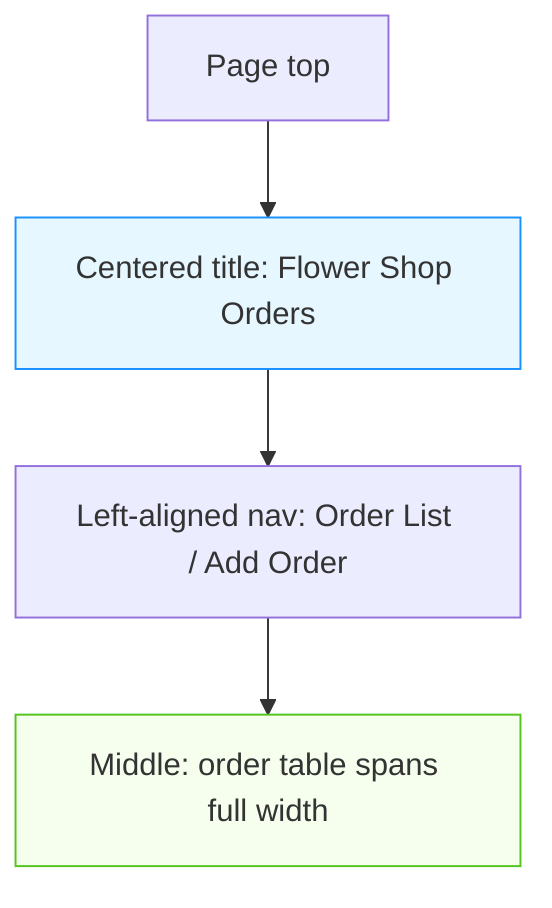
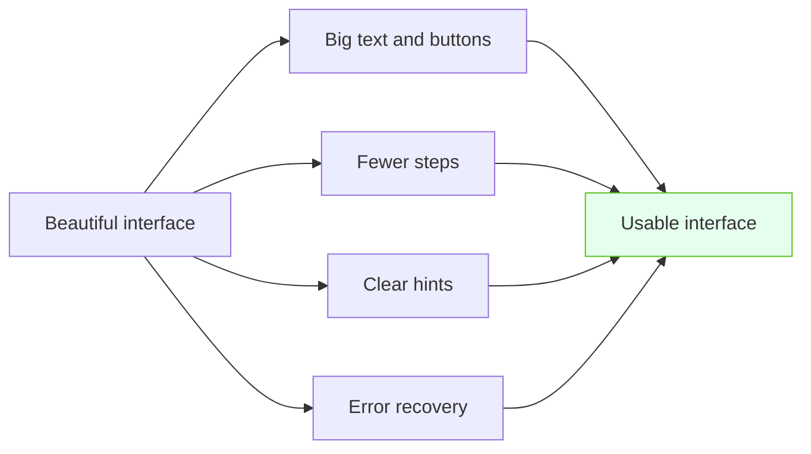
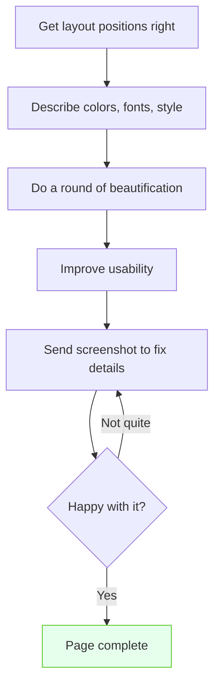

# Chapter 9: Developing Software Interfaces Together with AI

> This chapter answers one question: the software works, but it looks drab and is awkward to click — what now? Here you'll learn to describe "what it looks like, where things go, what color it is" in plain language, so the interface becomes both good-looking and easy to use.

## What You'll Learn in This Chapter

- What basic parts make up a software interface
- How to describe page layout using everyday direction words
- How to clearly describe common elements: buttons, input fields, tables
- How to describe colors, fonts, and visual style in everyday language
- A few simple principles for making an interface more beautiful and usable
- How to have AI reference an image, revise from a screenshot, and polish the page step by step

### Opening: "The Features Are There — But It's So Ugly"

Lin Xiaoman's flower shop helper finally worked. She eagerly called her daughter over to see. Her daughter took one look and grimaced: "Mom, it's all gray, the text is crammed together, the buttons are so small I had to click three times. And the red reminder you talked about — why is it gray?"

Lin Xiaoman leaned in. Sure enough: the page worked, but it felt off. The title was too small to read, the "Add Order" button was tucked in a corner, the table lines were dense, and the "Deliver tomorrow" reminder was anything but eye-catching.

She deflated a little. "I only know how to say 'record orders, remind me when a date is near.' How do I tell AI about 'looking good'? I don't know anything about design."

Actually, it's not hard at all. You don't need to know design — you only need to **say what you see and feel**: "the text is too small," "the button's too tiny to hit," "make the reminder big and red so I see it at a glance." AI understands plain language like this and turns those feelings into an interface.

In this chapter, we'll break down "describing the interface clearly" into bite-sized pieces.

## 9.1 What Basic Parts Make Up an Interface

An interface is **everything you see and everything you click** when you open a piece of software. Don't be intimidated by the phrase "interface design" — you use it every day, you just haven't taken it apart.

Take any page apart and it's made of these parts:

| Part | What It Is | Example in daily life |
|---|---|---|
| Text | Titles, labels, descriptions | Shop sign, price tag |
| Button | A small block that does something when clicked | Doorbell, remote-control key |
| Input field | A box you type into | The address line on a delivery form |
| Table / list | Data displayed in rows | A menu, a class schedule |
| Navigation | Entries for switching between pages | The mall's floor directory |
| Image / icon | A picture that decorates or conveys meaning | Store logo, restroom sign |

You don't need to memorize these terms. Just know this: **a page is these little parts assembled together, and your job is to tell AI, one by one, what each part looks like and where it goes.** The more specific you are, the more accurate AI is.

## 9.2 How to Describe Page Layout

Layout is "where things go." The best tool for describing layout is the **direction words** you use every day: top, bottom, left, right, middle, top-to-bottom, split into two columns…

Imagine directing someone arranging furniture: "put the sofa against the wall, the coffee table right in front of it, the TV opposite the table." Describing a page layout is exactly the same.

**You:** Let me describe the layout of the order list page. From top to bottom, three blocks: at the very top, the title "Flower Shop Orders," centered; below the title, a row of navigation with two entries "Order List" and "Add Order," aligned left; the middle of the page takes the most space — the order table, spanning the full width. Don't worry about colors or styling yet — this round, just get the positions right.

**AI:** Got it. Top to bottom: centered title → left-aligned navigation → full-width table. I'll only adjust positions this round, not colors or styling.



Sketch a rough diagram like the one above (even on paper), then describe from it, and AI will rarely place things wrong.

## 9.3 How to Describe Buttons, Input Fields, and Tables

The three most common parts each have their own description points. Get these clear and the page is basically formed.

**Buttons** — say three things: what text is on it, what it does when clicked, and where it goes.
Example: "put a green button above the table on the right, labeled '+ Add Order'; clicking it jumps to the add page."

**Input fields** — say four things: what it's called, what the gray placeholder text says, whether it's required, and what format it takes.
Example: "name field, placeholder 'Enter customer name', required; phone field, placeholder 'Enter 11-digit phone number', digits only."

**Tables** — say what columns there are, what each shows, and how it's sorted.
Example: "the order table has five columns: name, phone, flowers, delivery date, days remaining, sorted by delivery date soonest first."

| Part | Points to describe | Lin Xiaoman's phrasing |
|---|---|---|
| Button | Text, purpose, position | "a green 'Add Order' button above the table on the right" |
| Input field | Name, hint, required, format | "phone field hint says 11-digit number, digits only" |
| Table | Which columns, what each shows | "five columns: name, phone, flowers, date, days remaining" |

## 9.4 How to Describe Colors, Fonts, and Visual Style

When it comes to colors, many beginners panic: "I don't know any color codes!" Don't worry — **you don't need color codes at all; just describe the feeling.**

It's like renovating a house: you tell the designer "I want something warm and cozy, like natural wood and sunlight," not a string of numbers. AI understands feelings.

**You:** I want the interface to feel like a flower shop: gentle, fresh, with a touch of green. Main color soft green, like young leaves; buttons a slightly deeper green with white text; the reminder column in eye-catching bold red so I spot it instantly. Make the font bigger — it's hard for me to read now. Keep it clean, not too crowded.

**AI:** Got it. I'll set the main color to soft green, buttons to deeper green with white text, reminder text to bold red and larger, increase the overall body font size, and add breathing room around the page so it's not cramped. Styling only — no functional changes.

Useful "feeling words": warm, fresh, professional, lively, minimal, retro, premium. You can also just say "give it the feel of a certain flower website," or simply send an image (see 9.7).

## 9.5 How to Make an Interface More Beautiful

Beauty has four simple principles anyone can use:

1. **Whitespace**: don't cram content together — leave gaps around and between things so it can breathe.
2. **Alignment**: left-align, consistent spacing — no random blocks here and there.
3. **Consistency**: use one set of colors and fonts throughout — not a red button here and a blue one there.
4. **Emphasis**: make the most important thing (like a due reminder) the most eye-catching.

You don't need to say all the principles at once. Just ask AI for "a round of beautification":

**You:** Do a round of beautification — appearance only, no functional changes. Add whitespace around the page, make spacing and alignment consistent, keep colors and fonts consistent site-wide, and make the "due reminder" the most eye-catching element. Don't change anything else.

**AI:** Beautified: added whitespace, aligned elements, unified styling, and the due reminder is now the most prominent bold red label. No functionality changed.

## 9.6 How to Make an Interface Easier to Use

Beyond good looks, it should be easy to use. A usable interface "works right even if you're not paying attention." Key points:

- **Big enough text and buttons**: no squinting, no hunting for the click.
- **Fewer steps**: if it can be done in one step, don't ask for two.
- **Hints**: input fields have gray placeholder text, buttons have clear labels — no guessing.
- **Prevent and recover from errors**: if something's filled in wrong, say what's wrong and how to fix it, instead of just freezing.

**You:** Make the interface easier to use: 1) enlarge all buttons for easier clicking; 2) add gray placeholder text to input fields; 3) if the phone isn't 11 digits, show a message "phone must be 11 digits" on save instead of doing nothing. Only change these — don't touch the functional logic.

**AI:** Done: buttons enlarged, placeholders added, and a message shows when the phone format is wrong. The add-order save logic is unchanged.



## 9.7 How to Have AI Design an Interface from an Image

Sometimes you have an idea in your head but can't put it into words. That's when **sending an image** is easiest — find an interface you like, screenshot or grab a picture, send it to AI, and let it reference the style.

**You:** (sends a screenshot of a nice flower shop website) I like this feel: soft background, big product photos, clean layout. Please use this image's colors and style as a reference for my interface — but the content is flower shop orders, so don't copy the text and products from the image.

**AI:** Understood. I'll borrow only the color scheme (off-white background with green accents) and clean layout style; the content stays your flower shop orders. I won't copy the text from the image.

Two reminders:
- **Say what to reference**: colors, layout, or overall style? Be specific so AI doesn't wander.
- **Say "don't copy"**: otherwise it may bring over the image's text and products too.

## 9.8 How to Revise an Interface from a Screenshot

When something about the interface bothers you, the most direct approach is to **send a screenshot of the current interface and point out what to change.** It's like holding up a photo and telling a contractor, "change this light to warm, paint that wall light blue."

**You:** (sends a screenshot of the current order page) Look at this screenshot: 1) the title is too small — double its size; 2) the "Add Order" button color is too pale — make it a clear green; 3) the table lines are too dense — remove the vertical lines and keep only horizontal ones. Keep everything else the same — change only these three things.

**AI:** Got it, changing only these three: enlarge the title, make the button green, remove the table's vertical lines. Nothing else in the screenshot changes. Take another look when it's done.

**The key sentence here is "keep everything else the same — change only these three things."** It's a fence that stops AI from casually breaking other parts — the same "limit scope" principle from Chapter 7.

## 9.9 How to Polish a Page Step by Step

An interface isn't designed perfectly in one shot — it's **polished round by round.** Lin Xiaoman's page went like this: positions first → then colors → then beautification → then usability → finally detail fixes against a screenshot.



Each round changes only one kind of issue; check and confirm, then move to the next. You always know "where you are," and problems are easy to locate. Don't expect one sentence to make the interface perfect — **polishing slowly is actually fastest.**

## Common Pitfalls

- **Pitfall: Vague requests like "make it prettier."** Why: AI doesn't know what "pretty" means to you, so it guesses. What to do: be specific — "bigger text," "green button," "add whitespace" — or send a reference image.
- **Pitfall: Describing layout, color, font, and features all at once.** Why: mixed together, AI drops things and errors are hard to trace. What to do: one kind at a time (this round only layout, next round only color).
- **Pitfall: Accidentally changing features while changing the interface.** Why: AI may "helpfully" touch other places. What to do: add "appearance only, no functional changes, don't touch anything else" every round.
- **Pitfall: Copying the content of a reference image.** Why: reference images often contain other text and products, which look out of place. What to do: say "reference only the colors and style; use my own content."

## Chapter Summary

- An interface is assembled from parts: text, buttons, input fields, tables, navigation, images.
- Describe layout with everyday direction words: top, centered, left-aligned, full width.
- Buttons: text/purpose/position; input fields: name/hint/required/format; tables: which columns.
- For colors and style you don't need codes — describe the "feeling" or send a reference image.
- Beauty principles: whitespace, alignment, consistency, emphasis; usability: big text/buttons, few steps, hints, error recovery.
- An interface is polished round by round: change a bit, look, confirm, then the next bit.

## Practice Exercises

1. Open your software page and break it into parts: list at least four interface parts you see (text, button, input field...).
2. Describe one page's layout with direction words: "top... middle... bottom..." and send it to AI to arrange.
3. Pick one part (say a button) and write one complete instruction using the three elements: text, purpose, position.
4. Send an interface image you like to AI, saying "reference only the colors and style, don't copy the content," and see what it produces.

## Copyable Instruction Templates

**Template 1: Describing interface appearance (layout + color + style)**

```text
This round changes only the interface appearance — no functionality, and don't change anything beyond what I mention.

Layout: [describe with direction words, e.g. "title centered at top, navigation row left-aligned below, table spanning full width in the middle"].
Colors and style: [describe with feeling words, e.g. "soft green main color, deeper green buttons with white text, bold red reminders, clean and fresh overall"].
Font: [e.g. "increase the body font size a bit"].

Tell me in plain language what you changed. I'll open it and look before deciding the next step.
```

**Template 2: Revising an interface from a screenshot**

```text
I've attached a screenshot of the current interface. Change only these three things, leave everything else untouched:
1. [e.g. double the title size];
2. [e.g. make the Add Order button a clear green];
3. [e.g. remove the table's vertical lines, keep only horizontal ones].

Important: appearance only — don't change any functional logic, and don't change anything I didn't mention.
When done, explain exactly which three things you changed so I can check against the screenshot.
```
