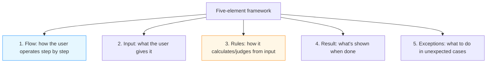
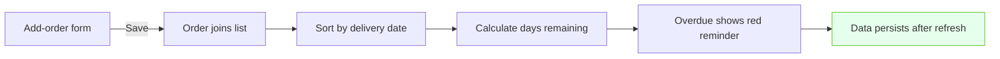

# Chapter 10: Having AI Implement Software Features

> This chapter answers one question: the interface looks good, but how do you get AI to build the "smart parts" — search, filtering, automatic days-remaining calculation? The answer is to describe the feature clearly: what steps the user takes, what input it gets, what rules it follows, what result it produces, and what to do when something unexpected happens.

## What You'll Learn in This Chapter

- The difference between a feature and an interface: one is "looks," the other is "abilities"
- The five elements of describing a feature: flow, input, rules, result, exceptions
- How to implement the three most common features: search, filter, sort
- How to implement forms, calculations, and data processing
- How to make multiple features cooperate into one smooth pipeline

### Opening: "Add a Search" — and It Searched Up All the Wrong Things

The flower shop helper had been in use a while and orders had piled up into the dozens. Lin Xiaoman flipped through the list, worried: "to find the flowers 'Ms. Wang' ordered, I have to scroll from top to bottom. If only I could search."

She told AI: "add a search feature." AI quickly built one. Lin Xiaoman tried it — typed "Ms. Wang" into the search box, and out came a bunch of flower names: roses, lilies, carnations… It turned out AI had understood "search" as "search product names."

Lin Xiaoman didn't know whether to laugh or cry: "I wanted to search by customer name!"

She learned: saying "add a search" is nowhere near enough. You must say clearly **what to search, what to input, what rule to match by, how to show the result, and what to do if nothing is found.** Get these five things clear and AI builds the feature you actually want. In this chapter, we'll break down these "five things."

## 10.1 The Difference Between Features and Interface

Many people confuse the two. Separate them first and everything after is easier to say.

The **interface** is "looks" — what the page looks like, where buttons are, what color, the things you **see and click**.
The **feature** is "abilities" — what happens when you click, how it calculates, what result it produces, the things the software **does behind the scenes**.

Think of a calculator: it's square with number keys (interface); press "2 + 3" then "=", and "5" pops out (feature). The interface is the shell; the feature is the skill.

| Aspect | Interface | Feature |
|---|---|---|
| Focus | What it looks like, where it's placed | What it does, how it calculates, what result |
| How you perceive it | You can see and click it | You only know if it's right by using it |
| Example | A search box, a button | Typing a name lists matching orders |
| Description points | Position, color, size | Flow, input, rules, result, exceptions |

A search box (interface) doesn't search by itself; "type a name → list matching orders" is the feature. Chapter 9 practiced interfaces; this chapter practices features.

## 10.2 How to Describe a Feature's Operation Flow

The most useful framework for describing a feature is the **five elements**: flow, input, rules, result, exceptions. Treat it like a fill-in-the-blank form — fill each item and AI can hardly go wrong.

Start with **flow** — the steps the user takes. List them like a recipe: step one, step two, step three.

For "search orders by customer name," the flow is:
1. The user types a customer name into the search box (e.g. "Wang");
2. The user clicks the "Search" button;
3. The system finds orders whose name contains "Wang";
4. It lists the results in the order table for the user to see.



You don't need all five perfect at once — the next few sections break them down one by one. Just form the habit of "running through these five," and your feature descriptions will be complete.

## 10.3 How to Describe Input Conditions

**Input** is what the user hands to the feature. To describe input, cover four things: what inputs there are, what format, whether required, and any default.

**You:** I want to build a "search orders by customer name" feature. First the input: there's a search box at the top of the page where the user types the customer name; it's text input, and they don't have to type the whole name — typing "Wang" should match "Ms. Wang" or "Xiaoming Wang." The search box may be empty; clicking Search with it empty shows all orders. This round, just get the input and trigger right — don't do the matching logic yet.

**AI:** Understood. Search box at the top, accepts text, supports partial matching (typing "Wang" matches all customers whose name contains "Wang"); empty input with Search shows all orders. This round only the input part.

Notice the phrase "supports partial matching" — without it, AI might make it "must type the full name to find anything." **What seems obvious to you isn't necessarily obvious to AI — say it out loud to be safe.**

## 10.4 How to Describe Processing Rules

**Rules** are the feature's "brain" — given the input, how exactly does it calculate or judge? This is the most important item, and the one most often forgotten.

Take Lin Xiaoman's most-wanted "days remaining." The rules need to be written like this:

| Case | Rule |
|---|---|
| Delivery date later than today | days remaining = delivery date − today |
| Days remaining = 1 | show "Deliver tomorrow," bold red |
| Days remaining = 0 | show "Deliver today," bold red |
| Delivery date earlier than today | show "Overdue," gray |

**You:** Now implement the "days remaining" calculation rule: subtract today's date from the delivery date to get the days remaining. If it's 1 day, show bold red "Deliver tomorrow" in the reminder column; if 0, show bold red "Deliver today"; if the date has passed, show gray "Overdue." This step only does the calculation and display rule — don't touch other columns.

**AI:** Got it. I'll calculate days remaining from the delivery date minus today, and show different text and colors for those three cases. Only changing the reminder column.

The more specific the rules, the more accurate AI. Avoid vague phrases like "judge intelligently" — list the judgment standard for every single case.

## 10.5 How to Describe the Result

The **result** is what the user sees after the feature runs. Say clearly: what the normal result looks like, and what happens when there's "no result."

**You:** Next, let's define the search "result": after clicking Search, the order table shows only the orders whose names match, and hides the others temporarily. If not a single order matches, show a line of text "No matching orders found" in the table area — don't show an empty table and make me think it broke. Don't affect other features.

**AI:** Understood. After searching, the table shows only matching orders; if there are no matches, show the message "No matching orders found." Noted.

The "not found" message matters — it's how a user tells "the feature worked, there's just no result" from "the feature is broken." Details like this, you have to mention proactively.

## 10.6 How to Describe Exceptions

**Exceptions** are "out-of-the-ordinary" situations. AI won't think of every unexpected case on its own — you have to remind it.

| Exception | How to handle it |
|---|---|
| Search clicked with an empty box | Show all orders, no error |
| User typed only spaces | Trim the spaces before searching |
| An order has no delivery date | Show "—" in the days-remaining column, not garbled text |
| Hundreds of orders match at once | List them all normally, don't freeze |

**You:** Add a few exception handlers: 1) clicking Search with the box empty shows all orders; 2) if the user typed only spaces, trim them before searching; 3) if an order has no delivery date, its days-remaining column shows a "—", not messy numbers; 4) if many orders match at once, list them all normally. Please only add these handlers — don't change the normal flow.

**AI:** Got it. I'll handle these four cases as you described; the normal search flow is unchanged.

Thinking about exceptions ahead of time makes software solid. You don't need to think of them all at once — add one whenever you think of it.

## 10.7 How to Implement Search, Filtering, and Sorting

These three are the most common features, and the five-element framework handles them quickly.

- **Search**: find by keyword. Input keyword → match by "contains" rule → show matches.
- **Filter**: pick by condition. E.g. "only show orders due this week" — input is the condition (this week), rule is "date within this week," result is only those orders.
- **Sort**: arrange by one column. E.g. "delivery date soonest first" — the rule is compare dates, earlier ones first.

**You:** Now add three features, one at a time — I'll confirm each before the next.
First: search — a search box at the top, type a customer name, match by "name contains input," show results in the table, and if nothing found show "No matching orders found."
Stop when this one is done and tell me.

**AI:** Search feature done. The top search box matches on partial customer names, results show in the table, and "No matching orders found" appears when there are no matches. Waiting for your confirmation before the next.

One at a time — the same old rule from Chapter 7. Search, filter, and sort built separately can each be verified immediately.

## 10.8 How to Implement Forms, Calculations, and Data Processing

These features are "smarter," but the core is still stating the rules clearly.

**Forms**: the user fills in information and submits. Say what fields there are, which are required, and what happens on submit. The add-order form from Chapter 8 is a form feature.

**Calculations**: compute a number by a rule. E.g. "days remaining," "total orders this month," "sum of order amounts per customer." The key is giving the formula and the edge cases.

**Data processing**: bulk operations on a set of data. E.g. "mark all overdue orders gray," "count how many times each customer ordered flowers."

**You:** Add a statistics feature: show two numbers at the top of the page, "total orders this month" and "total flower amount this month." The rule: only count orders with delivery dates in this month, and sum the amount by each order's flower price. If there are no orders this month, show 0 for both. Only add this statistic — don't change the order table.

**AI:** Done. The page now shows total orders and total amount for the month, counting only this month's delivery dates and summing flower prices; 0 when empty. The order table is unchanged.

## 10.9 How to Make Multiple Features Cooperate

Once single features work, make them **cooperate** — like an assembly line, each step feeding the next.

For example this chain: add order → save to list → list sorts by date → auto-calculate days remaining → overdue shows red reminder. These features don't work in isolation; the result of one feeds the next.



**You:** Chain a few features together: 1) after saving a new order, it should automatically appear in the list; 2) the list automatically sorts by delivery date soonest first; 3) the new order also participates in the days-remaining calculation and shows the red reminder when due; 4) the order is still there after refreshing the page. Implement in this order and tell me after each step.

**AI:** Chained: after saving, the new order enters the list and auto-sorts, participates in days-remaining calculation and overdue reminders, and persists after refresh. The whole flow is connected.

When features cooperate, the most error-prone spots are the "seams." That's why you should say things like "the new order must also participate in the calculation" and "sorting must update automatically" — patch up the seams.

## Common Pitfalls

- **Pitfall: Only naming the feature, like "add a search."** Why: AI has to guess and may build something else (search products instead of customers). What to do: use the five elements — flow, input, rules, result, exceptions.
- **Pitfall: Leaving out "rules."** Why: rules are the brain; without them AI calculates its own way and the result differs from what you want. What to do: list the judgment standard for every case, one by one.
- **Pitfall: Ignoring exceptions like "no result" or "filled in wrong."** Why: AI won't think of every unexpected case; unaddressed details make the software feel "buggy." What to do: proactively add a few exceptions and their handling.
- **Pitfall: Having AI build several features at once.** Why: mixed together they're hard to verify and debug. What to do: one feature at a time — try it, confirm, then the next.

## Chapter Summary

- Feature ≠ interface: interface is looks, feature is abilities; describe features by flow, input, rules, result, exceptions.
- The five-element framework is a universal fill-in form — fill each item and AI can hardly go wrong.
- For input, specify format and matching (e.g. "partial match"); for rules, list the standard for every case.
- Results should include a "not found" message; exceptions should be added proactively (empty input, spaces, empty dates).
- Search, filter, sort, forms, calculations, and data processing can all use the five elements.
- Features must cooperate: state the seams (new orders join calculations, sorting updates automatically).

## Practice Exercises

1. Pick a feature you want to add and fill in the five-element framework: how many steps in the flow, what inputs, what rules, what result, what exceptions.
2. Write out the "rules" item as a table, listing the judgment standard for every case, and check for omissions.
3. Have AI implement "search orders by customer name," writing "partial match" and "show a message when nothing found" explicitly into the instruction.
4. Design a feature chain (e.g. save → sort → calculate days → turn red when due) and have AI implement it in order, verifying each step.

## Copyable Instruction Templates

**Template 1: Describing a feature with the five elements**

```text
Please implement this feature: [feature name, e.g. "search orders by customer name"]. I'll describe it in five parts:

1. Flow: [the steps the user takes, e.g. "type name → click Search → view results"];
2. Input: [what inputs, what format, required or not, partial match or not];
3. Rules: [how to calculate/judge from input, list the standard for every case];
4. Result: [what's shown when done; what's shown when there's no result];
5. Exceptions: [empty input, wrong format, empty data, etc. — how to handle each].

Please build only this one feature, tell me the result when done, and explain how to test it. Don't change other features. Reply in plain language.
```

**Template 2: Making multiple features cooperate**

```text
Please chain the following features into one flow, in order, stopping after each step for my confirmation:
1. [e.g. after saving, the new order automatically appears in the list];
2. [e.g. the list automatically sorts by delivery date soonest first];
3. [e.g. the new order also participates in days-remaining calculation and shows a red reminder when due];
4. [e.g. the order is still there after refreshing the page].

Please pay special attention to the seams: [list spots likely to disconnect, e.g. "sorting must update automatically, no manual refresh needed"].
Only do things related to this flow — don't change anything else.
```
