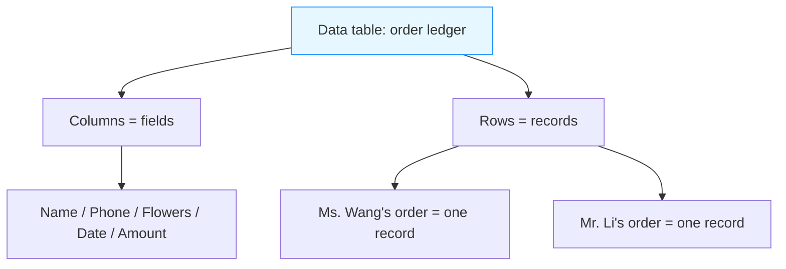
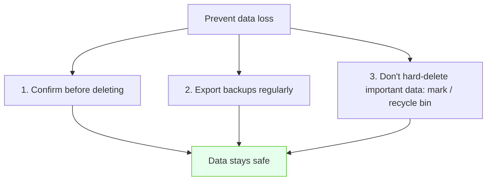

# Chapter 11: Letting Software Store and Manage Data

> This chapter answers one question: where is the data stored, how do you add/change/delete/query it, and what if it's lost? Here you'll make your software like a reliable ledger — storing data steadily, always findable, editable, and unloseable.

## What You'll Learn in This Chapter

- Why software must store data
- What "data" and a "data table" are (explained with a flower shop ledger)
- How to tell AI to design your data structure
- The four basic operations on data: create, update, delete, query
- How to import and export data
- How to prevent data loss

### Opening: One Order — Gone in an Instant

The flower shop helper had been running for weeks, and Lin Xiaoman had accumulated over a hundred orders. That day, clearing the list, her hand slipped and hit "delete" — an old customer's order vanished instantly. She searched the whole list and couldn't find it. She broke into a sweat: "in my notebook, if I cross something out wrong I can still see it and write it back; in software, gone is gone. What am I going to do?"

It hit her: until now she'd only cared "does the software work," never "where is the data stored, can it be lost?" Orders are the lifeblood of her business — more important than the software itself.

The good news: **getting AI to store and manage data properly is not hard.** You don't need to understand databases — just describe what the ledger looks like: what columns, how to record, how to change, how to back up. In this chapter, we'll explain "data" from the ground up.

## 11.1 Why Software Needs to Store Data

Data is the information software remembers. If software doesn't store data, it's like a blackboard — the moment you close the program, everything on it is erased, and next time you open it it's blank again.

Storing data has three benefits:

1. **Keep information**: an order recorded today is still there next week — no re-entering.
2. **Enable management**: only once stored can you modify, delete, find, and count it.
3. **Enable reuse**: with data you can calculate "how much sold this month," "who I delivered to," "who's due for a reminder."

Think of it this way: software that doesn't store data is like a forgetful assistant who turns around and forgets; software that stores data is like a ledger written in neat handwriting — always ready to flip through, correct, and check. That's the "reliable ledger" Lin Xiaoman wants.

## 11.2 What Is Data

**Data** is information that's been recorded. It sounds abstract, but you deal with data every day: a contact in your address book, an item in your shopping cart, an entry in a ledger — each is a piece of data.

In the flower shop helper, **one order is one piece of data.** A piece of data holds several items of information:

| Order | Customer name | Phone | Flowers | Delivery date | Amount |
|---|---|---|---|---|---|
| #1 | Ms. Wang | 13800001111 | Red roses | 2026-05-10 | 199 |
| #2 | Mr. Li | 13900002222 | Lilies | 2026-05-12 | 128 |

Each row is one piece of data (one order); each cell is one item of information. Data itself isn't mysterious — it's just "information recorded in rows."

## 11.3 What Is a Data Table

Arrange all orders neatly into a table like the one above, and that's a **data table**. Think of it as **a ledger with a consistent format**: one row per transaction, and every row's cells are the same — first cell name, second cell phone… never one row writing a name and another writing a flower type.

A data table has two basic terms — just listen, no need to memorize:

- **Field**: what a column is called and what goes in it. E.g. "name" is a field, "date" is a field.
- **Record**: one row is a complete piece of data. E.g. "Ms. Wang's order" is one record.



You don't build this table yourself — just tell AI "what columns the ledger should have," and it builds it for you.

## 11.4 How to Tell AI to Design the Data Structure

A data structure is "what cells the ledger has and what goes in each." It's the first and most important step of storing data. Design it well and everything after — create, update, delete, query — goes smoothly; design it badly and you'll be awkward at every turn.

When telling AI, cover three things: **what fields there are, what type each field holds, and which field uniquely identifies a record.**

**You:** I want to store order data properly now. Please design an "order data table" with these fields:
- Order number: a non-repeating number automatically generated for each order, to uniquely identify it;
- Customer name: text, required;
- Phone: text (not a number, to preserve leading zeros and all digits), required;
- Flowers: text, required;
- Delivery date: date format, required;
- Amount: number, may have decimals, required;
- Notes: text, optional.

Please confirm this design with me in plain language first — don't build it yet.

**AI:** Okay, I understand you want 7 fields in the order table: order number (auto-generated, unique), customer name/phone/flowers/delivery date/amount all required, notes optional; phone stored as text to keep the full number, amount as a number with decimals. Correct?

**You:** Yes, build it like that.

A few reminders:
- **Store phone as text**: a classic trap — stored as a number it loses leading and trailing zeros (you hit this in Chapter 8).
- **Order number**: give each record a unique number so you won't confuse records when modifying or deleting.
- **Required vs optional**: say clearly which must be filled and which can be blank.

## 11.5 How to Implement Data Creation

Creating data means adding a row to the ledger. Actually the add-order form from Chapter 8 was doing exactly this — there you looked at it from the "interface" angle; here we confirm it from the "data" angle: after filling in and clicking Save, that order should be written as a new record into the data table.

**You:** Now connect the add-order form to the data table: fill in customer name, phone, flowers, delivery date, amount, and notes; clicking "Save" should write these as a new record into the order data table and automatically assign a non-repeating order number. After saving, show "Order saved" and clear the form. Only do creation — don't do updates or deletes yet.

**AI:** Done. Clicking Save writes the form content as a new record into the order table, assigns an order number automatically, shows "Order saved," and clears the form.

## 11.6 How to Implement Data Updates

Updating data means changing one row in the ledger. The key question: **how do you accurately find the row to change?** Finding by name risks duplicates, so use the unique "order number" from 11.4.

**You:** Implement the update feature: add an "Edit" button after each order in the list. Clicking it opens a form like the add form, pre-filled with that order's original content; after changing, clicking "Save" updates that record (found by order number); clicking "Cancel" discards changes and returns to the list. The order number must not be editable.

**AI:** Done. Each order has an "Edit" button that opens a pre-filled form; saving updates that record by order number, canceling discards changes. The order number stays uneditable.

"Pre-filling the original content" matters — otherwise the user has to retype the whole thing, which is tedious and error-prone.

## 11.7 How to Implement Data Deletion

Deleting data means crossing a row out of the ledger. This feature needs extra care — Lin Xiaoman deleted an order by mistake. So deletion must have a "confirmation" defense.

**You:** Implement deletion: add a "Delete" button after each order. Clicking it first pops up a message asking "Are you sure you want to delete the order with number X?" — only clicking "Confirm" really deletes; clicking "Cancel" doesn't. What's deleted is the corresponding record in the order table. This step only does deletion and confirmation — don't touch other features.

**AI:** Done. Clicking Delete first shows a confirmation box with the order number; only "Confirm" deletes the record, "Cancel" doesn't.

**That confirmation step is the most effective way to prevent accidental deletion.** Two more robust options: change "delete" to "mark as deleted" (the data stays, just hidden), or add a "recycle bin." You can ask AI to add these, to be safe.

## 11.8 How to Implement Data Queries

Querying data means finding the records you want in the ledger. In fact the search, filter, and sort from Chapter 10 are all queries — there we looked from the "feature" angle; here we look from the "data" angle: they all find records in the data table and pick records by condition.

| Query method | Chapter 10 counterpart | What it does at the data level |
|---|---|---|
| Search by name | Search | Finds records whose name contains the keyword |
| This week only | Filter | Picks records with delivery date in this week |
| Sort by date | Sort | Rearranges records by date for display |

**You:** We already did search, filter, and sort for queries. Please check whether they truly pull from the order data table — I need to be sure the search finds real records in the ledger, not hard-coded fake data on the page. If not, change them to read from the data table.

**AI:** I checked — the search currently reads records from the order data table, not fake data. The list also shows the table's real content.

**That question is crucial**: a lot of software that "looks usable" is backed by hard-coded sample data and falls apart on refresh. Having AI confirm "data comes from the data table" guarantees your software is really using data.

## 11.9 How to Implement Data Import and Export

**Export** means saving the data table's records into a file (like a spreadsheet), like photocopying the ledger to take away; **import** means reading an outside file into the data table, like moving a ledger from elsewhere in.

These two features are especially useful:
- **Export**: back up data, send orders to someone, do further analysis in Excel.
- **Import**: enter a large batch of orders at once, migrate data from an old tool.

**You:** Implement export: add an "Export to Excel" button that exports all records in the order data table into a spreadsheet file, with columns order number, customer name, phone, flowers, delivery date, amount, notes. Let me confirm the file name before exporting. Only do export — not import yet.

**AI:** Done. The "Export to Excel" button exports all records in the order table to a spreadsheet with these 7 columns, and asks you to confirm the file name before exporting.

Import works similarly: say "read from which kind of file, which column maps to which field, and what to do with duplicate order numbers," and AI can build it.

## 11.10 How to Prevent Data Loss

Data is priceless. Lin Xiaoman's accidental deletion is a lesson worth remembering. There are three lines of defense against loss:



1. **Confirm before deleting**: like in 11.7, a popup asks first.
2. **Export backups regularly**: make it a habit — click "Export" once a week and store the file elsewhere. If something's lost, import it back.
3. **Don't hard-delete important data**: use "mark as deleted" instead of permanent deletion — leave yourself a way back.

**You:** I want to protect my data from loss. Please do three things: 1) all deletions must show a confirmation box (keep it if already there); 2) add a "remember to back up" reminder — if I haven't exported in over 7 days, show "time to export a backup" when I open the software; 3) change deletion to "mark as deleted" — data stays in the table but hidden — and add a "Recycle Bin" page where I can restore. Do it step by step and tell me after each.

**AI:** Okay — step one, the confirmation box is in place; next I'll add the backup reminder and tell you when done; then the recycle bin. One step at a time.

With these three defenses in place, your data is more reliable than a paper ledger.

## Common Pitfalls

- **Pitfall: Data only lives on the page, never written to a data table.** Why: it disappears on refresh or close. What to do: have AI confirm "data comes from the data table, not hard-coded fake data," and verify new records can be found later.
- **Pitfall: Storing phones and order numbers as numbers.** Why: leading/trailing zeros get dropped or the number overflows. What to do: explicitly tell AI "store as text."
- **Pitfall: No confirmation on delete — one slip and it's gone.** Why: deletion is irreversible and hard to recover. What to do: always add a confirmation box; for important data use "mark deleted + recycle bin."
- **Pitfall: Never backing up.** Why: however stable the software, accidents happen (misclick, device failure). What to do: export files regularly and store them safely; have AI add a "time to back up" reminder.

## Chapter Summary

- Data is recorded information; one order is one piece of data; arrange them neatly and you have a data table.
- A data table is like a ledger: a column is a field, a row is a record.
- Designing a structure means stating: what fields, what type each, and which field uniquely identifies a record (order number).
- The four data operations: create (write a record), update (find by number then change), delete (must confirm), query (from the real data table).
- Export is backup, import is bulk entry; both rely on stating "how columns map to fields."
- Three defenses against loss: deletion confirmation, regular export backup, mark-deleted + recycle bin for important data.

## Practice Exercises

1. Using the "ledger" analogy, explain to a friend who knows nothing about computers what a data table, field, and record are.
2. Design a data table for your software: list at least 5 fields, note each field's type and whether it's required, and point out which field uniquely identifies a record.
3. Have AI implement the "Edit" feature, requiring pre-filled original content, update by order number, and a non-editable order number.
4. Add loss-prevention measures to your data: confirm deletion + export backup + (optional) recycle bin, and actually export a file and save it.

## Copyable Instruction Templates

**Template 1: Designing a data table structure**

```text
I want to store data properly now. Please design a "[e.g. order] data table" with these fields:
- [field name]: [text/number/date], [required/optional], [other requirements, e.g. "store as text to preserve leading zeros"];
- ... (list all fields one by one)

One field is "[e.g. order number]", which uniquely identifies each record — please make it auto-generated and non-repeating.
First confirm this design with me in plain language; once confirmed, build the table for me and connect the add form to it:
after filling in and clicking Save, write it as a new record into the table and auto-assign a number. Don't do updates or deletes yet.
```

**Template 2: Adding security and backup to your data**

```text
Please protect my data and prevent loss, in three steps — stop and tell me after each:
1. All deletions must show a confirmation box naming the record to be deleted; only "Confirm" deletes;
2. Add a backup reminder: if I haven't exported in over 7 days, show "time to export a backup" when the software opens;
3. Change "delete" to "mark as deleted" — data stays in the table but hidden — and add a "Recycle Bin" page where I can restore.

Only do things related to data safety — don't change other features. Reply in plain language.
```
