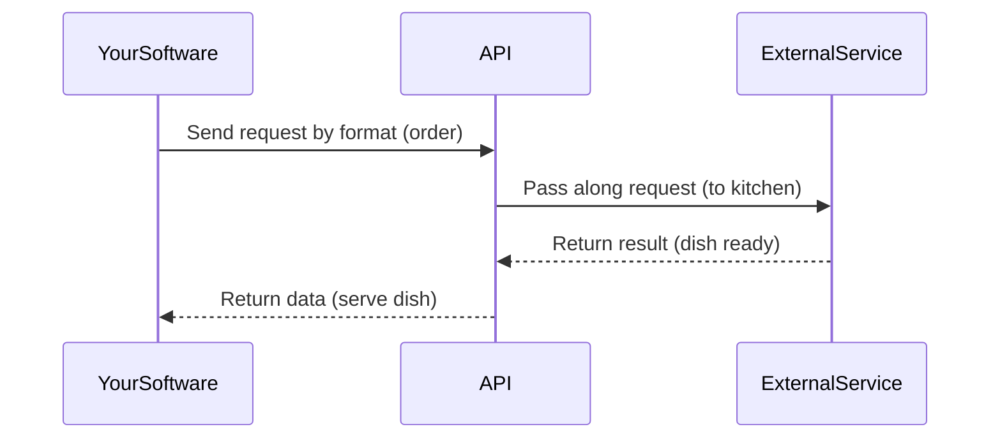
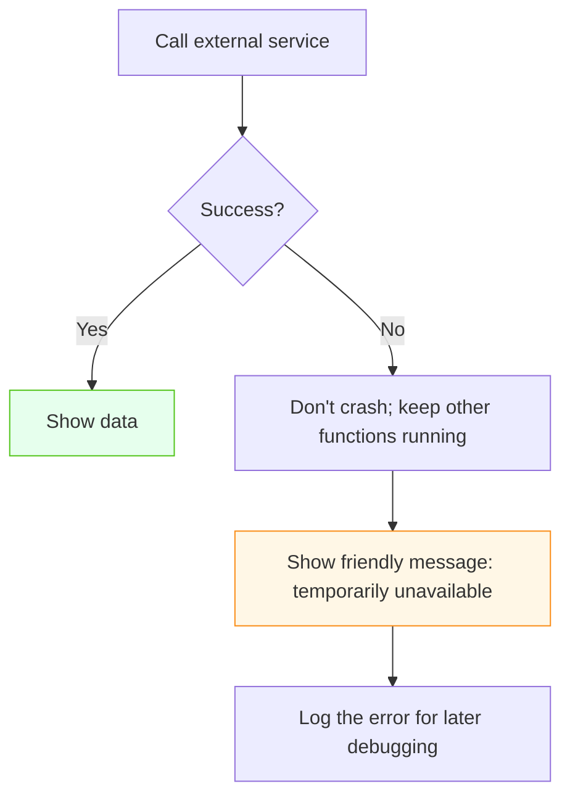

# Chapter 12: Having AI Connect External Capabilities to Your Software

> This chapter answers one question: software can only do so much on its own — what if you want it to check the weather, show a map, or recommend flowers? The answer is to "connect external capabilities" — let your software use services others have already built. This chapter explains what interfaces and APIs are, how to connect them, how to protect keys, and what to do when things fail.

## What You'll Learn in This Chapter

- What software interfaces and APIs really are (explained with food delivery)
- The general steps for having AI connect an external service
- How to connect AI models, maps, weather, file processing, and third-party data
- What an API key is and why it must be protected
- What to do when an external service connection fails

### Opening: To Gain New Powers, Software Must Borrow from Others

The flower shop helper could record orders, calculate reminders, and store data — Lin Xiaoman used it smoothly. Then new ideas came:

"When a customer orders flowers they write an address — if only it showed on a map, I'd see at a glance which direction to deliver. Before Valentine's Day, if it could recommend flowers based on the weather — on rainy days recommend warm-colored flowers. And could the software write the flower arrangement descriptions for me? My writing isn't great."

She told AI: "add a map." AI replied: "the software can't build a map itself; it needs to connect to an external map service. Weather and AI-written descriptions are the same — they all require connecting external capabilities."

Lin Xiaoman was puzzled: "Connect external capabilities? That sounds complicated."

Actually, not at all. Think of cooking at home — you can make anything, but for Peking duck you'd just buy it, because the duck restaurant has already made it; you don't build your own oven. **"Connecting external capabilities" means letting your software use services others have already built.** In this chapter, we'll make it clear.

## 12.1 What Is a Software Interface

For software to deal with outside services, it goes through a "window" — that window is an **interface**.

Think of a wall socket as an "interface." An appliance doesn't generate its own electricity; it plugs into the socket and uses power from the grid. The socket defines "what the plug looks like, how to plug in," and the appliance follows it to connect.

A software interface is the same: it defines "how to ask, what format, how the other side answers." Your software asks by the rules, the map service answers by the rules, and the two connect.

Another example: ordering takeout. You don't know the chef; you just open the app and order, the kitchen receives it and cooks, and a rider delivers it. The app is the "interface" between you and the restaurant.

| Interface in daily life | Interface in software |
|---|---|
| Socket: the window for appliances to get power | The window for software to exchange data |
| Takeout app: the window to order from a restaurant | The window for your software to ask a map service for data |
| Phone line: the channel for you and a friend to talk | Interface: the channel for two pieces of software to talk |

You don't need the technical details — just know: **it's the window through which software "borrows abilities," and you let AI handle the connection.**

## 12.2 What Exactly Is an API

You've probably heard "API." It's a standard name for an interface; the full form is long (Application Programming Interface) and you don't need to memorize it. Just know that **API ≈ the rules for how software talks to software.**

The restaurant analogy explains it best:

- **Menu** = API: tells you what dishes you can order and how;
- **You ordering** = request: by the menu you say "I'll have the Kung Pao chicken";
- **Kitchen cooking** = service processing: the kitchen works in the background, you don't care how;
- **Serving the dish** = response: the waiter brings the dish to you.

You don't enter the kitchen or need to know how the dish is made — **just order by the menu and the dish arrives.** Calling an API is exactly that: your software "orders" by the rules, and the external service sends back the "dish" (data).



The key point: **you only "order" and "receive the dish" — you can't and don't need to touch the kitchen.** That's why connecting external capabilities isn't that hard — the complex work is done by others; you're just ordering by the rules.

## 12.3 How to Have AI Connect an External Service

The general steps for connecting an external service are just five, and AI does most of them:

1. **Choose a service**: decide which provider (map, weather, AI model…);
2. **Get a key**: apply for a "key" from the provider (see 12.8);
3. **State the need**: tell AI what data you want, in what format, and how it'll be used;
4. **AI connects**: AI writes the connection code;
5. **Test**: actually use it and check the data is right.

Your parts are mainly steps 1, 3, and 5 — choose, say, verify; AI can guide you through 2 and 4.

**You:** I want to connect a weather service so the software can look up a city's weather. I don't understand this, so please guide me step by step:
1. Tell me which common weather services there are, and which is simplest for a beginner with enough free quota;
2. Tell me how to apply for a key, writing out every step;
3. Once I have the key, write the connection code. What I want: enter a city name, return that city's weather and temperature today;
4. After writing it, teach me how to test.

**AI:** Great, let's start with choosing a service. The most beginner-friendly is [Service A], with a free quota more than enough for personal use. The steps to apply for a key are… (listed step by step). Go apply first, and when you have the key tell me — then I'll write the connection and test it.

Notice the structure of your instruction: **have AI guide you through choosing and applying first, then write the connection once you have the key.** One step at a time — no rush.

## 12.4 How to Connect an AI Model

The most exciting thing is making your own software "use AI." For example, have it write flower arrangement descriptions or recommend flowers based on customer preferences — all doable by connecting an AI model.

The method is the same as other services; the key is to state three things clearly: **what's the input, what should AI do, and what format and tone the output should be in.**

**You:** I want to connect an AI model so the software can write flower arrangement descriptions for the shop. Here's the need:
- Input: customer name, occasion (e.g. birthday, Mother's Day), flowers chosen;
- What AI does: based on those, write a warm, appropriate description within 50 characters;
- Output: plain text, in the tone of a florist talking to a customer, no jargon.
Please implement: add a "Generate description" button on the add-order page; clicking it sends the three inputs to the AI model and shows the returned description in an input box that the user can edit. Only build this feature.

**AI:** Done. The "Generate description" button sends the customer name, occasion, and flowers to the AI model, generates a description with your length and tone requirements, and shows it in an input box for editing. Fill in an order to try it.

See — you don't need to know what a "model" is; just state "input — processing — output" clearly and AI connects it for you. **This kind of feature best shows the power of natural language programming: you describe the need in natural language, and AI connects natural-language ability into your software.**

## 12.5 How to Connect Map, Weather, and Similar Services

Maps and weather are the two most common external services:

| Service | What it does | Flower shop scenario |
|---|---|---|
| Map service | Turn address into coordinates, show location, plan a route | Mark customer addresses on a map to see delivery direction |
| Weather service | Look up weather, temperature, forecast for a place | On rainy days recommend warm-colored flowers; in heat recommend long-lasting ones |

**You:** Connect two external services, one at a time.
First, map: in the order details add a "View location" feature — send the order's customer address to the map service and mark that location on a map. If the address can't be resolved, show "Address could not be located; please check if it's complete." Stop when this one is done.

**AI:** Map feature connected: in order details, "View location" sends the address to the map service and shows the location; when the address can't be resolved it shows your specified message. Waiting for your confirmation before the next.

**You:** Good, now weather: add a "Check weather" feature — enter a city name and show today's weather and temperature. Tell me how to test when done.

**AI:** Weather feature connected. Enter a city name to show today's weather and temperature. You can test by entering "Beijing."

One at a time, test immediately — the same old rule.

## 12.6 How to Connect File-Processing Capabilities

File processing is another common external capability: upload images, generate PDFs, read Excel… all doable by connecting the appropriate ability.

**You:** Add two file-related features:
1. Upload image: add an "upload flower photo" feature to orders so customers can see what the flowers look like; support common jpg/png formats, and for others show "only jpg and png images are supported";
2. Generate PDF: add an "Export delivery note PDF" button that exports one order's info into a one-page PDF for printing.
Do one at a time; I'll confirm before the next.

**AI:** Let's do image upload first: orders can accept jpg/png photos, and other formats get a message. Confirm and I'll add PDF export next.

## 12.7 How to Connect Third-Party Data

Beyond maps and weather, you can connect all kinds of **third-party data** to make software smarter. For example:

- **Holiday data**: know in advance when Mother's Day or Valentine's Day falls, and remind you to stock up;
- **Flower price data**: understand price fluctuations to help with pricing;
- **Shipping data**: check the delivery status of orders.

**You:** Connect a holiday data source to remind me to stock up for holidays. Requirements:
- When the software starts, read upcoming holidays (next 30 days), such as Mother's Day, Valentine's Day, Qixi Festival;
- If a holiday is within 7 days, show a prominent reminder at the top of the home page: "X days until [holiday] — remember to stock up";
- If reading fails, don't affect other software functions — just don't show this reminder.
Please do it step by step and tell me after each.

**AI:** Okay. I'll first connect the holiday data source and read the next 30 days' holidays, then tell you; then add the within-7-days stock-up reminder; then handle read failures. One step at a time.

## 12.8 What Is an API Key and How to Protect It

Calling an external service usually requires a **key** (sometimes called Key or Token). It's like **the key to the service, or an account plus password** — the service uses it to recognize "who's calling, whether they have permission, and how much quota they've used."

**Think of the key as your house key**: you can't hand it to just anyone, let alone hang it on the door. If the key leaks, others can use your account to call the service, the charges are yours, and they may even use it for bad things.

Three iron rules for protecting keys:

1. **Don't send it to anyone or post it in a group chat**;
2. **Don't write it into publicly released code or the web front end** — visitors can see front-end code, so putting the key there is the same as publishing it;
3. **If you suspect a leak, immediately go to the provider's dashboard and "reset/rotate" the key.**

**You:** I want to connect an external service that needs a key. Please especially remind me: how should I keep this key safe? Where must it absolutely never be placed? If I accidentally leak it, how do I recover? Explain in plain language, and help me store the key securely in the code — don't put it in the web front end.

**AI:** Remember three things: first, don't give the key to anyone or post it in a group; second, don't write it into front-end code, because visitors can see it; third, if you suspect a leak, immediately reset the key in the provider's dashboard. I'll store the key where only the server can read it — never exposed to web visitors.

**This section is worth reading twice.** Key security is the thing beginners most often overlook, with the most serious consequences.

## 12.9 What to Do When an External Service Fails

External services aren't always reliable: networks break, keys expire, free quotas run out, providers change rules. So **when connecting external capabilities, you must plan for "failure"** — like carrying an umbrella not because it will surely rain, but just in case.

| Failure cause | Symptom | What to do |
|---|---|---|
| Network down | Spinning forever, no response | Friendly message "Network error, please retry later" |
| Key wrong or expired | "Unauthorized / 401" message | Prompt to check the key, update it in the dashboard |
| Quota exhausted | "Quota exceeded" message | Prompt to upgrade or switch service |
| Provider changed rules | Sudden errors returned | Have AI read the error details and update the connection |

The core principle: **a service failure must not drag down the whole software.** If the map is down, other functions (recording orders, viewing the list) must still work.



**You:** Handle external service failures well — don't let them affect my software. Please: 1) when calling maps, weather, AI and other external services fails, the software shouldn't error out or freeze, and other functions should work normally; 2) where the data would show, display a friendly message like "Can't get weather right now, please retry later"; 3) log the failure reason so I can send it to AI for debugging. Only do failure handling — don't change the normal flow.

**AI:** Done. All external service calls now have failure protection: on failure the software keeps running, shows a friendly message, and logs the error. The normal success flow is unchanged.

With this, your software is "tough" — when external services are up, it works great; when they have problems, it copes gracefully.

## Common Pitfalls

- **Pitfall: Thinking external capabilities are too hard and not daring to try.** Why: you just choose a service, state your need, and verify — AI does the complex connection. What to do: start with the simplest weather service and let AI guide you step by step.
- **Pitfall: Writing the key into the web front end or sending it to someone.** Why: front-end code is visible to visitors; the key leaks, gets misused, and incurs charges. What to do: store keys server-side only; never send them to people; reset immediately if leaked.
- **Pitfall: Connecting several external services at once.** Why: when something breaks you can't tell which service it is. What to do: one at a time, test immediately, confirm before the next.
- **Pitfall: Not handling external service failures.** Why: network, quota, and key problems happen; unhandled ones freeze or crash the whole software. What to do: add failure protection — don't crash, friendly message, log errors.

## Chapter Summary

- An interface is the window through which software borrows abilities; an API is the rule for software-to-software talk — like a restaurant menu: order by the rules and the service "serves" the data.
- Five steps to connect an external service: choose, get a key, state the need, AI connects, test; your parts are choose, say, verify.
- AI models, maps, weather, file processing, and third-party data can all be connected — state the input, processing, and output clearly.
- A key is the key to a service: don't send it to people, don't put it in the front end, reset it immediately if leaked.
- External services fail: add failure protection — don't drag down the software, give friendly messages, log errors.

## Practice Exercises

1. Using the "food delivery" analogy, explain API to a friend: what do the menu, ordering, kitchen, and serving correspond to?
2. Pick an external service you're interested in (weather, map, AI writing — any) and use the five-step method to write your connection need: which to choose, what to apply for, what data, how to use it, how to test.
3. Have AI connect an AI model feature (e.g. "generate flower arrangement descriptions"), stating clearly the input, what to do, output format, and tone.
4. Add failure handling and key protection to your external services: friendly message on failure, key not in the front end. Have AI guide you step by step.

## Copyable Instruction Templates

**Template 1: Connecting an external service**

```text
I want to connect an external service: [e.g. a weather service — enter a city name and return today's weather and temperature]. I don't understand the technical side, so please guide me step by step:

1. Recommend a beginner-friendly service with enough free quota, and explain why;
2. Tell me how to apply for a key, writing out every step;
3. Once I have the key, write the connection code to implement this need: [state clearly what the input is and what data/format you want];
4. Teach me how to test it, and how to show a message if it fails.

Please do only one step at a time, telling me the result and the next step after each. Reply in plain language.
```

**Template 2: Key protection and failure handling**

```text
Regarding external services' keys and failure handling, please do the following:

Key protection:
1. Don't write the key into front-end code — keep it somewhere secure;
2. Don't reveal my real key in the chat in plain text (use a placeholder and teach me to fill it in myself);
3. Remind me: don't give the key to anyone, don't post it in a group, and reset it in the dashboard immediately if I suspect a leak.

Failure handling:
4. When an external service call fails, the software shouldn't crash or freeze — other functions keep working;
5. Where the data would show, display a friendly message, e.g. "Can't get this right now, please retry later";
6. Log the failure reason so I can send it to AI for debugging.

Only do these safety and stability things — don't change the normal flow. Reply in plain language.
```
