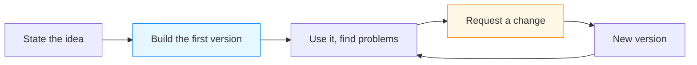
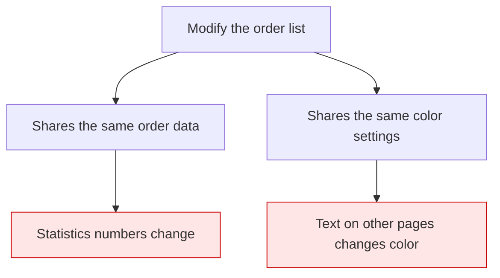
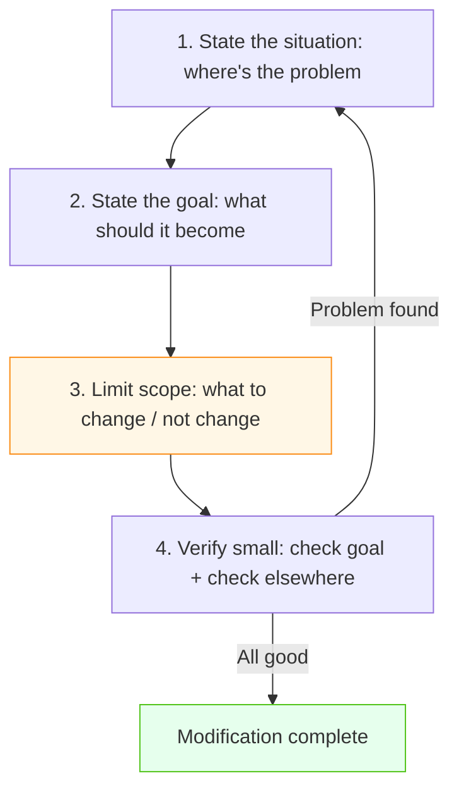

# Chapter 13: Why Modifying Software Is Harder Than Building It the First Time

> This chapter answers a question that puzzles many beginners: the software is built, so why is changing it harder than building it from scratch? The answer isn't that you're slow — it's that software is a web where everything is connected, and AI doesn't remember everything you've had in mind.

## What You'll Learn in This Chapter

- Why software isn't "generated once" — modification is the normal state
- Why AI changes the wrong place, and why changing one feature can break others
- What "context" is, and why AI "forgets" earlier requirements
- Why you shouldn't casually tear everything down and rebuild
- The right mindset for modification: state the current situation, state the goal, limit the scope, verify in small steps


*Figure: Software takes shape through repeated modification*

### Opening: Change One Line, Break the Whole App

Lin Xiaoman's flower shop helper has been running for a while. Recording orders, calculating reminders, checking the list — it all works smoothly. One day she decides the reminder color is too pale to read, so she says to AI:

**You:** Change the reminder color to red.

**AI:** Done. I changed all reminder text on every page to red.

Lin Xiaoman refreshes the screen and freezes — it's not just the order list. The hints on the "new order" page, the notes on the "statistics" page, everything turned red. The whole screen looks like a wall of warnings. She only wanted to change those two words in the list.

She's deflated. "The first build went so smoothly. Why did one little change make such a mess?"

This isn't her fault. During the first build, the software went "from nothing" — you could decide anything freely. When you modify it, the software is already a **connected whole**: touch one part, and other parts can get dragged along. Add to that the fact that AI doesn't remember everything you've said, and it's easy to miss the mark.

This part (Part IV) exists precisely to solve this problem. It may be the **most valuable** part of the whole book — because in real life, building the software is only the beginning; most of your time goes into modifying it again and again. Learning to modify well is what makes you truly able to build software with AI.

## 13.1 Software Isn't Generated All at Once

Many beginners secretly believe software should appear like magic: one sentence produces a perfect finished product, never to be touched again.

Reality is nothing like that.

**Software "grows"; it isn't generated in one shot.** Think of planting a tree. You start with a sapling, then water it, prune it, straighten it, and slowly it becomes the tree you want. What you build the first time is only a "usable" version — Lin Xiaoman's list can show orders, but the "days remaining" is hidden in the detail page and requires a click; the reminder color is a pale system default. Those "not quite right" spots all get fixed through later modifications.

Why can't it be perfect the first time?

- **Your ideas change.** Before building you think it's enough; after using it you realize "if only it could also…".
- **You can't say everything up front.** It's hard to describe every detail initially; many requirements only occur to you when you see the finished thing.
- **Situations change.** Holidays change, the business changes, phone screens change — the software has to keep up.



So treat "modification" as a **normal part** of development, not "a patch for failure." It's perfectly normal for a piece of software to be modified ten or twenty times. What you're learning here is how to make each modification land in the right place.

## 13.2 Why AI Often Changes the Wrong Place

Back to Lin Xiaoman's example. She said "change the reminder to red," and AI turned the whole site red. Where did it go wrong?

**Because the word "reminder" refers to more than one place in the software.** There's a reminder on the list page, one on the detail page, and hint text on the new-order page. AI saw "reminder" and changed every "reminder" it could find. It didn't misbehave — you said "reminder," and it changed things that really were reminders. The mismatch is that **you spoke broadly but thought narrowly.**

It's like telling a contractor "change the lights to warm white," and they change every light in the house — when you only meant the bedroom lamp. **The contractor didn't disobey; you didn't say which lamp.**

AI usually changes the wrong place for three reasons:

| Cause | Symptom | Your countermeasure |
|---|---|---|
| Vague wording | "change it," "optimize it" | Name the specific page and element |
| One word maps to many places | "reminder" exists on many pages | Add a qualifier, e.g. "the reminder on the order list" |
| AI "helpfully" expands | changes one spot and "improves" related ones | Say explicitly "only change this, leave everything else" |

Here's a comparison:

**❌ The wrong way to ask**

**You:** Change the reminder to red.

**AI:** Done. I changed all reminder text on every page to red. (Result: the whole site is red — more than you wanted.)

**✅ The right way to ask**

**You:** Only on the "flower order list" page. On that page, change the line shown on each order row that reads "reminder: N days left" to red and bold. Don't change any other page or any other text.

**AI:** Understood. I'll only change the "days remaining reminder" text on each order on the flower order list page, making it red and bold. The new-order page, detail page, statistics page, and all other text stay unchanged.

What's the difference? The right version contains one extra thing: **scope**. It tells AI "where to change" and "where not to change." These are the two most important parts of a modification instruction — Chapter 14 covers them in depth.

## 13.3 Why Changing One Feature Can Break Others

More subtle than "changing the wrong place" is "changing the right place but hurting somewhere else."

Think of software as a house: rooms (pages) share the same plumbing (data and shared code). You remodel the kitchen and move a pipe, and suddenly the bathroom water pressure drops — you never touched the bathroom, but it shares a pipe with the kitchen.

The same happens in software. Say the "order list" and the "statistics page" use the **same order data**. To make the list load faster, you change how data is read — and unexpectedly the numbers on the statistics page go wrong. Or "reminder color" and "normal text color" share one setting, so changing the reminder color changes ordinary text too.



The lesson: **what looks like one feature may be connected to others.** So when modifying, don't stare only at the spot in front of you — think about "what shares things with it."

This is why we keep stressing two habits:

1. **Before changing, ask AI: "What else uses this feature?"** Understand the connections first, then act.
2. **After changing, check: "Did anything else get affected?"** Don't assume it's fine — actually look.

The good news: you don't need to understand those connections yourself. You can have AI investigate. Your job is simply to **think to ask** — that's the key.

**You:** I'm about to change how the order list is displayed. Before touching anything, please analyze: what data does the order list use, and which pages or features share that data? Only analyze — don't change any code yet.

**AI:** I checked: the order list, order detail, and statistics page share the same order data. The statistics page's "orders this month" depends on the list's read result. Changing how the list reads data may affect the statistics page. I suggest keeping the original read method and only adding new display logic. Shall I proceed that way?

See — **analyze first, act second**, and you sidestep the "hurting somewhere else" trap. Chapters 16 and 17 go into even more detail on this approach.

## 13.4 What Is Context

We've been saying "AI doesn't remember." To understand that, you need one concept — **context**.

Context is simply **everything AI can currently "see."** Picture a desk in front of AI: everything you've said in this conversation, everything AI has replied, screenshots you've uploaded, code you've pasted — it's all on that desk. AI can only work with what's on the desk; anything not there, it doesn't know.

Here's an analogy. You hire a contractor to remodel your house, but this contractor **can only see what's on one desk in front of them** — whatever blueprints are on that desk, they follow. Things you said earlier on the phone, if not written down and placed on the desk, don't exist for them. So you have to keep putting important requirements back on the desk.

That desk has two crucial properties:

1. **It has a size limit.** The desk is only so big. When it's full and new things arrive, old things get pushed off. The longer the conversation, the more easily early content falls off.
2. **It only holds this conversation.** Rules you set in a previous session aren't on the desk when you open a new chat.

| On the desk (AI can see) | Not on the desk (AI can't see) |
|---|---|
| Requirements said in this conversation | Things you thought but never said |
| Screenshots and code you just sent | Rules set in a previous conversation |
| Records of earlier modifications in this chat | "Everybody knows that" assumptions |

Understanding context explains **why you assume AI knows something, yet it doesn't.** It genuinely can't see it. That's not stupidity — it can only see what's on the desk.

So here's a good habit: **whenever you request a change, restate the key information** — even if you think "I said that already." Put important things on the desk yourself, and AI won't miss them.

## 13.5 Why AI Forgets Earlier Requirements

Once you understand context, "forgetting" is easy to grasp.

When you first built the software you said, "a one-day-ahead reminder is fine." That sentence was on the desk then, and AI followed it. But afterward you chatted for dozens more rounds: change the list, add a button, hook up maps, adjust colors… more and more piled onto the desk, and the original "one day ahead" got shoved underneath. AI couldn't see it anymore. So when you asked it to "add a holiday reminder," it decided on "three days ahead" on its own — because it had forgotten the rule you'd set.

**AI doesn't forget on purpose — that piece of information got squeezed out of context by newer content.** Like trying to remember too many things at once, the early small agreements naturally fade.

There's a sneakier kind of "forgetting": **a new conversation.** You spent two hours yesterday building the software with AI; today you open a fresh chat and ask it to change something. As far as it's concerned, this is a brand-new app, and it knows nothing about all the rules you set yesterday.

How to prevent it? Three methods, from easiest to most reliable:

1. **Write important rules into a "file."** Have AI organize the key rules into a short checklist ("fixed rules for this project"), and paste that checklist into every future modification. That's like writing the agreement on paper and carrying it with you.
2. **Restate relevant requirements when modifying.** If this change touches reminders, add "reminders are still one day ahead — unchanged."
3. **"Hand over" when starting a new chat.** Explain the software's current state, the established rules, and what you want to change — all at once. It's like briefing a new contractor.

**You:** We've set a few rules along the way, and I'm afraid we'll forget them. Please organize all the rules we've confirmed into a short checklist: the reminder lead time, the colors, which pages must not be casually changed, and so on. From now on I'll send you this checklist with every change request — please follow it strictly. For now, just organize it; don't change any code.

**AI:** Done. Here's the fixed-rules checklist: 1) reminders lead by 1 day, unchanged; 2) reminder color is red and bold only on the flower order list page; 3) the statistics page's data definition must not be changed… From now on, when you send this checklist, I'll verify it before executing any change.

Keep that checklist safe — it's your "software manual," and the modification log in Chapter 17 will build on it.

## 13.6 Why You Shouldn't Casually Tear It Down and Rebuild

When changes keep going wrong, many people's first impulse is: "Forget it, let's just rebuild — AI works fast anyway."

**That's a tempting idea, but often a dangerous one.**

Why dangerous? Because your software contains a lot of **invisible "tacit knowledge"** — things you accumulated through rounds of modification. AI doesn't know them, and you may have nearly forgotten them yourself:

- You tried several reminder lead times and finally settled on "one day" as best;
- You found a certain color unclear on a particular screen and changed it to the current one;
- You hit the "wrong statistics numbers" bug and set the rule "don't change the statistics definition."

All of that experience lives in the current version. Rebuilding **wipes it all**, and you get to rediscover every pitfall. It's like a house you've lived in for three years — you know exactly where it drafts in winter and which floorboard creaks; tear it down and rebuild, and all that "lived-in" knowledge is gone.

And there's the **real data**: Lin Xiaoman's hundreds of customer orders, addresses, phone numbers, all in there. Rebuild, and what happens to that data? Move it wrong or lose it, and it's a genuine financial loss.

So when is rebuilding okay? Only in two cases: the software is still very early, has almost no data, and its structure is too messy to fix; or you have complete backups and a clear requirements list so you can carry the important things over. **Otherwise, prefer "change" over "rebuild."**

| Situation | Recommendation |
|---|---|
| Structure is clear, just small defects | Change — don't rebuild |
| Has data and accumulated experience | Definitely keep it; change beats rebuild |
| Early prototype, no data, messy structure | Rebuilding can be considered |
| Decided to rebuild | Back up data and write a requirements list first |

## 13.7 The Right Mindset for Modification

Gathering everything above, there's a clear four-step path for modifying software:

**Step 1: State the current situation (what it's like now).**
Describe where the problem is, ideally with location and symptom — a screenshot if possible. Example: "On the order list page, the reminder text is pale gray and hard to read."

**Step 2: State the goal (what you want it to become).**
Describe the expected result as concretely as you can. Example: "Make it red and bold."

**Step 3: Limit the scope (what may change and what may not).**
This is the most-often-skipped step, and the most important. Say explicitly "only change this page" and "don't touch anything else." Example: "Only change the flower order list page; leave other pages and text untouched."

**Step 4: Verify in small steps (check after each change, go in batches).**
Change one problem at a time. Right after each change, check: did it hit the goal? Did anything else get affected? Only move on once it's fine.



These four steps are the skeleton of the next three chapters:

- Chapter 14 breaks down "how to describe one modification" to the finest detail — steps 1 to 3;
- Chapter 15 focuses on "changing the interface" — the easiest kind to break and the easiest to verify;
- Chapter 16 focuses on "changing features" — the riskiest kind, needing the most protection against knock-on effects;
- Chapter 17 focuses on "how to change step by step, and how to log and accept changes" — putting step 4 into practice.

Remember this: **modifying software isn't "letting AI change things around," it's "you clearly state the situation, goal, and scope, let AI execute precisely, then verify it yourself."** You go from "the person who requests" to "the person who signs off on changes." That's exactly the skill this part trains.

## Common Pitfalls

- **Pitfall: Thinking "just change it" is enough.** Why: AI only sees what you say, not what you mean; "change it" is too vague, so it guesses — and guesses go wrong. What to do: use the three-part "situation–goal–scope" format; err on the side of writing more.
- **Pitfall: Not checking, just piling on the next request.** Why: errors accumulate; if a broken change goes unnoticed, things get messier over time. What to do: change one thing at a time, check immediately, continue only when it's right.
- **Pitfall: "Rebuild instead of fiddling."** Why: you lose data and experience earned through many modifications, and risk rediscovering every pitfall. What to do: unless it's an early prototype with no data, prefer changing; if you must rebuild, back up and write a requirements list first.
- **Pitfall: Assuming AI remembers every earlier agreement.** Why: context is limited; long conversations push old info off, and a new chat is blank. What to do: organize key rules into a checklist and paste it with every change; hand over context when starting a new chat.
- **Pitfall: Assuming "the right place changed" means all is well.** Why: features share data and settings, so one change can hurt another. What to do: before changing, ask AI "what shares this"; after changing, check "did anything else get affected."

## Chapter Summary

- Software "grows" — modification is a normal part of development, not a patch for failure.
- AI changes the wrong place mostly because you spoke broadly and thought narrowly; "scope" is the most important part of a change instruction.
- Features share data and settings, so one change can hurt others; ask about connections before, check for effects after.
- Context is what AI can currently see; the desk is limited and holds only this conversation, so it "forgets" earlier requirements.
- Don't casually rebuild — you lose data and tacit experience; the right path is: state the situation, state the goal, limit the scope, verify in small steps.

## Practice Exercises

1. Think of a time you "changed A and broke B" (software, a document, a spreadsheet — anything). Analyze it from the "shared things" angle: what might A and B have shared?
2. Find an old conversation with AI and check whether it still remembers the very first requirement you set. If not, try organizing a "fixed rules checklist" — decide which rules should be on it.
3. Write down the three places in your flower shop helper (or your own project) that "must not be gotten wrong," and explain why — these are what you'll protect in every future change.
4. Rewrite this vague change request into "situation–goal–scope" form: "Make the interface look nicer."

## Copyable Instruction Templates

**Template 1: Analyze connections before changing — don't act yet**

```text
I'm about to change something in my software, but I'm worried about breaking other features. Before touching anything, please only analyze — don't change any code:

What I want to change: [describe the spot, e.g. the color of the reminder text on the order list page]

Please find out:
1. What data, settings, or shared code does this spot use?
2. Which other pages or features use that data / those settings?
3. If I change it the way I intend, which places are most likely to be affected?
4. How do you suggest I change it to achieve the goal without affecting other places?

Give me only the analysis and your recommendation for now. I'll confirm before you make any change. Reply in plain language.
```

**Template 2: Organize established rules into a "fixed rules checklist"**

```text
We've worked together long enough to have established quite a few rules. To avoid forgetting them during future changes, please organize all the rules we've confirmed into a short checklist.

Requirements:
1. Include: data definitions, reminder rules, colors and styles, page conventions, and anything you were explicitly told "must not be changed";
2. One short, clear, unambiguous line per rule;
3. Start with "[Fixed Rules Checklist] …" so I can easily copy and paste it back to you;
4. Only organize — don't change any code.

From now on I'll paste this checklist at the top of every change request. Please verify against it before executing any change.
```
