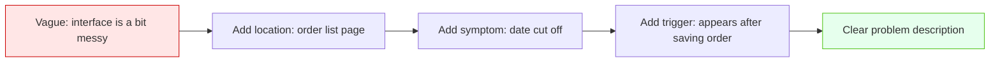
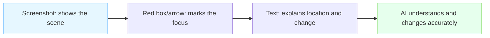

# Chapter 14: How to Tell AI Exactly What to Change

> The last chapter covered "why changes often go wrong." This chapter covers "how to make them go right." It comes down to one sentence: describe a modification as a **specific small task**, not a vague exclamation.

## What You'll Learn in This Chapter

- Why phrases like "change it" or "optimize it" are guaranteed to miss the mark
- The six elements of describing a change: location, current problem, goal, scope, no-go zones, and behavior
- How to use screenshots and concrete examples to turn "hard to say" into "easy to see"
- How to use a high-quality change-instruction template

### Opening: One Sentence That Caused a "Disaster"

Lin Xiaoman learned her lesson and knew she should be specific. One day she wants to adjust the order list, so she says:

**You:** Optimize the order list a bit.

**AI:** Done. I've: sorted the list by customer name, enlarged the font, added a delete button to each row, changed the background to blue, and added a search box.

Lin Xiaoman is stunned. "I… I just thought the date column was too narrow and wanted it a bit wider."

She thought "optimize a bit" was a polite softener; AI treated it as a **to-do list** — everything that could be "optimized," it optimized.

The problem isn't that AI disobeyed. It's that "optimize a bit" carries **almost no information**. AI has to guess, and when it guesses, it guesses toward "do more."

This chapter breaks "how to describe one change clearly" into fill-in-the-blank parts. After learning it, every change request you send will be as precise as a delivery form — the address down to the door number, not "roughly that neighborhood."

## 14.1 Don't Just Say "Change It"

First, a rule: **never send a change request that carries no specific information.**

"Change it," "tweak it," "make it look nicer," "optimize it," "improve it" — these sound natural to us, but to AI they're equivalent to saying nothing. Because:

- It doesn't know **where to change** (which page, which element);
- It doesn't know **what to change it into** (the result you want);
- It doesn't know **where to stop** (the boundary).

So it reaches for a "generic optimization package": bigger font, adjusted colors, an extra button, an added search… it looks diligent, but none of it is what you wanted.

**❌ The wrong way to ask**

**You:** The interface isn't very pretty. Change it.

**AI:** Done. I changed the main color to blue, made buttons rounded, enlarged the title font, and added shadows to the cards. Happy with it? (Result: a bunch of changes, none of them what Lin Xiaoman wanted.)

**✅ The right way to ask**

**You:** I only want one thing changed: on the "flower order list" page, the "delivery date" column is too narrow and the date gets cut off. Please widen that column so a full date like "May 10, 2026" displays completely. Don't change any other column, page, font, or color.

**AI:** Understood. I'll only widen the "delivery date" column on the flower order list page so the full date displays. Other columns, pages, fonts, and colors stay unchanged.

See the pattern? The right version hides six pieces of information. **Put all six together, and AI can hardly get it wrong.**

| Element | Question it answers | Example |
|---|---|---|
| Location | Where to change? | The "delivery date" column on the flower order list page |
| Current problem | What's wrong now? | Column too narrow, date gets cut off |
| Goal | What should it become? | Fully display "May 10, 2026" |
| Scope | What may change? | Only that column |
| No-go zones | What must not change? | Other columns, other pages, fonts, colors |
| Behavior | What's before vs. after? | Before: cut off; After: fully displayed |

Let's take them one by one.

## 14.2 How to Describe the Current Problem

When describing a problem, the worst thing is to use adjectives. Use **observable symptoms**.

"Too ugly," "doesn't work well," "a bit messy" — those are adjectives, and everyone interprets them differently. What you should say is the **concrete thing your eyes see**: where, what it shows, and how it differs from what you want.

A useful formula: **on【location】, when I【do something】, 【symptom】appears.**

**You:** On the "new order" page, after I fill in the delivery date and save, the date in that row of the list shows as "2026/05/10", but I want it to show in Chinese style like "May 10."

**AI:** Got it: after saving a new order, the date format in the list is wrong. I'll change dates in the list to the "Month Day" format.

Three tips for describing problems:

1. **Name the location, not "this app."** "The third column of the order list" is ten times more precise than "this list."
2. **Describe the symptom, not "it's bad."** "The number shows as June 10" is far more useful than "the date is wrong."
3. **State the trigger**, if the problem only appears after a specific action: filling a field, clicking a button, being on a certain page.



## 14.3 How to Describe the Desired Result

Once you've described the problem, say "what you want." The key here: **speak in results, not in process.**

You don't need to tell AI "which code to change" or "what method to use" — that's its job. You only need to describe the **final visible appearance**.

**❌ Describing the process (bad)**

**You:** Format the date field, convert it with a Date object and then render it.

(That's teaching AI how to do its job. You don't actually need to understand this, and if you get it wrong it just adds confusion.)

**✅ Describing the result (good)**

**You:** I want every order's delivery date in the list to display as "May 10" — no year, no slashes.

**AI:** OK, I'll make dates in the list display as "Month Day."

Three things to note when describing results:

- **Give a concrete appearance.** Write "May 10," not "Chinese format" — the former has no ambiguity.
- **State exceptions.** E.g. "if it crosses a year, show 'Jan 5 next year'" — if you think of it, say it; don't make AI guess.
- **One goal per instruction.** This request only fixes date display; don't tack on "and change the color too."

## 14.4 How to Describe the Scope

Scope tells AI "how far your hand may reach." It's the single most effective trick for preventing wrong changes.

Three common ways to fence in scope, from least to most precise:

1. **By page:** "Only change the flower order list page."
2. **By element:** "Only change the 'delivery date' column on that page."
3. **By state:** "Only change order rows with 'pending delivery' status; leave completed orders untouched."

**You:** Please only change the display format of the "delivery date" column on the "flower order list" page. Scope is limited to that column: don't change the header, other columns, the detail page, or the new-order page.

**AI:** Received. Scope is limited to the "delivery date" column on the flower order list page; everything else untouched.

A sentence pattern worth memorizing:

> **"Only change【A】; don't change【B, C, D】."**

Start every change request with this pattern and AI will struggle to drift off target.

## 14.5 How to Describe What Must Not Change

"No-go zones" are the other side of scope: scope says "what may change," no-go zones say "what must absolutely not be touched."

Why call out no-go zones separately? Because AI has a **tendency**: when changing one thing, it likes to "helpfully" improve related things too. The more explicitly you say "these must not move," the less likely it is to reach for your precious features.

How do you find no-go zones? Think about which parts of your software would hurt most if broken:

- **Data definitions:** how "orders this month" on the statistics page is calculated — must not change;
- **Confirmed styling:** the red reminder color was tuned through many rounds — must not change;
- **Critical flows:** the place-order-and-save flow — best left alone;
- **Already-working features:** customer search works fine — don't "optimize" it on a whim.

**You:** This change has a hard no-go zone: the calculation of "orders this month" on the statistics page must absolutely not change — we can't move its definition. Also, don't touch the "new order" save flow. Only change the date display in the list column. When you're done, please explicitly tell me: were the statistics page and the save flow completely untouched?

**AI:** Understood. No-go zones recorded: the statistics page's "orders this month" definition and the new-order save flow — neither will be modified. I'll only change the date display in the list column and will confirm, item by item, that those two are unaffected when I'm done.

Notice the last line — **asking AI to confirm item by item that no-go zones are untouched.** This works especially well: it forces AI to check before delivering.

## 14.6 How to Describe Before-and-After Behavior

Sometimes saying "what to change it into" isn't enough. It's better to put "before" and "after" side by side. This is **describing before-and-after behavior**, and it makes your intent unmistakable.

The formula is simple:

> **Before: 【current behavior】; After: 【behavior I want】.**

**You:** Before: clicking "view location" on an order row opens the map in a new tab, and you have to click once more to locate. After: clicking "view location" pops up the map on the same page and locates the address directly, with no new tab. Only change this one button's behavior; other buttons unchanged.

**AI:** Understood. The "view location" button changes from "opens map in a new tab needing a second click" to "pops up on the current page and locates directly"; other button behaviors unchanged.

Before-and-after comparisons are especially useful for:

| Type of change | Why a before/after comparison helps |
|---|---|
| Buttons / interactions | Behavior is invisible; comparison makes it clear |
| Data formats | Give an example of the old format and the new |
| Business rules | "Old rule vs. new rule" makes a changed rule obvious |
| Prompt / label text | Just give "original text → new text" |

One comparison table is worth ten adjectives.

## 14.7 Using Screenshots to Help with Changes

For some problems, "describing" a hundred times is worse than "pointing" once. **A screenshot is your pointing finger.**

It's ideal for: messed-up layout, an element in the wrong position, colors or fonts you can't quite describe, error messages you don't understand. Send the screenshot and AI sees the scene directly.

When you send a screenshot, **always add a sentence saying "look here"** — otherwise AI may stare at the whole image and guess randomly:

**You:** (attaching screenshot) In the screenshot, please look at the area I circled in red: under the last "Actions" column of the order list, the "delete" and "edit" buttons are crammed together and the text overlaps. Please stack these two buttons vertically with some space between them. Only change the button layout in that column; leave other columns alone.

**AI:** I see it — the two buttons in the red circle really do overlap. I'll stack "edit" and "delete" vertically with spacing, changing only the button layout in the last column of the order list.

Three screenshot tips:

1. **Mark it.** Use a red box or arrow to highlight the key spot; don't make AI hunt for it.
2. **Say what the screenshot shows.** Tell it which page and which step.
3. **Screenshot + text together.** The screenshot points "where"; the text says "what to change" — neither alone is enough.



## 14.8 Using Concrete Examples to Help with Changes

The counterpart to screenshots: for **data and format** changes, "giving an example" beats "explaining the rule."

If you say "dates should show in Chinese format," AI might give "May 10, 2026" or "the tenth of May." But if you give examples directly, there's no ambiguity.

**You:** I want the date display format changed. Here are three before/after examples to follow:
- Before: 2026-05-10 → After: May 10
- Cross-year example: Before 2027-01-05 → After: "Jan 5 next year"

Please apply this rule to all delivery dates in the list. Only change the display format; don't change the stored data.

**AI:** Understood: dates display as "Month Day," and cross-year dates as "Month Day next year." Only the display format changes; stored data stays the same.

Two keys to giving examples:

1. **Give "input → output" pairs** so AI can follow the pattern;
2. **Cover edge cases** — empty values, cross-year, overlong text. These are the most error-prone; one or two examples save ten minutes of later explanation.

## 14.9 A High-Quality Change-Instruction Template

Put all the parts together and you get a high-quality change instruction. It looks like this:

```text
【Location】Which page and which element?
【Current problem】What's wrong now? (symptom + trigger; screenshot if possible)
【Goal】What do you want it to become? (concrete appearance, examples if possible)
【Scope】What only may change? (fence by page / element / state)
【No-go zones】What must not change? (ask for item-by-item confirmation after)
【Behavior】Before → after comparison (for interactions, rules, formats)
【Acceptance】After changing, tell me what you did and confirm no-go zones are untouched
```

A real run-through:

**You:**
- 【Location】The "delivery date" column on the flower order list page.
- 【Current problem】The column is too narrow and "2026-05-10" is cut off (see red box in screenshot).
- 【Goal】Widen the column; show dates as "May 10," and cross-year as "Jan 5 next year" (see examples below).
- 【Scope】Only this column's width and date display format.
- 【No-go zones】Header text, other columns, detail page, statistics page, new-order page — none change; statistics page's "orders this month" definition absolutely must not move.
- 【Behavior】Before: "2026-05-10" cut off; After: "May 10" fully displayed.
- 【Acceptance】When done, say what you changed and confirm item by item that no-go zones are untouched.

**AI:** Received. I'll only widen the "delivery date" column on the flower order list page and show dates as "Month Day" per your examples (cross-year as "Month Day next year"). Header, other columns, detail page, statistics page, and new-order page stay unchanged; the statistics definition stays the same. I'll confirm each item when done.

That's a "delivery-form-style" change instruction: the address is accurate down to the door number, so AI can hardly misdeliver.

Writing such an instruction takes a minute or two, but it saves a dozen minutes of back-and-forth. **A few extra sentences up front prevent ten rounds of rework later.** It's the best investment you can make in modifying software.

## Common Pitfalls

- **Pitfall: Using "optimize it" or "make it nicer" as an instruction.** Why: those words carry zero information, so AI guesses and over-does it. What to do: replace them with a concrete "location + problem + goal" description.
- **Pitfall: Only saying what to change, not what not to change.** Why: AI likes to "helpfully" improve related features and may touch your favorites. What to do: list no-go zones explicitly and ask for item-by-item confirmation afterward.
- **Pitfall: Sending a screenshot without words.** Why: AI doesn't know where the focus is and will guess across the whole image. What to do: mark it with a red box / arrow, then add text saying "look here, change this."
- **Pitfall: Describing problems with adjectives.** Why: "a bit messy" or "not quite right" means something different to everyone. What to do: use symptoms and examples — say "what it shows," not "whether it's good."
- **Pitfall: Cramming several changes into one instruction.** Why: if something breaks, you can't tell which change did it, and it's hard to accept. What to do: one goal at a time, accept it, then send the next (Chapter 17 covers this in depth).

## Chapter Summary

- "Change it" / "optimize it" say nothing: AI has to guess, and guesses drift.
- A high-quality change instruction has six elements: location, current problem, goal, scope, no-go zones, behavior — plus an acceptance request.
- Describe problems with symptoms not adjectives; goals with results not process; scope with "only change A, not B."
- List no-go zones separately and ask AI to confirm item by item that they weren't touched.
- A screenshot is your "finger" (points at the scene); an example is your "sample" (removes format ambiguity). Both work best with text.

## Practice Exercises

1. Rewrite these three vague requests into full six-element instructions: (1) "Make the interface look nicer"; (2) "Search doesn't work well, fix it"; (3) "Change the reminder time a bit."
2. Open your flower shop helper, find one interface problem, take a screenshot with the problem circled in red, then write a "screenshot + text" change instruction.
3. For a "date display format" change, write three before → after examples, at least one covering an edge case (cross-year, empty, or overlong).
4. Using the template in 14.9, write the change you've been meaning to make as one complete instruction, send it to AI, and see whether its reply matches your expectation.

## Copyable Instruction Templates

**Template 1: Universal change instruction (six elements + acceptance)**

```text
I want to change one thing in my software. Please follow this strictly:

【Location】What I want to change is: [which page / which element]
【Current problem】The problem now is: [describe the concrete symptom; if it only appears after an action, explain the trigger]
(I'll attach a screenshot if needed, with a red box marking the focus)
【Goal】I want it to become: [describe the final visible appearance, with a concrete example]
【Scope】Only change: [page / element / state]; don't expand elsewhere
【No-go zones】Absolutely must not change: [list 1~3 places]
【Behavior】Before: …; After: … (fill in for interactions or formats)
【Acceptance】When done: 1) tell me what you did; 2) confirm item by item that every "no-go zone" is untouched.

Make only this one change — don't "helpfully" optimize anything else. Reply in plain language.
```

**Template 2: Screenshot + examples to assist a change**

```text
I've attached a screenshot. Please look carefully at the area circled in red — that's where I want the change.

Screenshot notes: this is a screenshot of [which page]; the problem is [describe the symptom].
My request: [describe what to change it into].

Also, for the format / data, here are a few examples — please follow them:
- Before: [old appearance] → After: [new appearance]
- Before: [old appearance] → After: [new appearance]
- Edge case: [e.g. cross-year / empty] → should display as: [concrete appearance]

Only change the spot I pointed out; leave everything else alone. Tell me the result when done.
```
