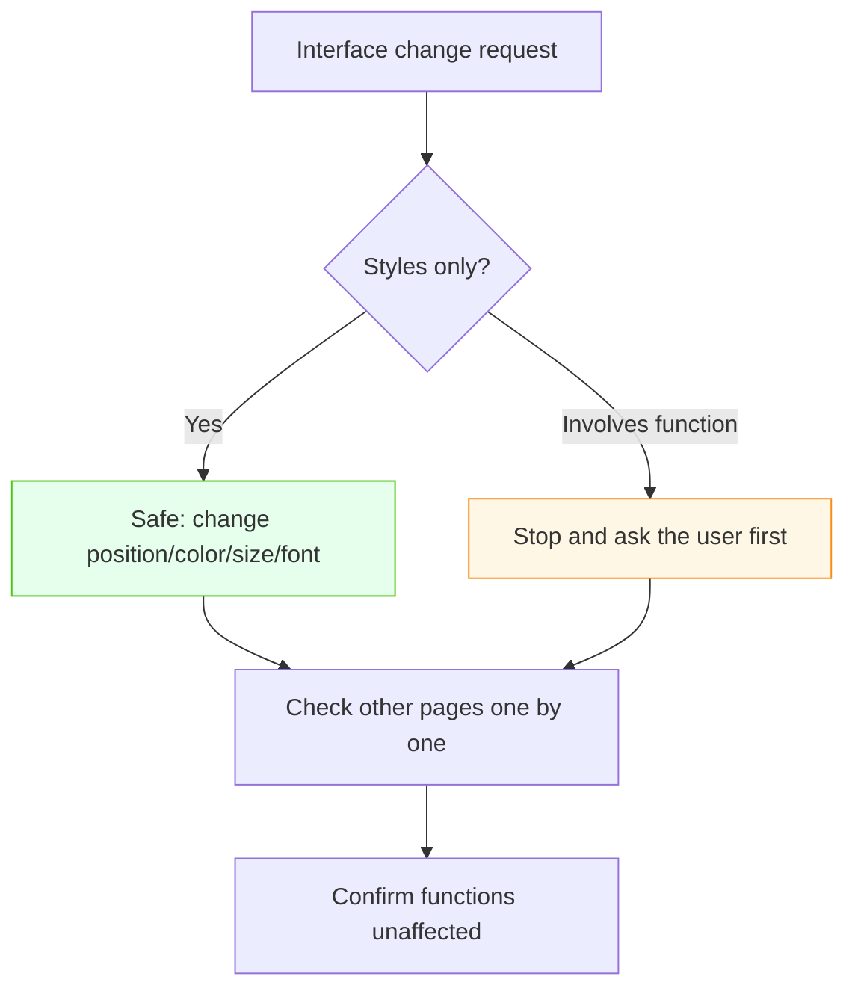
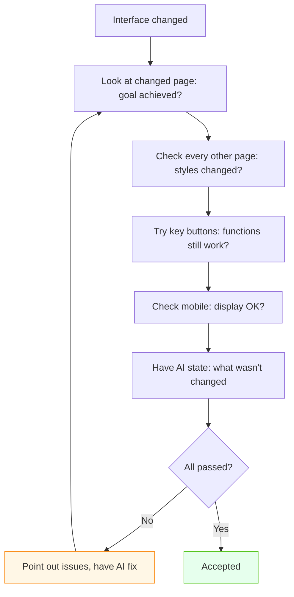

# Chapter 15: How to Change the Interface Without Breaking Other Features

> The interface is the easiest part of software to change — and the easiest to accidentally break. This chapter teaches you to keep interface changes locked at the level of "what you can see," away from the invisible functionality behind it, and to check every page afterward.

## What You'll Learn in This Chapter

- The core principle of interface changes: change "appearance," not "logic"
- How to describe layout, fonts/colors/sizes, and button interactions
- How to adjust the interface for mobile
- How to make AI change only the page you specify
- How to verify other pages weren't affected

### Opening: Change a Menu, Break Order Saving

After using the helper for a while, Lin Xiaoman wants to make the interface nicer. She makes a request:

**You:** Make the side menu look nicer, with big icons.

**AI:** Done. I redesigned the side menu: switched to big icons, reorganized the menu structure, and rewrote the menu's display logic.

Lin Xiaoman refreshes. The menu does look better — but the "save" button on the "new order" page does nothing now. She's baffled. "I just changed a menu. Why can't I save orders anymore?"

The culprit is "rewrote the menu's display logic." AI assumed that was necessary for a prettier menu, so it touched the code controlling page navigation and broke the save flow on the new-order page.

Interface changes have a special trait: **they look like "just changing how things look," but behind the interface sit real functions — page switching, data display, button actions.** Without drawing a line, AI easily crosses it into places it shouldn't touch.

This chapter teaches you to draw that line — and how to check your work afterward.

## 15.1 The Core Principle of Interface Changes

Remember one overarching rule:

> **Change only "what you can see," not "the logic behind it."**

"Appearance" means: where things sit, what color, how big, what font, how they're arranged. "Logic" means: how data is stored, what a button does when clicked, how pages navigate.

When you request an interface change, write this rule into the instruction to draw the line for AI:

**You:** I want to adjust the interface's appearance. Principle: only change styles (position, color, size, font, spacing); don't touch any functional logic — don't change how data is stored, what buttons do when clicked, or how pages navigate. Only change the specified page; leave other pages untouched.

**AI:** Understood. I'll only adjust appearance styles, not functional logic; only the specified page, other pages unchanged.

Three principles, expanded:

1. **Keep style and function separate.** If you say "prettier," AI should only touch styles. If it needs to change functionality to achieve that, make it **ask you first**, not act on its own.
2. **One category at a time.** If this change is about layout, don't also change colors. A big bundle makes it impossible to tell which change broke something.
3. **Check every page after.** Interfaces are visible, so verification is simple — open each relevant page and look. Don't skip it.



## 15.2 How to Change Layout

Layout is "where things go and how they're arranged." To describe a layout change, use **relative position + before/after comparison**, so AI understands it like a sketch.

Useful patterns:

- "Move A from its current 2nd column to the last column."
- "Change these two buttons from side-by-side to stacked vertically."
- "Move the search box from the bottom of the page to the top, directly under the title."
- "Increase the spacing between cards — they're crammed together now."

**❌ The wrong way to ask**

**You:** Adjust the list layout, make it look better.

**AI:** Done. I re-laid out the list: changed column order, column widths, alignment, and row height. (Result: Lin Xiaoman can't find where her column went.)

**✅ The right way to ask**

**You:** Only adjust the table layout on the "flower order list" page, two specific things: 1) move the "delivery date" column from its current 3rd position to the last column (before "Actions"); 2) slightly increase the row height so text isn't so cramped. Only these two layout changes — don't change column widths, fonts, colors, or the content of other columns.

**AI:** Understood. I'll only make two layout changes: move the "delivery date" column before "Actions," and increase row height. Column widths, fonts, colors, and other content stay the same.

A handy trick: if a layout change is complex, **draw a rough sketch in words** for AI:

**You:** Here's the layout I want (top to bottom):
- Top: title "Customer Orders"
- Second row: search box (full width)
- Third row: a "New Order" button (right-aligned)
- Below: the order table

Right now the search box is below the table. Please move the search box and the new-order button above the table, in the order shown. Only adjust these elements' positions; don't change styles or functionality.

## 15.3 How to Change Fonts, Colors, and Sizes

This kind of change is the easiest to describe — and the easiest to "helpfully change everywhere." The key is to **give a concrete value or appearance**, and say whether it's local or global.

**❌ The wrong way to ask**

**You:** Make the font bigger and the colors more eye-catching.

**AI:** Done. I enlarged the font site-wide to 18px and changed the main color to red. (Result: the whole site has bigger text and is all red — far beyond what was wanted.)

**✅ The right way to ask**

**You:** Only change one thing: on the "flower order list" page, change the reminder text (the "N days left" characters) to red and bold, one size bigger than now. Don't change the font, color, or size of any other text on the page, and don't change other pages.

**AI:** Understood. Only the reminder text on the flower order list page becomes red and bold, one size bigger; other text and pages unchanged.

Three points for describing these changes:

1. **Give a concrete reference.** "Red and bold" is clearer than "eye-catching"; a specific size (e.g. "one size bigger") is better still. If you don't know numeric sizes, use relative terms like "a bit bigger/smaller than now" or "same size as the title."
2. **Say whether it's local or global.** "All page titles" is global; "the reminder text on this page" is local. Always specify.
3. **Change one category at a time.** If you're adjusting colors, don't simultaneously adjust fonts and spacing.

| What you want | Recommended wording | Wording to avoid |
|---|---|---|
| Color | "change to red" / "same blue as the button" | "more eye-catching" |
| Font size | "one size bigger" / "same as the title" | "bigger" |
| Weight | "bold" / "remove bold" | "more prominent" |
| Spacing | "leave some space between the two buttons" | "don't cram them" (fine as a supplement, but prefer a concrete description) |

## 15.4 How to Change Buttons and Interactions

Buttons and interactions are the interface changes most likely to "break functionality" — because behind every button is a function. When changing them, use a **before → after behavior comparison** and stress "functionality unchanged."

**You:** Only change the style and position of the "Save" button on the "new flower order" page; don't change its function:
- Style: green background, white text, rounded corners;
- Position: move from the middle of the page to the bottom center;
- Function: clicking it still saves the order and still navigates to the list — all that behavior stays exactly the same.

Only change this button's appearance and position; don't change any logic it executes when clicked.

**AI:** Understood. I'll only adjust the "Save" button's appearance (green, white text, rounded) and position (bottom center); clicking it still saves the order and goes to the list, unchanged.

Common interaction changes and how to describe them:

| Interaction | How to describe it |
|---|---|
| Button position / style | Give the new position and style, and say "click behavior unchanged" |
| Click effect | Use "before: …; after: …" comparison |
| Disabled state | "when no customer name is filled, the Save button is grayed out and unclickable" |
| Loading indicator | "after clicking Save, the button shows 'Saving…' to prevent double-clicks" |
| Prompt text | Just give "original text → new text" |

**Remember**: whenever a button is involved, add the line "the function executed on click stays the same." That line is a lifesaver.

## 15.5 How to Adjust the Interface for Mobile

The same software often looks different on a computer and a phone — phone screens are narrow, so tables get crammed. These changes must specify whether they're for mobile, desktop, or both.

**You:** I want to adjust how it looks on mobile, not desktop. Requirements:
1. On mobile, change the order table into cards — each order becomes one card showing customer name, flowers, and delivery date, no more horizontal table, so no side-scrolling;
2. Make buttons a bit bigger on mobile for easy tapping;
3. Slightly reduce font size on mobile so it doesn't overflow the screen.

The desktop display must stay exactly as it is. When done, tell me how to preview it on a phone to confirm.

**AI:** Understood, only mobile changes: table to cards, bigger buttons, smaller fonts; desktop display unchanged. I'll tell you how to preview on a phone when done.

Three points for mobile changes:

1. **Say which platform.** Without it, AI may change both and mess up the desktop too.
2. **Explain what a phone is like.** Narrow screen, finger taps, small text — tell AI these so it can adapt.
3. **Ask for a preview method.** The mobile result must be seen on an actual phone; have AI tell you how to open the preview.

## 15.6 How to Make AI Change Only the Specified Page

This is the most practical trick in this chapter: **before it acts, make AI report what it plans to change.**

Add a line to your instruction: "Before you start, list what you're going to change and wait for my confirmation." AI will give you a "construction list," and you can see at a glance whether it's about to overstep.

**You:** I want to change the appearance of the "flower order list" page: make the reminder text red and bold.
Before you start, do two things and wait for my confirmation:
1. List which files or spots you plan to modify;
2. Explain whether these changes will affect other pages.
Only after I confirm "this page only" should you proceed.

**AI:** Received. I plan to change only the flower order list page's style file, setting the reminder text to red and bold; no data logic involved, no other pages affected. I'll wait for your confirmation before executing.

If AI's list contains something you don't want touched — e.g. "I'll also adjust the shared style file, because that affects all pages" — stop it immediately and ask for an approach that targets only your page.

**You:** No. A shared style file affects all pages, which is beyond my request. Please use an approach that applies only to the flower order list page; don't touch any shared files. Tell me the new plan first — again, wait for my confirmation before acting.

**AI:** OK, I'll instead add this style rule inside the flower order list page only, leaving shared style files untouched, so other pages are unaffected. That's the new plan above; I'll wait for your confirmation.

The essence of this trick: **turn "before changing" into a checkpoint you control.** Chapter 17's "give a plan before executing" follows the same idea.

## 15.7 How to Verify Other Pages Weren't Affected

Interfaces are visible, so verification is straightforward: **open each relevant page and look.**

Don't just look at the page you changed — the real fear is "change A, break B." Run through this checklist:

1. **Look at the changed page:** was the goal achieved? (Red? Bold?) Is it exactly what you wanted?
2. **Look at neighboring pages:** click through the other pages in the nav menu, see if any style changed unexpectedly.
3. **Try key functions:** on the changed page, click the main buttons (save, add, delete) and confirm they still work.
4. **Look at mobile:** if mobile was involved, open it on a phone.
5. **Make AI prove it:** require AI to state explicitly at delivery "what was not changed."



**You:** After finishing, please self-check against this list and report each item:
1. Is the reminder text on the flower order list page red and bold?
2. Are the styles of the new-order page, detail page, and statistics page completely unchanged?
3. Does the "Save" button still work?
4. Is the mobile display normal?
Don't just say "done" — give me a confirmation for each item.

**AI:** Self-check results: 1) done — reminder text on the flower order list page is red and bold; 2) new-order, detail, and statistics page styles unchanged; 3) Save button works; 4) mobile display normal.

Build this habit and you'll never fear "changed a menu, broke orders" again. **What's visible, verify with your eyes; what's invisible, get AI to self-check.**

## Common Pitfalls

- **Pitfall: Letting AI "make the interface look nicer."** Why: the scope is infinite; AI will change styles, structure, and logic. What to do: say "styles only, no logic," and limit the specific page and elements.
- **Pitfall: Changing a button without saying "function unchanged."** Why: behind a button is a function; AI may change the click behavior while restyling. What to do: always add "the function executed on click stays exactly the same" when changing a button.
- **Pitfall: Not saying mobile or desktop.** Why: AI may change both and mess up the desktop too. What to do: say explicitly "mobile only / desktop unchanged" and ask for a preview method.
- **Pitfall: Only staring at the page you changed.** Why: the real fear is "change A, break B" — you may miss changes elsewhere. What to do: follow the checklist — check every page, try key buttons, get item-by-item self-confirmation from AI.
- **Pitfall: Letting AI change directly, without a report first.** Why: you only discover it touched a shared file after the damage is done. What to do: have it list "what it plans to change" first, and only green-light after confirming no overstep.

## Chapter Summary

- Core interface principle: change "visible appearance," not "hidden logic"; one category at a time; check every page after.
- Describe layout with "relative position + before/after comparison"; for complex changes, draw a rough sketch in words.
- Fonts/colors/sizes need concrete references and a clear local-or-global scope; for button interactions always stress "click function unchanged."
- Mobile changes must say which platform, and ask for a phone preview method.
- Most practical trick: have AI report "what it plans to change" before acting, confirm, then change; after, accept against a checklist page by page.

## Practice Exercises

1. Write a "change only this spot, function unchanged" color/font instruction for the reminder text on your flower shop helper's order list page.
2. Find a button and write an instruction that changes both its style and position, explicitly including the "click function unchanged" lifesaver line.
3. For a mobile "table to cards" change, write an instruction that says "mobile only, desktop unchanged" and asks for a preview method.
4. Write your own "interface change acceptance checklist" with at least five items: the changed page, neighboring pages, key buttons, mobile, and AI self-check.

## Copyable Instruction Templates

**Template 1: Universal "interface only, no functionality" instruction**

```text
I want to adjust the software's interface appearance. Please follow strictly:

Principle: only change styles (position, color, size, font, spacing); don't touch any functional logic — don't change how data is stored, what buttons do when clicked, or how pages navigate.

What to change: [page name] → [specific element].
Specific change: [describe position/color/size, with a concrete appearance or before/after comparison].
Scope: only this spot. No-go zones: [list other pages/functions that must not change].

Before you start, first list which spots you plan to modify and whether other pages will be affected. Wait for my confirmation before executing. When done, tell me item by item: 1) was the goal achieved; 2) are other pages' styles unchanged; 3) are key functions still working. Reply in plain language.
```

**Template 2: Button / interaction change (with the lifesaver line)**

```text
I want to change a button, but must absolutely not change its function:

Button to change: [button name] on [page name].
Change appearance to: [color/shape/font size, etc.].
Change position to: [new position].
You may describe the position/style with a before/after comparison: before it was …; after it should be …

Lifesaver requirement (most important): the function this button executes on click must stay exactly the same — [say what it originally does, e.g. save the order and go to the list]. Don't change its click logic.

Scope: only this one button; other buttons and functions on the page untouched. When done, explicitly tell me: is the click function exactly the same as before?
```
