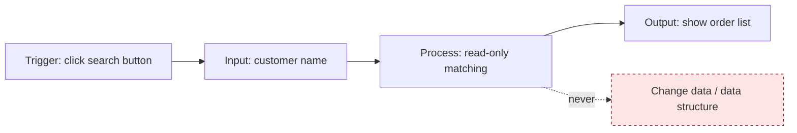
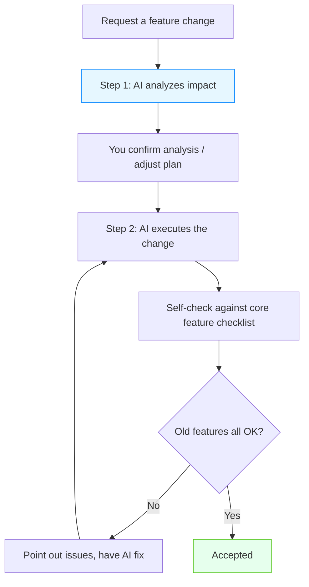

# Chapter 16: How to Change Features Without Breaking Existing Ones

> A broken interface is obvious at a glance; a broken feature may not show up for days — and by then wrong data may already be written. This chapter covers the riskiest kind of change: how to add, modify, and delete features, how to change business rules, and how to keep the old features working perfectly.

## What You'll Learn in This Chapter

- Why feature changes are far riskier than interface changes
- How to define a feature's boundary with "trigger–input–process–output"
- How to request adding, modifying, and deleting features
- How to change business rules without causing trouble
- How to have AI check knock-on effects and preserve old features

### Opening: Add a Feature, Scramble All the Old Orders

Lin Xiaoman's flower shop helper works better and better. She wants to add a feature: "look up a customer's past orders" — type a customer name and list all their flower orders.

**You:** Add a feature: type a customer name and find all that customer's past orders.

**AI:** Done, and I added a new field to the order data table to speed up the query.

Lin Xiaoman tries it — the new feature works. But the next day she discovers every old order's "delivery date" has gone blank. The "new field" AI added changed the structure of the order data and scrambled the old records.

Her heart sinks. "I just added a search feature. How did it break my old data?"

That's the scary thing about feature changes: **a broken interface is at worst ugly; a broken feature can corrupt data, and bad data is often hard to spot and hard to recover.**

The principle for feature changes is the opposite of interface changes. For interfaces: "change appearance, not logic." For features: "**add new capability, preserve old data and old flows**." This chapter shows you how.

## 16.1 The Risks of Changing Features

Why are feature changes so dangerous? Because they touch the software's "internal organs," not its "face."

| Risk | Description | Consequence |
|---|---|---|
| Touching data | Changing table structure or field meanings | Old data scrambled or lost |
| Touching flows | Changing the "order–save–reminder" chain | The whole business flow breaks |
| Hidden dependencies | You don't know feature A relies on feature B | Changing B silently breaks A |
| Delayed discovery | Feature errors often don't throw an immediate error | Found days later, after data is wrong |

A broken interface you see immediately. A broken feature might surface when a customer calls to ask "where did my last order go?" — by then it's too late.

So the iron rule for feature changes is:

> **Before changing, think about whether data and old flows will be touched; after changing, test every old feature one by one.**

This isn't about fearing feature changes — it's about adding one layer of insurance. The following sections are that insurance, in concrete steps.

## 16.2 How to Define a Feature's Boundary

Before requesting a feature, think about "how far this feature reaches." Any feature can be described in four parts:

- **Trigger**: when does it run? (a button click? opening a page? a certain date?)
- **Input**: what information does it need? (customer name? order data?)
- **Process**: what does it do? (search? calculate? decide?)
- **Output**: what result does it produce? (a list? a prompt? saved data?)

Describing a feature with these four parts stops AI from "freelancing" into other areas.

**You:** I want to add a search feature with this boundary:
- Trigger: when the "search by customer" button on the order list page is clicked;
- Input: the customer name the user types;
- Process: among existing orders, find those whose customer name matches exactly (do not modify any data);
- Output: show those orders in a list below the page; if none found, show "No orders found for this customer."

This feature only reads existing data — absolutely don't add, modify, or delete table fields, and don't alter any existing order.

**AI:** Understood. This is a read-only search: click button → enter name → find matching orders → display results, with a "not found" message. No new fields, no data structure changes, no changes to any existing order.

Notice the last line — "read-only, don't change data." That's drawing a boundary around the feature and directly plugging the "add a field, scramble old data" hole from the previous section.



## 16.3 How to Add a New Feature

Good news: **adding a new feature is the safest kind of feature change** — the old features don't move; you're just "adding one more thing." Provided you say clearly "the new feature is independent; don't touch the old."

Template for requesting a new feature:

**You:** I want to add a new feature that must not affect anything existing:
- What it is: [describe], triggered by [button / page / date];
- Inputs it uses: [list];
- Outputs it gives: [list];
- Important: please only add this capability; **don't modify any existing feature's code, and don't change the data table structure**. If it needs existing data, read it — but don't change it.
- When done, tell me: were any existing features changed?

**AI:** Understood. I'll only add this feature, reading existing data without changing it; all existing features and data structures stay the same.

But what if the new feature genuinely needs to store new data (e.g. "tag customers")? Then you must say clearly: **add new fields only, don't touch old fields**.

**You:** The new feature needs to store "customer tags." Please **add** a separate tag table (or a new field) used only for tags. **Absolutely don't change any field in the existing order table**, especially "delivery date" — that's exactly what went wrong last time. When done, confirm that old orders' delivery dates are intact.

**AI:** Understood. I'll use separate storage for tags and leave the order table alone; when done I'll confirm old orders' delivery dates are intact.

## 16.4 How to Modify an Existing Feature

This is the riskiest kind. The safest strategy when modifying an existing feature: **keep the original approach and "add a little on top," rather than rewriting from scratch.**

**❌ The wrong way to ask**

**You:** Change "search by customer" into fuzzy search.

**AI:** Done, I rewrote the search logic. (Result: the original exact search also stopped working, and the new logic mishandled the "not found" case.)

**✅ The right way to ask**

**You:** Modify the "search by customer" feature with these notes:
- Current behavior: enter a name, exact match, show "not found" if nothing matches;
- I want: besides exact match, also support entering part of a name (e.g. typing "Lin" finds "Lin Xiaoman");
- **Keep the original exact-match capability** — when a full name is entered, behavior must be exactly as now;
- When nothing is found, still show "No orders found for this customer" — don't change that message;
- Only change this search feature itself; don't touch other features or the data structure.

When done, tell me: with a full customer name entered, does it behave exactly as before?

**AI:** Understood. I'll add fuzzy matching on top of the existing exact match: a full name behaves as before, and the "not found" message is unchanged; only this search feature changes, data structure and other features untouched.

Two keys: one, **explicitly preserve old behavior**; two, **give AI the "old approach" to compare against**. That way it won't lose what already worked.

Before modifying a feature, there's one more insurance step: **have AI explain how it plans to change it, and wait for your confirmation** (covered in Chapter 17). If it says "I'll rewrite the whole search logic," be alert and ask it to "modify based on the existing logic, don't rewrite."

## 16.5 How to Delete a Feature

Deleting a feature looks simple but hides risks: **if you remove the entry point, what happens to the data? Do other features still depend on it?**

Before deleting, settle three questions:

1. **Are you deleting the "entry point" or "the data too"?** Just hiding it from users, or also wiping stored data?
2. **What about historical data?** Keep or delete data previously produced by this feature?
3. **Do other features depend on it?** e.g. if you delete "customer tags," what happens to "filter by tag"?

**You:** I want to delete the entry point of the "search by customer" feature (the search button and box on the list page). Please note:
- Only remove this feature's interface entry — **do not delete order data**; keep every order;
- Don't change any other feature;
- Don't rush — first tell me: does any other feature depend on this search feature? If I delete it, will anything else break? Wait for my confirmation before deleting.

**AI:** I checked: no other feature currently depends on this search feature, so deleting it won't affect anything else. It only reads orders and doesn't modify data. Once you confirm, I'll remove only its interface entry and keep all order data.

Again — **analyze first, act second**. Deletion especially requires checking dependencies first, because a missed dependency means you've just removed the foundation of another feature.

## 16.6 How to Change Business Rules

A business rule is a "if this, then that" rule: "reminder leads by one day," "orders over $100 get free delivery," "start stock-up reminders a week before Mother's Day."

The easiest place to go wrong when changing a rule is the **edge case**: "over $100 gets free delivery" — what about exactly $100? $99.90? If you don't say, AI has to guess.

To describe a rule change, best to use the "if… then…" form, with an old/new comparison and the edges.

**You:** Modify the delivery-fee rule with these notes:
- Old rule: orders of $100 or more get free delivery, otherwise $10;
- New rule: orders **over** $100 (strictly greater than 100, not including 100) get free delivery, otherwise $10;
- Edge cases spelled out: exactly $100 → charge $10; $99 → charge $10; $101 → free delivery;
- Only change this rule's calculation; don't change the order amount itself or any other feature.

When done, test with these three amounts and show me: $100, $101, $99 — what's the delivery fee for each?

**AI:** Understood. New rule: "amount strictly greater than $100 gets free delivery, otherwise $10." Test results: $100 → $10; $101 → free; $99 → $10. Other features and order amounts unchanged.

**Having AI test with edge values and show you** is the killer move for rule changes — you don't need to understand code; just check whether a few numbers come out right, and you know the rule was changed correctly.

## 16.7 How to Keep Old Features Working

After every feature change, do one thing: **try every old feature once**. This is a "regression check" — confirming the change didn't break things that used to work.

You don't need to understand technology; just keep a **core feature checklist** and click through it each time. For example, Lin Xiaoman's list:

| # | Core feature | Quick check |
|---|---|---|
| 1 | New order can be saved | Fill one in, save, see if it appears in the list |
| 2 | List shows orders | Open the list page and look |
| 3 | Reminder date correct | Check one order's days remaining |
| 4 | Statistics numbers correct | Check "orders this month" on the statistics page |
| 5 | Mobile works | Open on a phone and try it |

Keep this list and **run through it after every feature change**. If any item fails, have AI fix it immediately — don't put it off.

You can also have AI help make the list more complete:

**You:** Please list all the "must stay working" core features of this software as a short regression checklist, with a "how to verify quickly" note for each. From now on I'll check against this list after every feature change — please self-check against it too. Just organize for now; don't change code.

**AI:** OK, regression checklist: 1) new order can be saved — fill one and check the list; 2) list shows orders — open the list page; 3) reminder date correct — verify days remaining; 4) statistics correct — check orders this month; 5) mobile works — open on a phone. I'll self-check against this from now on.

## 16.8 How to Have AI Check Knock-On Effects

This section is the master switch for everything above: **before changing a feature, have AI do an "impact analysis."**

As with problem changes, split "analysis" and "action" into two steps:

**You:** I'm about to modify a feature but worry about affecting other features and old data. Two steps, please:

Step 1, analyze only — don't change any code:
1. What data, tables, and fields does this feature use?
2. Which other features use that data / those fields?
3. My intended change (described below) might affect what?
4. Is there a way to achieve the goal without touching old data and other features?

My intended change is: [describe it].

Step 2: after I confirm the analysis, make the change, and self-check against the "core feature checklist" when done.

**AI:** Analysis first. This feature uses the order table's "delivery date" field, which is also used by the statistics page's "orders this month" and the reminder feature. Your change would affect both. I suggest adding a new field rather than altering the original. I'll wait for your confirmation, then execute and check against the list.



Those few extra minutes block disasters like "add a search, scramble old data" at the door. **Analysis isn't wasted time — it's the cheapest insurance there is.**

## Common Pitfalls

- **Pitfall: Assuming adding a feature can't break old ones.** Why: new features often need data-structure changes, which can hit old data. What to do: say "read-only, don't change" / "add new fields only, don't touch old fields," and demand confirmation that old data is intact.
- **Pitfall: Having AI "rewrite" an existing feature.** Why: rewrites lose working details and edge-case handling. What to do: require "modify based on existing logic, preserve old behavior," and give AI the old approach to compare against.
- **Pitfall: Changing a rule without stating edges.** Why: "over $100" — does that include 100? AI has to guess. What to do: write the new and old rules and their edges in "if… then…" form, and require AI to test with edge values.
- **Pitfall: Deleting data along with a feature.** Why: removing the entry point doesn't mean deleting the data; historical orders are precious. What to do: say "remove the entry only, keep the data," and check for dependencies before deleting.
- **Pitfall: Not testing old features after a change.** Why: feature errors don't throw immediately; by the time you notice, data may already be wrong. What to do: keep a core feature checklist, click through it after every change, and have AI self-check against it.

## Chapter Summary

- Feature changes touch "internal organs": data, flows, hidden dependencies, and late-discovered errors — so be more careful than with interface changes.
- Define a feature's boundary with "trigger–input–process–output," and state "read-only, don't change data."
- Adding is safest (but still say "don't touch the old"); modifying is riskiest (preserve old behavior, modify based on existing logic); deleting needs a dependency check and "entry only, keep data."
- Change rules with "if… then…" and explicit edges, and have AI test with edge values for you.
- After every change, run through a core feature checklist; before changing, have AI do an impact analysis — analysis is the cheapest insurance.

## Practice Exercises

1. Using "trigger–input–process–output," describe the "new order" feature in your flower shop helper, and write down "which data must never be changed."
2. You want to change "one-day-ahead reminder" to "two days ahead." Write an instruction that keeps all other behavior unchanged and has AI test the lead-time boundary for you.
3. Write an instruction that "deletes a feature's entry point but keeps the data," requiring AI to check dependencies before deleting.
4. Make a "core feature regression checklist" for your own software with at least 4 items, each with a "how to verify quickly" note.

## Copyable Instruction Templates

**Template 1: Add a new feature (without touching old ones)**

```text
I want to add a new feature that must not affect anything existing:

New feature: [describe what it does]
Trigger: [button / page / date]
Inputs: [what information it needs]
Outputs: [what it produces]

Hard requirements:
1. Only add this capability; don't modify any existing feature's code;
2. Don't change the data table structure; if new storage is needed, add separate fields/tables only — absolutely don't touch old fields;
3. If it needs existing data, read it — don't change it.

When done, explicitly tell me: were any existing features changed? Is existing data intact? Reply in plain language.
```

**Template 2: Impact analysis before changing a feature (two steps)**

```text
I'm about to modify a feature and worry about affecting other features and old data. Two steps, please — don't skip:

Step 1 (analyze only, no code changes):
1. What data, tables, and fields does this feature use?
2. Which other features use that data and those fields?
3. My intended change is: [describe it] — what might it affect?
4. Is there a way to achieve the goal without touching old data and other features?

Step 2: after I confirm your analysis, make the change. When done, self-check against the "core feature checklist" item by item and report each result.

Core feature checklist: [list the old features that must stay working]
Reply in plain language.
```
