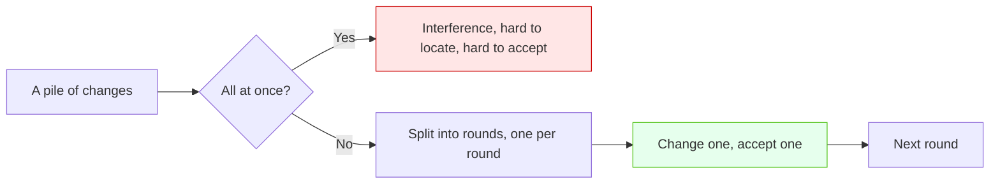
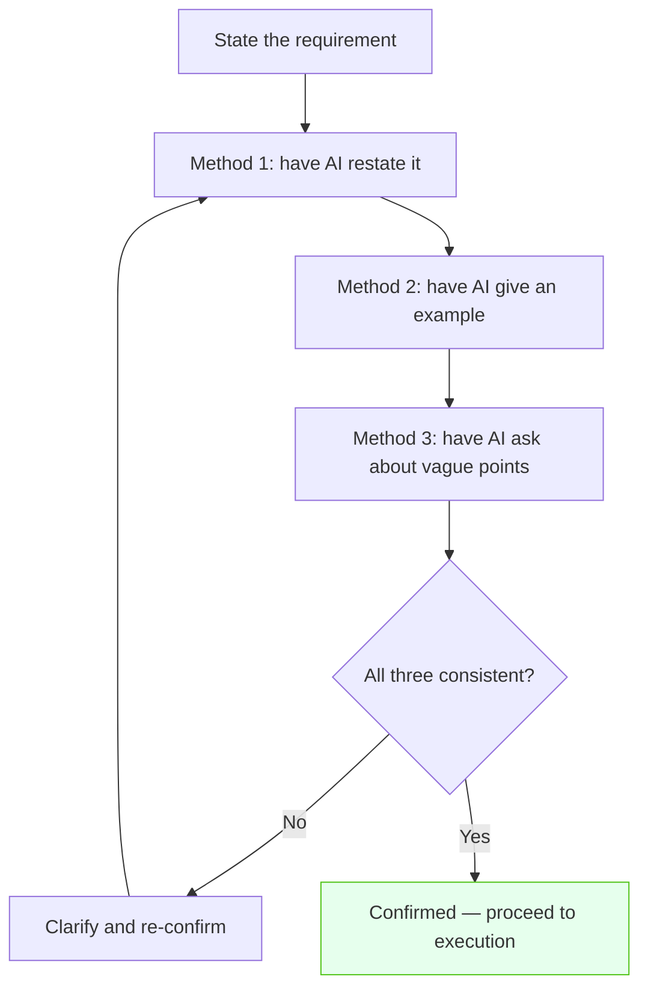
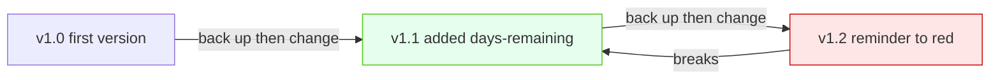

# Chapter 17: How to Have AI Change Things Step by Step Instead of All at Once

> This is the final chapter of Part IV, and the one that wires all the previous methods together. It comes down to one sentence: don't dump a pile of changes on AI at once — instead, **one at a time, analyze before acting, accept each step, and log everything.** Slow is fast.

## What You'll Learn in This Chapter

- Why changing several things at once inevitably goes wrong
- The three-step workflow: analyze, then plan, then execute
- How to confirm AI truly understood your meaning
- How to accept changes in stages and avoid over-modification
- How to keep a modification log and manage versions

### Opening: Five Changes at Once, Five Changes Wrong

Lin Xiaoman had a backlog of things she wanted to change, and one day she sent them all to AI at once:

**You:** Please change the software: 1) add a "days remaining" column to the list; 2) change the reminder to red; 3) make buttons bigger; 4) add search by customer; 5) fix the statistics numbers — they look wrong. Tell me when all five are done.

**AI:** Done. All five changes are complete.

Lin Xiaoman looks: item 1's new column is in the wrong place; item 2's red landed on a different page; item 3's buttons are absurdly huge; item 4's search returns wrong results; item 5's statistics numbers — still wrong.

Frustrated, she thinks: "All five changed, all five wrong. Now I have to explain everything one by one again."

The problem was "five at once." AI juggling too many tasks drops balls, and since all five were done before she looked, she couldn't tell which change broke what or how the changes affected each other.

The right approach: **split the five problems into five rounds, one per round, checking each as you go.** Then every round is crystal clear, and any problem is immediately traceable.

This chapter teaches you that "step-by-step modification" workflow. It's the final assembly of everything in Part IV.

## 17.1 One Problem at a Time

Rule one: **have AI change only one problem at a time.**

Why? Three reasons:

1. **Easy to locate.** Only one thing changed, so any problem must be there — no needle-in-a-haystack.
2. **Easy to accept.** One at a time, you can immediately confirm "did this get fixed?" — no tangled mess.
3. **Fewer conflicts.** Multiple simultaneous changes can interact (changing A also moves B); splitting them avoids collisions.

**❌ The wrong way to ask**

**You:** Change the list: add a "days remaining" column, make the reminder red, and make buttons bigger. Do it all.

**AI:** Done, all complete. (Result: three changes tangled together — red on the wrong page, ugly oversized buttons, and no way to tell which change caused which problem.)

**✅ The right way to ask**

**You:** This time, only one thing: on the flower order list page, add a "days remaining" column showing how many days until each order's delivery. Add only this column; change nothing else. When done, tell me — I'll confirm before we move to the next thing.

**AI:** OK, only adding the "days remaining" column on the flower order list page, nothing else. Please accept.

(After you confirm, you send the second thing — reminder to red; confirm; then the third — bigger buttons.)

One at a time looks slow but is actually fastest — because you don't have to redo anything.



## 17.2 Analyze First, Then Change

Rule two: **for any change, have AI analyze first; after you confirm the analysis, then act.** (Chapters 13 and 16 touched on this; here it becomes a fixed process.)

In the analysis phase, have AI answer three questions:

1. **What's the current state?** (how the thing it's about to change currently works)
2. **What will it affect?** (will other features or data be dragged along)
3. **How does it plan to change it?** (what approach it will take)

**You:** I want to add a "days remaining" column to the flower order list. Don't rush — first analyze:
1. Where does the list data currently come from?
2. Will adding this column affect other pages (e.g. statistics, detail)?
3. How do you plan to do it? Describe the approach only — don't change code.
I'll act after I confirm.

**AI:** Analysis: 1) list data comes from the order table, which includes the delivery date field; 2) adding a column is a display calculation, no data changes, so statistics and detail pages are unaffected; 3) approach: compute days remaining from the delivery date at list render time and show it in a new column, without changing the data structure. Waiting for your confirmation.

The value of this step: **it lets you hit the brakes before anything breaks.** If AI's plan includes "I'll also tweak the order table," you can stop it immediately.

## 17.3 Give a Plan First, Then Execute

After analysis, go one step further: **have AI produce a clear "change plan," which you review and then green-light.**

The difference between analysis and plan: analysis answers "what will happen," the plan answers "specifically, in how many steps, changing what." The plan must be detailed enough for you to judge "will it overstep."

**You:** I accept the analysis. Now give me a concrete change plan, step by step:
1. What each step changes (which page, which element);
2. What is explicitly left untouched;
3. How to verify when done.
Only give the plan — don't execute. I'll act after reviewing it.

**AI:** Change plan:
Step 1: in the flower order list's display logic, add a "days remaining" calculation (delivery date minus today).
Step 2: add a column to the list table, headed "days remaining," placed after "delivery date."
Step 3: don't touch other columns, other pages, the data structure, or order data.
Verification: open the list page and check each order's days remaining is correct.
I'll execute after you confirm the plan.

When reviewing a plan, watch two things: **overstepping** (touching what it shouldn't) and **omissions** (missing what it should do). If something's off, say directly "change step 2's header position to…" and have it revise the plan.

## 17.4 How to Confirm AI Understood Your Meaning

Sometimes you think you were clear, AI replies "OK," and the result is still wrong. Usually the problem is: **it understood the words, not the intent.**

How to catch this early? Three verification methods:

**Method 1: Restatement** — have AI repeat your requirement in its own words. If it repeats it correctly, it really understood.

**You:** Don't act yet. Please restate my requirement in your own words: what page, what to add, what to change it into, what must not change. Restate it, then wait for my confirmation.

**AI:** My understanding is: you want to add a "days remaining" column to the flower order list page, showing how many days until each order's delivery; only this column, with no changes to other columns, other pages, the data structure, or order data. Correct?

If the restatement is off, you can correct it before any code is touched.

**Method 2: Example** — have AI illustrate with a concrete example of what it will do.

**You:** Before acting, give an example: if an order's delivery date is May 12 and today is May 10, what will the new "days remaining" column show?

**AI:** It will show "2 days left."

**Method 3: Questions** — have AI ask you back, surfacing the vague points.

**You:** About this requirement, what's still unclear to you? If anything, ask me first, then act once it's clear.

**AI:** One question: if the delivery date is today, should "days remaining" show "0 days left" or "delivers today"?

(You see — AI surfaced an edge case you hadn't thought of. That's the value of the questions method.)



## 17.5 Accept Changes in Stages

Rule five: **don't wait until everything is changed to look — accept each small step as it completes.**

Acceptance means checking "did this step hit this step's goal?" Only when it passes do you let AI proceed; if it fails, fix it on the spot.

**You:** The first small step (adding the "days remaining" calculation and column) is done. I'm accepting it now: please open the list and check three orders' days remaining. Report the result — don't do the next step yet.

**AI:** Checked: order A, delivery May 12, shows "2 days left"; order B, delivery May 10, shows "delivers today"; order C, delivery May 9, shows "overdue." As expected. Waiting for your confirmation before the next step.

(After you confirm, you say "now do the second thing: reminder to red.")

Benefits of staged acceptance:

- **Early detection.** Errors are caught the moment they appear, not accumulated.
- **Easy rollback.** If this step is wrong, you only undo this step — prior work stays.
- **Growing confidence.** Each confirmed step gives you more control over the software.

Use the checklists from Chapters 15 and 16 here: **for interface changes, go through the page checklist; for feature changes, try the core feature checklist.** Attach the right check to each step.

## 17.6 How to Avoid Over-Modification

Rule six: **explicitly require "minimal changes," and cut it when AI tries to do more.**

AI has a bad habit: when changing one thing, it likes to "helpfully" improve related things. You say "add a column," and it may also adjust column widths, change colors, and add sorting. You wanted one column; it changed a bunch.

How to prevent it? Put a "minimal change" principle in the instruction, and review the plan.

**You:** Please follow the minimal-change principle: make only the changes necessary to fulfill my request; don't "helpfully" optimize, refactor, or "improve" anything I didn't explicitly ask for. If your plan contains steps beyond my request, list them separately with a reason, and let me decide whether to keep them.

**AI:** Understood. I'll make only necessary changes. My plan had one item beyond your request — "I planned to add sorting to the list" — I'll flag it separately for your decision; by default I won't do it.

When reviewing the plan, be alert to any "also," "optimize," or "improve" — ask "is this necessary? If not, remove it."

**You:** "Add sorting" isn't what I asked for — remove it. Keep only the "days remaining" column.

**AI:** Done, the sorting step is removed; the plan is now only adding the "days remaining" column.

## 17.7 How to Keep a Modification Log

Rule seven: **log every modification. Keep a "modification log."**

A modification log is a ledger: when, why, what changed, and the result. It has three big uses:

1. **Traceability.** When something breaks, you can find "which change broke it."
2. **Handover.** When starting a new chat or switching AI, paste the log and the newcomer instantly knows the full story — exactly solving the "AI forgets" problem from Chapter 13.
3. **Review.** Look back and see how the software grew into what it is.

The log doesn't need to be fancy — one table is enough:

| Date | Request | What changed | Acceptance | Notes |
|---|---|---|---|---|
| 5/1 | Add days-remaining column | New column on list page | Passed | No data structure change |
| 5/2 | Reminder to red | Reminder text red & bold on list page | Passed | This page only |
| 5/3 | Add customer search | New search button and results area | Passed | Read-only, no data change |

Have AI maintain it for you — easiest:

**You:** From now on, please maintain a "modification log" — after each change, append a row with: date, this request, what changed, acceptance result, and anything worth noting (e.g. no-go zones). Use a table. When I open a new chat, I'll paste this log, and you should read it to understand the software's history. Set up the table first; I'll have you fill the first row after our first change.

**AI:** OK, the modification log table is set up. After each change I'll append a row with date, request, change, acceptance result, and notes. When you paste the log, I'll read it before working.

That log is your "software diary" — and your weapon against AI's forgetfulness.

## 17.8 How to Manage Versions

Rule eight, the last one: **back up before changing, and give each stable state a version number.**

Version management sounds technical, but the idea is simple — like saving a copy of your document before editing, so you can recover if you mess up.

The simplest approach:

1. **Back up before changing.** Before acting, have AI save a copy of the current version ("back up the current version").
2. **Give version numbers.** Each time a stable change completes, assign a number: v1.0 (first usable version), v1.1 (added days-remaining column), v1.2 (reminder to red)…
3. **Roll back if broken.** If a new version has problems, return to the last good version and try again.

**You:** Before acting, please back up the current version as v1.1 (the one with the days-remaining column). Once backed up, start this change (reminder to red). If it fails acceptance, I want to be able to roll back to v1.1.

**AI:** OK, the current version is backed up as v1.1. Starting the change now. If acceptance fails, I can restore v1.1 for you.



Version management gives you **the right to change your mind**. With it, you can modify with confidence: worst case, roll back to the previous version — no disaster.

Combine the modification log in 17.7 with the version numbers in 17.8, and you have a complete "change archive": every change is recorded, every stable point is backed up. Then, no matter how AI "forgets," you can keep the software under control with that archive.

Part IV ends here. From Chapter 13's "why changing is harder than building" to Chapter 17's "how to change step by step, log it, and roll back," you've mastered a whole method for **making software changeable again and again — and better each time**. That's exactly the ability most beginners lack, and the most valuable one.

## Common Pitfalls

- **Pitfall: Requesting a big pile of changes at once.** Why: AI drops balls, changes interfere, and problems are hard to locate and accept. What to do: split into rounds, one at a time, accept one before the next.
- **Pitfall: Letting AI act without confirmation.** Why: you discover the misunderstanding after it's done, wasting the change and requiring rework. What to do: analyze, then give a plan, and use restatement/examples to confirm understanding before executing.
- **Pitfall: Waiting until everything's done to accept.** Why: errors accumulate, you can't tell which step broke things, and rollback is hard. What to do: accept each small step as it completes; continue only when it passes.
- **Pitfall: Letting AI "helpfully optimize."** Why: it changes things you didn't ask for, making a mess. What to do: require "minimal change," and in the plan question any "also / optimize" — remove it if not necessary.
- **Pitfall: No way back when a change breaks things.** Why: without backups you must rebuild or keep piling changes onto a broken version. What to do: back up before changing, number stable versions, keep rollback possible, and manage the whole process with a modification log.

## Chapter Summary

- The core of step-by-step modification: one at a time, analyze before acting, accept each step, log everything, back up before changing.
- Change one problem at a time: easy to locate, easy to accept, fewer conflicts — looks slow, is actually fastest.
- Three-step workflow: analyze (what will happen) → plan (how) → execute; you confirm and green-light each step.
- Use "restate, example, questions" to confirm AI truly understood, catching misunderstandings before code is touched.
- Staged acceptance, minimal changes, a modification log, and version backups together form a complete "change archive" — so software gets better with each change and can always roll back.

## Practice Exercises

1. List the multiple things you've been meaning to change, split them into a one-at-a-time queue, and write the "analysis + plan + acceptance" three-step instruction for the first one.
2. Write an instruction using the "restatement method" that has AI repeat your requirement before acting; then use the "example method" to give it a concrete date and ask what it would show.
3. For one change to your flower shop helper, fill in a row of the "modification log" (date, request, what changed, acceptance result, notes).
4. Assign version numbers to your software: state the current version and what the next one will be called, and write a "back up first, roll back if broken" instruction.

## Copyable Instruction Templates

**Template 1: The three-step workflow for one change (analyze → plan → execute)**

```text
I want to make one change. Please follow three steps strictly — don't skip steps or change multiple problems at once:

The one thing I'm changing this time: [describe this single problem].

Step 1 (analyze only, no code changes):
1. What's the current state? 2. What other features and data will it affect? 3. How do you plan to change it?

Step 2 (give a plan only, no execution):
List step by step: what each step changes, what's explicitly untouched, and how to verify when done.

Step 3 (execute only after I confirm the plan and understanding):
Before acting, restate my requirement in your own words and give a concrete example of the result; wait for my confirmation before changing.

When done, self-check against the verification method in the plan and report each item. Reply in plain language.
```

**Template 2: Backup + modification log (throughout)**

```text
Before changing, please do two things first:

1. Backup: fully back up the current version as [version number, e.g. v1.1], and tell me when it's done. Only start this change after the backup.

2. Modification log: maintain a table logging every change with: date, request, what changed, acceptance result, and notes. After this change, append one row.

Also:
- Follow the minimal-change principle — only do what I explicitly asked; don't "helpfully" optimize anything else;
- If this change fails acceptance, I want to be able to roll back to the backed-up [version number].

Please confirm the backup and the log table are ready before you start. Reply in plain language.
```
