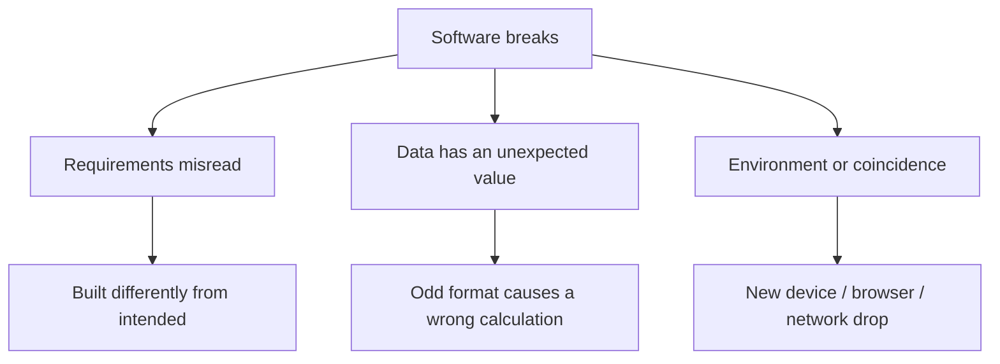

# Chapter 18: What to Do When Software Breaks

> When software breaks, the problem isn't the break — it's saying "it's broken" and leaving AI with nothing to work from. This chapter turns one vague "it's broken" into clues AI can understand and act on.

## What You'll Learn in This Chapter

- Why software breaks — and why that's normal, not your failure
- Why you can debug without knowing code — you describe the symptoms, AI diagnoses and fixes
- How to describe a bug: what you expected vs. what actually happened
- How to provide the three kinds of evidence: a screenshot, steps, and an error log
- How to have AI diagnose first and fix second, instead of changing things at random


*Figure: Debugging together with AI*

### Opening: The Software Is "Broken," but AI Has No Idea Where

Lin Xiaoman had been using her flower shop helper for two weeks. One day her assistant whispered, "Boss, the date looks wrong. I entered May 10, but the list shows June 10. And the Save button — I clicked it and nothing happened."

Lin Xiaoman panicked. She opened the chat and typed the first thing that came to mind:

**You:** My software is broken. Please fix it for me!

**AI:** Sure. What exactly is the problem? Which page? What did you click? What appeared on screen?

**You:** Like… it's broken. It doesn't work. Just take a look.

**AI:** I can't see your screen from here. Could you describe which page you were on, what you did, and what showed up? A screenshot would help too.

They went back and forth like this a dozen times. AI kept asking questions, Lin Xiaoman got more and more flustered, and the problem didn't move an inch.

Then she tried a different approach. She took a full screenshot of the page where the error appeared, wrote down which steps she'd clicked, and copied the red error line from the console verbatim. This time AI found the cause in three sentences: the month was being incremented by one during date conversion, and that same error was freezing the Save button so it never ran.

What changed? **AI didn't get smarter — Lin Xiaoman gave it the right clues.** This chapter teaches you, step by step, how to do exactly that.

## 18.1 Why Software Breaks

First, fix one misconception: **software breaking is completely normal.**

Even the most expensive software, built by the best teams, has bugs (a "bug" is just a flaw or mistake). It's not that you did something wrong or that AI is unreliable — software is simply complex.

Think of software as a machine assembled from thousands of tiny parts (code, data, settings). If even one part doesn't line up, the machine can start making strange noises. There are three common causes of problems:

- **Requirements weren't clear, so AI misread them.** You said "remind me when the date comes," meaning one day ahead; AI built same-day reminders. The software isn't broken — it's just not what you pictured.
- **Data contained an unexpected value.** Say you entered a date in a different format than the software expected, and it calculated wrong. Lin Xiaoman's "May turned into June" is this kind.
- **Environment or coincidence.** You switched computers or browsers, or the network blipped, and a feature that worked fine starts acting up.



Remember this: **breaking isn't an accident — it's part of building software.** The difference between an expert and a beginner isn't whether things break; it's how fast they can find and fix the problem. The rest of this chapter is that skill.

## 18.2 Can You Debug Without Knowing Code

Yes — and in fact you're the key person.

Here's an analogy. When you go to the doctor, do you need to understand medicine? No. You just tell the doctor three things: **where it hurts, when it started, and what you were doing at the time.** The doctor uses that to diagnose and decides how to treat you.

Debugging works exactly the same way:

| Seeing a doctor | Debugging with AI |
|---|---|
| You say "where it hurts, when it started" | You say "which page, what you did, what appeared" |
| The doctor runs tests, reads lab results | AI reads screenshots and logs, analyzes the cause |
| The doctor prescribes medicine and treats you | AI changes the code and fixes the problem |
| You follow up: better or not? | You try again and tell AI whether it's fixed |

Notice something: **diagnosing and doing are AI's job, but describing the symptoms is yours alone — because AI can't see your screen or watch what you do.**

So stop saying "I don't know code, I can't help." By giving an accurate description of what you saw, you've already done the biggest part. The rest of this chapter is all about how.

## 18.3 How to Describe an Error

Step one: replace "it's broken" with a comparison of "expected" and "actual." Here's a very useful formula:

> **I expected** …, **but actually** …, **the difference is** …

Compare these two versions:

**Weak version:**
> "The date thing is broken."

**Strong version:**
> "On the 'New Order' page I entered a delivery date of 2024-05-10. After saving, that row in the list shows 2024-06-10 — the month is one higher. I expected it to show May 10."

The second version tells AI everything: which page (New Order), which field (delivery date), the input (2024-05-10), the output (2024-06-10), and the difference (month off by one). With complete clues, it can head straight for "date conversion." Here's a real back-and-forth:

**You:** I got an error when saving a customer's flower order.

**AI:** Okay. Please tell me: 1) Which page did you click Save on? 2) What exact text appeared on screen? 3) Does every order fail, or only this one?

**You:** On the "New Order" page. After clicking Save, a red line popped up saying "invalid date." I tried three orders — two saved fine, only the one with February 30 failed.

**AI:** Got it, and that detail matters. "February 30" isn't a real date, so the software didn't handle that input well. I won't touch the code yet — my guess is missing date validation, because that's the only input that errors. Shall I confirm before changing anything?

See what happened? **You just described what you saw truthfully, and AI closed in on the truth step by step.** The more specific your description, the fewer rounds it takes.

## 18.4 How to Provide a Useful Screenshot

There's a saying: "A picture is worth a thousand words." Sending AI a screenshot gives it eyes on your screen. But screenshots have a technique.

**How to take a useful one:**

1. **Capture the whole window, not just a corner.** AI needs context — which page it is, what's around, which button the error sits next to.
2. **Make sure the error text and the problem area are in frame.** The red text, the button state, the wrongly displayed data — all of it must be visible.
3. **Mark the key spot if you can.** If your tool lets you draw, circle the error in red so AI sees the focus at a glance.
4. **Mind privacy.** Blur customer phone numbers and real names before sending.

| Unhelpful screenshot | Helpful screenshot |
|---|---|
| Only a single number, "06-10" | The whole list page, showing which row and column |
| Cropped so the error text is cut off | The complete red error and Save button visible |
| Customer phone number fully visible | Phone number blurred, date and error left clear |

One more reminder: send a screenshot if you can, **but never send a picture with no words.** The picture shows AI the symptom; your words tell it what you expected. The two together are best.

## 18.5 How to Provide the Steps

A photo of the crime scene isn't enough — AI needs to know **how it happened**, so it can replay it and verify a fix. That's what the steps are for.

Write steps like a recipe, in order:

1. I opened 【which page】
2. I clicked 【which button】
3. I typed 【what】 into 【which field】
4. Then 【what appeared】 on screen

Here's Lin Xiaoman's version:

> 1. Opened the "New Order" page;
> 2. Typed "Auntie Wang" for name and 138****0000 for phone;
> 3. Picked 2024-05-10 for delivery date;
> 4. Clicked "Save";
> 5. The page jumped to the list, where the date showed 2024-06-10 (every single time).

That last line — "**every single time**" — matters. Some errors happen "occasionally," others "every time." Telling AI the frequency helps it judge the difficulty: every-time bugs are easiest to chase; occasional ones often come from devices, networks, or specific data. If you can say "I can reliably reproduce it from step 3," AI can follow that path and work much faster.

## 18.6 How to Provide the Error Log

Don't be scared by the word "log."

**A log is the software's built-in dashcam.** It quietly records what the software was doing; when something breaks, it usually contains one precise error message. You don't need to understand it — just know how to grab it and hand it over as-is.

The most common log lives in the browser's "console." Let me walk you through getting it, hand in hand:

1. On the page where the error happens, press **F12** on your keyboard (on some laptops, Fn + F12). A panel pops open.
2. At the top of that panel, find **Console** and click it.
3. Go back to the page and repeat the action (e.g., click Save again).
4. **Red text** may appear in the console — that's the error.
5. **Copy that red section verbatim, including a few lines below it**, and send it to AI.

Two key reminders:

- **Don't trim or translate it yourself.** You may think that gibberish is useless, but hidden in it are the line number and file name — gold for locating the bug. Copying the whole thing is safest.
- **Logs can contain private or internal info** — glance through before sending and blur phone numbers if needed.

If the software itself pops up an error window, that text is a log too — copy it verbatim as well.

## 18.7 How to Have AI Analyze the Problem

Now package everything from the earlier sections into a "bug report." A handy checklist:

- **One-line summary**: expected vs. actual
- **Steps**: 1, 2, 3, 4
- **Screenshot**: the full screen where it broke
- **Log**: the error copied verbatim from the console
- **Environment**: device, browser, is this the first time?

Here's a complete, high-quality conversation:

**You:** Help me debug. I'm giving you symptoms — steps — screenshot — log — environment.

Symptoms: On the "New Order" page saving an order, I expected the list to show 2024-05-10, but it shows 2024-06-10. Happens every time.

Steps: 1) Open "New Order"; 2) fill name and phone; 3) pick 2024-05-10 for delivery date; 4) click Save; 5) the list date is wrong.

Screenshot: [attached, full screen, date column circled in red]

Log: Console shows `Uncaught RangeError: month out of range at formatDate.js:12`

Environment: Windows PC, Chrome browser. Worked before; noticed it today for the first time.

**AI:** Got it — very complete. The log already points at line 12 of `formatDate.js`, reporting "month out of range." Combined with your "May shows as June" symptom, I strongly suspect the date formatter treats months as zero-based (0 = January), so May gets counted as June.

A problem stated this completely can usually be located right away. The more orderly the clues you give, the less AI has to guess — and the fewer mistakes it makes.

## 18.8 How to Have AI Diagnose Before It Fixes

This last section is a habit that saves you a lot of grief: **make AI explain the cause before it changes anything.**

Many people panic and say "just fix it already," so AI starts editing immediately. Then either it didn't fix it, or it fixed A and broke B — because you never had a chance to judge whether the change was right.

Add one sentence: "**Don't change the code yet.**"

**You:** Don't modify any code yet. Based on what I gave you, tell me: 1) what you think the cause is, 2) your evidence, and 3) how you plan to fix it. Only act after I confirm.

**AI:** Diagnosis: 1) Cause — the date-formatting function treats the month as zero-based, making the displayed month one higher than reality; 2) Evidence — the error is at formatDate.js:12, and all your dates are "one month ahead"; 3) Fix — add 1 back when formatting, changing only that one function and no other page. Please confirm.

**You:** Sounds right. Go ahead with that, and tell me what you changed.

**AI:** Changed the month handling in formatDate.js — that single spot only. Please repeat your steps and check whether the date is back to 2024-05-10.

Why go to this trouble? Three reasons:

1. **You can check its work.** If AI's judgment is wrong, you stop it before it touches anything, preventing a mess.
2. **You learn.** After seeing its reasoning a few times, you'll slowly understand how software "thinks."
3. **It fixes more accurately.** Separating "thinking it through" from "doing it" produces fewer errors than charging in.

This is the "analyze first, act second" idea from Part IV applied to debugging (covered in Chapter 17).

## Common Pitfalls

- **Pitfall: Saying only "it's broken," "it doesn't work."** Why: AI can't see your screen, and those words carry zero usable information, so it can only keep asking. What to do: use the "expected vs. actual" formula, then add a screenshot and steps.
- **Pitfall: Describing the first symptom but not how to reproduce it.** Why: AI can't reach the error on its own, so it can't verify a fix. What to do: write ordered steps 1, 2, 3, 4 and say "every time" or "occasionally."
- **Pitfall: Trimming or translating the error log yourself.** Why: the line numbers and file names are the key clues, and the "gibberish" you delete is often the most useful part. What to do: copy the whole thing verbatim; blur only private data.
- **Pitfall: Panicking and saying "just fix it," without asking AI to explain first.** Why: AI may change the wrong thing and break something else without you knowing. What to do: say "don't change code — tell me the cause and your evidence first," then confirm.
- **Pitfall: Reporting several problems at once.** Why: tangled problems make it impossible to tell what got fixed and what's new. What to do: report one problem at a time; fix and verify one before moving on.

## Chapter Summary

- Software breaking is normal, not your failure; debugging is part of building software.
- You don't need to know code — you describe the symptom accurately, AI diagnoses and acts, just like visiting a doctor.
- Use the "expected vs. actual" formula for errors; the more specific, the fewer rounds.
- Three kinds of evidence matter: a full-window screenshot (with the error), reproducible steps, and a verbatim log.
- Build the habit of "diagnose first, fix second": have AI state the cause and evidence, confirm, then let it change — preventing a growing mess.

## Practice Exercises

1. Take a small software problem you recently hit (it doesn't have to be your own software). Write one sentence using the formula "I expected … but actually … the difference is …" See whether it's clearer than your original description.
2. Open your browser, press F12 to find the Console, visit any web page, and see whether any red errors appear. Practice copying one verbatim — get familiar with the motion so you don't freeze when a real error shows up.
3. Take one known small flaw in the software you're building and organize it into a bug report using "symptom — steps — screenshot — log — environment." Send it to AI and see whether it can locate the issue in one go.
4. Compare two instructions for the same problem: once say "just fix it," and once say "diagnose first, don't touch anything." Notice the difference in AI's two answers.

## Copyable Instruction Templates

**Template 1: Full bug report (give all the clues at once)**

```text
Help me debug an issue. I'm giving you symptoms — steps — screenshot — log — environment:

[SYMPTOMS] I expected …, but actually …, the difference is …
[STEPS] 1) … 2) … 3) … 4) … (every time / occasionally)
[SCREENSHOT] (see attachment, full screen, key area circled)
[LOG] (error copied verbatim from Console, nothing trimmed)
[ENVIRONMENT] (device, browser, whether this is the first time)

Please don't change any code yet. Based on your judgment, tell me:
1) the most likely cause, 2) your evidence, 3) how you plan to fix it.
I'll confirm before you act.
```

**Template 2: Have AI diagnose, then make the smallest fix**

```text
For the problem we just discussed, proceed like this:
1. First explain, in plain language, where the problem is and why;
2. Give the smallest fix — change only what's necessary, nothing else;
3. Before changing anything, list the files and locations you'll touch and wait for my confirmation;
4. After the change, tell me what you changed and give me a "retry steps" list so I can verify the fix myself.
```
