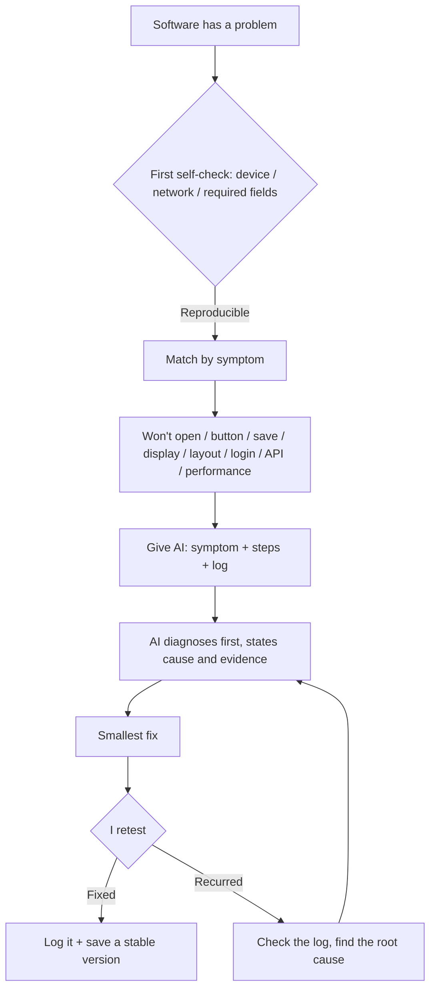

# Chapter 19: How to Solve Common Software Problems

> Software problems look endless, but they really come in just a handful of types. This chapter gives you a "triage chart": recognize which type of problem you have, follow the corresponding routine, then direct AI with one clear sentence.

## What You'll Learn in This Chapter

- The common problem categories: pages that won't open, dead buttons, failed saves, and more
- The investigation routine for each type, plus wording you can copy straight to AI
- How to tell "the software is broken" from "I used it wrong"
- Why AI sometimes fixes the same problem over and over, making things worse
- How to break the "fix it again" loop with a problem log, retesting, and a stable version

### Opening: In One Week, Every Ailment Showed Up

Once the flower shop helper was in real use, Lin Xiaoman started a little notebook for "what went wrong today." In a single week it filled a page:

- Monday: the page opened to a blank screen.
- Tuesday: the "New Order" button did nothing when clicked.
- Wednesday: a filled-in order wouldn't save.
- Thursday: the amount in the list showed the wrong number.
- Friday: on the phone, the page was squished into a mess.
- Saturday: the new assistant couldn't log in.
- Sunday: the software got slower and slower the more it was used.

"Did my software catch a cold?" she laughed.

She dumped all of it on AI at once, and AI got tangled too — fixing one thing broke another. Then she got smart: **handle one problem at a time, and first decide which type it is.** She noticed different types need completely different investigations — a blank page needs you to check for errors, a dead button needs you to check whether something's blocking it, a failed save needs you to check required fields.

This chapter teaches those routines one by one. You don't need to memorize code — just learn to match the type and ask AI the right way.

Keep this "triage chart" in mind — when something goes wrong, start at the top-left and follow it down:



## 19.1 Page Won't Open

**Symptom**: You open the software and get a blank page, endless spinning, or "can't be reached," "404," or "server error."

Analogy: a page that won't open is like ringing a doorbell with no answer. The reasons are simple: you went to the wrong door (wrong address), nobody's home (server not running), the bell is broken (network issue), or the house is under renovation (the program errored).

Three checks:

1. **First rule out "outside the door" problems**: try another device or switch networks (Wi-Fi to phone hotspot). If another computer opens it fine, it's your device or network — not the software.
2. **Check the address**: did a character get lost when you copied the URL?
3. **Press F12 and look for red errors in the Console** (Chapter 18). A blank page almost always leaves a clue there.

What to say to AI:

**You:** The software opens to a blank page. I switched to a phone hotspot and still nothing, and the address is correct. The Console error is `[paste verbatim]`. Is this a front-end problem or a server problem?

## 19.2 Button Doesn't Respond

**Symptom**: You click a button and nothing happens — like pressing a broken light switch.

Analogy: a button is a light switch. If the light doesn't come on, either the switch isn't wired up (the button has no function attached), something is blocking your finger (a transparent layer over it), or it takes a moment to light up (it's processing).

Three checks:

1. **See whether the button is grayed out (disabled).** Many buttons gray out until required fields are filled. That's not broken — it's waiting for you.
2. **See whether anything changes after clicking**: a red error? Spinning? A message?
3. **Refresh or try another browser** to rule out a temporary freeze.

| Symptom | Likely cause | What to ask AI |
|---|---|---|
| Button is gray | Required fields missing / conditions unmet | "Why is Save grayed out? What makes it active?" |
| Red error after clicking | The function attached to the button has a bug | "Save button throws this error [log] — locate it." |
| Absolutely nothing happens | No function attached / blocked by an overlay | "Clicking does nothing and Console shows no error — investigate." |

## 19.3 Data Won't Save

**Symptom**: You fill in a form and click Save, but it fails — or the data is gone afterward.

Analogy: saving data is like filing a document in a cabinet. It won't go in if the form isn't complete (missing required fields), the cabinet is locked (no permission), or the format is wrong (validation or field-length limits).

Three checks:

1. **Check required fields**: any blank fields marked with an asterisk (*)?
2. **Check input format**: dates, phone numbers, amounts — are they in the expected format? Lin Xiaoman's "February 30 won't save" was an impossible date.
3. **Read the save-time message**: software often tells you which field is wrong — the text is just small and easy to miss.

What to say to AI:

**You:** Saving an order fails. I filled in name, phone, and date 2024-02-30; clicking Save shows `[message]`, and Console reports `[log]`. Which field is the problem?

**AI:** The problem is that 2024-02-30 doesn't exist (February has no 30th), so validation rejected it. The save feature isn't broken — what's missing is a friendly warning. I can: 1) add date validation so an impossible date gets a clear message, or 2) translate the raw error into plain language. Which do you want?

## 19.4 Data Displays Incorrectly

**Symptom**: The data is saved, but displayed wrong — an amount becomes a different number, a date is off by a day, a name loses a character, or Chinese text turns to gibberish.

Analogy: you mailed a letter and the recipient read it wrong. The letter wasn't lost (data saved correctly); the problem is in the "reading it out" step — pulling it from storage and converting it for display.

Three checks:

1. **First confirm the stored data is right**: reopen the record and check the original input. If reopening looks right and only the display is wrong, it's a display-stage problem.
2. **Look for a pattern**: is everything wrong, or only specific values? All dates "one month ahead" points to a conversion rule; only one record wrong means that record is special.
3. **Watch calculated fields** like amounts and dates — they're most prone to unit conversions, time zones, and format changes.

The "expected vs. actual" description from Chapter 18 works best here: **"I saved X, it shows Y, everything else is normal."** The clearer the pattern, the faster AI finds it.

## 19.5 Page Layout Is Messy

**Symptom**: Text overlaps, buttons fall off-screen, everything crams together on a phone, or an image bursts out of its frame.

Analogy: this is like arranging furniture from a floor plan and ending up with the sofa on the coffee table. Everything's there — only the **positions and sizes** are wrong. In software this is called a "layout" problem, and it mostly relates to screen size.

Three checks:

1. **Confirm which devices are affected**: only on the phone, or on the computer too? Only in one browser?
2. **Try zooming**: press Ctrl + minus / plus to change browser zoom and see if it improves — that hints at a sizing issue.
3. **Say exactly what's messy and how**: e.g., "on the phone, the order list's text and price overlap, and the button is pushed off-screen."

What to say to AI:

**You:** The layout is messy. Fine on the computer; on the phone the order list's text and price overlap and the button is pushed off-screen. Please make it mobile-friendly, changing only the list page's layout.

**AI:** Got it. I'll add a responsive layout: on narrow screens, price and text go on separate lines and the button wraps. Only the list page's styles change — no data or functionality touched.

## 19.6 Login and Permission Problems

**Symptom**: Can't log in, correct password still rejected, new users can't register, or an assistant can see things they shouldn't.

Analogy: logging in is like swiping an access card. "Right card, won't open" could mean the card got demagnetized (account state problem) or the reader is broken (login function error). Permissions are about "which card opens which room" — an assistant's card shouldn't open the boss's accounting room.

Three checks:

1. **Separate "can't log in" from "wrong permissions"**: two completely different problems — describe one at a time.
2. **State the exact message**: "wrong password," "account not found," or simply no response.
3. **For permission issues, say "who, and what they shouldn't see"**: e.g., "the assistant account can see cost prices but shouldn't" — that's a security issue; fix it first.

Security note: if you find a permission hole (a regular user seeing admin content), **don't wait — have AI fix it immediately** and temporarily disable the affected entry point.

## 19.7 API Call Fails

**Symptom**: A feature that needs "data from the internet" fails — a map won't load, a text message won't send, a payment won't go through.

First, what's an API? **An API (an "interface") is like a waiter between pieces of software**: when your software wants data from another service (weather, maps, payments), it asks through the API. If the waiter doesn't deliver, that feature won't work.

Analogy: an API failure is like a food delivery that never arrived. The address was wrong (wrong endpoint), the key expired (expired token/key), the restaurant closed (the provider is down), or you ordered too much and got throttled (rate limit exceeded).

Three checks:

1. **Read the status code**: 404 = "address not found," 401/403 = "no permission / bad key," 500 = "their server errored," 429 = "too many calls." Ask AI to explain it.
2. **Check the key**: many APIs need a key (a secret string); an expired or mistyped one causes failure.
3. **Confirm whether it's the provider's issue**: try again later or check the provider's status page.

What to say to AI: **"Calling the [X] API fails with error [status code and raw text]. My key was recently set up. Please judge the cause and give me troubleshooting steps."**

## 19.8 Software Runs Slowly

**Symptom**: It takes forever to open, a click spins for ages, or it freezes once there's a lot of data.

Analogy: slow software is like a room stuffed with too much stuff — finding one thing means digging through everything. Usual causes: too much stuff (all the data loaded at once, no pagination), pointless trips (repeated requests), or things put back in the wrong place (missing indexes, repeated calculations).

Three checks:

1. **Say exactly where it's slow**: opening, a specific action, or only when data grows. "Slow from the start" and "slow after 100 entries" have different causes.
2. **Consider data volume**: try with less data to see whether it's only slow when there's a lot.
3. **Have AI find the bottleneck**: don't just say "optimize it" — make it identify the single slowest spot first.

What to say to AI:

**You:** The software got slow. It's fine with little data, but with over 100 orders the list takes 5 seconds to open. Don't change code yet — find the most likely bottleneck and your evidence, then give me an optimization plan.

**AI:** Initial judgment: the list page loads every order at once with no pagination, so it slows as data grows. Evidence: "fine with little data, slow only with lots." Suggestion: add pagination (20 per page) — small change, big effect. I'll act after you confirm.

## 19.9 How to Stop AI from Fixing the Same Problem Over and Over

This is the biggest headache: "We just fixed this — why is it broken again?" AI can be like a forgetful repairman, patching the same leak three times. Reasons:

- **Treating symptoms, not the root cause**: the visible error is covered up, but the source remains.
- **Fixing A, breaking B**: this change re-breaks something fixed earlier.
- **Lost context**: after a long chat, AI "forgets" what was fixed and applies the old approach again.

Four ways to break the loop:

1. **Keep a problem log.** A table with: problem, symptom, cause, fix, date. Next time it recurs, check the log instead of starting from zero. This is also AI's "memory."

| Date | Problem | Root cause | Fix | Retested? |
|---|---|---|---|---|
| 3/3 | Date off by one month | Zero-based month | +1 in formatDate | Yes |
| 3/5 | Save failed | Feb 30 doesn't exist | Added date validation | Yes |

2. **Require AI to write the "root cause" for every fix.** No "it's fixed" without a why. Without a root cause, there was no diagnosis (Section 18.8).
3. **Always retest after a fix.** Have AI give "retry steps," then do them yourself using Chapter 20's methods — confirm it's really fixed and didn't create new problems.
4. **Save stable versions + set rules.** Whenever things are stable, save a backup (covered in Chapter 21) and give AI a "development rules" list to read before every change. Even if it "forgets," the rules constrain it.

What to say to AI:

**You:** We fixed this once (see log 3/3), but it recurred. Read the log first, figure out why last time's fix didn't solve it, find the true root cause, then propose a change. Also tell me whether this change will affect features we already fixed.

**AI:** Checked the log — last time we only changed the display-time formatting, not the data entry. The root cause should be that the wrong month was stored at write time. This time I'll fix the write side, list affected pages, and give you a retest checklist.

## Common Pitfalls

- **Pitfall: Reporting and fixing several problems at once.** Why: you fix one and break another; cause and effect get tangled. What to do: one problem at a time — fix and verify one before moving on.
- **Pitfall: Treating "I used it wrong" as "the software is broken."** Why: missing required fields or a mistyped URL can't be fixed by changing software. What to do: run the first three self-checks in this chapter before asking AI to change anything.
- **Pitfall: Vague instructions like "optimize it" or "fix it."** Why: AI doesn't know what's slow or what's broken, so it changes things at random. What to do: say which step, under what condition, with what symptom — and ask it to diagnose first.
- **Pitfall: Glancing at an API error and seeing only "failed."** Why: the status code and raw text are the key to locating the issue. What to do: copy the full code and error text to AI for interpretation.
- **Pitfall: Never retesting or recording, so problems recur.** Why: with no log, you and AI both "lose memory." What to do: keep a problem log, write the root cause, retest, and save a stable version.

## Chapter Summary

- Common problems group into a handful of types: won't open, dead button, failed save, wrong display, messy layout, login/permissions, API failure, and slowness — each with its own routine.
- The general approach: rule out outside factors first, then look at the symptom and errors, then find a pattern — and use Chapter 18's "expected vs. actual" description.
- Self-check in everyday terms first (switch devices, check required fields, look for data patterns) before letting AI act — it saves a lot of wasted effort.
- An API is the "waiter" between pieces of software; on failure, focus on the status code, the key, and the provider's status.
- Four tools against repeated fixes: a problem log, requiring the root cause, retesting, and saving stable versions with rules for AI.

## Practice Exercises

1. Pick three of the eight problem types in this chapter and write one sentence for each describing "what is it like in everyday life" — in your own words, as if explaining to a friend who doesn't know computers.
2. Open your software and deliberately enter an impossible or wrongly formatted date (e.g., February 30). See what happens. Record the symptom and error and send it to AI to see how it diagnoses.
3. Using the table in 19.9, start your own problem log with three problems you've hit. Fill in the "root cause" column for each (write "to investigate" if you don't know yet).
4. Take a problem you previously fixed repeatedly and run it through the "diagnose first, write root cause, give retest steps" process. Compare it with "just let AI fix it."

## Copyable Instruction Templates

**Template 1: Triage by problem type**

```text
I have a problem. Please help me triage it by category:

[SYMPTOM] I expected …, but actually …, every time / occasionally
[ENVIRONMENT] device, browser, data volume
[ALREADY SELF-CHECKED] switched device/network: [result]; required fields: [result]; Console error: [pasted verbatim]

Please proceed as follows:
1. Classify it (won't open / button / save / display / layout / login-permissions / API / performance);
2. Don't change code yet — list the most likely causes and your evidence;
3. After I confirm, give the smallest fix plus a set of retest steps.
```

**Template 2: When a problem recurs — demand the root cause (break the fix-loop)**

```text
We fixed this once, but it came back. Handle it this way so it doesn't happen again:

1. First read our [PROBLEM LOG] and find the previous entry and fix for this issue;
2. Analyze why last time's fix didn't solve it — did we only treat the surface, or change the wrong place;
3. Find the true root cause (no temporary patches);
4. Give a fix and clearly state whether it will affect features we already fixed;
5. After changing, give me a retest checklist — I'll verify it myself.

[LOG ENTRIES] (paste the relevant rows)
[THIS SYMPTOM] (expected vs. actual + raw error text)
```
