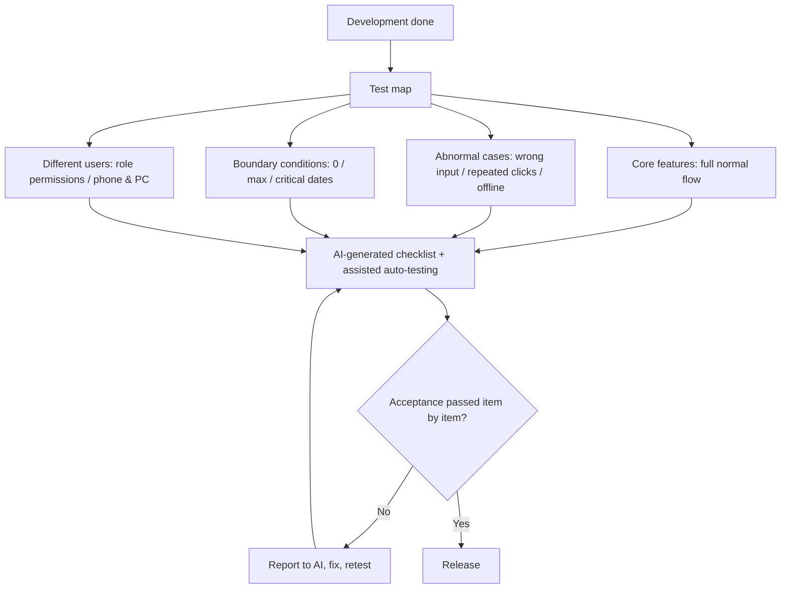

# Chapter 20: How to Test Your Software

> "AI says it's done" doesn't mean it's usable. This chapter teaches you to inspect software like a home inspector: test the core features first, then deliberately pick faults, try edge cases, switch users and devices — and finally have AI build the checklist and run the tests, catching problems before release.

## What You'll Learn in This Chapter

- Why "development done" is only half-finished — "tests passed" is what makes it done
- What testing really is — not fault-finding, but stepping into users' shoes ahead of them
- Four must-test situations: core features, abnormal cases, boundary conditions, and different users
- How to have AI generate a test checklist and even run tests automatically
- How to do a formal "acceptance" — sign off only when it passes

### Opening: AI Says "Done," and the Assistant Is Flabbergasted

Lin Xiaoman stared at the screen. AI had just said, "All features are complete."

Delighted, she handed the software to her assistants to try. Within ten minutes they were back:

- "Boss, I want to delete an order, but I can't find how."
- "I selected ten customers to send reminders, and only one went out."
- "I put the quantity as 0 and it still let me save."
- "On my phone, all the buttons are squished together."

Lin Xiaoman was stunned. "But AI said it was done!"

This is the trap almost every beginner falls into: **treating "development done" as "software done."** AI usually only guarantees that the code it wrote runs — not that it's pleasant to use or free of errors when you actually need it. The missing step in between is called **testing**.

This chapter explains testing hand in hand. You don't need technical knowledge — just be willing to "use it like a user," plus let AI help build the checklist and run tests, and you'll catch the vast majority of problems before release.

## 20.1 Why "Development Done" Isn't "Software Done"

Analogy: is a dish "done" when the chef sets it on the table? Not quite — you still need to see whether the customer likes the taste and the seasoning is right. Is a house "done" when the roof is sealed? Not quite — you still do an inspection: do the utilities work, do the doors close tightly?

Software is the same:

- **Development done** = the code is written; features "nominally" all exist.
- **Testing done** = you've used it yourself, deliberately abused it, and confirmed it works well in all kinds of situations.

AI is good at the first. It will confidently say "complete," but it hasn't actually placed a real flower order in your software. So when AI says "done," your reply should be "let's test it," not "let's publish it."

A harsh but useful truth: **the later a problem is found, the more it costs to fix.** Found during your own testing, it's a one-line change; found after a customer hits it, you have to fix it and apologize. Testing turns "the customer finds it for you" into "you find it for the customer."

## 20.2 What Is Software Testing

Don't be scared by the formal word. It's one sentence: **before using it, be a user yourself and try it from start to finish.**

You already do similar things every day: try on clothes before buying, taste a piece of fruit, press the buttons on a new phone. Software testing is those actions applied to software.

Testing isn't "fault-finding," still less "proving the software is broken." Its purpose is positive: **find problems early so the real users hit fewer of them.** A good testing mindset is "I want to break it" — because if you break it now, users won't break it later.

There are two broad approaches:

| Type | Mindset | Example |
|---|---|---|
| Using it as intended (normal scenarios) | Follow the designed path and check features are right | Add an order normally; see if it saves and displays |
| Using it against the grain (fault-finding) | Deliberately not follow the rules and see if it breaks | Leave required fields blank, enter 0, click Save ten times |

Test both. Testing only "as intended" misses a huge share of real-world problems.

Here's a "test map" of everything this chapter covers — follow it and you won't skip anything:



## 20.3 How to Test Core Features

A core feature is the software's reason for existing. The flower shop helper has two: **record orders** and **remind on the date**. Everything else is nice-to-have.

Always start with core features — they're what users use most and can least afford to get wrong. There's an 80/20 rule here: **users spend 80% of their time in 20% of your features.** Nail down that 20% first for the biggest payoff.

How? Walk a "standard route":

1. **Open the software** and go to the new-order page.
2. **Enter one real piece of data** (as if a real customer ordered).
3. **Save** and check for a success message.
4. **Return to the list** and see whether the data displays correctly.
5. **Reopen that record** and check the data truly persisted.
6. **Walk the whole flow**: add → save → view → reminder (if today is the reminder day).

If every step is right, the core feature passes. If any step sticks, stop and report it to AI using the Chapter 18–19 methods.

A practical tip: **test with real data, not fake "test123" stuff.** Real names, dates, and amounts expose format and display issues more easily — Lin Xiaoman's "date one month ahead" only showed up with a real date.

## 20.4 How to Test Abnormal Cases

Once the normal route works, it's time to "pick faults." Real users don't always follow your script; abnormal-case testing simulates exactly that.

Common fault-finding actions:

- **Leave required fields blank**: click Save with no name — what happens?
- **Enter wrong formats**: letters in the phone field, "Feb 30" as a date, a negative amount.
- **Repeat actions**: click Save five times — does it create five duplicate orders?
- **Interrupt midway**: refresh or close the browser halfway through — is data lost?
- **Go offline**: act with no network — does it freeze or spew unreadable errors?

Analogy: testing a suitcase means not just packing normal clothes but stuffing it full, pressing down hard, and dropping it — to see whether the zipper bursts. Software has to be "roughed up" to be trustworthy.

Good software, in abnormal situations, should **give a clear message** ("Please enter the customer name"), not crash or silently misbehave. If it crashes, record "what I did + what appeared" and hand it to AI.

## 20.5 How to Test Boundary Conditions

A boundary is a value "right at the limit." Bugs love to hide at boundaries.

Analogy: an elevator says "max 13 people." The ones to test aren't 7 (the middle is fine) but 12, 13, and 14 — **right on the line and just past it** — because that's where trouble happens.

Common boundary values in software:

| Scenario | Boundary values to test |
|---|---|
| Quantity | 0, 1, max value, max + 1 |
| Dates | Feb 28, leap-year Feb 29, Feb 30 (doesn't exist), Dec 31 |
| Text length | empty, one character, exactly the limit, over the limit |
| List | 0 records, exactly 1, a full page, across pages |

Lin Xiaoman's lesson was at a boundary: she entered "February 30," an impossible date, the software didn't stop her, and the save failed. A textbook boundary bug.

How to test? For every field with a number, date, or length, ask: "What's the smallest? What's the biggest? What happens just past the limit?" Try each. Having AI generate boundary cases is also efficient (see 20.7).

## 20.6 How to Test Different Users

The same software can behave very differently for different people. Analogy: the same outfit looks completely different on people of different heights and builds — so you need different people to "try it on."

Two kinds of "different":

**First, different roles.** In a flower shop there's the boss (admin) and the assistant (regular user):

- The boss sees cost prices and can change any order;
- The assistant only enters orders, shouldn't see cost prices, and shouldn't delete others' orders.

Test by logging in as each and confirming "what should be visible is, and what shouldn't be isn't." This matters for security, especially (covered in 19.6).

**Second, different environments.** The same page on:

- a computer and a phone;
- Chrome and Safari;
- a large screen and a small one.

can look different. Test at least on the devices you and your users will actually use. Lin Xiaoman's "buttons squished on the phone" was missed because she only tested on the computer.

## 20.7 How to Have AI Generate a Test Checklist

Thinking of cases yourself is easy to miss things — let AI list them. The key: **describe the feature clearly and explicitly require all four categories.**

A real conversation:

**You:** My flower shop helper has a "new order" feature: enter customer name, phone, flowers, quantity, delivery date, then click Save. Please make me a test checklist covering: core features, abnormal cases, boundary conditions, and different users/devices. Use a table with columns "what to test, how to operate, expected result."

**AI:** Sure. Here's the checklist for "new order":

| # | Category | What to test | How to operate | Expected result |
|---|---|---|---|---|
| 1 | Core | Normal save | Fill all fields, click Save | Success message; order appears in list |
| 2 | Core | Data persistence | Reopen the order | Info complete and consistent |
| 3 | Abnormal | Required field blank | Save with empty name | "Please enter name" shown; not saved |
| 4 | Abnormal | Wrong format | Enter date 2/30 | "Invalid date" message |
| 5 | Boundary | Quantity 0 | Enter 0 | "Quantity must be greater than 0" |
| 6 | Boundary | Overlong text | 200-character name | Truncated or "too long" message |
| 7 | User | Assistant permission | Log in as assistant | Can only add, not delete/edit |

**You:** Great. I hadn't thought of #5 — quantity 0 really is a hole. Please save this as "test-checklist.md" so we can run through it after every feature change.

See that? AI thought of a boundary case you missed. **Your job is to review the list, add your business's special cases, and test them one by one.**

## 20.8 How to Have AI Run Tests Automatically

Clicking through everything after every change gets tiring. Good news: some tests can be automated with AI's help.

First, what "automated testing" is. Analogy: like a washing machine's "auto wash" — you press once and it runs a whole cycle without you hovering. Automated testing means: prepare a set of "test actions," let the computer do the clicking, filling, and result-checking, and tell you which step failed.

How to use it with zero experience? Three paths, easy to advanced:

1. **Have AI give you a manual checklist and you follow it.** Lightest form — the list already says what to test, where to click, what to expect (covered in 20.7).
2. **Have AI write a test script and you run it.** Say "write a script that automatically tests the 'new order' feature and reports pass/fail for each item." You don't need to read the script — just follow AI's run steps and feed back the results (pass/fail).
3. **Use an AI development tool with built-in testing.** Some tools simulate clicks and compare screenshots; you say "test the login feature" and it runs it for you.

Whatever the path, the core idea is the same: **you define the expected result; AI executes and compares.** Automated testing is especially good at guarding "previously fixed bugs stay fixed" (regression testing) — run the old checklist after every change and instantly see whether you broke something.

## 20.9 How to Do Software Acceptance

Acceptance is the final gate before a formal release. Analogy: when a renovation is finished, you walk the place with an inspection sheet — utilities, walls, doors — and sign off only when everything passes. Software acceptance is the same: **confirm item by item against a list; release only when all pass.**

A simple acceptance checklist:

- [ ] All core features work (add, save, view, remind)
- [ ] Common abnormal cases give clear messages, no crashes
- [ ] Key boundaries (0, overlong, impossible dates) handled correctly
- [ ] Boss and assistant permissions correct
- [ ] Displays fine on phone and computer
- [ ] Data persists after reopening
- [ ] Previously fixed bugs retested and not recurring
- [ ] You know where to find logs and how to report a problem (Chapter 18)

For acceptance, ideally **have someone who wasn't involved in development try it** — e.g., really let an assistant use it for half a day. You're too familiar with it to notice things like "a new user can't find the button."

Once it passes, you can release (Part VI covers how). But remember: **acceptance isn't one-and-done.** After every big change, re-accept the affected parts. Have AI store this acceptance checklist in the project too, so every release follows it.

## Common Pitfalls

- **Pitfall: Publishing straight after AI says "done."** Why: AI only guarantees the code runs, not that it works well or doesn't crash. What to do: make "tests passed" your new definition of done — always use it yourself before release.
- **Pitfall: Testing only the normal flow, never picking faults.** Why: real users fill things in wrong, click repeatedly, and lose network — bug hotspots. What to do: specifically test abnormal and boundary cases (20.4, 20.5).
- **Pitfall: Testing with one data set and one device.** Why: fake data and a single device hide problems. What to do: use real data, and test on phone and computer, under different accounts.
- **Pitfall: Saying "test it" to AI without stating the expected result.** Why: without "expected," you can't judge pass or fail. What to do: write "what I expect to see" for every test.
- **Pitfall: Not retesting old features after a change.** Why: new changes often break old features. What to do: run the old checklist after every change (regression) and confirm no recurrence.

## Chapter Summary

- Development done is only half; testing done makes it complete, because AI guarantees code runs, not that it works well.
- Testing is "trying it as a user before using it," with two mindsets: using as intended (normal) and using against the grain (fault-finding).
- Test core features first (walk the full flow with real data), then abnormal cases, boundary conditions, and different users and devices.
- Boundary bugs hide at 0, max values, and critical dates; permissions and cross-device behavior are easy to miss.
- Have AI generate the checklist and assist with automated testing; before release, sign off item by item against an acceptance checklist — that's when it's truly done.

## Practice Exercises

1. Write down your software's single most core feature and walk the six-step "standard route" from 20.3 yourself, noting whether each step goes smoothly.
2. For that feature, list five "fault-finding" actions (e.g., blank required field, five rapid clicks), try each, and record what went wrong.
3. Find one number or date input in your software, list its boundary values (smallest, largest, just over, impossible), and try each.
4. Have AI generate a full test checklist for your software following 20.7 and save it as a file. From now on, run through it after every change.
5. Make an acceptance checklist following 20.9, then ask someone who's never used your software to try it for half a day and note where they get stuck.

## Copyable Instruction Templates

**Template 1: Have AI generate a four-category test checklist**

```text
Please generate a test checklist for my software feature.

[FEATURE DESCRIPTION] [In plain language: what the user enters, what they click, what should happen]
[COVER FOUR CATEGORIES] 1) Core features (normal flow); 2) Abnormal cases (wrong input, blanks, repeated clicks, offline); 3) Boundary conditions (0, max, critical dates, overlong); 4) Different users and devices (role permissions, phone/PC/browser).

Output a table with columns: #, category, what to test, how to operate, expected result.
Finally save the checklist as "test-checklist.md" so we can reuse it after every change.
```

**Template 2: Have AI assist with automated testing and guard old bugs**

```text
Please help me automate testing for "[feature name]".

1. First list test cases for this feature (with expected results);
2. Write a test script that executes these cases automatically, reporting pass/fail for each, and on failure gives the actual result and error;
3. Tell me how to run it (plain-language steps — I need to follow them by clicking);
4. The point of this script is regression testing — make sure previously fixed bugs stay fixed. I'll run it after every code change.
```
