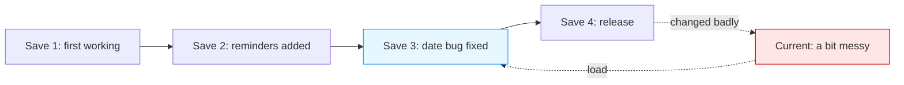

# Chapter 21: How to Stop AI from Making Your Software a Mess

> Software "grows" — it isn't finished all at once. But every change can plant a new problem, and over time things turn into a tangle. This chapter teaches you to save, back up, and roll back your project, and to give AI rules to follow, so your software gets better with each change instead of worse.

## What You'll Learn in This Chapter

- Why software gets messier as it's changed — changes accumulate
- What version control is — it's like "save points" in a game
- How to save stable versions and back up before making changes
- How to compare versions and "load" an earlier one when a change goes wrong
- How to give AI rules to follow and build a long-term maintenance routine

### Opening: Wanting Last Thursday's Version Back, but It's Gone

The flower shop helper had been changing for three months. Lin Xiaoman had added feature after feature, but she gradually felt the software was "off": the list was sometimes slow, reminders sometimes sent twice, and a page occasionally went blank.

Worse, she clearly remembered — **the version from last Thursday was great.** But she couldn't find it. Every time she asked AI to change something, it built on the previous version and overwrote the old one. When she asked AI to "restore last Thursday," it could only guess from memory, and the more it guessed, the worse it got.

"If only I'd kept a copy of every good version," she sighed.

That sentence is the heart of this chapter. **Software development isn't a one-way street moving only forward — it's more like writing a document: you can save, look back, and undo at any time.** This chapter teaches you that "keeping things under control" skill. It closes Part V and lays the foundation for using AI long-term.

## 21.1 The Accumulation Problem in Software Development

Software gets messier not because AI is stupid, but because **changes naturally accumulate.**

Analogy: it's like a room you never tidy. Today a box, tomorrow a stack of books, the next day a cardboard carton — each thing is fine alone, but after months you can't push the door open. Every software change is another thing tossed into the room.

Accumulation causes three kinds of trouble:

- **Patch on patch.** To fix A you add code; that code causes B; to fix B you add more — layer upon layer, impossible to untangle.
- **Fixing one thing, breaking another (regression).** AI changes the list page and breaks reminders — because both used the same piece of code, which it didn't notice.
- **No road back.** Changes overwrite the original files; when the new version turns out worse than the old, the old is gone — like Lin Xiaoman's Thursday version.

The fundamental defense against accumulation is to **leave a trace for every change that you can trace back and roll back.** That's what the rest of this chapter is about.

## 21.2 What Is Version Control

Version control sounds professional, but it's one thing: **take a "snapshot" of the software at different points in time, save it, and be able to pull it up or return to it whenever you want.**

The best analogy is a **game save**. You reach a good spot and save; later you lose to the boss, load back to that good spot, and try again. No save means starting over from the beginning; with a save, you can experiment boldly because you can always come back.

Software is the same:

- **Saving** = preserving a stable version;
- **Loading** = rolling back to an earlier version;
- **Save point** = an important state you can return to.

You may have heard of a tool called **Git**, and sites like GitHub or Gitee — they're built for version control. But you don't need to learn them first. The actual saving and rolling back can be done by AI; what you need to understand is judgment: *when to save, and which save point you're returning to.*



With version control, you'll never say "I can't find Thursday's version" again — it's sitting there, safe.

## 21.3 How to Save a Stable Version

Not every change deserves a save, or you'll end up with so many you can't tell them apart. Save **stable versions**.

What makes a version "stable"? Three things:

1. Features have been tested and work;
2. No known serious bugs;
3. You feel "this version is good, I can use it with confidence."

When should you save? Remember these moments:

- Right after a feature is **finished and tested**;
- Right after a bug is **fixed and retested** (stressed in 19.9);
- Before every **release**;
- Before a **big change** — save the current good state, then go at it.

How? For a beginner, the simplest way is to have AI do it:

**You:** This version has been tested and all features work. Please save the current state as a stable version named "v3-reminders-added-complete," and record today's date.

**AI:** Saved the current snapshot as "v3-reminders-added-complete." I've added it to the version record table for easy lookup and rollback.

You can also have AI keep the version record in a table like this:

| Version | Date | Status | Notes |
|---|---|---|---|
| v1-initial | 3/1 | Stable | Can record orders |
| v2-reminders | 3/3 | Stable | Added holiday reminders |
| v3-date-fix | 3/5 | Stable | Fixed month-off-by-one |

## 21.4 How to Create a Pre-change Backup

Saving is "preserving a good state after finishing"; backing up is "leaving a safety net before changing." The two are twins — both about keeping a way out.

Analogy: **photocopy a document before you edit it.** If you're revising an important contract, the smart move is to copy the original first, so if you ruin it you can start from the copy. Software is the same — **before any big change, back up the working state.**

When especially to back up:

- Before a **big change** (new feature, page redesign);
- Before trying an **uncertain approach**;
- When AI says "this change might affect other parts."

How? Again, hand it to AI:

**You:** I'm about to make a fairly big change. Before we start, please copy the whole current project as a backup named "backup-before-stats-change-Mar10." Confirm the backup is done, then we can begin.

**AI:** Copied the current project to "backup-before-stats-change-Mar10" — backup complete. We can start changing now. If anything breaks, we can restore from this backup anytime.

Key reminder: **back up before the change, not after.** If you back up afterward and the change is bad, you've just backed up the bad version — useless. Build the muscle memory: "back up first, then act."

## 21.5 How to Compare Versions

Once you have several versions, how do you know what changed between two of them? That's "comparing versions" (also called a diff).

Analogy: it's a game of "spot the difference" — put two versions side by side, and every added line, removed bit, or changed word jumps out. Tools highlight changes (usually additions in green, deletions in red).

What's it for? The most practical use: **figuring out "which change broke it."** Lin Xiaoman's "reminders sent twice" could be investigated by comparing the broken version with the last good one, looking for a newly added reminder-sending piece.

Have AI compare:

**You:** Please compare "v3-date-fix" with the current version and tell me: 1) which files changed; 2) what exactly changed in each; 3) whether any features were added or removed; 4) which change most likely caused the "duplicate reminders" problem.

**AI:** Comparison: changes are concentrated in `remind.js`. This time we added "holiday batch send," but the new code shares the send function with the original "single reminder," causing one trigger to send twice. That's the most likely cause.

Comparing versions turns "guessing by feel" into "investigating with evidence" — far more efficient.

## 21.6 How to Roll Back a Bad Change

At last, the most satisfying move: if a change breaks things, go back.

Analogy: this is a game **"load."** You botched this level — don't push on; load the last save and try again. In software, that means returning the current state to a previously saved good version.

Two kinds of rollback:

1. **Undo the most recent change.** You spot the problem right after changing — go back one step, like Word's Undo (Ctrl+Z). For "just broke it, caught it immediately."
2. **Roll back to a save point.** You notice after several rounds that something's off — return to a specified stable version. For "broke it a while ago and only now found out."

Let AI do it, and say clearly where to return:

**You:** This latest version is getting messier; I don't want to keep building on it. Please roll back to "v3-date-fix" — I tested that one and it was good. Before rolling back, back up the current version (in case I want something from it later), then roll back and tell me the resulting state.

**AI:** Backed up the current version as "backup-messy-Mar12." Rolled back to "v3-date-fix"; the current project matches that version. Please retest to confirm.

Two important reminders:

- **Back up the current version before rolling back.** In case you change your mind, or the messy version actually contains something worth keeping.
- **Retest after rolling back.** Confirm the version you returned to really works — don't assume it's good when it might also have issues.

## 21.7 How to Get AI to Follow Development Rules

Everything so far is "rescue after something goes wrong." Smarter is to **make AI commit fewer of these mistakes from the start** — give it rules.

Analogy: give AI an "employee handbook." A new employee reads the handbook before starting — what's allowed, what needs permission first, what to report when done. AI is the same: write your requirements into a rules file and have it read before every change.

A useful rules file (call it `RULES.md` or "development-rules.md") includes:

1. **Change one problem at a time** — don't touch anything else along the way.
2. **Diagnose before changing** — state the cause and evidence, wait for my confirmation.
3. **Back up before big changes.**
4. **After changing, give retest steps** and say which files changed.
5. **Before starting any work, read this file and follow it.**
6. **When unsure, ask me** — don't guess and change things.

How to use it? The key: **at every new conversation and before every important change, have AI read the rules first**:

**You:** I'm about to change the software. Please read "development-rules.md" first, confirm you'll follow every rule, then begin. This change is: [describe it].

**AI:** Read "development-rules.md." I will follow: one change at a time, diagnose and wait for confirmation, back up before big changes, give retest steps after. For this change, my diagnosis is … please confirm before I act.

Why emphasize every time? Because AI "forgets" in long conversations (covered in 19.9). The rules file is written into the project — solid and permanent; reading it each time is a repeated reminder. Even in a new conversation, the rules remain.

## 21.8 Building a Long-term Maintenance Routine

String all these habits together and you have a "long-term maintenance routine." Analogy: growing flowers isn't watering once and walking away — it's a fixed care schedule: when to water, when to fertilize, when to prune. Software needs the same "care schedule."

A complete maintenance routine is a few tools, each with a job:

| Tool | Purpose | Chapter |
|---|---|---|
| Problem log | Record each problem, cause, fix, retest status | 19.9 |
| Test checklist | Run after every change to prevent regressions | 20.7 |
| Acceptance checklist | Sign off item by item before release | 20.9 |
| Version record + saves | Store stable versions, roll back anytime | 21.3–21.6 |
| Development rules | Constrain AI's modifications | 21.7 |
| Change log | What changed each time, and why | This chapter |

How does it run day to day? A simple rhythm:

- **Before changing**: read rules → back up → have AI diagnose;
- **After changing**: retest → update the change log → if fine, save a stable version;
- **When a problem appears**: check the log → diagnose → fix → retest → record;
- **Before release**: go through the acceptance checklist → save a version → release;
- **Every so often**: tidy the log and version record, clearing outdated info.

That sounds like a lot, but it gets easier, because most actions are just "have AI note it down, save it." The judgments truly yours are few: **Is this version stable? Should I save? Is it fixed?**

Do this, and your software will never "get messier as it changes." It's like a well-tended plant — steadily putting out new growth. With this, Part V, "Debugging with AI," is complete — you're now able to make your software **increasingly reliable.**

## Common Pitfalls

- **Pitfall: Never saving, just overwriting as you go.** Why: once something breaks you can't go back, like Lin Xiaoman losing Thursday's version. What to do: save a version at every stable state; always back up before big changes.
- **Pitfall: Backing up after the change.** Why: if the change is bad, you've just saved the bad version — useless. What to do: build the habit "back up first, then act"; only let AI start after the backup is confirmed.
- **Pitfall: So many saves you can't tell them apart.** Why: careless names and no notes leave you with "final v2," "really final," etc. What to do: give clear names and notes (what changed, what date), and maintain a version record table.
- **Pitfall: Not retesting after a rollback.** Why: you assume the old version is good, but it may also have issues. What to do: rerun the test checklist after rolling back.
- **Pitfall: Assuming one round of rules with AI is enough forever.** Why: AI "forgets" in long conversations. What to do: write the rules into a project file and have AI read it before every important change.

## Chapter Summary

- Software gets messier because changes accumulate (patches on patches, fixing one breaking another, no way back).
- Version control is like game saves: snapshot each stable state and view or "load" it anytime.
- Save a stable version when a feature is done, a bug is fixed, before release, and before big changes; always back up before a big change.
- Comparing versions helps you "spot the difference" and locate which change broke things; rollback lets you experiment boldly because you can return.
- Combine the problem log, test checklist, acceptance checklist, version saves, development rules, and change log into a maintenance routine — and have AI read the rules before every change, so software improves with each change.

## Practice Exercises

1. Think of a time you "broke something and couldn't undo it" (not necessarily software — writing or crafts count). If you'd had a "save," what would you have done?
2. Save your software's first stable version now, named "v1-current-working," and have AI create a version record table with name, date, and notes.
3. Write your own "development-rules.md" with at least the six items from 21.7. Next time you ask AI to change something, have it read the rules first and see whether it complies.
4. Rehearse a "break it and roll back" drill: back up first, have AI make a small change, then practice rolling back to the backup and confirm restoration works.
5. Assemble everything from this part into a "maintenance routine" checklist posted in your project, and follow it for your next software change.

## Copyable Instruction Templates

**Template 1: Back up before changing + have AI read the rules**

```text
I'm about to make a change. Before we start, please do three things in order:

1. Read "development-rules.md" in the project and confirm you'll follow every rule (one change at a time, diagnose and wait for my confirmation, back up before big changes, give retest steps after);
2. Copy the entire current project as a backup named "[backup name + date]" and confirm the backup succeeded;
3. After the above, don't change code yet — for the change below, state your diagnosis and evidence, and wait for my confirmation.

The change I want to make is: [describe what you want to change]
```

**Template 2: Roll back to a stable version when something goes wrong**

```text
The current version is a mess. Please help me roll back safely.

1. First back up the current version as "[messy-backup name + date]" in case I later want something from it;
2. Then roll back to "[stable version name]" — I tested that one and it was good;
3. After rolling back, tell me whether the current state exactly matches that stable version;
4. Give me a short retest checklist so I can confirm the rolled-back version really works.

(If you're not sure which version to return to, first list all available versions with their notes so I can choose.)
```
