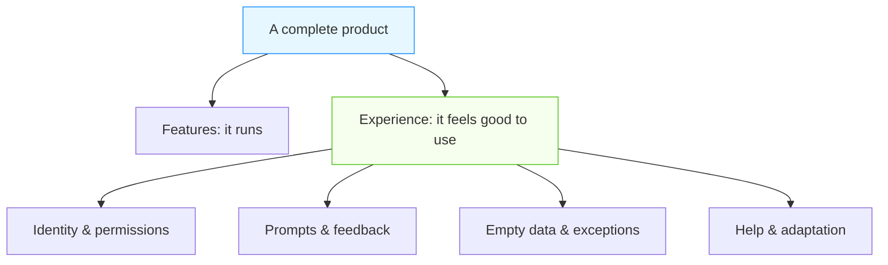
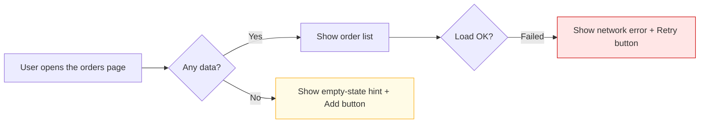

# Chapter 22: How to Give Your Software a Complete User Experience

> In earlier chapters we made the software "run," "change correctly," and "debug well." But something that's comfortable for you alone often frustrates everyone else. This chapter answers: how do you turn a program that runs into a product other people are willing to use — and can use with confidence?

## What You'll Learn in This Chapter

- What "complete user experience" really means — why getting the features right isn't enough
- What login, registration, and user identity are, and how to have AI add them
- User permissions: who can see what, and who can change what
- How to handle the "edges": prompts, empty data, and error states
- How to hand help screens and mobile adaptation to AI, step by step

### Opening: Xiaoman Shares the App with Her Assistant — and It Backfires

Lin Xiaoman's flower shop helper works beautifully when she uses it alone. She wants her assistant Jay to use it too, so she sends him the link.

Jay opens it and freezes: "What is this? Where do I click?" — there's no explanation anywhere on the screen. He taps "New order," fills in half of it, and has no idea what "customer tier" means, so he picks something at random. Worse, he accidentally sees another customer's phone number — because Xiaoman's app doesn't distinguish users; anyone who opens it sees all the data.

"It's fine for you alone," Jay says, "but if I use it, I'm afraid I'll delete the wrong thing — and I'm afraid of seeing things I shouldn't."

That's when Xiaoman realizes something: **getting the features to run is only "usable." For other people to use it confidently and understandably, there's a whole layer of "experience" work still missing.** Login, permissions, prompts, empty pages, viewing it on a phone — these seemingly minor edges are exactly what separate a personal toy from a real product. In this chapter, we'll fill in those edges one by one.

## 22.1 What Is a Complete Software Experience?

First, separate two things: **features** are what the software "can do," while **experience** is how smooth, understandable, and trustworthy it feels while someone uses it.

Here's an analogy. Features are like the taste of a dish; experience is like the restaurant's atmosphere, whether the menu is readable, and whether the staff explains how to eat it. No matter how delicious the food, if the menu is full of gibberish and no one greets you, the customer feels uneasy.

A complete software experience = features + the details that let people use it clearly, confidently, and smoothly. It usually includes:

| Dimension | The user question it answers |
|---|---|
| Identity | "Who am I? Is this my data?" |
| Permissions | "What can I do? Could I delete someone else's data?" |
| Feedback | "Did my last click actually work?" |
| Exceptions | "What shows up when there's no data, or the network drops?" |
| Help | "Where do I look when I don't understand something?" |
| Adaptation | "Can I use it on my phone?" |



Remember this: **features are for you; experience is for everyone else.** The roughness you tolerate when you're the only user, others won't.

## 22.2 Login, Registration, and User Identity

**User identity** is simply the software knowing "who is using it right now." The everyday analogy is a **building access card**: you swipe it, the system knows it's you, and it lets you into your own apartment only.

For software, the most common identity method is "username + password":

- **Register**: the first time you come, you sign up for an account and password — like getting a new access card.
- **Log in**: next time, you give your username and password; if they match, you're let in.

You don't need to understand how passwords are stored or how a session is kept — let AI handle that. Your job is to state the *rules* clearly.

**You:** My flower shop helper currently lets anyone see all the data. I want to add login: one admin account and a few assistant accounts, and you must enter a username and password to get in. I don't code — please walk me through it.

**AI:** Great. A few questions first: 1) Should accounts be created by you manually, or should assistants register themselves? 2) What happens if someone forgets their password? 3) After adding login, should the existing data belong to the admin account?

**You:** I'll create the accounts myself; no public registration. Skip "forgot password" for now — I'll reset it for them if needed. All the existing data is mine.

**AI:** Understood. I'll build the simplest version first: a login page that only lets you into the main screen with a correct username and password; accounts are added by you under "Settings." I'll add only login and leave your existing order features untouched.

When asking AI to add identity features, the key is to think through the rules first — "who creates accounts," "what if a password is forgotten" — otherwise AI will guess, and its guesses usually aren't what you wanted.

## 22.3 User Permissions

Login answers "who are you"; permissions answer "what can you do." Sticking with the access-card analogy: some cards open the front door only, while others also open the server room.

Permissions group people into **roles**, and each role can do different things. The flower shop helper might look like this:

| Role | View orders | Add/edit orders | Delete orders | Manage accounts |
|---|---|---|---|---|
| Admin (Xiaoman) | Yes | Yes | Yes | Yes |
| Assistant (Jay) | Yes | Yes | No | No |
| Read-only (temporary help) | Yes | No | No | No |

Don't design something complicated on day one. Settle on two or three roles and have AI "show or hide buttons by role and block actions without permission." You can phrase it like this:

> "Add two roles: admin and assistant. Assistants can view and add orders but cannot delete, and cannot see the 'Manage accounts' menu. If an assistant tries something they don't have permission for, show a message saying 'You don't have permission for this.'"

There's one core principle behind permissions: **give people only as much access as they need** — otherwise you get exactly what Jay worried about: deleting the wrong thing.

## 22.4 Prompts and Feedback

You press a button and nothing happens — do you start wondering "did my click register?" Software is the same: **every action needs to give the user a response**, and that's called feedback.

Everyday analogy: an elevator button lights up when pressed, and a microwave beeps when you hit "start." Those lights and sounds are telling you "I got your instruction."

There are three common kinds of feedback in software:

- **In progress**: after clicking "Save," the button changes to "Saving…" or shows a little spinner, so you know it's working.
- **Success**: a message like "Saved successfully" puts your mind at ease.
- **Failure**: explain the cause clearly — "Phone number should be 11 digits" — rather than throwing up a bare "Error."

When asking AI to add feedback, spell out all three cases:

> "Add feedback to the 'New order' form: when Save is clicked, show 'Saving…' on the button; on success, show a green 'Order recorded' message and clear the form; if a required field is empty, show a red hint under that specific field — don't just pop up one vague error."

Describe success, failure, and in-progress explicitly, and AI won't miss any.

## 22.5 Empty Data and Error States

The easiest thing for beginners to overlook is "abnormal" screens. You don't see them normally — but the moment they appear, the software shows its cracks.

- **Empty data**: when the app is brand new and there are no orders, what does the list page show? If it's blank, users think it's broken. The right move is a friendly line like "No orders yet — tap 'New order' to record your first one."
- **Loading**: while data is slowly arriving, show "Loading…" instead of leaving people staring at nothing.
- **Error state**: if the network drops or the server hiccups, show "Network seems down — please check and retry" with a "Retry" button, not a white screen or a wall of English errors.



You can ask AI to fill in all these states at once: "Add three states to the order list: when there's no data, show a friendly hint and an Add button; while loading, show 'Loading…'; if loading fails, show the reason and a 'Retry' button."

## 22.6 Help and Documentation

No matter how simple the software, users will hit something they don't understand. Rather than make them guess, give them explanations right where they need them.

Help doesn't have to be a thick manual. In a small app, these are the most useful:

- **Hint text next to a control**: hover or tap a "?" and a line appears — e.g., "Customer tier: regular customers get priority reminders before holidays."
- **First-run walkthrough**: on first open, use two or three arrows to show "here are your orders, here's how to add one."
- **A "Help" page**: list common questions as Q&A — "How do I change my password?" "How do I export orders?"

When asking AI to add help, the key is telling it *where people get confused*. For example:

> "Add a question-mark icon next to 'Customer tier'; tapping it shows: 'Regular customers are reminded first before holidays; other customers are reminded by order date.' Then make a 'Help' page listing three common questions."

## 22.7 Mobile Adaptation

Xiaoman said, "I occasionally check it on my phone." The same app is wide on a computer and cramped on a phone — without adaptation, buttons can be too small to tap and tables require endless sideways scrolling.

**Mobile adaptation** means the page adjusts itself to the screen: columns sit side by side on a wide screen, stack vertically on a narrow one, and text and buttons grow large enough for a finger.

The good news is you barely need to worry about the technical details. Modern approaches usually make pages "responsive" if you simply ask:

> "Make all pages adapt to phones: on narrow screens turn tables into one-card-per-order cards, enlarge buttons and text so they're easy to tap, and collapse the navigation bar into a menu button."

Afterward, **actually open it on a phone and look** — whether adaptation worked is obvious to your eyes; no code knowledge needed. Your computer browser also has a "simulate mobile device" mode; ask AI to show you how to open it.

## 22.8 How to Have AI Optimize the Experience

Everything above is "find a problem, patch it." But you can also proactively ask AI for an **experience checkup** — to surface the issues you didn't notice, all at once.

The key is to avoid vague requests. "Optimize the experience" is too thin; AI can only speak in generalities. Give it a concrete checklist:

**You:** The flower shop helper is about to be used by my assistant. Please put yourself in the shoes of a first-time assistant and check for anything confusing, easy to misuse, or awkward on a phone. List them by severity, and for each say which page it's on, what the problem is, and how to fix it. Check only for now — don't change anything yet.

**AI:** I went through it as a new user and found five issues: 1) the order list is blank when empty — add an empty-state hint; 2) "Customer tier" has no explanation — add a question-mark hint; 3) deleting has no confirmation, so an assistant might delete by mistake — add a confirmation dialog; 4) the table requires horizontal scrolling on phones — switch to card layout; 5) there's no feedback after saving — add a "Saved" message. Shall I fix them one at a time starting with #1?

**You:** Good — do #1, #3, and #5 first. I'll decide on #2 and #4 later.

**AI:** Got it. This round I'll change only the empty state, the delete confirmation, and the save-success message. I'll wait for your confirmation before doing more.

This "checkup first, then name what to change" approach is far safer than letting AI rewrite everything at once — **you keep the deciding vote throughout.**

## Common Pitfalls

- **Pitfall: focusing on features and ignoring the "edges."** Why: roughness you tolerate alone is a disaster for others. What to do: before release, walk through the checklist in 22.1 — identity, permissions, feedback, exceptions, help, adaptation.
- **Pitfall: asking AI to "optimize all the experience" in one shot.** Why: too broad a scope makes AI change the wrong things or miss items. What to do: like 22.8, list the problems first, then name them one at a time.
- **Pitfall: designing permissions too elaborately.** Why: with many roles, rules conflict and even you lose track. What to do: start with two roles, admin and regular user — enough is enough.
- **Pitfall: assuming "adding a login page" solves everything.** Why: you've only guarded the door; without permissions, assistants can still see and delete. What to do: think about login and permissions together — decide "who can do what" before asking AI to build.

## Chapter Summary

- A complete product = features + experience; experience decides whether others are willing and able to use it confidently.
- User identity is like an access card — login/registration answer "who are you"; permissions are like card clearance — "what can you do." Give only as much access as needed.
- Every action needs feedback: spell out the in-progress, success, and failure cases.
- Design the "abnormal" screens — empty data, loading, errors — so users never stare at a blank page.
- Give help in place (question-mark hints, first-run walkthroughs, a Help page), and after AI does mobile adaptation, verify it with your own eyes.
- For an AI experience checkup, give a concrete checklist: list issues first, then name which to fix — the decision stays with you.

## Practice Exercises

1. Think of the mobile app you use most: which "experience details" make it feel good? (Hint: look at login, prompts, errors, empty pages, help.) List at least three.
2. Using your own small app, have AI do an experience checkup from a "new user's perspective" as in 22.8. Read the issue list it produces — don't change anything yet.
3. Define two roles for your app (e.g., admin, visitor), writing down clearly what each can see and change. Send that table to AI and have it implement permissions accordingly.

## Copyable Instruction Templates

**Template 1: Add login and permissions to your app**

```text
I want to add user login and permission control to my app, and I don't know how to program — please walk me through it step by step.

Current situation: [briefly describe how anyone can currently open the app, and what features and data it has]

What I want:
1. Add a login page — a correct username and password are required to enter; I create accounts manually, with no public registration;
2. Two roles: admin (me) can do everything; regular users can only view and add, not delete or manage accounts;
3. If a regular user tries something they lack permission for, show a message "You don't have permission for this."

First ask me a few key questions, then start after confirming, doing only one step at a time and waiting for my confirmation after each.
```

**Template 2: Have AI run an experience checkup and fix items one by one**

```text
Please put yourself in the shoes of a first-time, ordinary user of this app and run an experience checkup.

Focus on these areas:
1. Anything confusing or unclear about how to use it;
2. Anything easy to misuse or delete by mistake;
3. What shows when there's no data, while loading, and when an error occurs;
4. How usable it is on a phone.

Requirements: list problems by severity; for each, say clearly [which page] [what the problem is] [how to fix it].
List the items first — don't change anything yet. Only after I name which ones to fix should you modify them one at a time.
```
