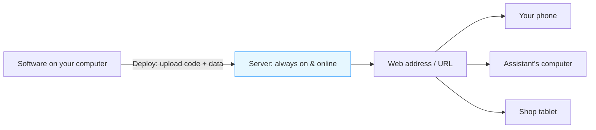

# Chapter 23: How to Have AI Publish Your Software for You

> By now your software has complete features and a solid experience. But it still lives only on your own computer. This chapter answers: how do you "move" it online so anyone can use it by opening a web address — without you having to learn operations and maintenance?

## What You'll Learn in This Chapter

- What "deployment" is — what happens between your computer and someone else's phone
- The real difference between running locally and running online
- How to pick a hosting platform that fits your situation
- How to have AI prepare the deployment environment, publish the site, and set up a domain
- How to troubleshoot deployment problems and maintain the app after launch


*Figure: Publish your software and let it grow*

### Opening: "The App Only Lives on My Computer — How Does Anyone Else Use It?"

For the few months since it was built, Lin Xiaoman has opened the flower shop helper on her own computer. She wants to put a tablet in the shop so customers can check orders, and to check it herself on her phone at home — but the moment she leaves that computer, the app "won't open."

"It works fine right here on my computer. Why does it disappear somewhere else?" she wonders.

She tries copying the folder to her assistant Jay. Jay double-clicks it on his machine — nothing opens, because the software needs a whole "environment" to run; copying files alone doesn't do it.

The problem is she's been treating the app like "a file on my computer." For people to open it in a browser anytime, anywhere, it has to live on a computer that's **always on, connected to the internet, and accessible to everyone** — a **server**. Moving it onto one is called **deployment (publishing)**.

That sounds professional, but here's the good news: you can let AI walk you through almost the entire process. This chapter takes you through it end to end.

## 23.1 What Is Deployment?

**Deployment** means installing the software you built on your computer onto a server, where it serves users through a web address (URL).

Everyday analogy: you cooked a dish in your own kitchen (the finished software), and only you and your family can taste it (local running). Now you want to serve it at a restaurant table so any guest can order it — the restaurant has a storefront, a kitchen, and is always open (the server). That process is deployment.

After deployment, these things change:

- The app goes from "you double-click to open" to "anyone opens a web address to use."
- Data goes from "stored on your computer" to "stored on the server," so you see the same data from any device.
- When your computer is off, the software keeps running — because it's on the server.

Deployment doesn't mean selling it to others. You can deploy an internal tool only you and your assistants use — you've simply swapped a local file for a web address.



## 23.2 Local vs. Online Running

People often ask, "It works fine on my computer — why put it online?" The key differences are in this table:

| Aspect | Local running | Online running (after deployment) |
|---|---|---|
| Who can use it | Only you, at that computer | Anyone online who knows the address |
| After the device is off | Software stops | Keeps running |
| Where data lives | On your computer | On the server — same data from any device |
| Can a phone use it | Usually not | Yes — open it in a browser |
| Maintenance responsibility | You | Platform/server + you (content updates) |

In one line: **local running is "your own toy"; online running is "a product for other people."** For software to truly serve others, it must be deployed.

One caution, though: going online means "anyone who opens the address" — so security and permissions matter more. That's the topic of the next chapter. If your app holds private data like customer phone numbers, read Chapter 24 before publishing.

## 23.3 How to Choose a Hosting Platform

A hosting platform is the "always-on computer" that holds your software. For a beginner, there's no need to buy hardware or install systems — pick a platform and follow its steps. There are three common types:

| Platform type | Best for | Characteristics |
|---|---|---|
| Static site hosting | Display-only pages (can't store data) | Simplest, often free, sometimes drag-and-drop |
| All-in-one app platform | Small tools with a database (like the flower shop helper) | Handles front end, back end, and database together — most beginner-friendly |
| Cloud server / VM | Complex systems needing full control | Most flexible, but requires ops knowledge — not recommended for beginners yet |

How to choose? Match your software type:

- Just a page introducing your flower shop → static hosting.
- Something like the flower shop helper that stores orders and has login → an all-in-one app platform (recommended for beginners).
- Later, a large system with many users → then consider a cloud server.

You don't need to memorize platform names. Describe your software to AI and have it recommend one with reasons. The key is to make AI **speak plainly**: "Tell me in everyday language which one you recommend and why, roughly how much it costs, and whether I need to pay."

## 23.4 How to Have AI Prepare the Deployment Environment

Before code moves to the server, some "environment" usually needs preparing — like packing before a move and writing down your new address. You don't need to understand all of it, but you should have AI prepare it for you:

- **Dependency list**: the "parts" the software needs to run, which must be installed on the server first.
- **Config / environment variables**: settings like database address and secret keys that "shouldn't be hard-coded."
- **Start command**: telling the server "how to actually run my software."

The best approach is to have AI **list a plan first, and act only after you confirm**:

**You:** I want to publish the flower shop helper online. I don't understand deployment — first make me a checklist: what needs preparing before publishing? What do I need to provide (like a database or account), and what will you do? Just list it for now; don't start yet.

**AI:** Sure, let me lay it out. Things for you to prepare/confirm: 1) a database (for orders and customers); 2) the admin account for login; 3) whether you already have a domain. Things I'll do: generate the dependency list, write the start configuration, and organize the code into a deployable form. A few questions: do you want a platform-provided database or a separate one? Are you starting free, or okay spending a little for less hassle?

**You:** Platform-provided database, and start free. No domain yet — maybe later.

**AI:** Understood. I recommend the free tier of an all-in-one platform with a built-in database — a good fit for your scale. I'll write the deployment checklist and configuration for your review first.

The value of this step: **AI separates "things for you to decide" from "things it will do,"** and you only answer a few questions.

## 23.5 How to Publish the Site

Once preparations are done, publishing is usually a fixed sequence of actions. Have AI guide you through them:


For each step, ask AI for "idiot-proof" instructions. For example:

> "I'm about to publish my software on this platform. Tell me step by step: 1) where do I click to create a project; 2) how do I upload the code; 3) how do I configure the database; 4) which button is Publish. For each step, say exactly what to click and what to fill in, in plain language — no jargon."

After publishing, **verify it yourself**: copy the URL AI gave you into a browser, open it on a computer, then on a phone, click a few buttons, and save a test entry. Only when you've seen it actually run is the step complete.

## 23.6 How to Configure a Domain

After publishing, you'll get a platform-provided address — usually a string of characters like `xhxs-helper-12345.app.com`. A **domain** swaps that for something memorable, like `huadian.example.com`.

Everyday analogy: the server is a house; the web address is its current location description ("third building behind XX Road No. XX"), while the domain is the signboard you hang up ("Xiaoman Flower Shop"). The signboard is easier to remember and looks more professional.

Configuring a domain usually takes two steps:

1. **Buy a domain**: register a name you like with a domain registrar (a small annual fee).
2. **Point it at the server**: in the domain settings, create a "record" pointing that name to your platform address; then bind the domain inside the platform.

This step has lots of fiddly details and is easy to get wrong, so definitely have AI hold your hand: "I bought a domain xxx and want to bind it to the app I just published. Tell me step by step where to enter what, and how to confirm it took effect."

If you don't want to spend money on a domain yet, the platform's free address works perfectly well — just less memorable. Add a domain later, once the app is running smoothly.

## 23.7 How to Handle Deployment Problems

Deployment rarely goes perfectly on the first try; small hiccups are normal. The most common beginner issues:

| Symptom | Likely cause | What to do |
|---|---|---|
| Blank page / error when opening the address | Incomplete upload, missing config | Copy the error to AI and have it check logs |
| Works locally, not online | Different environment, database not connected | Have AI compare local and online config |
| Changes don't appear after publishing | Didn't redeploy, or browser cache | Redeploy and hard-refresh the browser |
| Site is slow | Large resources, platform tier too low | Have AI check and suggest optimizations |

Your key weapon for troubleshooting is the **log** — a notebook where the server records "what went wrong in the software." You don't need to read it; just copy it to AI:

> "After publishing, my address shows a blank page. Here are the last few error lines from the platform log: [paste log]. Please tell me in plain language: what's wrong? Which step caused it? How do I fix it specifically? Do I need to redeploy after fixing?"

Remember: a deployment problem isn't because you're slow — the environment is complex. Hand the symptoms and the log to your AI partner; this is what it's good at.

## 23.8 Maintenance After Launch

Going live isn't the finish line — it's the start of "everyday care." Build these habits after launch:

- **Changes require republishing**: editing code locally won't automatically appear online; redeploy after each change. Memorize this and you'll avoid a lot of "I changed it, why didn't it update" confusion.
- **Check it occasionally**: open the address now and then, click around, confirm it's still healthy.
- **Mind data backups**: data lives on the server; confirm the platform backs it up, or export a copy regularly (see Chapter 24).
- **Record versions**: after each release, note "what changed in this version" (see Chapter 25) so you know which build to return to if something breaks.

You can hand these to AI too: "Please generate a short release note after each publish, recording the date and what changed, so I can look back later."

## Common Pitfalls

- **Pitfall: thinking copying files to someone lets them use it.** Why: software needs a runtime environment, not just files. What to do: deploy it to a server and let people access it via a web address.
- **Pitfall: choosing the most complex cloud server right away.** Why: a beginner must install systems and configure environments and can easily get stuck. What to do: for a small tool with a database, use an all-in-one app platform, starting on the free tier.
- **Pitfall: publishing once and never checking again.** Why: code changes without republishing won't update online, and things can break over time. What to do: make "change → redeploy → open and verify" a fixed routine.
- **Pitfall: feeling it's not "official" without buying a domain.** Why: the platform's free address works just as well. What to do: run on the free address first; buy a domain once it's smooth and you're sharing it with others.

## Chapter Summary

- Deployment = moving your software from your computer to an always-on, online server so others use it via a web address.
- Local running serves only you; online running is a product for others — but online means more attention to security.
- Choose a platform by software type: static hosting for display pages, all-in-one platform for small tools with databases, free tier for beginners.
- Before deploying, have AI list a plan separating "your decisions" from "its work"; during publishing, ask for idiot-proof steps.
- After publishing, verify in person on both computer and phone; a domain is an optional, memorable signboard — no rush.
- When problems hit, don't panic — give the symptoms and log to AI for diagnosis; after launch, remember "changes require republishing," and watch backups and versions.

## Practice Exercises

1. Explain "deployment" to a non-technical friend in one sentence, using your own analogy (don't copy the book's).
2. Describe your software (does it have a database, login, how many users) to AI and have it recommend a hosting platform. Ask it to explain the reasons and cost in plain language.
3. For practice: have AI walk you through publishing the simplest possible page. Once you have the URL, open it on a computer and a phone, then note the first problem you hit and how you solved it.

## Copyable Instruction Templates

**Template 1: Have AI plan and guide you through publishing**

```text
I want to publish the software I built online so others can use it by opening a web address. I don't understand deployment — please guide me through the whole thing.

My software: [describe whether it's a display page or a tool that stores data, whether it has login, and roughly how many people will use it]

Please:
1. Explain in plain language what I need to do and what the steps are;
2. Recommend a hosting platform suited to my case, with reasons, rough cost, and whether I need a domain;
3. First list a preparation checklist, separating what I must provide from what you'll do;
4. After I confirm, tell me step by step what to click and fill in — one step at a time, waiting for my confirmation after each.
```

**Template 2: Ask AI to diagnose a deployment error**

```text
My software has a problem after publishing: [describe the symptom, e.g., "blank page," "works locally but not online"].

Here's the relevant error or platform log: [paste the log]

Please tell me in plain language:
1. What's the most likely cause?
2. How do I fix it specifically, step by step?
3. Do I need to republish after fixing it?
4. How can I confirm it's fixed?
Diagnose and propose a fix only — don't change anything directly yet.
```
