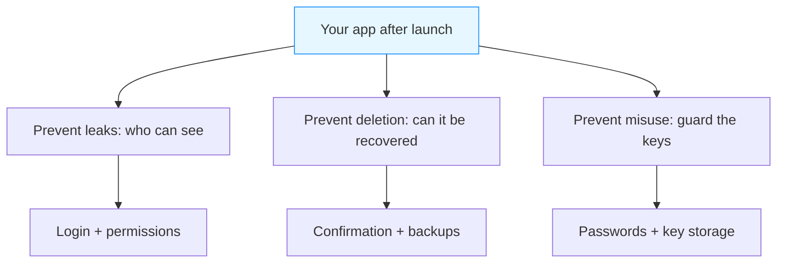

# Chapter 24: Software Security and Data Protection

> Once your software is online, it's like opening a shop on the street: convenient for others, but it also attracts risk. This chapter won't scare you with hacking techniques. It covers a few things any ordinary person can do — lock the door, protect the data, and keep a way out.

## What You'll Learn in This Chapter

- Why security matters even for a small app
- How to protect customer data: collect less, hide it well, transmit it safely
- How to manage passwords and API keys — and the mistakes never to make
- Three kinds of "insurance": permissions, preventing accidental deletion, and backups
- How to have AI run a security checkup

### Opening: A Stranger's Text Gives Xiaoman a Scare

After the flower shop helper went live, Lin Xiaoman got a text from a customer, Aunt Wang: "Xiaoman, why did someone message me saying they know what flowers I ordered and where I live?"

Xiaoman was baffled — her app does store customers' phone numbers, orders, and addresses. She opened the site and tried it in her browser's "incognito mode" (not logged in) — and discovered that **anyone could see every customer's details without logging in!**

Her heart sank. She had never thought about "security" — only about "does it work, is it easy to use." But once software is online, people can poke at it from every angle. Luckily this was just someone stumbling across it, with no real harm done.

"I thought finishing the app was the end of it," she said, shaken. "Turns out I have to lock it up too."

In this chapter, we lock it up. You'll see that "security" isn't mysterious — it's mostly common sense: don't hang the key on the door, don't leave valuables in the doorway, and always keep an extra copy of what matters.

## 24.1 Why Security Can't Be Ignored

When people hear "security," they think it's a concern for big companies and banks. It isn't. Even a small tool for you and a few customers can run into three kinds of trouble:

- **Data leakage**: customers' phone numbers and addresses seen by the wrong people — like Aunt Wang's case. At best awkward; at worst illegal (personal information is protected by law).
- **Accidental deletion or corruption**: you or an assistant slip up and delete an important order, with no backup to recover it.
- **Misuse**: if your app connects to a paid service (like an SMS API) and someone steals the key, you may face charges you never expected.

Everyday analogy: a shop needs a lock on the door, valuables in a cabinet, and insurance — not because a break-in is certain, but because the cost is high enough that precautions are worth it.

For a beginner, the good news is: **you don't need to become a security expert. Hold to a few basic rules of thumb and let AI check your work.** One overarching principle:

> **Trust no one and no input by default; grant only necessary permissions; always keep an extra copy of what matters.**



## 24.2 How to Protect User Data

The first rule of protecting data is **"collect only what you need"** — not stinginess, but responsibility. Three concrete moves:

- **Collect less**: store only information you truly need. A name may be enough — do you need an ID number? Can you skip the address? Customers aren't obligated to hand over all their privacy.
- **Hide it well**: never show customer data on a public page. No data before login, none to users without permission. Mask phone numbers in lists (e.g., `138****5678`) and reveal the full number only to authorized users who open the detail view.
- **Transmit safely**: the address should start with `https://` (a little lock icon in the browser bar), meaning data is encrypted in transit. Most platforms provide HTTPS by default now — just confirm it after publishing.

To have AI check your data handling, ask like this:

> "Check my app: 1) is there any page where customer data is visible without logging in? 2) are phone numbers masked in lists? 3) is the site using https? List what you find — don't change anything yet."

## 24.3 How to Manage Passwords

A password is like a door key — you don't hang it on the handle, and you don't use the same key for every door.

There are two kinds of passwords; don't mix them up:

| Password type | Whose it is | How to manage it |
|---|---|---|
| User password | Customers / assistants logging in | Must **never be stored in plain text** in the app — convert it into an unreadable "fingerprint" (this is called hashing; AI handles it automatically) |
| Admin password | You, entering the back office | Long, not reused on other sites, kept safely in a password manager |

The most common mistake: writing a password **directly into the code** (like `password = "123456"`). That's taping the key to the door — anyone with the code can get in.

You can ask AI explicitly:

> "Are my users' passwords stored securely? Is there anywhere a password is written in plain text in the code? If so, point it out and tell me how to fix it safely."

Also: don't use weak passwords like `123456` or `password`, and don't reuse one across sites — obvious, but worth repeating.

## 24.4 How to Manage API Keys

What's an **API key**? Think of it as a "master key" to a service. If your app sends reminder text messages, it needs a key from the SMS provider to use that service.

If such a key leaks (say, someone reads it in your code), others can use it to spend your money or consume your service. There's one iron rule:

> **Never write a key into code, upload it to a public drive or chat, or let it appear on a web page.**

The right place is something called an "environment variable" — picture it as a locked little box on the server: the app fetches from it at runtime, and its contents never show up on the web page.

**You:** My app uses an SMS service and has an API key. I don't understand security and worry about leaking it. How should I store it safely?

**AI:** Never hard-code it. Put it in an "environment variable": I'll move the key out of the code into a config file and show you how to set the variable on the platform. Also — have you ever pasted this key into a chat group, a document, or a screenshot? If so, revoke it at the provider and generate a new one: once it's been exposed, treat it as unsafe.

**You:** I think I did paste it into a document once. I'll generate a new one.

**AI:** Good — a new key is the safest move. Put only the new one in the environment variable; never let it appear in chats, documents, or screenshots again.

Remember this habit: **if a key has ever been exposed, replace it** — don't gamble.

## 24.5 How to Set Permissions

The previous chapter covered assigning user roles (who can see and change what). From a security standpoint, one more important principle applies — **least privilege**: give every person and every program only the minimum access needed to do their job, and nothing more.

Apply it in several places:

- **Database account**: the account your app uses to connect should be able to "read/write orders," not "drop the entire database."
- **Admin accounts**: give out as few admin accounts as possible — one if that's enough, not three.
- **Third-party authorization**: when connecting to an external service, request only the permissions actually needed (e.g., "send SMS," not "read all your profile").

When asking AI to configure this, state the principle outright:

> "Check my app against the least-privilege principle: is the database connection account over-privileged? Are there any requests for permissions the app doesn't use? Keep only what's necessary, remove the extra permissions, and tell me what you changed."

With permissions, it's fine to be a bit inconvenient — the price of leaving everything open usually shows up only on the day something goes wrong.

## 24.6 How to Prevent Accidental Deletion

The most common security incident isn't a hacker — it's a slip of the hand. So preventing accidental deletion is excellent value for effort. Three moves:

- **Confirmation**: clicking "Delete" pops up "Are you sure you want to delete?" — giving a chance to back out.
- **Soft delete / recycle bin**: "delete" just marks the order as deleted and moves it to a recycle bin, with permanent removal later — like tossing something in the trash and being able to fish it back out.
- **Restrict and log**: only admins can permanently delete; record who deleted what in an operation log for tracing.

Have AI set all three at once:

> "Add three layers of protection to order deletion: 1) show a confirmation dialog before deleting; 2) deleted orders go to a 'Recycle Bin' and are permanently erased only after 30 days, and can be restored in the meantime; 3) only admins can empty the Recycle Bin, and each deletion is recorded in an operation log."

Afterward, test it yourself: delete a test order and check that the confirmation appears and that you can restore it from the bin.

## 24.7 How to Back Up Your Data

A backup is **an extra copy of your important data** stored somewhere else. Analogy: you keep photos of valuables on another phone, so if the original is lost, you can still recover.

Why must you back up? Because accidental deletion, system failure, and platform problems can all erase data, and those aren't within your control. What *is* within your control is whether you left a fallback.

Good backups have three qualities:

- **Automatic + regular**: have the platform back up daily, or export a data file yourself on a schedule (say weekly). Don't rely on "backing up when I remember."
- **Stored elsewhere**: keep the backup in a different place from the original, so one disaster doesn't take out both.
- **Actually restore-tested**: a backup you've never restored from may be useless. Occasionally try "restore from backup" to confirm it works.

Let AI arrange it:

> "My app's data lives on the platform. Please help me confirm: 1) does the platform back up automatically, how often, and how long are backups kept? 2) Teach me how to manually export a full copy of the data. 3) Tell me how to do a periodic restore test to make sure backups really work."

## 24.8 How to Have AI Run a Security Checkup

Like the experience checkup, you can ask AI for a **security checkup** — work through a checklist instead of going by gut feeling.

The checklist can cover the areas in 24.2–24.7:

**You:** My app stores customers' phone numbers and addresses and is live. Please run a security checkup, focusing on: 1) any page where customer data is visible without login; 2) whether passwords are stored in plain text; 3) whether any key is hard-coded; 4) whether the database account is over-privileged; 5) whether deletion has confirmation and recovery; 6) whether there's a backup. List problems by severity, saying where each is, the risk, and how to fix it. Check only — don't change anything.

**AI:** I found six points: 1) the order list is accessible without login — high risk, needs a login gate; 2) passwords are hashed — fine; 3) the SMS key is in a config file but not an environment variable — medium risk, move it and replace the key; 4) the database account has full privileges — medium risk, reduce to read/write; 5) deletion has no confirmation or recovery — medium risk, add a confirmation dialog and recycle bin; 6) the platform backs up daily — fine. Shall I start fixing from #1?

**You:** Good — do #1 and #3 first. I'll schedule the rest.

**AI:** Got it. This round I'll add the login gate and move the key into an environment variable with a replacement. I'll note the rest and change them when you name them.

This flow — "checkup, rank by severity, change only what you name" — lets you see the risks clearly without changing too much at once and causing new problems.

## Common Pitfalls

- **Pitfall: thinking "it's a small app, nobody will target it," so skipping security.** Why: automated scanners exist, and risk is unrelated to data size; privacy data is legally protected. What to do: at least follow this chapter's basics and have AI run one checkup.
- **Pitfall: writing passwords or API keys into code or pasting them in chats.** Why: that's hanging the key out in public. What to do: put keys in environment variables; revoke and replace any that were ever exposed.
- **Pitfall: adding login but no permissions.** Why: you've blocked outsiders, but not assistants from seeing or deleting what they shouldn't. What to do: assign roles by least privilege — only the necessary access.
- **Pitfall: backing up but never restoring.** Why: an unverified backup may not work at all. What to do: do a restore test periodically to confirm it actually recovers data.

## Chapter Summary

- Security isn't just for big companies: preventing leaks, accidental deletion, and misuse are basics for any small app.
- Protect data three ways: collect less (only what's needed), hide it well (login, permissions, masking), transmit safely (HTTPS).
- Never store passwords in plain text; make admin passwords long and unique. Put API keys in environment variables and replace any that leaked.
- Configure databases, admin accounts, and third-party access by least privilege.
- Prevent accidental deletion with confirmation, a recycle bin, and restricted privileges plus an operation log.
- Backups should be automatic and regular, stored elsewhere, and genuinely restore-tested.
- Have AI run a security checkup from a checklist: list issues, rank by severity, then change only what you name.

## Practice Exercises

1. Open your app's address in incognito/private mode (not logged in) and see what data is visible without login. Write down the result.
2. Check your code or config for any hard-coded password or key. If you find one, have AI teach you to move it to an environment variable and replace the exposed key.
3. Run a "deletion drill" on your app: delete a test order and see whether there's a confirmation and whether you can restore it. If not, have AI add the protections from 24.6.

## Copyable Instruction Templates

**Template 1: Have AI run a security checkup**

```text
My app stores users' private data (like phone numbers and addresses) and is live. Please run a security checkup.

Focus on:
1. Any page where user data is visible without login;
2. Whether passwords are stored in plain text;
3. Whether any password or API key is hard-coded in the code;
4. Whether the database account is over-privileged;
5. Whether deletion has confirmation and recovery;
6. Whether there's a data backup.

List problems by severity; for each, say [where it is] [what the risk is] [how to fix it].
List the items first — don't change anything yet. Only after I name which ones to fix should you modify them one at a time.
```

**Template 2: Move a key safely into an environment variable**

```text
I have an API key that may have been exposed, and I worry about misuse. Please help me handle it:

1. Find every place in the code where the key is hard-coded;
2. Teach me how to move the key into an environment variable (plain language, step by step);
3. Show me how to set that environment variable on the publishing platform;
4. Remind me to revoke the old key at the provider and generate a new one.

After the change, confirm that no plain-text key appears on the web page, in the code, or in chat records. Give me the plan first; I'll confirm before you make changes.
```
