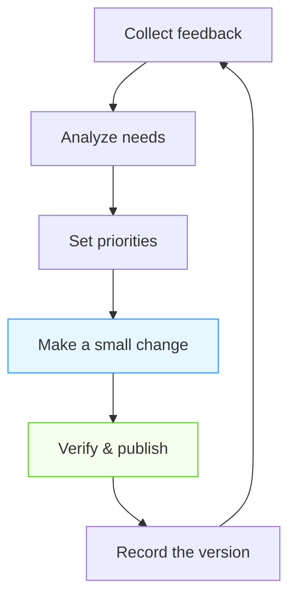

# Chapter 25: How to Keep Iterating on Your Software

> The day your software goes live isn't the finish line — it's the first day it truly starts growing. This chapter teaches a "get-better-with-use" loop: hear feedback, sort out real needs, set priorities, make small changes, record versions — so a small tool grows alongside your life.

## What You'll Learn in This Chapter

- Why "finishing" is only the beginning of a software's life
- Where to collect user feedback
- How to tell "what users say they want" from "what they actually need"
- How to decide what to change next and keep an iteration list
- How to have AI iterate with you long-term and manage versions

### Opening: Half a Year Later, Xiaoman Looks Back

The flower shop helper has been live for six months. One evening Lin Xiaoman opens it and is a little amazed — it's no longer the single page that just recorded orders.

Now it can automatically remind her to send flowers before holidays, look up a customer's past orders, let assistants log in with different accounts, look right on a phone, and back up data daily. Not one of these features was in the original plan. They all **grew** over those six months, bit by bit:

- Jay said, "Looking through the notebook for what a regular customer ordered is such a hassle" — so "order history lookup" was born.
- Mother's Day was chaotic — so "holiday batch reminders" appeared.
- A customer asked, "Can I check my order on my phone?" — so mobile adaptation and login were added.

"So software isn't 'finished,'" she thought. "It 'grows' as you use it."

That's exactly what this chapter is about. You don't need to think of everything up front — with a method for "getting continuously better," your software grows along with your needs. This is the closing chapter of the book.

## 25.1 Software Isn't Finished When It's Built

Many people imagine building software like building a house: draw the blueprint, put up the walls, cap it off, done. In reality software is more like **tending a plant**, or **running a restaurant** — the handover day is just the start, followed by watering, pruning, and adjusting the menu based on guests.

Why does "finished" software need changing?

- **You can't think of everything up front.** You discover what you truly need by using it. Xiaoman could never have imagined "holiday batch reminders" at first.
- **Users show you your blind spots.** What's normal to you may be awkward to them.
- **Life changes.** Holidays, seasons, and shop size all change — software must change to keep up.

So switch your mindset from "finish and be done" to "keep tending." The good news: with AI, each round of "tending" (modifying) is cheap — you don't relearn programming; you keep describing needs in everyday language, just as earlier chapters taught.



This loop is "iteration." The more smoothly you run it, the more steadily your software grows.

## 25.2 How to Collect User Feedback

The raw material of iteration is "feedback." Feedback isn't necessarily a formal email; more often it hides in daily life. There are four common channels:

| Channel | How | Best for finding |
|---|---|---|
| Direct conversation | Casually ask assistants/customers "what's awkward?" | The most honest pain points |
| In-app feedback button | Add a "Give feedback" field that saves what people write | Problems users proactively report |
| Observing use | Watch how people use it — where they stall, what they re-tap | Problems users "feel but can't articulate" |
| Usage data | Which features nobody uses, which step people abandon | Poorly designed parts |

For a small tool like Xiaoman's, the first two are most effective. She casually asks Jay, "Anything annoying lately?" and added a small "Give feedback" button in the app that stores what customers write into a table.

One trick: **ask specific questions** — more effective than "any suggestions?" For example, "How long does it take you to look up one order?" "Which step feels troublesome?" The more specific the question, the more useful the answer.

## 25.3 How to Analyze User Needs

Once you have feedback, don't rush to implement it. What users say isn't always what they want.

A classic story: before cars existed, if you asked people what they wanted, many would say "a faster horse." What they said (a faster horse) and what they truly needed (to get from A to B faster) aren't the same. If you took it literally, you'd breed horses, never invent the car.

So when analyzing a need, ask "why" one level deeper:

- User says: "I want an export button." They may really want to **send orders to the accountant to reconcile** — maybe auto-emailing is the better answer.
- User says: "Can reminders come earlier?" They may really **fear forgetting to stock up** — maybe a "stocking list" is the real solution.

Filter with two questions:

1. **Real need or passing whim?** A pain point many people hit repeatedly, or one person's offhand remark?
2. **Frequent or rare?** Something used daily outranks something used once a year.

Keep "the user's words" and "the underlying real goal" as separate notes, and you won't be led astray by surface wording. When unsure, just go back and ask, "What would you use this for?" — that usually clears it up.

## 25.4 How to Decide What to Change Next

You'll have far more feedback than you can do at once. How to pick "what to change next"? Use a simple score: **impact × urgency ÷ effort**.

- **Impact**: how many people, how often, will hit this?
- **Urgency**: if you don't fix it, will something go wrong or get messed up?
- **Effort**: is it simple or complex? (With AI helping, effort is usually lower than you think.)

Think of each need along these three axes and the priority becomes clear. A useful rule of thumb:

> **Fix what's "wrong" first (bugs, things that cause mistakes), then what "many people want," then what's "fun but not urgent."**

One more discipline: **change only one thing at a time**. Don't ask AI to change five or six features in one go — the more you change, the more they interfere and the harder bugs are to find (the point of Chapter 21). Change one, verify it, then move to the next — far steadier.

## 25.5 How to Keep an Iteration List

As the things you want to do pile up, you need a "list" to keep them organized instead of lurching from one idea to another. The simplest list has three columns: **To Do / Doing / Done** (this is called a kanban board).

| To Do | Doing | Done |
|---|---|---|
| Add "holiday batch reminders" | Improve mobile table display | Added login and permissions |
| Export orders to Excel |  | Added delete confirmation |
| Customer birthday reminders |  | Added daily backup |

This list can be paper, a notes app, or maintained by AI. Write each item as "what problem it solves," not just a feature name — so later you still remember why you added it.

Each time you decide, pick one item from "To Do" by the priority in 25.4, move it to "Doing," and to "Done" when finished. This small ritual gives you a clear view of your software's growth rhythm.

## 25.6 How to Have AI Iterate with You Long-Term

This is the single most important move for long-term AI iteration: **leave AI a "project memory."** AI may "forget" earlier context between conversations — it doesn't remember how the software grew the way you do.

The fix is to maintain a simple **project description file** (call it `README` or "Project Notes") that records:

- What the app does and who uses it;
- What features exist and how data is stored;
- Agreed rules (e.g., "don't store passwords in plain text," "make the reminder red");
- The current iteration list.

Then, before each new round of changes, have AI read it first:

**You:** I want to keep working on the flower shop helper. Here are our project notes: [paste the project description / have AI read the file]. First recap: what features does this app have now, and what rules did we agree on? Then I'll tell you what to change this time.

**AI:** I've read the notes. Recap: it's a tool for recording flower orders and sending reminders; it already has login, permissions, an order list, and holiday reminders; rules include "no plain-text passwords," "reminder text in red and bold," and "change only one thing at a time"; the to-do list has "export orders to Excel." What would you like to change this time?

**You:** This time only do "export orders to Excel" — a spreadsheet I can send to the accountant. Don't touch anything else.

**AI:** Got it. I'll add only the Excel export: an "Export" button on the orders page that exports current orders to a spreadsheet file. Nothing else changes. I'll show you the change for confirmation first.

With this "memory," AI won't ask the same questions every time or accidentally overturn rules you set earlier. Whenever the project changes significantly, remember to update it.

## 25.7 How to Manage Software Versions

Remember the "save points" from Chapter 21? In long-term iteration they matter even more. Each time you reach a stable, working state, "save a version" and briefly note what changed.

Two habits to build:

- **Version numbers**: number each release — simplest is `v1.0`, `v1.1`, `v2.0`. A small change bumps the last digit (1.0 → 1.1); a big change bumps the first (1.x → 2.0).
- **Release notes**: for each version write two or three lines — the date, what changed, and any known issues.

| Version | Date | What changed |
|---|---|---|
| v1.0 | Mar 1 | First version: record orders, view list |
| v1.1 | Apr 10 | Added login & permissions, delete confirmation |
| v1.2 | May 20 | Added holiday batch reminders, mobile adaptation |
| v2.0 | Aug 1 | Added order history lookup, Excel export |

The payoff: if a new version breaks, you can return to the last good one (the "load" from Chapter 21); looking back, you can see exactly how the app became what it is. Have AI help: "After each release, append a version record to the project notes."

## 25.8 How to Keep a Small App Growing

You've now completed the whole journey from "an idea" to "a continuously growing product." Xiaoman's path is also the book's path:

- **Say the idea** → AI builds it (Parts II & III)
- **Modify, debug** → make it better and steadier (Parts IV & V)
- **Polish experience, publish, secure** → turn it into a product others can trust (Part VI)
- **Keep iterating** → small changes keep it growing with your needs (this chapter)

The secret to keeping a small app growing isn't "start grand." It's three sentences:

1. **Small steps, quick pace**: change a little, use it right away, verify it.
2. **Listen to real voices**: one user's complaint is often worth ten of your guesses.
3. **Leave a trail**: lists and version records make growth traceable, forward and backward.

Remember: you don't need to become a programmer. What you need is the ability to "describe ideas clearly, break problems down, and judge results" — and you've practiced all of that, chapter by chapter. Your software will grow, and so will your skill at directing AI.

## Common Pitfalls

- **Pitfall: publishing and then walking away.** Why: problems surface "through use," and life's needs keep changing. What to do: make it a habit to check feedback and open the app to verify regularly.
- **Pitfall: building exactly whatever users say.** Why: users often describe the surface, not the real goal. What to do: ask "why" one level deeper; separate real from passing and frequent from rare needs.
- **Pitfall: changing a big pile of features at once.** Why: many changes interfere and make bugs hard to trace. What to do: change one thing at a time, verify, then continue.
- **Pitfall: iterating long-term with no records, so AI "loses its memory" each round.** Why: AI doesn't naturally remember history and rules. What to do: maintain a project description file and iteration list, and have AI read them before starting each round.

## Chapter Summary

- Going live isn't the finish but the start: software is like a plant to tend, and AI makes each change cheap.
- Feedback comes from conversations, in-app entries, observation, and data; specific questions work best.
- Analyze needs by seeing "the real goal" behind "what users say," filtering real vs. passing and frequent vs. rare.
- Set priorities with "impact × urgency ÷ effort": fix what's wrong first, then what many want; change one thing at a time.
- Keep a three-column "To Do / Doing / Done" list to manage what you want to do.
- Maintain a project description file and version records; have AI read them each round, number versions like v1.0, and write release notes.
- The secret to growth: small steps, listen to real voices, leave a trail. You don't need to become a programmer.

## Practice Exercises

1. Think of a need your app discovered "through use" (like Xiaoman's holiday reminder). Write down: who raised it, in what situation, and what real pain it solved.
2. Make a three-column list for your app (To Do / Doing / Done), with at least three To Do items, and use 25.4's method to decide which to do first.
3. Write a short "project description file" containing: what the app does, what features exist, what rules you agreed on. Before your next change, have AI read it and see whether it recalls the context accurately.

## Copyable Instruction Templates

**Template 1: Have AI "recap the project" before each iteration**

```text
I want to keep iterating on my app. Here are our project notes: [paste the notes / have AI read the project file].

Please do two things first:
1. Recap in plain language: what this app does, what features it has now, and what rules we agreed on;
2. List the unfinished items in the current iteration list.

After the recap, don't act yet. Wait until I tell you which single thing to change this time — and change only that one.
```

**Template 2: Turn a pile of feedback into an actionable iteration list**

```text
I've collected some user feedback: [list the feedback, one item per line]

Please help me organize it:
1. For each item, separate "the surface request the user stated" from "the real problem they're trying to solve";
2. Prioritize using [impact × urgency ÷ effort], putting error-type fixes first, then what many people want;
3. Organize into a three-column list: To Do / Doing / Done;
4. Tell me which single item you recommend doing "next," and why.

Organize and sort only — don't change any code yet.
```
