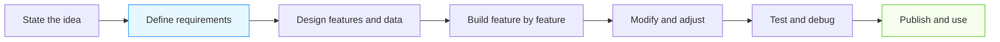
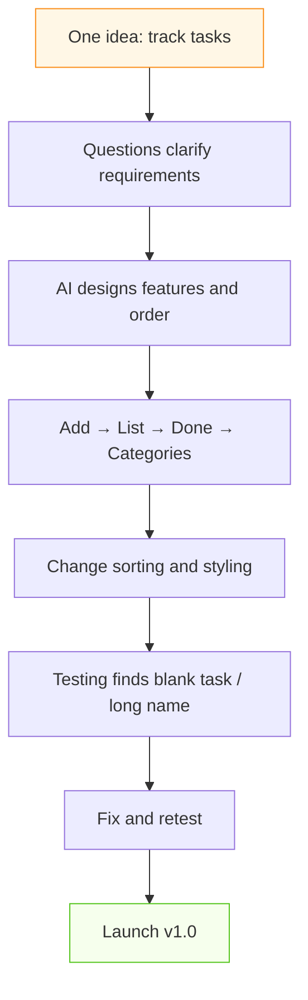

# Chapter 26: Project One — Building a Personal Task Manager

> Starting here, we build five complete pieces of software for real. The first is one that helps you remember "what I need to do, when it's due, and how far along it is." You'll walk the entire path: idea, requirements, AI design, development, modification, testing, and publishing — every single step.

## What You'll Learn in This Chapter

- How to turn a vague idea into clear requirements, step by step
- How to design features and data together with AI, then order them
- How to build one feature at a time, confirming as you go
- How to correct AI in real conversation and get it to change the right thing
- How to test, publish, and actually start using your software


*Figure: The five hands-on projects in this book*

### Opening: Alex's "Sticky-Note Disaster"

Alex Chen is a freelance graphic designer juggling five or six projects at once: a logo for one client, a brochure for another, two posters on deadline. The way Alex keeps track is "primitive" — sticky notes cover the edges of the monitor, important items live in the phone's notes app, and last-minute client requests get buried in chat favorites.

The result is predictable. Last week a client chased a deliverable and Alex remembered it was due three days ago. Another job got the "draft" and "final" dates mixed up, costing a whole all-nighter. Alex's complaint: "It's not that I have a bad memory. It's that there's too much stuff, scattered everywhere, and my head can't hold it all."

Alex had thought about using a task manager. But the two that got downloaded were too "heavy" — sign-up, team setup, a pile of features Alex would never use. After half an hour of figuring them out, Alex gave up. "I just want one place to write things down, put a date on them, and check them off when they're done. That's it."

In this chapter, we build that "that's it" software, for Alex and for you. More importantly, you'll see the real back-and-forth between Alex and AI — how to ask, how to correct, how to make it listen. This same flow carries through all four projects that follow.

## 26.1 Stating the Software Requirement

Every beginning is one plain sentence. Here's Alex's first:

**You:** I want an app to track my tasks. I've got a lot of work and I want to write it down, put a date on it, and check it off when it's done. I don't know how to program, so guide me through it.

**AI:** Sure. To build something that fits you, a few questions first:
1. What information goes into one task? (A name and a date — anything else?)
2. Is "when it's due" a single deadline, or do you also want a reminder?
3. Will you use this on a computer, on a phone, or both?

**You:** A task name, a due date, and maybe a "important / normal" flag. No reminder for now. Mostly computer, but I'd like to be able to check it on my phone.

**AI:** Got it. Let me repeat it back to confirm: this is a **personal task list** where each task has three fields — name, due date, and importance; you can add tasks and check them off as done; no reminders yet; computer first, with the phone able to view. Right?

**You:** Yes, that's it. Let's start with the simplest version.

In one exchange, the vague "task app" became a clear requirement. That's the key to stating a requirement: **don't worry about being wordy — say everything you can think of; every question AI asks is a point you should consider.**

Once the requirement is clear, the whole path comes into view:



This diagram is the backbone of this chapter — and of the four after it. We'll walk it one box at a time.

## 26.2 Designing the Task Manager's Features

Now that we know what it is, don't rush into code. Have AI lay out "what it will become" so you can approve it before anything gets built. That's called **design**.

**You:** So what exactly will this thing have? Explain it in plain language, no jargon.

**AI:** Sure. It'll have two main parts:
1. **Task list page**: open it and see all tasks; each row shows the name, due date, importance, and a checkbox. Done tasks get crossed out or grayed out.
2. **Add task**: a form with name, date, and importance; hit "Add" and it goes into the list.

For data, each task stores four things: name, due date, importance, and whether it's done.

**You:** In the list I also want to see at a glance "which ones are due soon." And can "important" be shown in red?

**AI:** Yes. I'll add a "days remaining" column, with same-day and overdue items in red; important tasks get a small red mark before the name. Both changes stay on the list page and won't affect adding tasks.

**AI:** Let me also suggest a build order: to show a list we need tasks in it, so we should build "add task" first. I recommend: (1) add task → (2) show list → (3) check off done → (4) categories/importance → (5) polish the look. One at a time, showing you each.

**You:** OK, go with that.

There's a small trick here: **build the feature that creates data first ("add"), then the feature that displays it ("list")**. Beginners often ask for a beautiful list first, only to find it empty and impossible to check. Letting AI order the work handles exactly that.

## 26.3 Building the Task List

Per the plan, the real first step is "add task" — but so Alex can see something, AI suggests putting up a list page with sample data first.

**You:** Give me a page where I can see tasks first, even if it's fake data. I want to see what it looks like.

**AI:** Good. I'll make a task list page: a title "My Tasks" on top, then rows of tasks, each with a checkbox, name, due date, and days remaining. I'll put in three sample tasks for now — they're just placeholders and will later be replaced by tasks you really add.

(AI generates the page.)

**You:** It's there. But the days-remaining column shows "0 days" for a task due today, which reads like it's not done. Can it say "Due today," and for overdue say "Overdue by 2 days"?

**AI:** Got it — my display was too rigid. I'll change it: due today shows "Due today," upcoming shows "3 days left," overdue shows "Overdue by 2 days" in red. Only that column's display rule changes.

Notice: the first version of anything **almost always needs a tweak**. That's not failure — it's the normal flow. What Alex did was simple: say "what I see" and "what I want it to be." No code needed, and AI changed the right spot.

## 26.4 Building Add and Edit

With a viewable list, it's time to let Alex's own tasks go in.

**You:** Now make an "Add task" button and form. Click it and a form pops up where I can fill in a name, pick a date, and choose importance; hit save and it goes into the list.

**AI:** Good. I'll add an "Add task" button that opens a form: task name (required), due date (calendar picker), importance (normal/important). On save, the new task appears at the top of the list.

**You:** I tried it — I left the date blank and it still saved, so the list has a task with an empty date. That looks bad. The date should be required. Also, after saving, the form didn't close; I had to close it myself.

**AI:** Two issues received: (1) make due date required — block saving and show a hint if empty; (2) after a successful save, close the form and clear the fields automatically. Fixing both now.

A very common pattern hides here: what AI builds is "usable" but doesn't cover the edges — like "it saves even when you leave it blank." If you act like a picky tester and say the flaws out loud one by one, the software gets sturdier bit by bit.

## 26.5 Building Task Categories

Alex's jobs fall into groups: design, copywriting, odds and ends. Alex wants to see tasks by group.

**You:** I want to categorize tasks, like "design," "writing," "misc." Can the list filter by category?

**AI:** Yes. I'll add a "Category" dropdown to the form (design/writing/misc, customizable), store one category per task, and add filter buttons above the list — "All / Design / Writing / Misc" — so clicking one shows only that group.

**You:** Wait, I don't want to be locked in. I want to type any category I like — say a new one pops up like "client meeting." Don't limit me to your three.

**AI:** Understood — I made categories too rigid. I'll change it: the category field accepts free text (whatever you type is the category), and the system remembers categories you've used and offers them as suggestions next time — so you can pick or create your own.

Alex's "don't limit me to your three" is a very typical correction. AI often **fixes your choices into a few preset options** when the real need is "I want freedom." Remember: the moment you say "I want to define it myself," AI can change it.

## 26.6 Modifying the Interface

The features are in; Alex starts fussing about "is it nice to use."

**You:** The list is sorted by the order I added things. I want it sorted by due date, soonest first — the most urgent on top. And completed tasks shouldn't sit in the middle; push them to the very bottom.

**AI:** Good. I'll change the sort to: first by done/not-done (undone first), then by due date (sooner first). Completed tasks get gray text and a strikethrough, and move to the end of the list.

**You:** One more: important tasks only have a tiny dot in front of the name now — too subtle. Give the whole task a red bar on its left edge so I can scan for it instantly.

**AI:** Received. Important tasks get a red vertical bar on the left; shown only while undone, disappearing when completed. Only the list's styling changes — data and the add form stay the same.

Did you notice the habit in this section? Every time Alex asks for a change, it ends with "**only change X, leave the rest alone**" — a good habit carried over from earlier chapters. Saying "only change this part" prevents AI from accidentally breaking other things.

## 26.7 Testing the Task Manager

Just because it works on the surface doesn't mean it's ready. Time to deliberately "pick a fight."

**You:** Let's test it. List a few things I should try — especially how to break it.

**AI:** Sure. Focus on these:
1. A really long task name (dozens of characters) — does the list break apart?
2. A due date in the past — does it correctly show "overdue"?
3. Saving with no name — does it create an empty task?
4. Repeatedly adding, checking, and unchecking — does the data get messed up?

**You:** I tried #3 — it really saved with no name, leaving a blank row. And #1 — the long name shoved that column out of shape.

**AI:** Both confirmed. Fixing: (1) make task name required and disallow all-whitespace, with a hint and no save; (2) truncate long names in the list with an ellipsis, with the full text visible on hover. I'll re-run those scenarios after the fix.

The mindset of testing is: **assume it's broken, then find a way to break it.** You don't need to code — just be willing to enter garbage, click wildly, and try extreme values, then describe what happened to AI. This step is what separates software from "a demo toy."

## 26.8 Completing Your First Piece of Software

After fixing what testing found, Alex's software is finally solid. One last step: make it genuinely usable.

**You:** I've tested it and it's fine. How do I get it to open in a browser and still be there if I switch computers?

**AI:** I'll deploy it online so you get a web address that opens in any browser, on computer or phone. Two things to flag before we do: (1) right now data lives on this machine, so switching devices won't carry it over — if you want cross-device later, we can connect an online database; (2) after launch, let's save the rules we settled on into a "project notes" file so I don't forget them next time we edit.

**You:** Fine, go ahead and launch. And write me a project-notes file too.

**AI:** Done. This is your first piece of software, v1.0: add tasks (name/date/importance/category), list display (days remaining, overdue in red, important red bar), check off done, filter by category, sort by urgency. It's online, with project notes and a version log.

Look back: Alex went from "I want to track tasks" to a launched piece of software. Alex didn't write a single line of code, yet did everything that truly mattered: **state the requirement, judge right and wrong, request changes, and find bugs by testing.** That is natural language programming.



## Common Pitfalls

- **Pitfall: Say one sentence, then wait for a finished product.** Why: one sentence can't hold a full requirement, so AI has to guess. What to do: like 26.1, let AI ask questions and add your own details; clarify the requirement before building.
- **Pitfall: Demanding a beautiful interface first.** Why: with no data, a pretty interface can't be checked and is wasted work. What to do: build the data-creating feature ("add") first, then the data-displaying one ("list"); let AI order them.
- **Pitfall: Assuming AI's first version should be right.** Why: AI tends to miss edges (saving when blank) and hard-code options. What to do: be a picky tester, say whatever feels off, one clear item at a time.
- **Pitfall: Requesting changes without saying "where."** Why: AI may fix other things by accident. What to do: always include "only change X, leave everything else alone."
- **Pitfall: Publishing without testing.** Why: "clickable" isn't "correct" — blank values and extremes expose flaws immediately. What to do: have AI list test scenarios, enter junk and click wildly, then describe problems for it to fix.

## Chapter Summary

- The five projects start here; each walks the full path: idea → requirements → design → build → modify → test → publish.
- Stating a requirement means "say a lot + answer AI's questions"; a vague idea becomes clear in conversation.
- Design before building: have AI explain the parts and stored data in plain language, and order the work.
- Build one feature at a time; first the one that creates data ("add"), then the one that displays it ("list").
- AI's first version almost always needs tweaking; describe each flaw and it will change the right place.
- Test by deliberately picking fights: blank values, long names, extreme dates, repeated actions — then fix and retest.
- You don't write code, but you do four real jobs: state needs, judge results, request changes, and test.

## Practice Exercises

1. In your own words, describe a "task/to-do" tool you want to AI, and answer at least three of its follow-up questions. See how your one sentence became several requirements.
2. Following 26.7, have AI list five "how to break it" scenarios for that tool, actually try them, and write down what you found.
3. Deliberately give AI a wrong instruction: "Lock the categories — only the three I gave you." Then correct it: "No, I want to type anything I like." Notice how its two solutions differ.

## Copyable Instruction Templates

**Template 1: Start from an idea and have AI walk you through the whole path**

```text
I want to build a piece of software and I don't know how to program at all. Please guide me through it step by step.

My idea is: [describe in plain language what you want to build and what problem it solves — e.g., "I have lots of tasks and want to write them down with dates and check them off when done"].

Please:
1. First ask me a few key questions to turn my idea into clear requirements;
2. Once confirmed, explain in plain language what parts the software will have and what data it will store;
3. Order the work for me, then do only one step at a time, showing me each and waiting for my confirmation before continuing.
```

**Template 2: Turn one annoyance into one effective change request**

```text
I tried what we just built and one thing feels wrong: [describe what you saw, e.g., "it saves with no task name, leaving a blank row in the list"].

Please:
1. Change only this one thing, and tell me how you'll change it;
2. Explicitly confirm that you're leaving everything else untouched;
3. After changing, re-run that scenario and show me the result.
```
