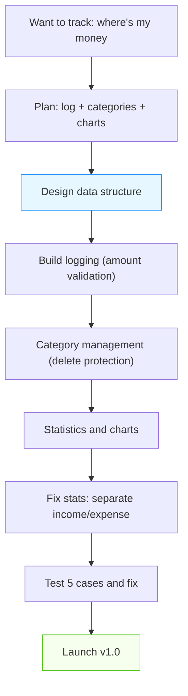

# Chapter 27: Project Two — Building a Personal Expense Tracker

> Where does the money go? Almost everyone has asked themselves that. This chapter builds a tool that answers it: log an income or expense in seconds, sort it automatically, then see with charts where your money went. An expense tracker looks simple, but it's the toughest test of "are the numbers right?" — and that's exactly the skill we'll practice.

## What You'll Learn in This Chapter

- How to plan an expense tracker and describe the "money" part clearly
- How to design a data structure so every entry is recorded and calculated correctly
- How to build the three big pieces: logging, categories, and statistics/charts
- How to spot and fix mistakes in the statistics logic
- How to systematically test the accuracy of your data

### Opening: Zhou's "Where Did My Money Go?"

Zhou has been working for a year. The salary isn't bad, but at the end of every month she stares at her balance in shock: "Where did it all go? I didn't buy anything big." She tried expense apps, but they were either plastered with ads or had categories that didn't fit her. She wanted to know "how much did I spend on takeout this month" and "how much on books," but those apps lumped takeout under "Food" together with groceries, so she couldn't see what she cared about.

Her small goal: **log an income or expense, pick a category, and at month's end see at a glance how much went into each category.** "I don't need anything flashy — just correct numbers and categories I can shape my own way."

In this chapter, we build it with her. An expense tracker is different from the last project — a wrong task means you might miss something, but **wrong math can mislead your decisions**. So you'll see more real conversations here about correcting AI and double-checking numbers. That's what makes this project so good for learning.

## 27.1 Planning the Expense Tracker

Again, we start with one plain sentence.

**You:** I want an expense tracker. Log income and expenses, see how much I spent per category, and ideally have charts. I don't know how to program, so guide me through it.

**AI:** Good. To get it right, a few questions:
1. What info goes into each entry? (amount, date, type, category…)
2. Should categories be fixed (food, transport, shopping) or ones you define yourself?
3. What charts do you want — a pie chart of category shares, or a line chart of monthly trends?

**You:** Amount, date, income-or-expense, and category — those four are a must. I want to add my own categories. I'd like both charts, but start with the category shares.

**AI:** Let me repeat it back: a **personal expense tracker** where each entry has "amount, date, income/expense type, category"; you can freely add and remove categories; you can add entries, total by category, see a pie chart of category shares, and a line chart of monthly income/expense trends. Right?

**You:** Yes. Do the core first: logging and the shares chart; the trend chart can wait.

**AI:** Good. Suggested route: (1) design the data structure → (2) logging (add an entry) → (3) category management → (4) total per category → (5) pie chart → (6) trend line chart. One step at a time.

In planning, you do the same as last chapter — **say it all, answer AI's questions, and cut what can wait.** Zhou's choice to "do the trend chart later" is smart: focus on getting the core "logging + shares" solid first.

## 27.2 Designing the Data Structure

The foundation of an expense tracker is "what exactly does one entry store." Get this wrong and everything downstream breaks.

**You:** So what does one entry store? Explain in plain language, and show me what each looks like.

**AI:** Sure. One entry (let's call it a "record") stores:

| Field | Description | Example |
|---|---|---|
| Amount | A number, always stored positive | 35.5 |
| Type | Income or expense | expense |
| Category | Which group it belongs to | takeout |
| Date | Which day it happened | 2026-11-03 |
| Note | Optional description | the Sichuan place at noon |

**You:** Wait, why is the amount "always positive"? Shouldn't an expense be negative?

**AI:** Great question — and a very common intuition. If expenses are negative and income positive, every calculation has to carry the sign around, which invites mistakes. A sturdier approach is: **store only the magnitude (positive), and use the "type" field to tell income from expense.** Then totals are unambiguous: sum expenses, sum incomes, no interference.

**You:** Oh, I see. Then I'll go with you. One more thing — I want to search by note, like typing "Sichuan" to find that meal.

**AI:** Received, note becomes searchable. Final design: positive amount + type distinguishes direction + category + date + note (searchable). We'll build to this structure.

The "store amount as positive, distinguish by type" decision is a valuable one. You don't have to invent it — **AI proposes the design and explains why**; your job is to understand, judge, and confirm. If something's unclear, do what Zhou did and ask one more question — AI will explain in plain language.

## 27.3 Building the Logging Feature

With the foundation set, we build the first layer: logging one entry.

**You:** Make a "log entry" form: amount, income or expense, category, date, note, then save into a list.

**AI:** Good. I'll make a form: amount field, income/expense toggle, category picker, date picker (defaults to today), and note field. After saving, the entry appears in a list showing amount, type, category, and date.

**You:** I tried it — I can type "abc" as the amount, or a negative number, and it saves. The statistics will be a mess. The amount field should only allow numbers, right?

**AI:** Correct — I missed validation. I'll change it: the amount accepts only numbers greater than 0; text or negatives show "please enter a valid amount" and block saving.

**You:** Also, when I pick "income," the category dropdown still shows expense categories like takeout and taxi. That doesn't make sense.

**AI:** Understood. I'll split categories by type: when "income" is selected, only income categories show (salary, bonus…); when "expense," only expense ones. The list updates when you switch types.

Same rhythm again: "first version works, edges need filling." Zhou's two points — **amount validation** and **categories following the type** — are things any real user hits. She wrote no code; she just used it carefully and pulled them out.

## 27.4 Building Category Management

Defining her own categories is Zhou's hard requirement.

**You:** The categories are fixed right now. I want to add my own, rename them, and delete ones I don't use.

**AI:** Good. I'll add a "Category Management" page: add a category (name + income/expense type), rename, delete. The logging form's category dropdown reads from here.

**You:** Deleting needs care. If I delete "takeout" and 20 past entries used it, what happens to those?

**AI:** Excellent catch. I'll add two safeguards: (1) if a category has entries, deleting prompts "this category has N entries" for confirmation; (2) offer two options — "move those entries to 'Uncategorized'" or "cancel deletion." Nothing gets quietly lost.

**You:** Right, that's what I want. One more: before deleting, let me see which entries are affected.

**AI:** Received. Before confirming deletion, it lists the number and a sample of affected entries; deletion runs only after you confirm. Only the category-management delete flow changes.

Zhou's question — "if I delete the category, what about the old entries?" — is a classic expense-tracker problem. AI's first version was simple; one follow-up question forced out an important "delete protection" design. That's the value of your thinking: you don't need to know how to build it, only to ask "what happens if…?"

## 27.5 Building the Statistics and Charts

With entries in place, it's time to answer "where did the money go" — statistics and charts.

**You:** Make a statistic: add up expenses by category, tell me how much each cost, and show a pie chart of the shares.

**AI:** Good. I'll make a "Statistics" page: compute each expense category's total and its percentage of total spending, with a pie chart showing shares and exact amounts on hover.

**AI:** (After generating) Here it is.

**You:** It's out, but I checked: the pie says "Food 45%," yet takeout plus groceries is clearly 38%. The numbers don't match — look into it.

**AI:** Let me check. Two likely causes: (1) some other entries got mixed into "Food"; (2) the denominator is wrong — I computed shares over all records (including income), while you want shares over total expenses only. Let me change it: use total expenses as the denominator, exclude income. Then I'll recheck those two entries with you.

The moment the first chart appeared, Zhou found the numbers off. That's exactly where an expense tracker must be strict. **A pretty chart is worthless if the numbers are wrong.** Her method is worth copying: compare a hand-calculated result with the software, and chase any mismatch.

## 27.6 Modifying the Statistics Logic

Statistics bugs often come in chains; this section is about "fixing the root."

**You:** After changing the denominator to total expenses, the shares are right. But I found something else: I logged a "refund 100" as income in the Shopping category, and it reduced Shopping's expense total. That's wrong, isn't it?

**AI:** You're right — that's a hole in my statistics logic. When I "sum by category," I didn't separate income from expense, so I added Shopping's income and expenses together. Fix: when totaling expenses, accumulate only records with type "expense"; income is counted separately and never enters expense-category totals. Shopping will count only its expense entries.

**You:** Good. And confirm this: the pie percentages should add to 100%, right? After the fix, show me each category's amount and percentage.

**AI:** Yes — all expense categories' percentages should sum to 100% (with possible rounding error of ~0.1%). After the fix I'll list each category's amount and percentage in a table and add them up to verify for you.

A problem like "a refund offsets an expense" is hard to spot just by looking at the screen; it takes you **understanding the business logic**: income must not mix into expense statistics. You don't need to code — you just need to know "how should this entry be counted?" — and then you can be AI's quality inspector.

## 27.7 Testing Data Accuracy

The last gate for an expense tracker is a systematic check of the numbers.

**You:** Let's test the data properly. List a set of test cases covering all the easy-to-miscalculate situations.

**AI:** Sure. Here's a set with expected results for us to check together:

| Test scenario | Input | Expected result |
|---|---|---|
| Multiple same-category expenses | takeout 30 + takeout 20 | Takeout total = 50 |
| Income excluded from expense stats | salary 5000 (income) | Expense total unchanged |
| Refund offset | shopping expense 200, refund income 50 | Shopping still counts 200 expense |
| Percentage sum | several expense categories | shares sum ≈ 100% |
| Empty category | expense with no category | shown as "Uncategorized," nothing lost |

**You:** I ran them. The first four passed. #5 has a problem: I named a category "Uncategorized" myself, and it collided with the built-in "Uncategorized," so the statistics show two rows.

**AI:** Confirmed — a category-name collision. Two fixes: (1) reserve "Uncategorized" as a built-in name users can't reuse; (2) if entries already use the duplicate name, merge them into the built-in "Uncategorized." Then I'll rerun all five cases.

**You:** All five pass now. Let's publish, and write me a project-notes file recording the rules: "positive amounts, income and expense counted separately, confirm before deleting a category."

**AI:** Done. Expense tracker v1.0 is live: log entries, category management (with delete protection), per-category totals, pie-chart shares, income and expense accounted separately. Project notes and version log are written.

From "where did my money go" to a tool that answers it accurately — Zhou walked the whole path. The attitude to take from this chapter: **for anything involving numbers, compare the computed results against reality again and again, and chase any mismatch to the bottom.**



## Common Pitfalls

- **Pitfall: Letting amounts mix positive and negative.** Why: calculations carry signs and are easy to get wrong. What to do: like 27.2, store amounts as positive, distinguish direction with "type," and total them separately.
- **Pitfall: Testing only "normal" input, not junk.** Why: text or negative amounts silently corrupt data. What to do: deliberately enter invalid values and see if the software blocks them with a hint.
- **Pitfall: Deleting a category along with old entries.** Why: deleting a referenced category destroys history. What to do: check references before deleting, show what's affected, and offer "move to Uncategorized."
- **Pitfall: Judging a chart by looks, not by numbers.** Why: a beautiful chart with wrong numbers misleads. What to do: compare with hand calculations; percentages should sum to 100%.
- **Pitfall: Mixing income into expense statistics.** Why: income offsets expense-category totals (the refund problem). What to do: when totaling expenses, accumulate only "expense" records; count income separately.

## Chapter Summary

- An expense tracker's core isn't its interface — it's whether the numbers are correct.
- The data structure decides everything: positive amounts, type distinguishes direction, customizable categories, searchable notes.
- Three big features: logging (with amount validation), category management (with delete protection), statistics/charts.
- Statistics logic is the most error-prone: denominator is total expenses, income and expense counted separately, percentages sum to ~100%.
- Accuracy comes from systematic testing: cover same-category sums, income isolation, refund offsets, percentage totals, and empty categories.
- Your value is "knowing the business": if you know how an entry should be counted, you can be AI's quality inspector.

## Practice Exercises

1. Following 27.2, have AI design a data structure for your own expense tracker, and ask it a question like Zhou's: "Why not store expenses as negative numbers?" See how it explains.
2. Design three "miscalculate-able" test cases yourself (e.g., refund, cross-month, empty category), run them with expected results, and note which ones fail.
3. Deliberately tell AI to mix income and expenses in the statistics, then correct it to "count them separately." Compare the two results and understand why separation matters.

## Copyable Instruction Templates

**Template 1: Design a data structure that "adds up correctly"**

```text
I want to build an expense tracker. First, use plain language to design what data each entry should store.

Please explain in particular:
1. How should the amount be stored so statistics won't miscalculate (positive/negative signs)?
2. How do we distinguish income from expense?
3. How are category, date, and note each handled?
List each item in a table and explain why it's designed that way. I'll approve before we build.
```

**Template 2: Accuracy testing with expected results**

```text
For the statistics in our expense tracker, please list a set of test cases. For each, write the [input] and the [expected result], covering:
- multiple same-category expenses added together
- income not entering expense statistics
- refunds not offsetting expenses
- category percentages summing to about 100%
- records with an empty category

I'll run them one by one. When I give you the actual results, any case that differs from expected — find the cause, fix it, then rerun ALL cases.
```
