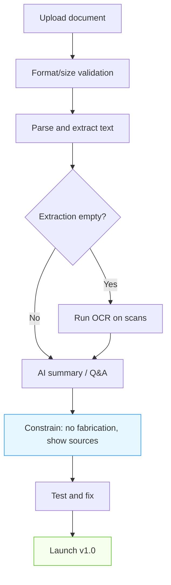

# Chapter 28: Project Three — Building an AI Document Assistant

> In the first two projects, the "intelligence" was you and me. This one is different: we'll make the software itself "read" documents — upload a contract or report, and it summarizes the key points; then you can ask it questions about the content as if talking to a person. This is your first piece of software with real AI in it, and the most fun project in the book.

## What You'll Learn in This Chapter

- How to plan an AI assistant that "reads" documents
- How to get software to accept and parse PDF, Word, and similar files
- How to make AI summarize and answer questions
- How to cure AI's habit of "missing the point and making things up"
- How to test the accuracy of document processing

### Opening: Chen's "Mountain of Documents"

Chen is a marketing specialist whose desk is permanently buried in documents: contracts from clients, industry reports, hundred-page tender files. Much of the job is "reading" — finish this contract and extract the payment terms; finish that report and find the competitor data.

"The worst are the tender documents," she says. "A hundred-plus pages, and I have to flip through the whole thing to find a few key numbers. My eyes practically go blurry." She tried dumping documents into a chat AI, but either the file wouldn't upload, or the AI read only the beginning and summarized wildly, then invented details when asked — "it told me about a clause that didn't exist at all. I nearly filled in the tender form wrong."

What she wants is clear: **throw in a document, let it explain the key points first; ask it specific questions, and it must answer from the document — no making things up.**

In this chapter, we build that "reads documents and stays honest" assistant with her. You'll set AI's "way of working" for the first time, and witness its most common mistake firsthand — **hallucination** — and learn how to cure it.

## 28.1 Planning the Document Assistant

First, say what it should do.

**You:** I want an AI document assistant. Upload a document, it summarizes the key points, and I can ask it questions about it. I don't know how to program, so guide me through it.

**AI:** Good. To get it right, a few questions:
1. Which file formats should it support — PDF, Word, or also plain text?
2. What kind of summary do you want — a short overview, or a bulleted list of key points?
3. When you ask a question the document doesn't answer, what should AI do?

**You:** PDF and Word mainly. Summaries as bullet points, not too long. Most important for Q&A: **if it's not in the document, say so plainly — absolutely no making things up.**

**AI:** Let me repeat it back: a **document assistant** supporting PDF/Word uploads; bulleted key-point summaries; Q&A based on the document; with one iron rule — if there's no basis in the document, say "not mentioned in the document" and never invent. Right?

**You:** Yes — especially that last one, that's the most important.

**AI:** Good. Suggested route: (1) file upload → (2) document parsing (extract the text) → (3) AI summary → (4) Q&A → (5) adjust how AI answers (cure the making-things-up) → (6) testing.

Chen putting "no making things up" first is exactly right. **For software with AI, the first thing to define is the bottom line** — what it may do and what it absolutely may not. That bottom line becomes concrete techniques in 28.6.

## 28.2 Building File Upload

Step one: let the user hand the document to the software.

**You:** First make an upload feature — pick PDF and Word files, upload them, then show me the file name and size.

**AI:** Good. I'll make an upload button accepting PDF and Word (.doc/.docx), showing file name and size after upload with status hints. No other formats for now.

**You:** I uploaded a 50MB file and it hung forever with no feedback, and I couldn't tell if it succeeded. I need progress and a result message, and huge files should be blocked.

**AI:** Received. I'll add: (1) a progress bar during upload; (2) clear success/failure messages; (3) reject files over 20MB with a "file too large, please compress or split" hint. Only the upload part changes.

**You:** Also prevent wrong uploads — I uploaded a fake PDF with a changed extension and it accepted it.

**AI:** Understood. I'll add validation: not just the extension, but check the file's "signature" (a real PDF has a fixed beginning); if it doesn't match, show "incorrect file format."

Upload is the "entrance," and the entrance must **guard well**: right format, reasonable size, clear result. Chen's three rounds of follow-ups made the entrance pretty solid.

## 28.3 Building Document Parsing

The file is in, but for AI to read it, we must first "extract" the text — that's called **parsing**.

**You:** The file's uploaded, but how does AI read the words inside? Aren't PDF and Word binary?

**AI:** Great question. A document is like "packed luggage," and parsing is "unpacking and laying everything out." I'll use a parser for each type — PDF parser for PDF, Word parser for Word — to extract the text as plain text. This happens automatically on your side; after upload you'll see "text extracted."

**You:** I tried a scanned PDF — the kind made from a photo — and the extraction was empty. What's going on?

**AI:** Very common. A normal PDF contains "text" that can be extracted directly; a scanned PDF is actually a series of "images" with no text, so it needs OCR (recognizing words in images). I'll add: when extracted content is empty, show "this is a scan, OCR needed" and automatically run the OCR flow.

**You:** Also, a table in a Word document came out all mushed together, rows and columns scrambled.

**AI:** Received. I'll extract Word tables row by row with tab separation, preserving table structure so AI can still tell it's a table when reading. Only parsing rules change, not upload.

Parsing is the step most often tripped up by "special documents": scans, tables, images. You don't need to understand how parsing works — just **try it with all kinds of real documents**, and when you hit a problem, describe the symptom to AI and it will add the handling.

## 28.4 Building AI Summarization

The text is out; now let AI do the work: summarize the key points.

**You:** Make a "Summarize" button. When clicked, AI reads the document and lists the key points as bullets, not too long.

**AI:** Good. I'll add a "Summarize" button: on click, it passes the document text to AI with the instruction "list 5–8 key points, one sentence each." Results display in an area.

**You:** I clicked it and it basically copied the whole document back, still long. That's not a summary.

**AI:** Understood — my instruction to AI was too loose. I'll make it explicit: "keep only key conclusions and numbers, ignore background, no more than 30 characters per point, no more than 8 points total." Then it will genuinely distill instead of copying the original.

**You:** Much better. But what if the document is really long, like a hundred pages?

**AI:** Good question. AI has a limit on how much text it can "see" at once — that's **context length**, like a person who can only read so much at a time. For very long documents I'll first split into chunks, summarize each, then merge into one set of key points. It happens automatically; you just click "Summarize" once.

Two key concepts appeared here: the **instruction (prompt)** you give AI, and **context length**. The first decides how well AI works — the more specific the instruction, the more reliable the result; the second decides how much it can process at once — long documents need "split then merge." You don't need to memorize the terms; just remember: **state your requirements specifically, or AI will slack off.**

## 28.5 Building the Q&A Feature

Beyond summarizing, Chen wants to "ask" the document.

**You:** Add a Q&A box. I type a question and AI answers from this document, like "what's the payment method in this contract?"

**AI:** Good. I'll add a Q&A area: after you type a question, the system sends "document text + your question" to AI to answer from the document. Keep the last 10 turns so you can ask follow-ups.

**You:** I asked "payment method" and it answered well. But when I followed up with "what about the penalty clause," it seemed to pull in content from the previous document and mixed them together.

**AI:** Found it. When switching documents, did I clear the conversation? Apparently not. I'll change it: **every time you switch documents, clear the Q&A history** so AI only answers from the current document — no cross-contamination.

**You:** Yes, clear it. Also, if I close the page and reopen it, will my previous questions still be there?

**AI:** Currently no — the conversation lives in memory and disappears on refresh. If you want to keep it, I can store Q&A history grouped by document. Just tell me if you'd like that.

"Cross-contamination" (mixing up documents) is a very typical Q&A bug. The cause is leftover old content in AI's "context." Chen's observation — "it brought in the previous one too" — pinpointed it. As long as you watch "is it answering only from my current document?" you'll catch this kind of error.

## 28.6 Modifying How AI Answers

This section tackles the most important problem: **curing hallucination.**

**You:** I deliberately asked a question that's not in the document at all — "was this contract signed on Mars?" — and it said "on Mars." Absolutely unacceptable.

**AI:** That's AI's classic flaw, called "hallucination" — it follows your question and fabricates something that looks like an answer. There are several layers to cure it; I'll add them all:
1. Write explicitly in the instruction: "Answer only from this document's content; for information not in the document, you must reply 'not mentioned in the document' — no guessing or inventing."
2. After answering, attach the original text passage it relied on so you can verify.
3. If no relevant passage exists in the document, return "no relevant content found" directly.

**You:** #2 is great — seeing the basis puts me at ease. But the answer shouldn't be so wordy — just now it pasted the entire paragraph.

**AI:** Received. I'll change "attach basis" to show only the 1–2 most relevant sentences, with the conclusion first, then the basis. Concise yet verifiable. Only the answer format and basis display change; no other features.

Hallucination (AI fabrication) is the core risk of AI software. The cure is worth remembering: **constrain it with explicit instructions, make it show its sources, and let it say "I don't know."** Chen insisting on "seeing the basis" turned AI from an "authority" back into a "verifiable assistant."

## 28.7 Testing Document Processing

Finally, test this kind of software systematically.

**You:** Let's test. List a set of cases, especially ones that can catch it fabricating.

**AI:** Sure. Focus on these:

| Test scenario | How to test | Expected result |
|---|---|---|
| Normal Q&A | Ask something clearly in the document | Answers correctly, with basis |
| Fabrication question | Ask something not in the document at all | Replies "not mentioned in the document" |
| Very long document | Summarize a 100+ page PDF | Completes, key points intact |
| Scanned document | Upload an image-based PDF | Runs OCR, extracts text |
| Switch documents | Ask on doc A, then switch to doc B | No cross-contamination, only B |

**You:** I ran them. The "fabrication question" now correctly says "not mentioned," passed; "switch documents" doesn't cross-contaminate either. But "very long document" failed: summarizing stopped halfway with an error saying content too long.

**AI:** Confirmed — a problem in splitting and merging long documents: one chunk was too long and exceeded the single-processing limit. I'll change it: split on paragraph boundaries with a per-chunk character cap so every chunk stays within the limit; when merging, if there are too many points, do a deduplication pass. Then retest that case.

**You:** Retest passed. Let's publish, and write these three rules into the project notes: "answer only from the document, say so if there's no basis, attach the original passage."

**AI:** Done. AI Document Assistant v1.0 is live: upload (format/size validation), parsing (including scan OCR and table preservation), AI summary (long-text split and merge), document Q&A (follow-ups, no cross-contamination), honest answers (no fabrication, with sources). Project notes and version log are written.

From "eyes going blurry reading documents" to an assistant that reads, summarizes, and stays honest — Chen walked the whole path. The big takeaway: **an AI app's ability comes from its instructions; its reliability comes from constraints and verification.**



## Common Pitfalls

- **Pitfall: Assuming whatever AI says is true.** Why: AI "hallucinates" and fabricates answers that follow your question. What to do: like 28.6, constrain it with "say 'not mentioned' if it's not there," and require sources you can verify.
- **Pitfall: Giving AI a vague instruction.** Why: "summarize it" makes it copy the original. What to do: specify "how many points, how long each, only conclusions and numbers" — the more concrete, the better.
- **Pitfall: Leaving the upload entrance unguarded.** Why: fake or oversized files hang or error out. What to do: validate format (check the signature, not just the extension), cap size, give progress and result messages.
- **Pitfall: Ignoring scans and tables.** Why: scanned PDFs have no text and Word tables get mushed. What to do: run OCR when content is empty, extract tables with row/column structure.
- **Pitfall: AI "cross-contaminates" after switching documents.** Why: old conversation lingers in context. What to do: clear Q&A history on document switch, ensuring answers come only from the current document.

## Chapter Summary

- This is the first piece of software with real AI: ability comes from instructions, reliability from constraints and verification.
- Flow: upload (guard the entrance) → parse (extract text) → AI summary → Q&A → constrain answers → test.
- Parsing must handle special cases: OCR for scans, structure for tables, split-then-merge for long documents.
- The more specific the instruction, the more reliable the result; context has a length limit, so long documents need splitting and merging.
- AI hallucinates — cure it by saying "say 'not mentioned' if it's not there," attaching sources, and allowing "I don't know."
- Test by targeting "fabrication questions, long documents, cross-contamination" — find, fix, and retest.

## Practice Exercises

1. Take a real document of yours (a contract or report) and have the assistant summarize it. Then check it yourself: are its points consistent with the document? Did it invent anything?
2. Deliberately ask three questions "not in the document at all" and see whether it honestly says "not mentioned." If it fabricates, fix its instruction following 28.6, then test again.
3. Upload a scanned PDF and a Word file with a table, and record the parsing results. When you hit problems, describe the symptoms to AI and see how it fixes them.

## Copyable Instruction Templates

**Template 1: Make AI answer from a document and not fabricate (write into the app's core instruction)**

```text
You are a document assistant. Answer questions and summarize ONLY from the [document content] provided below.

Iron rules:
1. Use only information explicitly present in the document; no guessing, associations, or added common knowledge;
2. When the document has no basis, you MUST reply "not mentioned in the document" — never invent;
3. After every answer, attach the original passage you relied on (1–2 sentences) so I can verify;
4. Give the conclusion first, then the basis, in concise language.

[Document content]:
[paste here or have the program insert the document text]
```

**Template 2: Test whether an AI document assistant is reliable**

```text
Please test this document assistant, focusing on cases where it "fabricates" or "can't handle" something. List test cases, each with [action] and [expected result], covering at least:
- asking something clearly in the document (should answer correctly with basis)
- asking something not in the document at all (should say "not mentioned," never fabricate)
- uploading a 100+ page document (should summarize completely, no error)
- uploading a scanned PDF (should OCR the text)
- asking on doc A then switching to doc B (should not cross-contaminate)

I'll run them and give you the actual results; anything that differs from expected, find the cause, fix it, then rerun ALL cases.
```
