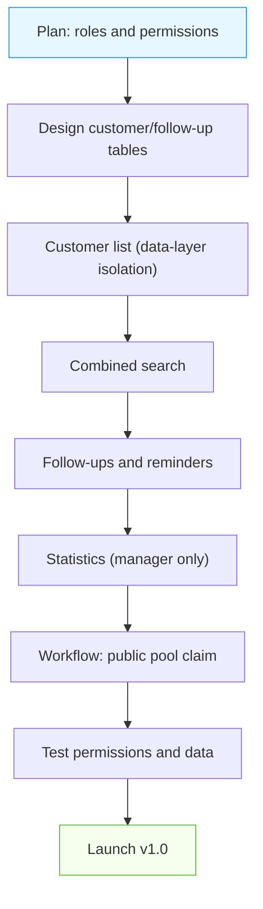

# Chapter 29: Project Four — Building a Customer Management System

> One person managing customers can get by with memory or a spreadsheet. Add colleagues, permissions, and "who followed up with whom" workflows, and it gets complicated. This chapter builds a customer management system that actually works for a team — not just storing customers, but handling search, follow-ups, statistics, and permissions. This is the project closest to a real enterprise application.

## What You'll Learn in This Chapter

- How to plan a customer management system for multiple users
- How to design the data structure for customer info and follow-up records
- How to build the customer list, search, follow-ups, and statistics
- How to modify the software based on real business workflows
- How to test permission isolation and data security

### Opening: Wang's "Spreadsheet Hell"

Wang runs a small office-equipment wholesale company with five or six salespeople. Customer data lives in a shared Excel sheet: company name, contact, phone, quote history…

The problems pile up. With thousands of rows, finding a customer means scrolling forever. Salesperson Zhang follows a customer, but Li doesn't know, so both quote to the same customer, who gets confused. Worse, someone who left took the customer data along, costing the company dearly.

"I need a system," Wang says, "that stores customers, lets me search, records every follow-up, and totals who handled how many deals. And — **salespeople only see their own customers; the manager sees everything**."

That last sentence, "permissions," is what makes this project different from the previous three. The first three were single-user. **This one needs roles and data isolation.** In this chapter you'll see how something invisible like permissions gets built up through conversation — and how you test whether it actually holds.

## 29.1 Planning the Customer Management System

Start with the requirements.

**You:** I want a customer management system. Salespeople can record customers, search, and log follow-ups; the manager sees everything and does statistics. I have no programming background, so guide me through it.

**AI:** Good. To get it right, a few questions:
1. What roles are there, and what can each do?
2. What information goes into one customer?
3. What goes into a "follow-up record"? Is one entry logged per call or visit?
4. What statistics do you want — total customers, per-person customer counts, deal counts?

**You:** Two roles: sales and manager. Sales can see and edit only their own customers; the manager sees all and does statistics. A customer stores company name, contact, phone, industry, source, and status. A follow-up records time, method, and content. Statistics: "customer count per salesperson" and "distribution across statuses."

**AI:** Let me repeat it back: a **customer management system** with sales/manager roles; customers have six fields — company, contact, phone, industry, source, status; each follow-up logs time, method, content; sales operate only on their own customers, the manager sees all and totals "customers per person, status distribution." Right?

**You:** Yes. Do the core first: customer list, search, follow-ups, statistics — and permissions must be right from the start.

**AI:** Good. Route: (1) design data structure → (2) customer list → (3) search → (4) follow-up records → (5) statistics → (6) adjust for business workflow → (7) test permissions and data.

Wang stressing "permissions right from the start" is crucial. Permissions are **much harder to retrofit than to design in from day one** — they permeate every feature. Decide "who sees what" up front and you won't be patching everywhere later.

## 29.2 Designing Customer Information

This step fixes what a "customer" and a "follow-up" each store.

**You:** What exactly do customers and follow-ups store? Show me in tables.

**AI:** Sure, two "tables":

**Customer table:**

| Field | Description | Example |
|---|---|---|
| Company | Customer's company | Hongyuan Tech |
| Contact | The person you deal with | Manager Li |
| Phone | Contact number | 138xxxx |
| Industry | Industry | Education |
| Source | Where the customer came from | Trade show |
| Status | Follow-up stage | Negotiating |
| Owner | Who owns this customer | Zhang |

**Follow-up table:**

| Field | Description | Example |
|---|---|---|
| Customer | Which customer it belongs to | Hongyuan Tech |
| Time | When contact happened | 2026-11-05 |
| Method | Call/visit/chat | Call |
| Content | What was discussed | Sent quote, awaiting reply |

**You:** I want "status" fixed to a few values: new, negotiating, won, lost. Don't let people type anything, or statistics get messy.

**AI:** Good idea. I'll make "status" a fixed four-option dropdown, no free text; then status distribution statistics stay clean. Also, I'll add an "owner" field to each table for permission isolation — when sales query customers, they only get ones where the owner is themselves.

**You:** Wait — does the follow-up table need an owner field too?

**AI:** Yes. Otherwise a salesperson could see another's customer info through follow-up records. A follow-up's permission must follow its customer's owner. I'll note in the design: **the visibility of every piece of data is determined by the owner of the customer it belongs to**.

Wang's question — "does the follow-up table need an owner too?" — hits the heart of permission design: **permissions must run through every related table.** Miss one and data leaks through that gap. That's exactly what 29.8 tests hard.

## 29.3 Building the Customer List

With the foundation set, build the list first.

**You:** Make a customer list showing company, contact, status, owner. Sales see only their own; the manager sees all.

**AI:** Good. I'll make a customer list page. On login it detects identity: a sales user sees only customers where "owner = current user"; a manager sees all. The top shows "N customers total."

**You:** I tried both accounts. The manager's fine, but the sales account could still see other people's customers! What happened?

**AI:** Serious issue; let me check. The list filters "at display time," but the underlying API returned all data to the browser — someone technical could bypass the interface and grab everything. The right fix is to **filter at data-query time**, so the server returns only what the user is entitled to. I'll change isolation to the query layer, not just hiding it in the UI.

**You:** That's the right fix — hiding it in the interface really isn't safe.

This is a very important correction. Wang doesn't understand the tech, but the habit of **logging in with two accounts separately** caught the fatal flaw of "hidden in the UI, not in the data." Remember: **permissions belong in the data layer, not the display layer.**

## 29.4 Building Customer Search

With many customers, you need to search.

**You:** Add a search box — type a company name or contact to find a customer.

**AI:** Good. I'll add a search box with "contains matching" on company and contact — type part of a word and it finds it. Results still obey permissions: sales only find their own customers.

**You:** Searching "Hongyuan" works. But I want to search "customers in education, status negotiating" — can I combine conditions?

**AI:** Yes. I'll upgrade search to "filtering": keywords on company/contact, plus dropdown filters for industry, status, and source, with multiple conditions combined. Results still respect permissions.

**You:** Small thing: when I typed spaces before and after "Hongyuan," it found nothing. Please strip spaces before searching.

**AI:** Received. Search trims leading/trailing whitespace before matching. Only search logic changes; list and permissions untouched.

Search looks simple, but "contains matching, combined filters, trimming spaces" are all real-life needs. Wang raises them one by one, AI fixes them one by one, and search gets smoother.

## 29.5 Building Follow-up Records

The real soul of a customer system is "follow-ups" — logging every contact.

**You:** On each customer's detail page, add a "Follow-up Records" area where I can add an entry (time, method, content), listed newest first.

**AI:** Good. I'll add a "Follow-up Records" area on the detail page: an add form (time defaults to today, method dropdown, content field), and history listed newest first. You can only add follow-ups to customers you own.

**You:** I want to see "last follow-up" right in the customer list, without clicking in. And customers not followed up for over 7 days should be marked yellow to remind me.

**AI:** Understood. I'll add a "Last Follow-up" column (the most recent follow-up time for that customer), and shade rows pale yellow if it's been over 7 days. This reminder is visible only to the manager and that customer's owner, respecting permissions.

**You:** Can I edit a follow-up if I wrote it wrong?

**AI:** Yes, but I'll make it "append a revision" rather than erasing the original — every edit keeps history, with who changed what and when. That traceability matters for a team.

"Mark yellow if no follow-up in 7 days" turns the system from a recording tool into a proactive reminder assistant. That's exactly the kind of improvement that takes software from "usable" to "nice to use."

## 29.6 Building the Statistics Feature

The manager needs the big picture; enter statistics.

**You:** Make a statistics page. The manager can see: how many customers per salesperson, and the distribution across statuses.

**AI:** Good. I'll make a stats page, manager-only: (1) a table — customer count and follow-up count per salesperson; (2) charts — a bar chart and shares for customers in each status (new/negotiating/won/lost).

**You:** The numbers are out, but "won" doesn't match what I counted. Check it.

**AI:** Let me check. Two likely causes: (1) some customers were created twice, and a status update changed one copy while the other kept the old status; (2) statistics counted "lost" as "active." Let me first look for duplicates, then pin the statistics to "exact status classification, each counted separately, non-overlapping."

**You:** Found it — duplicate customers. While you're at it, add a feature: when adding a customer, if the company name already exists, warn me so I don't create duplicates.

**AI:** Received. Check company name on add; if a duplicate is found, prompt "may already exist — view existing customer?" to avoid duplicate records. Also clean up existing duplicates and fix the statistics to exact classification.

Mismatched statistics leading to duplicate data — an old headache for customer systems. Wang's add-on "duplicate warning" is a good feature that grew out of a bug. This kind of "fixing one thing and strengthening another along the way" is very common in real development.

## 29.7 Modifying the Business Workflow

Real business comes back and asks the software to change.

**You:** We have a new rule: a customer shouldn't be hoarded by one salesperson forever. Customers with no follow-up for 30 days should automatically go into a "public pool" that other salespeople can claim. Can that be done?

**AI:** Yes — that's a fairly big workflow change. My plan: (1) a daily check marks customers with no follow-up for 30 days as "public pool" and clears their owner; (2) add a "Public Pool" page where sales can claim customers (owner becomes them); (3) log each claim so the manager can audit. This touches the list, permissions, and statistics; I'll change it in steps, confirming each with you.

**You:** Don't change everything at once. First just do the "mark as public pool" step and let me check it.

**AI:** Good. This round only does "daily check, mark customers with no follow-up in 30 days as public pool and clear owner." The claim page and logs stay untouched. I'll show you the result.

Wang's "don't change everything at once" is seasoned judgment. A sweeping workflow change like "public pool" **must be broken into small steps, each verified**, or it triggers a pile of chain-reaction problems — exactly the "one change at a time" rule from earlier chapters.

## 29.8 Testing Permissions and Data

Finally, focus on permissions and data security.

**You:** This is a team system; permissions are the make-or-break. List a group of tests focused on permission and data holes.

**AI:** Sure, here's a set:

| Test scenario | How to test | Expected result |
|---|---|---|
| Sales overreach view | Sales A searches for Sales B's customer | Can't find it; API doesn't return it |
| Overreach edit | Sales A tries to edit B's customer | Rejected |
| Follow-up leak | Sales A views follow-ups on B's customer | Can't see them |
| Manager rights | Manager views all customers and stats | All accessible |
| Public pool claim | After claiming, owner changes | Change correct, with a log |

**You:** I had two salespeople try each other. The first three held — especially the API one; my technical colleague checked the network traffic and only their own data came back. But the last one has a problem: after I claimed a public-pool customer, the owner changed, but no log was recorded.

**AI:** Confirmed — the claim missed writing a log. I'll add it: every claim records "who, at what time, claimed which customer" into the log table, viewable by the manager on a log page. Only the logging piece changes.

**You:** Retested and passed. Let's publish, and record these rules in the project notes: "permissions isolated at the data layer, status fixed to four choices, duplicate-customer warning, claims logged."

**AI:** Done. Customer Management System v1.0 is live: customer list, combined search, follow-up records (with reminders and history), manager statistics, public-pool claim workflow, data-layer permission isolation. Project notes and version log are written.

From a chaotic shared spreadsheet to a role-based, follow-up-capable, workflow-driven customer system — Wang walked the whole path. The big takeaway: **for a team system, permissions are the foundation; put them in the data layer, run them through every table, and verify with real accounts again and again.**



## Common Pitfalls

- **Pitfall: Permissions only in the UI.** Why: the UI hides it, but the API still returns everything, so a technical user bypasses it. What to do: like 29.3, filter at data-query time so the server returns only authorized data.
- **Pitfall: Related data missing permissions.** Why: customers are blocked but follow-ups aren't, so data still leaks through follow-ups. What to do: make every piece of data's visibility follow its customer's owner; check each table.
- **Pitfall: Letting people type status/categories freely.** Why: inconsistent entries wreck statistics. What to do: use fixed dropdowns, e.g., four status choices.
- **Pitfall: Rolling out a big workflow change all at once.** Why: it touches everything and errors are hard to trace. What to do: like "public pool," break it into small steps, verifying each — don't change everything at once.
- **Pitfall: Not testing overreach in a team system.** Why: permission holes are invisible until they leak data. What to do: use two real accounts against each other, and check the network traffic confirms API-level isolation.

## Chapter Summary

- The customer system is the closest to a real enterprise app: multiple roles, workflows, and heavy permissions.
- Permissions must be designed from the start, placed in the data layer (not display layer), and run through the customer table and follow-up table.
- Data structure splits into a customer table and a follow-up table; status is fixed to four choices to avoid distorted statistics.
- Features: customer list, combined search, follow-ups (reminders + history), manager statistics, duplicate-customer warning.
- Real business changes the software (e.g., public-pool claim); big changes must be broken into small, verified steps.
- Team systems must specifically test permissions: overreach view, overreach edit, follow-up leaks, manager rights, operation logs.

## Practice Exercises

1. Following 29.2, design a "customer table" and "follow-up table" for your own system, and answer: "Why does the follow-up table need an owner field?" Think through how permissions run through it.
2. Use two accounts (or have AI simulate) to try overreach: can sales A see sales B's customers and follow-ups? Record the results and fix anything that fails.
3. Think of a scenario from a business you know where "customers/resources can't be hoarded forever." Have AI design a public-pool-like flow following 29.7, and require it to be implemented in small steps.

## Copyable Instruction Templates

**Template 1: State permission requirements clearly from the start**

```text
I want to build a piece of software for multiple users, with two roles: [role A] and [role B]. Please design permissions from the very start according to these rules — don't add them afterward:

1. [Role A] can only view and edit [data they own];
2. [Role B] can view all data and do statistics;
3. The visibility of all related data (e.g., follow-up records) follows the owner of the main data it belongs to;
4. Permissions must filter at "data query time," not just hide things in the interface.

First paraphrase the permission rules back to me in plain language; after I confirm, then begin.
```

**Template 2: Specifically test whether permissions have holes**

```text
This is a team system. Please design a set of "permission and data security" tests, each with [action] and [expected result], covering at least:
- whether a low-privilege user can see others' or high-privilege data (including by calling the API directly)
- whether a low-privilege user can modify others' data
- whether related data (e.g., follow-ups) leaks others' info
- whether a high-privilege user can normally see everything and run stats
- whether key operations (e.g., claiming a customer) leave a log

I'll test with real accounts. Anything that fails, find and fix it — especially the "hidden in the UI but still returned by the API" kind — then retest.
```
