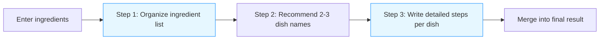
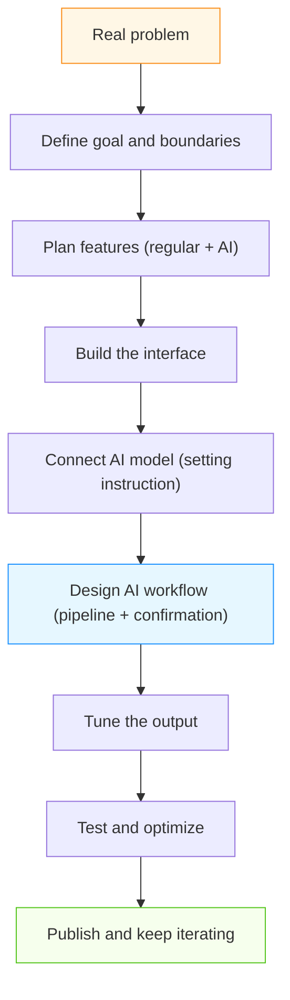

# Chapter 30: Project Five — Building Your Own AI App

> You've now followed along and built four pieces of software. This chapter hands the wheel fully to you: **start from a real problem of your own and build an AI app that's yours.** It's the finale of the five projects — and the place where, having walked the whole path of natural language programming, you can finally set off on your own.

## What You'll Learn in This Chapter

- How to start from a real problem, not "building AI for AI's sake"
- How to turn a problem into a clear goal and feature set
- How to design an AI app's interface and workflow
- How to connect an AI model and tune its output
- How to test, optimize, and publish your own AI software

### Opening: A Problem on the Way Home from Work

Every evening on the way home, Ya walks past the market and picks up a few things. But once home, she often stares at the fridge: a couple of eggs, a carrot, half a cabbage — "what can I make with these?" She'll ponder for ten minutes and end up ordering takeout anyway.

She thought about recipe apps, but they all work one way: "tell me the dish, I'll give you the recipe." Her problem is the reverse: "**here's what I have, tell me what I can cook.**" What she wants is a "fridge cleaner": toss in your ingredients, and AI tells you what home-cooked dishes you can make, how to make them, and roughly how long it takes.

This isn't a "grand" AI project, but it's a **real, specific problem that's hers**. In this chapter we use it as the example and walk the full "problem to AI app" path. You can swap in your own problem — **the method is identical.** Remember: a good AI app never starts with "what can AI do," but with "what do I actually need to solve?"

## 30.1 Starting from a Real Problem

The easiest mistake when building an AI app is to think "I want to make something cool with AI," then scramble to find a use for it. Work the other way around.

**You:** I want to build an AI app but don't know where to start. I have a small annoyance: I get home and there are a few leftover ingredients in the fridge, and I never know what to cook, so I order takeout. Can that be an app?

**AI:** That's an excellent starting point — real and specific. Let me confirm a few things:
1. What's the input — do you type ingredient names, or take a photo for AI to recognize?
2. What's the output — just dish names, or also steps?
3. Is this for you alone, or for others too?

**You:** Type ingredient names first, simple. Output needs dish names plus steps, not too fancy, home-cooked is fine. Just me for now; we'll see about others later.

**AI:** Good. One important note: we **confirm the problem is real before talking about AI.** Your annoyance — "I have ingredients but don't know what to cook" — is clear, and there's no handy tool for it, so it's worth building. If instead you'd said "I want to make an AI thing but haven't thought what problem it solves," you'd likely build something nobody uses.

**You:** Got it. Let's start with this "fridge cleaner."

Starting from a real problem has three checks to keep you from wasting effort:

| Check | Ask yourself | Ya's answer |
|---|---|---|
| Real? | Is this a daily annoyance or an imagined one? | Almost every day |
| Specific? | Can you say "who, in what situation, stuck where"? | After work, leftovers, no idea what to cook |
| Solved already? | Don't rebuild a wheel that already works well | Recipe apps go "dish → steps," not the reverse |

Pass all three and it's worth starting. You can do this step without AI — **it's your judgment, not AI's.**

## 30.2 Defining the App's Goal

With the problem set, turn it into a one-line goal and a few boundaries.

**You:** Help me define the "fridge cleaner": what's the goal, what we do and don't do.

**AI:** Sure, here it is:

> **App goal**: The user enters ingredients they have on hand; the app recommends 2–3 home-cooked dishes makeable with those ingredients, with steps and approximate time, helping the user stop staring at leftovers and ordering takeout.

**Boundaries (not doing for now):**
- No photo recognition (manual input first)
- No shopping lists, no nutrition analysis
- No grand or dinner-party dishes — only home cooking under 30 minutes

**You:** Good. But I need to clarify "ingredients on hand": cooking usually needs oil, salt, soy sauce — I don't want to type those every time. Assume basic seasonings are available at home and let me enter only main ingredients, okay?

**AI:** Very reasonable. I'll write into AI's setting: "assume the user has basic seasonings — oil, salt, soy sauce, vinegar, water — and recommend based only on the main ingredients the user provides." Then you just enter eggs and carrot, no need to report seasonings.

A clear goal = one sentence saying "for whom, solving what, outputting what," plus a "what we won't do for now" list. **Boundaries matter as much as the goal** — they keep the app from sprawling and give this round a clear definition of done.

## 30.3 Planning the AI Features

With the goal set, plan the features. The big difference between an AI app and a regular one: some features run on ordinary code (interface, storage), some on AI (understanding ingredients, generating recipes).

**You:** What parts does this app have? Which use AI, which are regular features?

**AI:** Good, I'll split them into two groups:

**Regular features (ordinary code):**
- Ingredient input: type, add, remove ingredient tags
- Result area: show recommended dish names, steps, time
- History: save last input and result for review

**AI features (via the model):**
- Understand ingredients: organize the user's input into a clean list (e.g., "two eggs, one carrot")
- Recommend dish names: think of home-cooked dishes from those ingredients
- Generate steps: write the method and time for each dish

**You:** Wait — does "understanding ingredients" really need AI? I'm typing ingredient names; why not just pass them straight to AI to generate recipes?

**AI:** Fair question. You could merge them, but splitting helps: **first let AI clean up the messy input** (e.g., turn "eggs, carrot, and half a cabbage" into a clear list), then generate recipes — more stable. It's like "prepping ingredients" before cooking — get them organized first so the rest isn't chaotic. That's the "workflow" we'll cover in 30.6.

Splitting features into "ordinary code" and "AI" is a useful habit. You don't need to know how they're built, but you should know: **which are deterministic (an input box is an input box) and which aren't (AI output can vary each time).** The uncertain parts are what you'll focus on designing and testing.

## 30.4 Building the App Interface

First, make an interface you can see and click.

**You:** Make the interface first: an ingredient input, a "cook something" button, and results below. Nothing fancy.

**AI:** Good. I'll make a simple page: title "Fridge Cleaner" on top; an input in the middle where you type and press Enter or click "Add" to turn it into a tag; a "Cook something" button; and a result area below with sample content so you can see the layout.

(AI generates the page.)

**You:** I added "eggs" and "carrot," but got one wrong and couldn't delete it. Can tags have a little × to remove them?

**AI:** Received. Each ingredient tag gets a "×" delete button on the right; click to remove. Only the input area changes; the result area stays.

**You:** Also, I added 10 ingredients at once and the page got crammed. Cap it at 8 with a hint when exceeded.

**AI:** Understood. Limit to 8 ingredient tags; beyond that show "max 8 — remove some first." Only the input-area rule changes.

Like the earlier projects, the interface step is: get a first look, then tweak against real use. "Delete tag" and "count limit" are small details, but **they're exactly what makes software nice to use.** You just need to click through it conscientiously like Ya and say what bugs you.

## 30.5 Connecting the AI Model

The interface is up; now give it a "brain" — connect the AI model.

**You:** Interface's done. How do I connect AI? Do I need to prepare anything?

**AI:** Good news: you don't prepare a model — I'll connect you to an off-the-shelf AI service; you just call it. On your side there are two things: (1) confirm which model (I'll recommend a cheap, capable one); (2) prepare a "setting instruction" telling AI who it is and what to do.

**You:** What's a setting instruction? Can I see it?

**AI:** Of course. For example:

> You are "Fridge Cleaner," a home-cooking chef. The user will give you a list of ingredients on hand. Using only those ingredients (assume basic seasonings like oil, salt, soy sauce, vinegar, and water are available), recommend 2–3 home-cooked dishes makeable within 30 minutes. For each dish give: name, ingredients needed (chosen from what the user has), step-by-step method, and estimated time. Use conversational language, clear steps, no grand dishes.

**You:** I tried it and it followed that. But sometimes it recommends dishes needing "starch" or "cooking wine," which I don't have. Is that it not listening?

**AI:** Partly. You said "basic seasonings" but didn't list them, so AI counted cooking wine and starch as basic by its own reading. Fix: **list the basic seasonings explicitly** — I'll write "assume only oil, salt, soy sauce, vinegar, and water; nothing else may be used." The more specific the instruction, the less AI improvises.

Connecting AI is less daunting than it sounds: the model is ready-made; your main job is **writing that setting instruction**. Its core trick is eight words: **state the role, state the boundaries.**

## 30.6 Designing the AI Workflow

This section is the chapter's high point — and the most valuable skill in building AI apps: **break AI's task into a pipeline instead of asking it to do everything in one sentence.**

**You:** Right now AI gives dish names and steps in one shot, and I feel it "thinks shallow" — names are okay, steps are sloppy. Can we improve it?

**AI:** Yes, this is the key technique. Asking AI to "name dishes and write steps" in one sentence makes it drop balls. Let's change it into a **three-step pipeline**:



- **Step 1** (to AI): organize the user's messy input into a clean ingredient list.
- **Step 2** (to AI): from the list, recommend only dish names and reasons — no steps yet.
- **Step 3** (to AI): for each dish name, write detailed ingredients, steps, and time.

Each step has its own instruction, and the previous step's output feeds the next. Like a factory assembly line — each worker does one station, faster and better than one person doing it all.

**You:** Sounds good, but is it complicated to build?

**AI:** A little more work, but worth it. I'll chain the three steps; you still click "Cook something" once, and it runs all three internally. You won't feel the complexity — you'll just see a more detailed result.

**You:** Let's try. But I want to intervene at step 2 — I want to be able to swap out a dish name before it writes the steps.

**AI:** Great idea. I'll add a "midpoint confirmation": after step 2 produces names, it shows them to you first; you can delete one you don't like or add your own, then confirm to go into step 3 for steps. You guard the dish names; AI handles the details.

"Pipeline + midpoint confirmation" is the essence of AI app design. **Splitting lets you check and correct each step individually; a confirmation point embeds human judgment into the AI flow.** Far more reliable than a one-sentence black box.

## 30.7 Tuning the AI Output

With the pipeline built, shape the output into what you like.

**You:** The result's out, steps are detailed. But the language is a bit "official," like a manual. I want it like a friend teaching me to cook — conversational. Okay?

**AI:** Sure. I'll add to step 3's instruction: "write steps in a friendly, conversational tone, like 'first beat the eggs,' no formal language or jargon." Change that instruction only; the flow stays.

**You:** Also, I want "total time" shown at the top of each dish — right now it's buried on the last line, hard to see.

**AI:** Received. In the result display, add a line "⏱ about X minutes" at the top of each dish card, filled from the time field in AI's output. Only the display format and the corresponding output requirement change.

**You:** Last thing: sometimes it recommends 3 dishes, sometimes 2 — not fixed. I want exactly 3.

**AI:** Understood. In step 2's instruction I'll change "2–3 dishes" to "exactly 3 dishes, using as many of the available ingredients as possible" — output will be stable.

Tuning output is mostly **repeatedly editing instructions and display**, not code. You'll find that building an AI app is largely "state the requirement specifically, look at the result, adjust again." It's the same thing you practiced in all five projects: "state need → see result → request change."

## 30.8 Testing and Optimization

Before publishing, push it to the extremes.

**You:** Let's test. List scenarios, especially weird ones.

**AI:** Sure. Focus on these:

| Test scenario | Input | Expected result |
|---|---|---|
| Normal input | eggs, carrot | 3 home dishes, clear steps |
| Only one ingredient | just one egg | Honestly say "too few ingredients," no forcing |
| Odd ingredients | "stone, toothpaste" | Recognize they're not food, ask to re-enter |
| Many ingredients | 8 at once | Handles it, steps not chaotic |
| Output stability | same input twice | Exactly 3 dishes both times, same format |

**You:** I tested. "Only one egg" actually forced out three weird dishes; "stone toothpaste" it took seriously and wrote a recipe for "stone scrambled eggs"… absurd.

**AI:** Both confirmed. Fixing: (1) add validation in step 1 — if fewer than 2 ingredients, prompt "too few ingredients, add a few more" and stop; (2) in step 1, check whether inputs are foods; if something clearly isn't (stone, toothpaste), prompt "these don't seem like ingredients, please check" and don't pass them downstream. Only step 1 changes; later steps untouched.

**You:** All pass after the fix. "Output stability" passed too — 3 dishes both times, same format.

Tests like "stone scrambled eggs" look funny but are essential. **AI will earnestly process any input, so it especially needs you to guard the entrance.** Notice how "test edges, prevent junk" — stressed in every earlier project — matters even more for AI apps, because AI won't volunteer "that's unreasonable" unless you tell it to.

## 30.9 Publishing Your AI Software

The last gate: get your very own app truly online.

**You:** All tested. How do I publish? I want it openable on my phone so I can show my mom later.

**AI:** I'll deploy it online so you get a web address that opens on phone and computer. Three things to flag before we publish:
1. **Cost**: each AI call costs a little; you should know how much you're spending — I'll add a simple usage counter;
2. **Privacy**: user input goes to the AI service, so don't collect sensitive info — I'll add a note;
3. **Iteration**: launch isn't the end. After using it you'll want changes — like "photo recognition of ingredients" — and we'll keep making small, verified changes the way we did before.

**You:** Good, all covered. Publish it, and write the project notes and version log too.

**AI:** Done. "Fridge Cleaner" v1.0 is live: ingredient input (tag add/remove, limit 8), three-step AI pipeline (organize → recommend → steps, with midpoint confirmation), conversational output, input validation, usage counter. Project notes and version log are written.

From "staring at leftovers after work" to an AI app that genuinely helps — and is live — Ya walked the whole circle. And that circle is the same path as the previous four projects:



And here, all five projects are complete. Looking back, you've actually mastered a whole set of skills: **turn a real problem into requirements; turn requirements into features; turn features into rounds of conversation with AI; then, through modification, testing, and publishing, deliver it into a real person's hands.** You didn't need to become a programmer first — you needed the abilities this journey built: state it clearly, break it down, judge it accurately.

AI apps will keep getting stronger and tools smoother. But what ultimately decides what you can build is always the starting point: **do you have a real problem worth solving, and are you willing to build it sentence by sentence, as these five chapters showed?** Now it's your turn.

## Common Pitfalls

- **Pitfall: Building AI for AI's sake, with no real problem.** Why: nobody uses it. What to do: run the three checks (real/specific/not solved by existing tools) before starting.
- **Pitfall: Unclear goal, undefined boundaries.** Why: the app sprawls and has no definition of done. What to do: write a one-line goal + a "what we won't do for now" list.
- **Pitfall: Asking AI to do everything in one sentence.** Why: it drops balls and gives sloppy results. What to do: like 30.6, break it into a pipeline, one instruction per step, with a human confirmation point at key steps.
- **Pitfall: Vague instructions.** Why: AI improvises — random seasonings, unstable dish counts. What to do: specify role, boundaries, counts, and tone, then look at results and adjust.
- **Pitfall: Not testing weird inputs.** Why: AI will earnestly cook "stone scrambled eggs." What to do: add validation at the entrance (too-few or non-food ingredients blocked) and test output stability.
- **Pitfall: Ignoring cost and privacy after publishing.** Why: calls cost money, inputs may be sensitive. What to do: add a usage counter and privacy note; keep making small iterative changes after launch.

## Chapter Summary

- Build AI apps from a real problem, not from "what can AI do."
- Three checks for a good problem: real? specific? unsolved by existing tools?
- A clear goal = one sentence "for whom, solving what, outputting what" + a "what we won't do for now" list.
- Split features into two groups: regular code (interface, storage) and AI (understanding, generation); focus design and testing on the uncertain AI parts.
- Connecting AI is really writing a "setting instruction": state the role, state the boundaries.
- The most valuable skill is designing an AI workflow: a pipeline (organize → recommend → steps), one instruction per step, with a human confirmation point.
- Tuning output means repeatedly editing instructions and display; test weird inputs and output stability; publishing means considering cost, privacy, and ongoing iteration.
- With five projects done, you now have the complete ability to turn a real problem into real software — now go set off on your own.

## Practice Exercises

1. Find a real "if only I had an AI tool" problem of your own. Judge it with 30.1's three checks (real/specific/unsolved by existing tools) and write down whether it's worth doing.
2. Write a one-line goal for that problem plus a "what we won't do for now" list, then split its features into "regular / AI" groups.
3. Following 30.6, design a three-step pipeline for one AI task in your app: draw the flow and mark at which step you'd insert a "human confirmation" point.
4. List three "weird input" test cases (like stone and toothpaste) and decide at which step of the pipeline you'd block them.

## Copyable Instruction Templates

**Template 1: Start from a real problem and plan your AI app**

```text
I have a real problem: [say it plainly — who, in what situation, stuck where, and how they cope now].

I want to build a small AI app to solve it. Please:
1. Use the three checks "real? / specific? / can't existing tools solve it?" to help me judge whether it's worth building;
2. Write the goal as one sentence: for whom, solving what, outputting what;
3. List a "what we won't do for now" boundary list;
4. Split the features into "regular features" and "AI features," explaining each in plain language.
Don't write code yet — let me see this clearly before we continue.
```

**Template 2: Design an AI task as a pipeline with confirmation points**

```text
For this AI task I'm building, don't produce the result in one step. Help me design a step-by-step pipeline:

1. Break the task into 3 sequential steps, each doing just one thing;
2. Write a dedicated instruction for each step, stating that step's role, input, output, and boundaries;
3. Point out where I should insert a "human confirmation" point, so I can see the result, tweak it, and then continue;
4. Draw the pipeline with a Mermaid flowchart.

Show me the design before implementing, then I'll confirm.
```
