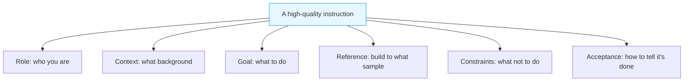
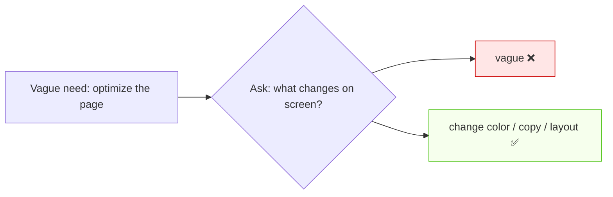

# Chapter 31: Mastering High-Quality AI Development Instructions

> This chapter answers one question: why does one person say a need once and get it right immediately, while another goes back and forth a dozen times and still ends up off target? The difference isn't the AI — it's the quality of the *instruction*. Here we turn "describing things clearly" into a method you can actually follow.

## What You'll Learn in This Chapter

- What parts make up a high-quality instruction
- How to give AI context, so it knows the backstory
- How to provide reference material, so AI can build to a sample
- How to set a role, goal, constraints, and acceptance criteria
- How to save good instructions and turn them into your own template library

### Opening: The Same Sentence, Wildly Different Results

Lin Xiaoman's flower shop helper has been running for almost a year. The little notebook she once used to record flower orders has grown into a proper system: customer profiles, holiday reminders, flower-stock inventory, loyalty points — nothing missing. She's also hired a part-time assistant, A-Qing, to help run it. "A-Qing," Xiaoman said, "learn how to talk to AI too. Then you can make your own changes someday."

One day the two of them each ask AI to add the same feature: "show the customer's membership tier in the order list."

Xiaoman types fast: "Add a column to the order list showing membership tier."

AI returns a pile of code and adds it. But when she opens the page, the tier sits at the far right in tiny text, and it only shows codes like "Level 1, Level 2" — customers can't make sense of it. She has to go back and forth several more rounds.

Then it's A-Qing's turn. Here's what she writes:

> "We're building a flower shop order system (an internal tool for the shop owner, not for customers). Please add a column called 'Membership Tier' to the *order list page*, placed to the right of the 'Customer Name' column. Show tiers in friendly Chinese: 普通会员 (Regular), 银卡会员 (Silver), 金卡会员 (Gold) — don't use numeric codes. Only change the order list page; don't touch any other page. When you're done, I should be able to see each row's tier at a glance."

AI gets it right in one shot.

Xiaoman leans over, stunned. "Same need — how come your sentence worked so well?"

A-Qing smiles, a little embarrassed. "I don't know any tricks. I just wrote down 'what I want, what I don't want, and what it should look like.'"

That's what this chapter teaches. A so-called "high-quality instruction" isn't magic — it's **organizing the scattered thoughts in your head into a checklist AI can execute accurately.** You've already used a fair bit of this without realizing it in earlier chapters. Here we'll make it fully explicit and turn it into a reusable skill.

## 31.1 The Basic Structure of an Instruction

First, a term: an **instruction** (or **prompt**) is whatever you send to AI — the entire block of text you type. It doesn't have to be long, but a good one usually contains several fixed parts.

Here's an analogy. If you ask a new employee to buy coffee, you can't just say "get a coffee." You need to say: what kind (americano or latte), who it's for (the boss, no sugar), where (the café downstairs), the budget (under 30), and when (before ten). Say it all, and they get it right the first time; leave things out, and they'll come back to ask you three times.

Giving AI an instruction works the same way. A complete instruction usually has these six parts:

| Part | Purpose | What Xiaoman's first version lacked |
|---|---|---|
| Role | What identity AI should use | None — AI defaulted to a generic assistant |
| Context | Background and backstory | None — it didn't say what kind of system this was |
| Goal | The specific thing to do | Stated (add a column), but too vague |
| Reference material | A sample to build to | None |
| Constraints | Boundaries not to cross | None — it didn't say "only change this page" |
| Acceptance criteria | How to tell it's done right | None — it didn't say "friendly display, visible at a glance" |

You don't need all six every time. **For simple jobs, two or three are enough; the more complex the job, the more complete your instruction should be, and the fewer the do-overs.** The key is the habit: before sending, mentally run through these six items.



## 31.2 How to Provide Context

**Context** is the "backstory" AI needs to understand your sentence. AI has no memory of you and doesn't know your software — unless you tell it.

The most common beginner mistake is assuming AI "should know." It doesn't. Every conversation is like talking to a brilliant person with amnesia: very capable, but completely unfamiliar with your project.

**You:** Help me change it — show the customer tier.

**AI:** Sure. Which page? Where is the "tier" data stored? What should it look like? What kind of project is this?

**You:** You don't know? Weren't we working on the flower shop system all along?

**AI:** Sorry, I can't see our earlier conversation. Please restate the relevant background so I can make the change accurately.

Sound familiar? **Providing context means proactively explaining that background.**

What goes into context?

- **What the project is**: a flower shop order system, an internal tool for the owner.
- **What you're doing right now**: editing the order list page.
- **Related backstory**: tier data lives in the customer table, with three values — Regular, Silver, Gold.
- **Earlier decisions**: this page just got a "days remaining" column last round.

A practical way to write it is a two- or three-sentence "background setup" at the start:

> "Background: I'm building a flower shop order system (an internal tool for the owner). The order list page currently has three columns: customer name, flowers ordered, days remaining. The customer data table stores a membership tier field with values normal / silver / gold."

With that setup, AI won't ask a bunch of basic questions or change the wrong thing. **Remember: the things you think "go without saying" are exactly the ones you most need to write down.**

## 31.3 How to Provide Reference Material

Sometimes it's hard to describe "what you want" in words alone. The easiest fix then is: **give a sample and let AI build to it.**

That's **reference material** — a screenshot, a piece of existing code, a page you like, a field list. Its job is to "replace a thousand words with an example."

Say "make an order table" and AI's idea of a table may be completely different from yours. But say "make a table like this page," attach a screenshot, and it has a clear target.

Common forms of reference material:

| Form | Good for | How to use it |
|---|---|---|
| Screenshot | What an interface should look like | Send the image + "use this style, but with order data" |
| Existing page / code | Keeping a consistent look | "Match the color scheme and buttons of the login page" |
| Field list | What data to store | Paste "Customer fields: name, phone, tier…" |
| Text example | Output format | "Output like 'Zhang San \| Gold \| 3 days left'" |

**You:** I want an order detail page, but I can't describe the style.

**AI:** Then give me a reference. A screenshot works, or another page.

**You:** (sends a screenshot of a membership center page) Build it with this page's layout and colors, but swap in order information. Keep the font, spacing, and rounded corners the same.

**AI:** Got it. I'll use this image's layout (info card on the left + detail table on the right), colors (cream background + green accent), and rounded-card style, and build an order detail page from that.

There's one key move when giving a reference: **say clearly what to copy and what to replace.** Send only a picture and AI may copy the content too. Saying "copy the layout and colors, swap in order content" — as above — keeps it on track.

For you as a beginner, a screenshot is often far more useful than learning a pile of jargon — **one picture is worth a hundred sentences.**

## 31.4 How to Set a Role

**Setting a role** means telling AI "who you are and what identity or tone to work in."

Why bother? Because the same task done by different identities comes out very differently. Make AI a "strict code reviewer" and it will nitpick; a "patient teacher" and it will explain; a "seasoned retail operations consultant" and it will think like a businessperson.

Analogy: when you ask someone for help, you first tell them "in what capacity I'm approaching you." Ask a friend casually; consult a lawyer formally. **A role setting is the different "hat" you put on AI.**

A role usually takes one sentence, placed at the very start:

> "You are a retail systems designer with 10 years of experience, skilled at designing simple, usable internal tools for small shop owners."

> "You are a patient programming teacher, guiding a flower shop owner who knows nothing about code."

A good role setting has three elements:

1. **Identity**: who (retail systems designer / test engineer / copywriter).
2. **Experience or specialty**: what they're good at (10 years, understands small shops).
3. **Style tendency**: how they work (simple and usable, patient, rigorously critical).

**You:** I ask AI to check my code, and it always says "looks good" — it never finds anything.

**AI:** That's because you didn't give it a "fault-finding" role. Try adding this at the start: "You are a strict code reviewer. Your job is to find everything that could go wrong in this code and explain why. Skip the pleasantries — list the problems directly."

**You:** After adding that it found several issues at once — and got a bit snarky.

**AI:** Exactly — **the role changes AI's behavior pattern.** Need it rigorous? Give it a rigorous role. Need it gentle? Give it a gentle role.

Small note: roles don't need to be fancy. "You are a helpful assistant" works too, but the more specific, the more stable. A clear identity and responsibility beats a long character description.

## 31.5 How to Set a Goal

The goal is **what you want AI to accomplish in this round**. It's the heart of the instruction.

Back in Chapter 30 we stressed "state the goal in one sentence" — who it's for, what it solves, what it outputs. Here let's turn that into a checkable formula:

> **verb + object + specific requirement**

- "**On the order list page** (object) **add** (verb) a column for membership tier (specific requirement)."
- "**Change** (verb) the reminder color (object) **to** (verb) bold red (specific requirement)."
- "**Write** (verb) a function (object) that **implements** (verb) searching orders by customer name (specific requirement)."

The most common problem with goals is being **too vague**. "Optimize this page" — optimize what? Make it faster? Prettier? Change the layout? AI has to guess, and its guess is rarely yours.

To turn a vague goal into a specific one, ask yourself "after it's done, what will be different on screen?":

| Vague goal ❌ | Specific goal ✅ |
|---|---|
| Optimize the order page | Change "days remaining" on the order page from a number to a phrase like "3 days left" |
| Improve reminders | Change the reminder lead time from 1 day to 3 days |
| Make the table nicer | Add alternating row colors to the table and make the header light blue |

**A goal should be verifiable — you can tell at a glance whether it's done.** Any goal where you're still left guessing "did it actually change?" isn't specific enough.

One often-overlooked point: **set one main goal per instruction.** This is where Chapter 7's "break down features" pays off. Cram five goals into one instruction and AI tends to drop balls. Better to split into five instructions, one goal each, finishing one before the next.



## 31.6 How to Set Constraints

**Constraints** are the "red lines" you draw for AI — what it can do, and what it absolutely must not touch.

If the goal is "what to do," constraints are "what not to do and how far you may go." Think of them as the work zone you mark out for a construction crew: you may knock down walls, but never the load-bearing one.

Why do constraints matter so much? Because AI has one trait: **anything you haven't forbidden, it may do.** Say "change the order page" and it may helpfully rewrite the styles, data, and other pages too — in its mind, that's all "helping." So you need to draw the boundary explicitly.

Common kinds of constraints:

- **Scope**: "Only change the order list page, don't touch other pages" / "Only change the front-end display, not the data structure."
- **Style**: "Use friendly Chinese, not numeric codes" / "Keep the existing color scheme."
- **Technical**: "Don't introduce new third-party libraries" / "Make it work on phone screens."
- **Security**: "Don't show full phone numbers — mask the middle with ****."

Look at the constraints in A-Qing's instruction: "only change the order list page, don't touch other pages" and "don't use numeric codes." Those two lines are exactly what kept AI on track.

**You:** I asked AI to add a feature and it rewrote the whole project — even the working features broke.

**AI:** Classic case of missing constraints. Next time, end your instruction with an explicit red line: "Only modify [specific file/page]; **do not change anything else**; if you must change something else, tell me first and wait for my approval."

**You:** After adding that, it really did only touch the specified place.

An especially useful constraint sentence is: **"Only change A, don't touch B, and if you must touch B, ask me first."** That single line is a charm for almost every modification instruction — we used it in Chapters 15 and 16 on "not breaking existing features," and it's worth repeating here.

## 31.7 How to Set Acceptance Criteria

The final piece: **acceptance criteria** — what counts as "done right."

This is the most-skipped item and the one that most reduces rework. Think about renovation: if you only say "install a cabinet," you may later say "wrong color" or "wrong position." But if you write up front "white, against the wall, two meters wide, three shelves," there's barely anything to redo.

Acceptance criteria are simply "the version I'll be happy with," written down in advance. They can be:

- **Observable result**: "Open the order page; every row shows the customer's Chinese membership tier."
- **Actionable checks**: "I enter a Gold customer, and the list shows 'Gold Member' rather than 'gold'."
- **Edge cases**: "A customer with no tier shows 'Regular Member,' not a blank."
- **No regressions**: "The existing 'days remaining' column must still be there."

Write these into the instruction and AI has a basis for self-checking, while you have a checklist for acceptance.

**You:** Every time AI finishes, I spend ages checking it, and still keep finding things it missed.

**AI:** Try putting "acceptance criteria" into the instruction. For example: "When done, self-check against these and tell me whether each is met: 1) every row shows a Chinese membership tier; 2) gold shows as 'Gold Member'; 3) no tier shows as 'Regular Member'; 4) the original 'days remaining' column is still there."

**You:** Having AI check itself against the list saved me so much time, and I find far fewer omissions.

Acceptance criteria and testing are two sides of the same coin. You learned about testing in Chapter 20; these acceptance criteria are really **test cases written in advance** — except AI runs them before delivery. Writing the criteria clearly front-loads the checking, so rework naturally drops.

## 31.8 How to Build Your Own Instruction Template Library

At this point you might think: "Six sections, every time? That's exhausting."

Relax — **you don't write from scratch every time.** Skilled people save the instructions that work and reuse them with a few edits. That's an **instruction template library**.

Analogy: a chef cooks from recipes, not by reinventing the dish each time. You can have your own "recipes" for software — write common tasks (add a column, change a color, add search, fix an error) as templates, fill in the blanks when needed.

Build a template library in three steps:

**Step 1: Collect.** Whenever you write an instruction that works especially well, copy and save it. No need to organize yet — just keep it in a document called "My Instructions."

**Step 2: Extract variables.** Mark the parts that change every time with square brackets; keep the fixed parts. For example:

> "Add a column called [column name] to [page name], placed to the right of [reference column], displayed as [format], and don't touch other pages."

**Step 3: Categorize.** Group by task type so you can find the right one when needed:

| Template category | Typical task | When to use |
|---|---|---|
| Add | add a column / button / page | Feature expansion |
| Modify | change color / copy / position | Fine-tuning |
| Debug | describe error, send screenshot, ask AI to diagnose | Fixing bugs |
| New project | state idea, have AI guide you step by step | Starting from zero |

With a template library, your instruction quality becomes stable — you won't write sloppy instructions just because you're tired. A-Qing also had to think hard at first, but once she saved her six or seven most-used instructions as templates, her instructions became fast and accurate.

Better yet, you can have AI maintain the library for you:

**You:** I'll send you the three instructions I've used most successfully. Please organize them into reusable templates: mark the parts that change as [variables], give each template a name, and write a one-line "when to use" note.

**AI:** Done. I made three templates: [Add a List Column], [Change Color Scheme], [Describe an Error]. Each has its variables and use case marked, so you just fill in the blanks.

**Instruction quality is something you "accumulate."** Every project you finish makes your template library richer — that's a real skill, and no one can take it from you.

## Common Pitfalls

- **Pitfall: assuming "AI should know," skipping context.** Why: every conversation is like amnesia — AI can't see earlier context. What to do: open with two or three sentences explaining "what project this is, what we're changing, and the related backstory."
- **Pitfall: vague goals like "optimize it."** Why: AI has to guess, and its guess is rarely yours. What to do: use "verb + object + specific requirement," and ask "what will be different on screen?"
- **Pitfall: saying what to do but not what not to do.** Why: anything you haven't forbidden, AI may do — often breaking other features. What to do: add "only change A, don't touch B, and ask me first if you must touch B."
- **Pitfall: sending only a reference image without saying what to copy.** Why: AI may copy the content too. What to do: say "copy the layout and colors, swap in XX content."
- **Pitfall: rewriting instructions every time instead of saving them.** Why: tiring, and quality varies. What to do: save good instructions as templates, extract variables, categorize them, and let AI help maintain the library.

## Chapter Summary

- A high-quality instruction usually has six parts: role, context, goal, reference material, constraints, acceptance criteria. Skip some for simple tasks; write all for complex ones.
- Context = backstory. Explain the background proactively; don't expect AI to "just know."
- For reference material, say "what to copy and what to replace" — one screenshot is often worth a hundred sentences.
- The role shapes AI's behavior; a clear identity and responsibility beats a long persona.
- Goals should be specific, verifiable, and one at a time: "verb + object + specific requirement."
- Constraints are red lines: "only change A, don't touch B, ask me first if you must" is the charm for modification instructions.
- Acceptance criteria = a pre-written checklist; have AI self-check before delivery so there's less rework.
- Save good instructions into a template library — fill in the blanks. Instruction quality is something you accumulate.

## Practice Exercises

1. Find the last instruction where "AI didn't get it right." Check it against the six parts above: which did you omit? Add them and send it again, then compare the result.
2. Take a task you do most often (say, "add a column to a table") and write it as a template with [variables]. Then swap in a different set of variables and see whether it really works as-is.
3. Pick an instruction you wrote vaguely (like "optimize it"). Rewrite it into a specific goal using "verb + object + specific requirement," and add two acceptance criteria.
4. Create your first "My Instructions" document. Save Template 1 from this chapter into it, then dig through your past conversations and add two more good instructions.

## Copyable Instruction Templates

**Template 1: A complete "six-element" instruction (for important modification tasks)**

```text
[Role] You are a patient development assistant, skilled at building simple, usable tools for small shop owners.

[Context] I'm building a flower shop order system (an internal tool for the owner). The order list page currently has three columns: customer name, flowers ordered, days remaining. The customer data table stores a membership tier field with values normal / silver / gold.

[Goal] Add a column called "Membership Tier" to the order list page, placed to the right of "Customer Name."

[Reference] Match the column widths and style of the existing list page.

[Constraints] Only change the order list page; don't touch any other page; show tiers in friendly Chinese, not numeric codes; if you must change something else, ask me first.

[Acceptance criteria] When done, self-check and tell me whether each is met: 1) every row shows a Chinese membership tier; 2) gold shows as "Gold Member"; 3) no tier shows as "Regular Member"; 4) the original "days remaining" column is still there.
```

**Template 2: Have AI turn your good instructions into a template library**

```text
I'll send you the three instructions I've used most successfully below. Please:
1. Organize each into a reusable template, marking the parts that change as [variables];
2. Give each template a short name;
3. Write a one-line "when to use" note for each;
4. Finally, summarize all templates in a table (template name / variables / when to use).

Here are the three instructions:
[paste your three instructions here]
```
