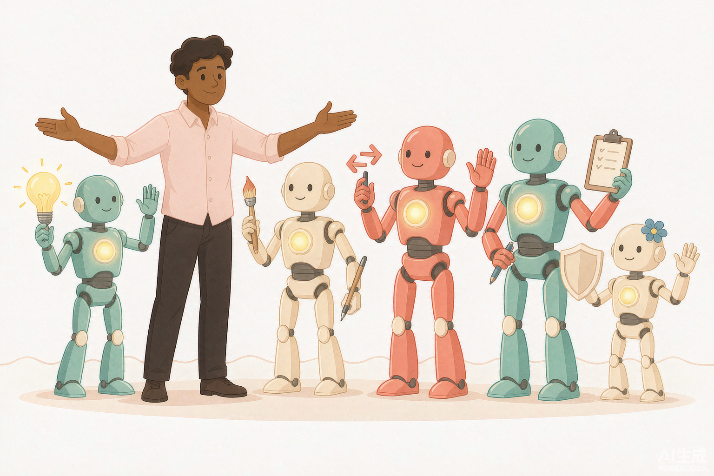
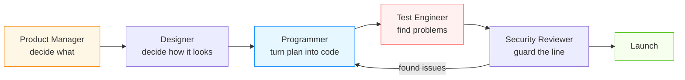
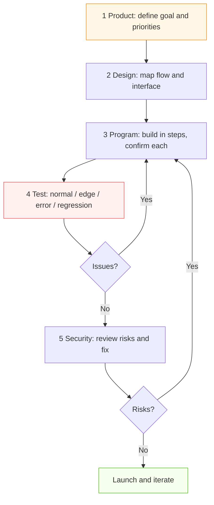

# Chapter 32: Turning AI into Your Software Development Team

> This chapter answers one question: your energy is limited — how do you think through requirements, manage design, watch the code, and run tests all at once? The answer: stop carrying it all yourself. Use AI as a whole team. On its own, it can play an entire crew.

## What You'll Learn in This Chapter

- The five roles AI can play: product manager, designer, programmer, test engineer, security reviewer
- What each role is responsible for and how to instruct it
- How to make these roles work together
- How to coordinate "multiple AIs" or multiple identities of one AI
- How to fix the whole thing into a repeatable development process



*Figure: Turn AI into your development team*

### Opening: Xiaoman's One-Person Team

The flower shop helper has been running for over a year, and features keep piling up. Recently Xiaoman wanted to add a "membership points mall," where customers could redeem points for flowers. She sat down to map it out and soon felt her head spin:

- What problem does this mall actually solve? Will customers really redeem? — that's a **product manager**'s job.
- What should the page look like, how should points be shown, is the redemption flow smooth? — that's a **designer**'s job.
- How to write the code, how to store the data? — that's a **programmer**'s job.
- Could points be miscalculated, could someone redeem twice? — that's a **test engineer**'s job.
- Could customer phone numbers leak, could points be faked? — that's a **security reviewer**'s job.

Five roles, all dumped on one person. "I have to think about the business and the details too," she sighed. "My brain isn't enough."

In fact, she doesn't need to be good at all five things. She only needs to **direct** — like a film director handing each role to AI to act. AI can be a product manager one moment helping her sort out requirements, a designer the next sketching a plan, a programmer writing code, then switch into a nitpicky tester and security guard.

"So I'm not short of people," Xiaoman realized. "I just hadn't delegated the work."

This chapter teaches you how to use AI as a complete software development team. You don't have to actually hire five people — **with five "role prompts," you can have a whole team.**

## 32.1 AI Product Manager: Helping You Decide "What to Build"

A product manager's core job is to answer "**what exactly to build, why, and what first**." It's the team's compass.

Many beginners skip this step and have AI write code directly, ending up with something nobody uses or a pile of useless features. The product manager role plugs that hole.

How do you make AI a product manager? Give it the identity and let it ask *you* questions:

**You:** From now on, you're an experienced product manager. I want to add a "membership points mall" to my flower shop system, where customers redeem purchase points for flowers. Help me sort out the requirements.

**AI:** Great. As a product manager, I won't talk about *how* yet — let me ask a few questions:
1. How are points earned — how many yuan per point?
2. What can points buy — exactly which flowers, and how many points each?
3. Do points expire?
4. What do you most want to validate first — whether customers will actually redeem, or whether the flow works end to end?

**You:** Hmm… I hadn't thought that far. 1 yuan = 1 point, redeemable for a few small potted plants. I guess I want to see whether customers will redeem first.

**AI:** Then I suggest the first version does only the minimum: customers can see their points and redeem 2–3 kinds of flowers. Complicated point rules and expiry can wait. Build a small version, let a few regular customers try it, see if they redeem, then decide whether to invest more.

See? The value of the product manager role isn't writing code — it's **forcing you to turn "I feel like building" into "I know exactly which small piece to build first."** It curbs the urge to do everything at once and gets you to the smallest version that validates value.

A product manager role should also:

- Turn your vague idea into a one-sentence goal.
- Prioritize: what first, what later.
- Challenge you from the user's angle: "Do customers really need this?"
- Define "what does success look like for this feature?"

**Copyable product manager role prompt:**

> "You are an experienced product manager, skilled at turning a small shop owner's vague ideas into clear, actionable minimum requirements. First ask me questions to understand the goal, then help me: 1) write a one-sentence goal; 2) prioritize and say what the first version should include only; 3) define success criteria. Don't discuss technical implementation yet."

## 32.2 AI Designer: Helping You Decide "What It Looks Like and How It's Used"

The designer handles **what the interface looks like, whether the flow is smooth, and whether the experience is good**. It's about "usable and good-looking," not "how to write the code."

As a beginner you often can't say what "good-looking" means. A designer role guides you from the usage flow rather than empty talk about aesthetics.

**You:** You're a designer now. Design the points mall page and redemption flow for me.

**AI:** Good. I'll start with the usage flow. A customer redeeming points should ideally go:
1. On the mall page, see their point balance →
2. See which flowers are redeemable and the cost →
3. Tap "Redeem" → confirm → success →
4. Get a "Redemption successful" message.

One key design question: what should the page show when the customer doesn't have enough points? I'd suggest greying out the button and saying "X more points needed," rather than showing an error only after they tap. What do you think?

**You:** Right — don't make people tap first to find out they can't. Also, I want a picture of each redeemable flower.

**AI:** Good. I'll put a small image, name, and required points on each redeemable flower; when points are insufficient, grey out the button and show the gap. I'll keep the green color scheme of the existing system for consistency.

What a designer role cares about:

| Focus | What it asks you | Why it matters |
|---|---|---|
| Usage flow | Where does the user tap first, where do they end | A smooth flow is what makes people keep using it |
| State hints | What to show when points are short / success / failure | Good interfaces "tell" users in advance |
| Style consistency | Colors and buttons matching existing pages | Consistency looks professional |
| Error paths | What if the network fails or stock runs out | Don't only work in the "ideal case" |

**Copyable designer role prompt:**

> "You are a senior UI/UX designer, skilled at designing simple, usable interfaces for small shops. Starting from the user's usage flow, help me design the pages and flow: first map the user's step-by-step path, then state what each step shows and what the state hints are, and explain how to stay consistent with the existing system's style. Don't write implementation code."

## 32.3 AI Programmer: Turning the Plan into Code

The programmer (developer) is the role that actually turns requirements and design into **running code**. This is the role you're most familiar with from earlier chapters — you've been having AI "do the work."

But as "the programmer on the team," the difference is: **it should receive the outputs of the previous two roles** — a clear goal and a designed flow — not a vague sentence.

**You:** You're the programmer. The product manager and designer have decided: the mall page shows points and redeemable flowers (with image, name, required points), insufficient points grey out the button with a gap hint, and the redemption flow is "tap redeem → confirm → success message." Please start implementing.

**AI:** Got it. I'll do it in three steps, showing you each one:
1. First the mall page (points display + redeemable flower list + button states);
2. Then the redemption logic (deduct points, record, prevent double redemption);
3. Finally hook up the success message.
Starting with step one, okay?

**You:** Okay. But I want the points display at the top of the page, most prominent.

**AI:** Good — points go in a banner at the top, in large text. I'll show you step one when it's done, then do step two after you confirm.

Keys to making the programmer role work well:

- **Give it clear "design input"** — don't let it guess the requirements.
- **Have it work in steps and confirm after each** (the "gradual modification" from Chapter 17).
- **State constraints clearly**: which files to change, which not to touch (Chapter 31's constraints).
- **Have it explain**: at key points, ask it to say in plain language "what I did and why," so you can check.

**You:** Can you explain in plain language what that code just did?

**AI:** Sure. It does three things: ① reads the customer's current points from their profile; ② when you tap redeem, checks whether points are enough — if so, deducts the points and records a redemption; ③ shows the result on the page. Think of it like a counter: first see how much money you have, then if it's enough, take payment, log it, and hand you the flowers.

Getting the programmer to "speak human" is an important way for you, a beginner, to check — **you don't need to understand the code, but you should understand what it says it's doing.**

## 32.4 AI Test Engineer: Finding Problems on Purpose

The test engineer (QA) is responsible for **finding problems before launch**. It's the programmer's natural opposite — the programmer "builds it," the tester "finds what's wrong."

Why a separate role? Because whoever wrote the code (or whatever identity) testing it tends to go easy — unconsciously testing only the paths that pass. A dedicated "fault-finder" will actively drive into the ditch.

**You:** Now switch to test engineer. The points mall is done — find problems, don't hold back.

**AI:** Good, with fault-finding as my goal, here are test categories:

| Scenario | How you test | Expected result |
|---|---|---|
| Normal redemption | Enough points, tap redeem | Points deducted, record created, message shown |
| Insufficient points | Look at the button when points are short | Button greyed out, gap shown |
| Double redemption | Tap redeem twice quickly | Points deducted once only, no second redemption |
| Boundary value | Points exactly equal to cost | Redemption works, balance becomes 0 |
| Error | Network drops mid-redemption | No points deducted, failure message with retry |

**You:** I tested as you said, and "double redemption" really broke — two taps deducted twice!

**AI:** Caught it. Classic "duplicate submission" bug. I'll fix it: disable the button immediately after tapping, and handle duplicate requests on the server so one redemption only deducts once. Only change the redemption logic, nothing else on the page.

A good test engineer role proactively covers:

- **Happy path**: does it work ideally?
- **Edge cases**: just enough, just short, zero points, tons of points.
- **Error cases**: network loss, double taps, random input.
- **Regression testing**: did the new feature break an old one?

**Copyable test engineer role prompt:**

> "You are a strict, nitpicky test engineer. The feature just completed is [feature description]. Standing firmly on 'I will find problems,' list test scenarios across four categories — normal, edge, error, regression — and for each say how to test and what to expect. If you spot a risk, say it directly; skip the pleasantries."

## 32.5 AI Security Reviewer: Guarding the Bottom Line

The security reviewer handles **the security of data and the system**: could customer info leak, could points be forged, could someone exploit a loophole.

This is the most overlooked role and the one whose failures hurt most. Chapter 24 covered security and data protection; here we fix it into a role from the "team division" angle.

For Xiaoman's flower system, security isn't some distant "hacker attack" — it's very concrete: can someone else see customers' phone numbers and addresses? Can a customer change their own points to 99,999?

**You:** You're the security reviewer now. Check the points mall for security holes.

**AI:** Good, I'll review from several angles:
1. **Data privacy**: does a redemption record show the customer's phone? If it's internal-only, don't display the full number publicly — mask it.
2. **Anti-tampering**: points are stored on the server, so the customer can't change them from their phone — we need to ensure that. There must be no "let me edit my points" opening on the page.
3. **Redemption vouchers**: a voucher generated after redemption must not be guessable and used by someone else.
4. **Permissions**: is this mall for customers themselves, or only staff? Permissions must be clear.

Point 2 matters most: **never let points become a number the customer can edit themselves.** I'll check that the deduction logic lives on the server, not just as a show on the page.

Common checks for a security reviewer:

| Review dimension | Typical issue | Why check |
|---|---|---|
| Privacy | Are phone numbers / addresses exposed publicly | Customer info must be protected |
| Anti-tampering | Can users change critical data themselves | Prevent forged points, bypassed rules |
| Permissions | Are "who can view / who can change" separated | Prevent unauthorized actions |
| Vouchers | Can redemption codes / links be guessed | Prevent someone else claiming rewards |

**Copyable security reviewer role prompt:**

> "You are a strict security reviewer. Review the security risks of this feature [feature description], focusing on: whether customer private data is exposed, whether critical data can be tampered with by users, whether permissions are clear, and whether vouchers can be forged. Explain in plain language how each risk 'could be exploited' and give fixes, sorted by severity."

## 32.6 How to Make the Roles Work Together

Now that we know all five roles, the key question: **how do we make them cooperate instead of working at cross-purposes?**

The answer: advance like a real team, with each role's output becoming the next role's input. That's essentially a pipeline:



Note the arrow from "Security Reviewer" back to "Programmer" — **found issues get sent back for a redo.** That's normal in a real team, not a failure. Problems raised by testing and security go back to the programmer to fix, then get retested.

Three principles for working together:

1. **Advance in order, don't skip.** First decide "what" (product), then "what it looks like" (design), finally "how" (programming). Skipping straight to code is the root of rework.
2. **Hand off outputs.** The product manager's goal and the designer's flow must be written clearly for the programmer — don't make the programmer guess. Last chapter's "context" and "reference material" are the vehicles for that handoff.
3. **Close the loop on problems.** Issues found by testing and security must go back to the programmer to be fixed, then be retested until they pass. Never "found it and left it."

**You:** I'm one person using AI — how do I show "division of labor"? Isn't it all me typing?

**AI:** Division doesn't require different AIs; it can be the *same* AI switching roles at different stages. The key is that on each switch, you clearly tell it "who you are now and what the previous stage produced." It's like one person playing five parts — as long as you explain the backstory each time you change hats, the result is the same as in a real team.

## 32.7 How to Coordinate Multiple AIs

The previous section was about "one AI switching roles." What if you're genuinely using several AI tools, or want several conversations open at once? That's **coordinating multiple AIs**.

There are three common approaches:

| Approach | How | Best for |
|---|---|---|
| Switch roles in one window | In one conversation, have it play roles in sequence | Most people — simplest |
| Parallel windows | Open several chats, one running product, one testing | Advancing several tasks at once |
| Cross-check with multiple AIs | Ask two AIs the same question, compare answers | Important decisions; fear one AI is wrong |

**Switching roles in one window** is my top recommendation for beginners. The trick is to open each switch with "role switch + handoff":

> "Please pause your programmer identity now and switch to a strict test engineer. Background handoff: we're building [project brief]. The previous role just completed [output description]. Your goal now is [what this role should do this round]. Your stance is [e.g. find problems, no pleasantries / judge from user-friendliness / guard the security line]."

That one message does three things: switches the role, hands off the output, and states the stance. All three are needed.

**Cross-checking with multiple AIs** is great for key steps. For a security review, for instance, have two AIs independently check the same logic:

**You:** (in AI-A) Please review the security risks of this redemption logic.

**You:** (in AI-B) Please review the security risks of this redemption logic and list loopholes someone could exploit.

**AI-A:** Main risks are duplicate submission and points tampering…

**AI-B:** I found one A didn't mention: if redemption records are numbered sequentially, someone can guess another person's redemption code…

**You:** Oh? The two don't fully agree — I'll guard against both.

See the value of **cross-checking: the two AIs' blind spots differ.** What one misses, the other may catch. Asking one more AI at a key step costs little and gains a lot.

The core of coordinating multiple AIs is still Chapter 31's skill: **write the context, goal, constraints, and output handoff clearly.** No matter how many roles, the underlying "describing things clearly" doesn't change.

## 32.8 How to Establish an AI Development Process

String everything above together and you get a repeatable **AI development process**. Fix it in place, and every feature you build follows it — so quality stays stable.

The full process looks like this:



How to make it stick? Three suggestions:

**First, make a checklist and keep it at hand.** Copy the five roles and each step's "role prompt" into your "My Instructions" document. Before starting a feature, scan it and switch roles in order. No memorizing needed — just follow it.

**Second, leave an output at every step.** The product manager's one-sentence goal, the designer's flow diagram, the programmer's implementation note, the tester's test-case table, the security reviewer's risk list — keep all of it in writing. Those outputs are both input to the next step and the "project documentation" we'll cover in Chapter 33.

**Third, move in small steps.** Finish all five steps for one feature before starting the next. Don't batch a bunch of features together — roles get mixed up and problems get hard to locate.

After using this process, Xiaoman reflected: "Before, I was one person scrambling. Now it's like leading a five-person team. I don't understand every line of code, but I know what each step needs, who to put on it, what to ask, and what to check. **I've become the captain.**"

That's what this chapter wants to give you: you don't need to become five experts — you just need to **be the captain who can direct five experts.**

## Common Pitfalls

- **Pitfall: skipping the product role and having AI write code directly.** Why: you build something without deciding whether it should exist or which part first — easy to waste effort. What to do: have the product manager define the goal, prioritize, and set success criteria first.
- **Pitfall: letting the coding identity test its own work.** Why: "self-checking" goes easy, testing only passing paths. What to do: explicitly switch to a "nitpicky test engineer" role and focus on edges and errors.
- **Pitfall: not handing off outputs when switching roles.** Why: the new role doesn't know what happened before and has to ask from scratch. What to do: open switches with the trio "who you are + previous output + your stance."
- **Pitfall: remembering the security role only at the very end.** Why: privacy and tampering issues get harder to fix the later they're found. What to do: build security review into the process and always run it before launching an important feature.
- **Pitfall: finding problems but leaving them.** Why: the problems stay in the software. What to do: issues from testing and security must go back to the programmer to be fixed, then be retested until they pass.

## Chapter Summary

- You don't have to carry it all — use AI as a team with different roles.
- Five roles: product manager decides "what," designer "what it looks like," programmer "writes code," test engineer "finds problems," security reviewer "guards the line."
- Collaboration order: product → design → programming → testing → security; found issues go back to the programmer, closing the loop.
- Role-switch trick: "who you are now + hand off the output + state the stance" — one AI can play five parts.
- Three ways to coordinate multiple AIs: switch roles in one window, parallel windows, cross-checking; the last complements blind spots.
- Make the process a checklist, leave an output at each step, move in small steps — quality stays stable.
- Your new identity is "captain": you needn't be five experts, but you must direct them.

## Practice Exercises

1. Think of a feature you recently wanted to add. Have AI play product manager first and ask you about it — see which questions it asks back. Answer them and you'll have a clear goal.
2. Then have the same AI switch in turn to designer, programmer, and test engineer, opening every switch with "role + handoff + stance." Notice what the handoff accomplishes.
3. Take a feature you've already built. Have AI play security reviewer and find one risk each from privacy, anti-tampering, permissions, and vouchers.
4. Copy the five role prompts into your "My Instructions" document, organize them into a "development process checklist," and follow it on your next feature.

## Copyable Instruction Templates

**Template 1: Role switch + handoff (when changing roles in one conversation)**

```text
Please pause your current identity and switch to [role name, e.g. strict test engineer].

Handoff: the project we're building is [project brief]. The previous role just completed [output description — paste key content if helpful].

Your goal this round is [what this role should do now].
Your stance is [e.g. find problems, no pleasantries / judge from user-friendliness / guard the security line].

Work in this role now, and first tell me how you plan to proceed.
```

**Template 2: Run the whole process in one go (for a small feature — have AI guide the switches)**

```text
I want to build a feature: [describe it in plain language].

As my "AI development team," please guide me through these five steps, asking for my confirmation before moving to the next:
1. [Product Manager] clarify the goal, prioritize, and define success criteria;
2. [Designer] map the user flow and what each page shows;
3. [Programmer] implement in steps, showing me each and waiting for confirmation;
4. [Test Engineer] list test scenarios in four categories — normal / edge / error / regression — and test them with me one by one;
5. [Security Reviewer] review risks from privacy, anti-tampering, permissions, and vouchers.

Explain everything in plain language; don't pile on jargon. Problems found must go back to step 3 to be fixed and retested. When ready, start with step 1.
```
