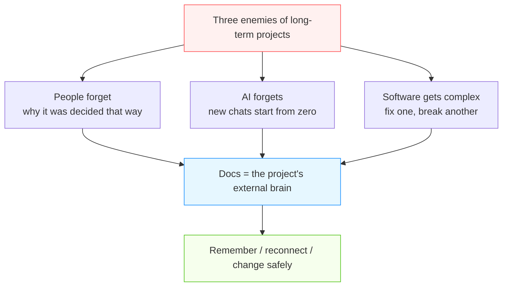
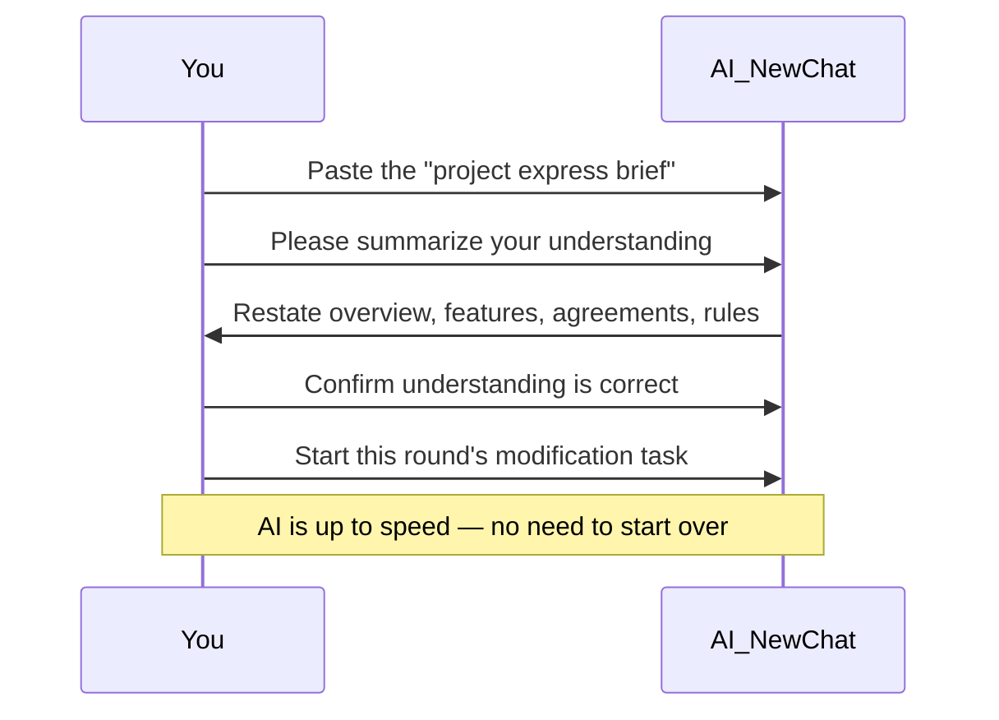

# Chapter 33: Managing a Long-Term Software Project

> This chapter answers one question: building a small tool is easy, but when a piece of software has been used for a year or two — with features piled up and countless changes — both you and AI "can't remember." How do you keep a long-term project clear and under control? The answer: give it documentation and memory.

## What You'll Learn in This Chapter

- Why long-term projects can't live without documentation
- How to create a project brief, feature list, and technical notes
- How to set development rules so every change follows the discipline
- How to build "project memory" so AI picks up where it left off
- How to get AI in a fresh conversation up to speed quickly
- How to plan a steady rhythm of long-term iteration

### Opening: The Trouble with Not Remembering

The flower shop helper has been live for nearly two years. In that time it grew into a great assistant to Xiaoman's business: customer profiles, holiday reminders, membership points, a points mall, flower inventory — a huge pile of features.

But lately Xiaoman has a growing headache.

One day she wanted to change a points rule. She opened her conversation with AI and found hundreds of messages stretching back further than she could scroll. She couldn't remember how "points expiry" had been decided, or when and why "phone number masking" had been added. Worse, she switched computers and started a new conversation, and AI didn't know her project at all:

**You:** Help me change the redemption rules in the points mall.

**AI:** Sure. First tell me: what is your project? What features does the points mall have? Where is the data stored? What agreements were made earlier?

**You:** I… I told you all this before.

**AI:** Sorry, this is a new conversation and I can't see any earlier records.

Only then did Xiaoman realize: **she had pinned the entire memory of her project on a chat log that would become unscrollable.** Once the conversation is lost, or she switches tools, or she wants a different AI to help, everything has to be explained from scratch.

"It's like running the shop," she later told A-Qing. "When there were few goods, I remembered it all in my head. Now there's a lot — without a ledger, without records, it's chaos. Software needs a ledger too."

This chapter teaches you to build that "ledger" — documentation and memory. It keeps a long-term project clear no matter how long it runs, how many conversations you change, or how many AIs you use.

## 33.1 Why Long-Term Projects Need Documentation

First, what is **documentation**? It's writing down the project's key information and saving it to files — what the project is, what features it has, how it's built, what the rules are.

A short project (like a one-off tool) can be built without docs. Long-term projects are different, because they have three "enemies":

**Enemy 1: You forget.** Human memory is unreliable. Why did you change reminders to three days ahead three months ago? What pitfall did you hit? Without writing it down, it's a blank a while later.

**Enemy 2: AI forgets.** In every new conversation, AI starts from zero. It has no memory across conversations (unless you feed it the material). The longer the chat, the more it "forgets the head for the tail," missing earlier agreements.

**Enemy 3: The software gets complex.** More features and more changes mean touching one thing breaks another. Without documentation you don't dare change anything — afraid that fixing A will break B.

Documentation is the weapon against all three. It's the project's "external brain": you forgot it? Check it. AI doesn't recognize the project? Let it read it. Afraid of breaking things? Follow its rules.



"So I should write down the important things," Xiaoman realized, "instead of counting on the chat log."

Exactly. Docs don't need to be formal. Even a plain text file, as long as it holds the key information, beats relying on memory a hundred times over.

## 33.2 How to Create a Project Brief

The first document is a **project brief** (or README). It's a "one-pager" that lets anyone understand in minutes: what this project is, who it's for, and why it exists.

It answers the most basic questions:

- **What's it called**?
- **Who uses it, what problem does it solve**?
- **What are the core features** (a rough list)?
- **Where does it stand now** (current state)?
- **Who maintains it, how to reach them** (for a team)?

Xiaoman's project brief looks like this:

> **Project name**: Flower Shop Helper
> **Purpose**: An internal tool for the neighborhood flower shop owner (me), managing customer orders, holiday reminders, membership points, and redemptions.
> **Problem it solves**: Orders used to be kept in a notebook — slow to look up, easy to miss holiday deliveries.
> **Core features**: customer profiles, holiday reminders, order management, membership points, points mall, flower inventory.
> **Current state**: v2.3 live, works on phone and computer. Points mall just added, watching how customers use it.
> **Users**: mainly the owner herself, occasionally staff helping with data entry.

That's one page; anyone picking it up understands the gist immediately.

A handy test for a project brief: **if you completely forgot this project six months from now, could this brief bring you up to speed in five minutes?** If yes, it's good enough.

**You:** Does the project brief need to be very detailed?

**AI:** No. It's an "overview," not an encyclopedia. Save the detail for the feature list and technical notes. A brief wins by being short, accurate, and clear at a glance. Too long and nobody reads it.

## 33.3 How to Create a Feature List

The second document is a **feature list**. It lists "what features the project has," one by one — the project's table of contents.

A feature list shouldn't just have names; each item should carry a **status**, so you can see at a glance how far along things are:

| Feature | Description | Status |
|---|---|---|
| Customer profiles | Record name, phone, order history | ✅ Done |
| Holiday reminders | Remind 3 days before a holiday | ✅ Done |
| Order management | Add, query, edit orders | ✅ Done |
| Membership points | 1 point per yuan spent, show balance | ✅ Done |
| Points mall | Redeem points for 3 flower types, prevent double redemption | ✅ Done in v2.3 |
| Flower inventory | Track stock levels, low-stock reminders | 🟡 In progress |
| Data export | Export customer list for suppliers | ⬜ Planned |

This table is hugely valuable:

- **See progress**: what's done, in progress, not started — all in one view.
- **Avoid duplication**: you won't "build it again" when it's already there.
- **Plan next steps**: the unfinished ones are your to-do list.
- **Onboard**: AI in a new chat sees the whole picture at a glance.

A feature list must be **kept current** — every time you finish a feature, change 🟡 to ✅. It's a "living document," not a dead file locked in a drawer.

**Have AI maintain the feature list for you:**

**You:** Here's our current feature list [paste the table]. I just finished "flower inventory" — please change its status to done, and check whether any feature is missing.

**AI:** Done — "flower inventory" is now ✅. I also noticed you once mentioned "batch holiday reminders" but it's not on the list. Want me to add it?

See? AI doesn't just edit the table — it helps you **find gaps**.

## 33.4 How to Create Technical Notes

The third document is **technical notes**. It records "how this project is built" — what technology, how data is stored, and what key agreements exist.

As a beginner you might think, "I don't understand technology — how can I write technical notes?" Don't worry. You don't need anything profound; just have AI record the "important technical facts." Its purpose: **next time you change something, AI knows where and according to what rules.**

Worth recording in technical notes:

- **Tech choices**: what approach and what database (let AI write it; you don't need the detail, but record it).
- **What data is stored**: what fields the customer table has (name, phone, points, tier…).
- **Key agreements**: e.g. "mask phone numbers in any display," "points stored on the server, users can't change them," "dates always use YYYY-MM-DD format."
- **Important historical decisions**: e.g. "reminders three days ahead, because one day wasn't enough time," "disable button immediately after redemption, to prevent double submission."

That last category is the most precious. They are "pits you've fallen into" — without recording them, you'll likely fall in again.

One line in Xiaoman's technical notes:

> **Agreement**: in any page display, the middle four digits of a customer's phone number must be replaced with **** (decided at the 6th modification, after a screenshot shared in a group chat leaked a customer's phone number).

That single line ensures every future change involving phone numbers follows the rule.

**You:** I don't understand any of these technical details — if AI writes them and I can't even read them, are they useful?

**AI:** Very useful. You don't need to understand every line, but you should know "what the agreements are." Analogy: you don't need to understand how a car engine works, but you need to know "this car takes 92-octane, don't put diesel in it." Technical notes are the software's "fuel instructions" — they make AI follow the same rules every time, so it doesn't drift.

## 33.5 How to Establish Development Rules

The fourth document is **development rules**. It specifies "what discipline every future change must follow."

If technical notes record "facts," development rules record "discipline." They're the code of conduct you set for AI (and yourself), preventing "this change went well, next time it's a mess again."

Development rules can include:

- **Change rules**: "only change one feature at a time" / "before changing, state what and what it affects" / "always test after changing."
- **Security rules**: "any change touching customer data must mask it first" / "run a security review before launch."
- **Trace rules**: "every change updates the version log" / "after changing, write one line on what changed."
- **Communication rules**: "explain in plain language" / "if unsure, ask me first, don't decide on your own."

Write these as a checklist and have AI read them before every job:

**You:** Before starting the modification, please read our development rules [paste the rules], confirm you understand and will follow them, then begin.

**AI:** Read. I confirm these rules: 1) change only one feature at a time; 2) state the scope of impact before changing; 3) run regression tests after changing; 4) mask customer data; 5) update the version log; 6) explain in plain language. I'll follow them strictly — may I begin now?

The biggest value of development rules is **making "good work habits" permanent.** The five-role process from Chapter 32 and "only change A, don't touch B" from Chapter 31 can all go into the rules, turning them from "occasionally remembered" into "always executed."

## 33.6 How to Build Project Memory

The earlier documents are "static archives"; this section's **project memory** is a "dynamic diary" — recording the project's journey: what was done, what changed, why, and what pits were hit.

Why? Because documents tell you "what it's like now," but memory tells you "why it became this way." And the "why" is often the most valuable part.

For example, the feature list says "reminders are three days ahead," but project memory says "originally one day, then a customer complained it wasn't enough time, so we changed it to three." Knowing that "why," you won't idly change it back to one day later.

Project memory can be simple — a log kept in time order:

> **2026-09-12** Launched v2.0, added membership points.
> **2026-10-03** Changed: reminders from 1 day ahead to 3 days. Reason: customer feedback that 1 day wasn't enough.
> **2026-10-20** Fixed: phone numbers masked. Reason: a screenshot shared in a group leaked a customer's phone; middle four digits now masked.
> **2026-11-05** Launched v2.3, added points mall. Pitfall: double taps deducted points twice — fixed with button disable + server-side dedup.
> **2026-11-18** Found: flower inventory not linked to orders — selling a bouquet didn't reduce stock. To-do: fix next version.

This diary is the project's "medical record" — every change, why, and result, all clearly noted.

A very practical habit for building memory: **after every change, spend one minute writing three lines** — what changed, why, and any leftover issues. Over time, it becomes an enormous asset.

**Have AI write the memory for you:**

**You:** We just finished fixing the points mall. Please write a project memory entry: what was done, why, what pitfall was hit, and any leftover issues.

**AI:** Sure:
> **2026-11-05** Points mall: implemented points display, redemption, and double-redemption prevention. Pitfall: double taps deducted twice — fixed with "button disable + server-side dedup." Leftover: redemption records don't yet mask phone numbers; handle next version.

Having AI write memory is both easy and consistent — **it remembers to include the "why" and "leftover issues" for you.**

## 33.7 How to Get AI Up to Speed Quickly

With all the documents and memory above, the last step is: **get AI in a fresh conversation to understand the whole project quickly.**

The method is simple: package the key documents into a "project express brief" and feed it to AI first thing in a new conversation.

That express brief can include:

1. **Project brief** (one-line overview)
2. **Feature list** (what features, what status)
3. **Key agreements from technical notes** (rules that must be followed)
4. **Development rules** (discipline for changing)
5. **Recent project memory entries** (what happened lately)

Xiaoman saves hers as a fixed text. Whenever she starts a new conversation, the first thing she does is paste it in:

**You:** I'm starting a new modification task. First please read this "project express brief." After reading, summarize your understanding of the project in your own words; once I confirm it's right, we'll begin. [paste the express brief]

**AI:** Read. My understanding: this is "Flower Shop Helper," an internal tool for a shop owner, v2.3 live. It has customer profiles, holiday reminders, a points mall, etc.; flower inventory is in progress. Key agreements: mask phone numbers, points stored on the server and not tamperable. Development rules: change one feature at a time, state impact before changing, test after changing. Recently we built the points mall and just fixed a double-redemption bug. Correct?

**You:** Entirely correct. Now let's change…

See that? **One "project express brief" plus "have AI summarize to confirm" — a few sentences and AI is up to speed.** No more explaining from scratch.

The key move here is **having AI summarize to confirm**. Don't paste and dive straight in — first let it restate in its own words, confirm it understood, then proceed. Like onboarding a newcomer: have them repeat the task back to make sure they got it.



## 33.8 How to Manage Long-Term Iteration

Finally, zoom out: **how do you plan a piece of software's long life?**

Launch isn't the finish line — it's the starting line. A long-term project moves forward "generation by generation," which is **iteration** — repeated improvement, continuous updating. Chapter 25 covered the idea of iteration; here we cover how to manage it.

To manage long-term iteration, use these handles:

**First, number the versions.** Every release gets a version number (v1.0, v2.0, v2.3…) and a line on "what this version changed." That makes problems traceable and progress visible.

**Second, keep a to-do pool.** Maintain a "to-do list" and dump everything you want to do but haven't (the ⬜ items in the feature list). No need to do it all now — just don't lose it; if you think of it, write it down.

**Third, keep a steady rhythm.** Don't change things whenever a whim strikes; every so often, do a round of iteration. Xiaoman now "looks at the to-do list once a month and picks one or two most worthwhile things." A steady rhythm beats doing it sporadically.

**Fourth, close out every round.** When a round ends, do four things: update the version number, update the feature list, write a project memory entry, and back up the current version. Call these the "closing four-piece set" — only when all four are done is the round truly over.

**You:** Why emphasize backup separately?

**AI:** Because the scariest thing for a long-term project is "breaking it with no way back." Back up every stable version; if a new feature breaks things, you can instantly roll back to the last good one. Like saving in a game — clear a level, save first, so if you die later you can reset.

Managing long-term iteration is essentially making the software **traceable, reversible, and sustainable**: know where you are (versions and list), know the road you traveled (memory), roll back if something breaks (backup), and know what's next (to-do pool).

**Have AI help with iteration close-out:**

**You:** This round of changes is done. Please help close out the iteration: 1) update the version from v2.3 to v2.4; 2) update feature-list statuses; 3) write a project memory entry summarizing this round; 4) remind me to back up the current version.

**AI:** Done: version updated to v2.4, feature list synced, memory entry added — "v2.4 completed flower inventory–order linkage." Please remember to back up the current version — that step needs you; I can't do it for you.

After half a year of sticking to this method, Xiaoman's project was still perfectly orderly. She smiled: "I used to think making software was 'writing code.' Now I understand that making software long-term is really 'managing' — managing docs, memory, and rhythm. AI writes the code, but these ledgers — I have to hold them up myself."

## Common Pitfalls

- **Pitfall: pinning all project memory on the chat log.** Why: chats become unscrollable, get lost, and break when you switch AIs. What to do: write key info into files; don't depend on any single conversation.
- **Pitfall: creating a feature list but not updating it.** Why: it becomes outdated and actively misleads. What to do: change status every time you finish a feature, so it always reflects reality.
- **Pitfall: recording "what" but not "why."** Why: later you forget the original decision and fall into the same pit again. What to do: in project memory always write "why it changed," especially for pitfalls.
- **Pitfall: diving into a new conversation without having AI summarize to confirm.** Why: AI may misunderstand and you waste a round. What to do: paste the "project express brief," have AI summarize, confirm, then begin.
- **Pitfall: no backup or close-out during long iteration.** Why: you can't roll back when broken, and you can't explain what happened. What to do: at the end of each round do the "closing four-piece set" — update version, list, memory, and backup.

## Chapter Summary

- Three enemies of long-term projects: people forget, AI forgets, software gets complex. Documentation is the "external brain" that fights them.
- Five documents each have a job: project brief says "what it is," feature list "what exists and how far," technical notes "how it's built and what agreements," development rules "the discipline for changing," project memory "the road traveled and why."
- A feature list carries statuses and stays current — the project's living table of contents.
- The most precious parts of technical notes are "key agreements" and "pits hit," so AI follows the same rules every time.
- Development rules make good habits permanent; have AI read them before every job.
- Project memory records "why": after every change write three lines in a minute — what changed, why, leftover issues.
- In a new chat, use "project express brief + AI summary to confirm" to get up to speed in a few sentences.
- Manage long-term iteration with four handles: numbered versions, a to-do pool, a steady rhythm, and a "closing four-piece set" each round (version, list, memory, backup).

## Practice Exercises

1. Write a one-page project brief for your project: name, who it's for, what problem it solves, core features, current state.
2. Build a feature-list table listing your project's existing features, each tagged ✅ done / 🟡 in progress / ⬜ planned.
3. From your past changes, dig out two "pits you hit" and write them as project memory (what changed, why, result).
4. Package your brief, feature list, key agreements, and development rules into a "project express brief." Paste it into a new conversation and have AI summarize to confirm it understood.

## Copyable Instruction Templates

**Template 1: Have AI build your whole documentation set**

```text
I want to build documentation for a long-term project so it stays clear no matter how many conversation changes. Please act as my "project document manager" and help me build it step by step:

1. Based on the project info below, write a one-page "project brief" (what it is, who it's for, what problem it solves, core features, current state);
2. Create a "feature list table" with three columns: feature name, description, status;
3. Write "technical notes," focusing on key agreements and pits hit;
4. Draft a "development rules" checklist (change one feature at a time, state impact before changing, test after changing, mask data, update version log, explain in plain language).

My project info: [describe in plain language your project, existing features, known key agreements and pits]
Generate a draft first for me to review, then finalize after I confirm.
```

**Template 2: Quickly reconnect in a new chat + iteration close-out**

```text
[When starting a new task] I'm starting a new modification task. First please read this "project express brief." After reading, summarize your understanding in your own words (overview, features, key agreements, development rules, recent progress); once I confirm it's right, we'll begin. [paste the express brief]

[When a round ends] This round of changes is done. Please help close out the iteration:
1. Suggest the next version number and write one line on "what this version changed";
2. Update feature-list statuses;
3. Write a project memory entry (what changed, why, leftover issues);
4. List what I still need to do manually (e.g. back up the current version).
```
