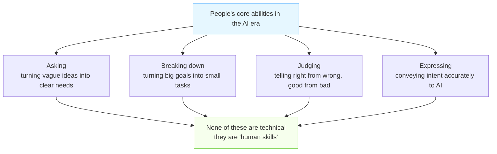
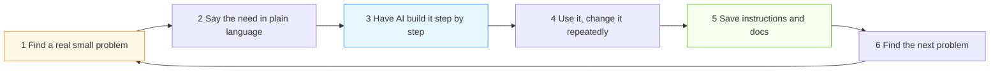

# Chapter 34: The Future of Natural Language Programming

> This is the final chapter of the book. In the previous thirty-three, we built software step by step, changed it, debugged it, launched it, iterated on it, and learned to write instructions, lead a team, and manage a project. Now we lift our eyes to the distance: as the barrier to building software keeps dropping and AI keeps growing stronger, where should an ordinary person go? The answer isn't in the technology — it's in you.

## What You'll Learn in This Chapter

- How the barrier to software development is changing, and what it means
- Whether "not knowing code" will be a problem — an honest answer
- Whether natural language will become a new programming language
- What people's core abilities are in the age of AI development
- Why creativity, judgment, and expression matter more than ever
- How an ordinary person can build their own software ability, step by step

### Opening: The Computer, Two Years Later

Two years ago, Lin Xiaoman sat at the computer in her flower shop at the neighborhood entrance and typed her first sentence to AI:

> "I want a little tool for my flower shop that records each customer's order — what flowers, phone number, delivery date — and reminds me when the date is near. I don't know how to program, so please guide me step by step."

Back then, she didn't even know what "code" was, and was as nervous as at a first job interview.

Two years later, same computer, same flower shop. Her software has grown into a real help to the business: customer profiles, holiday reminders, membership points, a points mall, flower inventory — all working on phone and computer. She's long since stopped fearing changes. When something goes wrong, she writes a clear requirement, switches roles to have AI divide the work, tests after the change, and logs a project memory entry.

A-Qing, watching from the side, marveled: "Xiaoman, you're better than a lot of programmers now."

Xiaoman shook her head with a smile. "I don't know how to program. I just... learned to say things clearly."

She paused, looking out at the people coming and going buying flowers, and said softly: "Two years ago I thought making software was programmers' business, nothing to do with me. Now I understand — people with ideas should be able to make their ideas real."

That sentence is, in essence, everything this book has been trying to tell you. In this last chapter we move our gaze from "how to do it" to "where it's going" — the future of natural language programming, and — your place in it.

## 34.1 The Barrier to Software Development Is Changing

Looking back, the barrier to building software has always been coming down — but this time it's dropping unusually fast.

In the beginning, computers were huge machines only a few scientists could operate. Then came programming languages — from machine language to assembly, then "high-level" languages like Python and JavaScript. Each step brought programming a little closer to ordinary people. But even with high-level languages, you still had to learn syntax, memorize rules, and practice logic — the barrier was still high.

What AI brings is different. It doesn't lower the barrier "a bit"; it **changes what kind of barrier it is**.

| Era | Where the barrier is | What you must learn first |
|---|---|---|
| Early computing | Operating the machine itself | Hardware, machine language |
| Programming-language era | The grammar for talking to computers | A programming language |
| Natural-language-programming era | Saying what you want clearly | Describe requirements, break down problems, judge results |

See it? The barrier hasn't disappeared — it has **shifted from a "technical barrier" to a "barrier of expression and thinking."**

In the past you asked: "Do I know how to write code?" Now you ask: "Can I describe what I want clearly? Can I judge whether what came out is right?"

For people like Lin Xiaoman this is a huge stroke of luck. She doesn't know code, but she knows flowers, customers, and business — that "domain knowledge" counted for little in building software before, but now it's the most valuable input. **AI can write the code, but "what to build and what it should look like" has to come from you, the person who knows.**

Analogy: in the past, to build a house you had to lay bricks yourself. Now there's a construction crew — you just need to be the "client who understands houses." The barrier shifts from "can your hands do the work" to "is your head clear about what you want."

## 34.2 Will Not Knowing Code Be a Problem

This is the biggest question in many people's minds, and one this book must answer honestly.

**Short answer: for the vast majority of people, not knowing code will not be a problem.**

But let me give you the complete, scenario-by-scenario answer:

| What you want to build | Is not knowing code a problem? | Notes |
|---|---|---|
| Personal tools, internal systems, small apps | Basically no | Exactly what this book teaches throughout |
| Small/medium products, prototypes, validating ideas | Usually no | Clear requirements and iteration are enough |
| Large complex systems, low-level architecture | Yes — but that's professional programmers' job anyway | Natural language programming isn't here to replace them |
| Core systems needing peak performance or extreme security | Yes | These still need traditional engineering rigor |

So the honest conclusion: **natural language programming isn't about letting everyone write aircraft control systems — it's about letting millions of people with ideas build the software they need.** This is precisely the group that was locked out before — shop owners, teachers, accountants, doctors, retirees, stay-at-home parents — getting the chance, for the first time, to make their own tools.

**You:** But if I don't understand code at all, how will I know where something went wrong?

**AI:** Good question — and the real reason many people don't dare start. But think back: how many "something went wrong" scenes did we handle in the last dozens of chapters? You never wrote a line of code, yet you fixed problems by "describing the symptom, sending a screenshot, and having AI diagnose." Because you don't need to understand code; you need to understand: **"it's wrong now, and I know what right looks like" — and knowing right is what lets you drive AI to fix it.**

**You:** So should I learn a little code anyway?

**AI:** No rush. First make solid the skill of "describing requirements clearly, breaking down problems, judging results" — that's the 1; code is the zeros after it. With the 1 in front, when you want to go deeper you'll learn fast and understand well; without it, all the code you learn stays scattered. My advice: **build it first, then go deeper as needed.** Interest is the best teacher, and the software you've made is the best starting point for that interest.

In one line: **not knowing code is no longer the barrier to "can I make software"; it's a dividing line on "whether I go deeper."** And most people never need to cross it — you only need to make the software that solves your problem.

## 34.3 Will Natural Language Become a New Programming Language

Since we can build software by speaking the way we talk, will natural language become a "new programming language"?

It's an interesting question. My judgment: **it's becoming a new way of "programming," but strictly speaking it isn't a programming language in the traditional sense.**

What's the difference?

A **programming language** (like Python) is something humans write for machines to read. It has strict grammar, and the machine executes it exactly. **Natural language** is something you say to AI. It has no strict grammar — AI understands, translates, and generates the code.

In other words, there's an extra "translator" in the middle: AI. What you say in Chinese isn't directly turned into a running program; it's first understood by AI as intent, then AI writes the code.

| Comparison | Traditional programming language | Natural language as a way of programming |
|---|---|---|
| Who executes | Machine follows grammar strictly | AI understands intent, then generates code |
| Grammar | Strict, no tolerance for error | Flexible, can be vague |
| Why errors happen | Syntax errors, logic errors | Unclear expression, AI misreading |
| Your core action | Write it correctly | Say it clearly, judge accurately |

So the more accurate phrasing: **natural language is becoming "the language for humans and AI to program together."** It isn't here to replace Python or Java — it opens a door for millions of people who don't write code.

One important reminder. Since natural language is flexible and allows vagueness, does that mean you don't need to be clear? Quite the opposite. **Precisely because it allows vagueness, your "clarity" becomes more valuable.** In traditional programming, if the grammar is wrong the machine reports an error to warn you. In natural language programming, if you're vague, AI may silently produce the wrong thing — it won't report an error, it'll just look "done." So the "say it clearly" taught in Chapter 31 isn't outdated in the natural-language era — it's more important than ever.

The software industry of the future will likely have "two tracks": professional programmers using programming languages to build foundational and cutting-edge systems, while millions of ordinary people use natural language to turn their ideas into tools around them. The two tracks don't conflict — they complement each other.

## 34.4 People's Core Abilities in the Age of AI Development

If writing code is increasingly handed to AI, what's left for people? What abilities become more important?

This section gives an answer that may surprise you but is very certain: **technology isn't the core — the person is.**

Specifically, four abilities become more important than ever:



**First, the ability to ask.** In the past, the person who could answer was impressive; now it's the person who can ask. Because AI can answer anything, what matters is whether you ask the right thing. A good question forces a vague idea into a clear requirement. You'll notice we practiced this in every chapter — having AI ask you questions to clarify.

**Second, the ability to break down.** AI isn't good at finishing a huge system in one shot, but you are good at breaking a big problem into small steps. We covered this in Chapter 7 and used it again and again in Chapters 30 and 32. This "divide and conquer" skill is key to directing AI.

**Third, the ability to judge.** AI makes mistakes, drifts off, and confidently talks nonsense. Who checks it? You. You need to know "is what came out right, good, and what I wanted." The more you know your domain, the stronger your judgment. This is something AI can never replace — it doesn't understand your business, your customers, your life.

**Fourth, the ability to express.** That's the "say it clearly" from before. With the same idea, a clear speaker gets it right in one round; a vague one goes ten rounds. This ability directly determines how efficiently you work with AI.

Notice: none of these four is "knowing how to code." They're all "human skills" — thinking, judging, communicating. That's why Chapters 31, 32, and 33 spent a whole part on instructions, teams, and documentation without a single line of code. Because **in the age of AI, these are the real skills.**

## 34.5 Creativity, Judgment, and Expression

Among the four core abilities, I want to single out three that are the most "human" and the hardest for AI to replace: **creativity, judgment, and expression.**

**Creativity: AI can generate, but doesn't know "what to generate."**

You can have AI write a hundred feature ideas, but "which idea is worth doing, which solves a real problem" — that choice is yours. AI is like an assistant with unlimited imagination, but it has no desire to "make something." Where does the idea come from? From your life, your troubles, your observations.

Xiaoman's points mall wasn't AI's idea — she saw regular customers coming back again and again and thought, "could I give the loyal ones something back?" **The source of creativity is always living people and real problems.**

**Judgment: AI can give answers, but doesn't know "which answer is right."**

AI will hand you a bunch of options; choosing is yours. It doesn't know whether your customers care more about price or freshness, whether your shop's cash flow is tight this month, or whether a feature will confuse regulars. Those "nuances" — only you know them.

**Expression: turning what's in your head into words AI can execute.**

This is the final link that puts creativity and judgment into effect. However good your idea or accurate your judgment, if you can't express it, AI can't help. Conversely, clear expressers amplify these abilities many times over.

These three are the "new reading, writing, and arithmetic" of the AI era. In the past, reading, writing, and arithmetic were basic abilities; now, **framing needs (expression), making trade-offs (judgment), and thinking of ideas (creativity)** are the basics for humans working with AI.

The good news: none of these is innate — all can be practiced. And this book, from beginning to end, is one long practice — every time you describe a requirement to AI, you're practicing expression; every time you judge "is this result right," you're practicing judgment; every time you think "if only I had a little tool," you're practicing creativity.

## 34.6 How an Ordinary Person Builds Software Ability

By now you might think: "I get the ideas, but how do I, an ordinary person, actually build these abilities?"

Here's a path you can start right now. It doesn't require quitting your job, enrolling in a course, or studying programming for three years — only that you **start with a small problem around you and actually build.**



This path is the distillation of every chapter you've read:

1. **Find a real small problem.** Start with something that makes you frown daily — can't remember, can't calculate, can't find, keeps repeating. "If only I had a little tool" — that sentence is the starting point.
2. **Say the need in plain language.** No jargon — just who it's for, what it solves, what it should look like. If you can't say it clearly, ask AI to help ask you.
3. **Have AI build it step by step.** One step at a time, confirm after each, don't bite off more than you can chew.
4. **Use it, change it repeatedly.** Software "grows"; it isn't perfect all at once. Only by really using it do you know what's wrong.
5. **Save instructions and documentation.** Store good instructions as templates; record key project info as docs. These are your accumulations, growing more valuable over time.
6. **Find the next problem.** Finish one and your confidence comes, your ability grows a notch. Another one, and it snowballs.

Walk this loop once and you're no longer an "ordinary person" — you've become "someone who can turn their ideas into software." Once you have that identity, you never lose it.

**You:** But I'm afraid I won't do it well. What if nobody uses it, or I give up halfway?

**AI:** Let me say something heartfelt: **building it wrong or abandoning it is no loss.** Because the "say clearly, break down, judge accurately" you practice along the way grows on *you* — the software can vanish but the skill stays. Besides, your first piece of software doesn't need to be perfect — it needs to *exist*. Even if it's ugly, clumsy, and only you use it, it's proof that you turned an idea into reality with your own hands.

Xiaoman's first flower shop helper was simple too: a list, a form, a reminder. But that simple thing let her take the first step, and led her all the way here.

## Epilogue: Back to the Flower Shop

Let's return to the beginning, to that scene.

Two years ago, a florist who didn't know how to code sat nervously at her computer and typed: "I want a little tool for my flower shop..."

She had no idea where that sentence would take her.

Two years later, her software remembers the ordering habits of hundreds of customers, reminds her to deliver before Mother's Day on time, and lets regulars exchange points for bouquets of surprise. She never wrote a line of code, yet built an entire system.

One evening after closing, Xiaoman sat down at that computer again. A-Qing can now change features independently, and the shop runs much more smoothly thanks to the software. She opened it and, looking at the screen full of customer names and orders, suddenly thought of her nervous self from two years ago.

In her heart she said to that self:

> You see, you didn't go learn programming, and you didn't spend thousands hiring someone. You just learned to say what you wanted, sentence by sentence, clearly. And then it grew into exactly what you needed.

Outside the window, the evening breeze brushed the wind chime by the flower shop door, giving a soft ring. Tomorrow is a new day — customers will come, flowers will bloom, and the next little feature she wants to build is already sprouting in her mind.

**The story ends here — but yours has only just begun.**

What this book can give you isn't the magic of "one sentence produces a perfect app" — no such thing exists. What it can give you is a path, walked and validated by many: **start from a real problem, say the idea clearly, break it into small steps, build it with AI round after round, use it, keep changing it, keep accumulating.** Tools will change, AI will change, but the heart of that path won't — **because you, the person with ideas, with life experience, and with the willingness to act, are its starting point and its main character.**

Now it's your turn. Find that "if only I had a little tool" moment, open an AI tool, and type your first sentence.

Just like Lin Xiaoman two years ago.

Just like yourself on the first page of this book.

## Common Pitfalls

- **Pitfall: thinking "I can't make software if I don't know code" and not daring to start.** Why: you've imagined the barrier wrong — it's "saying it clearly," not "writing code." What to do: start with a real small problem and just build; confidence will follow.
- **Pitfall: treating AI as all-powerful, expecting it to judge and think of ideas for you.** Why: AI can generate and execute, but "what to build and which to choose" is your job. What to do: actively practice asking, breaking down, judging, and expressing — don't hand over your brain.
- **Pitfall: chasing a perfect, finished-in-one-shot piece of software.** Why: software grows; the first version is inevitably crude. What to do: accept "build something usable first," then use and keep changing it.
- **Pitfall: learning lots of techniques but never building one complete thing.** Why: ability comes from doing, not reading. What to do: even a tiny tool — walk the whole loop of "state need → build → use → change."
- **Pitfall: not accumulating, always starting from zero.** Why: instructions and documentation compound; without saving, they're lost. What to do: save good instructions as templates, record projects as docs, let your ability grow thicker over time.

## Chapter Summary

- The barrier to software development is shifting from a "technical barrier" to a "barrier of expression and thinking" — great news for people with ideas who don't know code.
- Not knowing code isn't a problem for most things you'd want to build; natural language programming is about letting people with ideas make their own software.
- Natural language isn't a programming language in the traditional sense — it's "the language for humans and AI to program together." Precisely because it allows vagueness, being clear matters more.
- People's core abilities in the AI era are four "human skills": asking, breaking down, judging, expressing — none of them is "knowing how to code."
- The three hardest for AI to replace: creativity (ideas), judgment (trade-offs), expression (execution) — the new "reading, writing, and arithmetic."
- An ordinary person builds software ability through a six-step path: find a problem → say the need → build it → use and keep changing → save instructions and docs → next problem.
- Building it wrong or abandoning it is no loss — the skill grows on you; your first software needn't be perfect, only exist.
- The book's end is also its beginning: start from a real problem, say the idea clearly, build it with AI round after round — tools change, but you are the starting point and the main character.

## Practice Exercises

1. Write down three real "if only I had a little tool" moments from your life or work. Pick the smallest one and say its need clearly in plain language — that's the starting point of your next project.
2. Look back at the thing you did most often in this book (state needs / break down / judge results / change things). Which of the four core abilities does it correspond to? How will you keep practicing it?
3. Take a software idea you once thought "too hard, I can't touch that," and look at it again with this chapter's eyes: without writing code, how would you say it clearly, break it down, and build it step by step? Write it as three sentences.
4. Close the book, open an AI tool, and type your first instruction for the small problem you picked in exercise 1. It doesn't need to be perfect — just send it and see how AI responds.

## Copyable Instruction Templates

**Template 1: Turn one real idea into a startable first step**

```text
I have a real small annoyance: [say it in plain language — who, in what situation, where they get stuck, how they cope now].

I don't want to learn programming first; I want to practice "saying things clearly" by doing. Please:
1. Ask me a few questions to turn this idea into a clear requirement;
2. Break it into 2–3 smallest steps and tell me what the first step is;
3. Explain in plain language what each step does and what it'll look like when done.

Don't rush to finish it all at once — let's go step by step. Begin.
```

**Template 2: Have AI be your "future coach," practicing core abilities**

```text
From now on, you are my coach for learning "natural language programming." My goal is to practice four abilities: asking, breaking down, judging, and expressing.

As I describe a software idea next, please:
1. When I'm vague, push me to clarify by asking questions (practice my expression and asking);
2. When I try to do too much at once, remind me to break it into small steps (practice breaking down);
3. After each result, first ask me "do you think it's right, what could be better," then give suggestions (practice judging);
4. Use plain language throughout; no jargon.

Let's begin: my first idea is [write your idea here].
```
