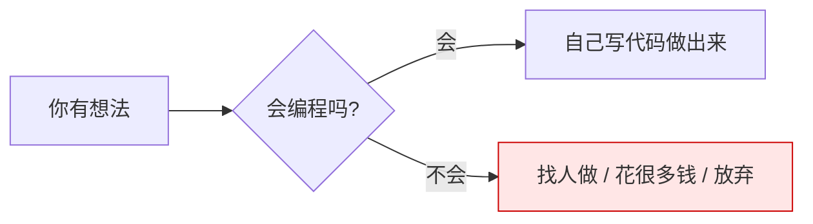
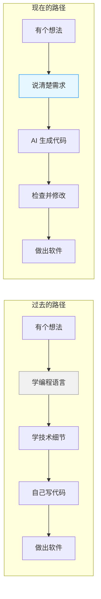

# 第1章 人人都可以开发软件的时代

> 这一章要解决一个问题：一个从没写过代码的人，凭什么也能做出软件？答案不是「你也去学编程」，而是「编程这件事本身变了」。

## 本章你会学到

- 为什么过去软件开发是一道很高的门槛
- AI 到底改变了什么，没改变什么
- 「自然语言编程」是什么意思
- 它和传统编程有什么不同、各自适合什么
- AI 不是魔法：它能做什么、不能做什么
- 一个普通人（花店老板林小满）是怎么做出自己软件的

### 引子：林小满的烦恼

林小满在小区门口开了家花店。她有个烦心事：客户订花的信息全记在一个本子上——谁、订了什么花、什么时候要送到。本子越写越厚，翻起来越来越慢。有一次她忘了给一位老客户在母亲节前送花，对方失望了好几天。

「要是有个软件能帮我记这些就好了，」她想，「到日子还能提醒我。」

放在几年前，她只能有两个选择：花几万块找人开发，或者自己去学编程——学一门叫 Python 或 JavaScript 的语言，学几个月甚至几年。她两个都不想选。

但今天，她坐在电脑前，用打字的方式对着 AI 说：

> 「我想做一个花店用的小工具，能记下每个客户订了什么花、电话、要送到哪天，并在日子快到的时候提醒我。我不懂编程，你一步一步带我做。」

十分钟后，屏幕上出现了一个能用的页面。这不是魔法，也不是她突然学会了编程。这是这本书要教你的东西。

## 1.1 软件开发曾经是一道技术门槛

过去，软件是这样做出来的：一个懂技术的人，用一种计算机能听懂的语言（比如 Python、Java），把「先做什么、再做什么」一条条写下来。计算机严格按照这些指令执行。这些写下来的指令，就是**代码**，写代码的这个过程，叫**编程**。

问题在于，计算机的语言和人的语言差别太大了。它要求极其精确：少一个符号、错一个标点，程序就可能跑不起来。所以想做软件，你得先花很长时间学一门编程语言，学它的语法、规则、各种技术细节。

这就形成了一道门槛：

- **时间门槛**：学会能做出东西的程度，往往要几个月到一两年。
- **思维门槛**：你得学会用计算机的方式思考——把事情拆成一步步精确的命令。
- **试错门槛**：出错了，报错信息是一堆看不懂的英文，排查起来很痛苦。

结果就是，绝大多数有软件想法的人——像林小满这样——被挡在了门外。有想法，没能力实现。软件行业里那些「会做软件的人」和「需要软件的人」，是两拨人。



## 1.2 AI 为什么改变了软件开发

AI 带来的最大变化，用一句话说就是：**计算机开始能听懂人的自然语言了。**

你不再需要把想法翻译成计算机语言。你可以直接用中文（或任何你熟悉的语言）告诉 AI 你想要什么，AI 来负责把它变成能运行的代码。

打个比方。过去你要盖房子，得自己学会和泥、砌砖、拉电线——因为工人听不懂你的话，只有你自己上手。现在来了一位什么都懂的施工队，你只要说「我要一个两室一厅、朝南、带阳台的家」，他就能帮你规划、施工。你从「动手干活的人」变成了「说清楚想要什么的人」。

这就是变化的本质：**瓶颈从「会不会写」转移到了「会不会说清楚」。**

具体来说，AI 帮你做了这些以前必须自己做的事：

- 把你的想法翻译成代码
- 记住各种编程语言的语法和规则
- 生成页面、按钮、表格这些界面元素
- 在你出错时帮你分析原因
- 按你的要求修改已经做好的东西

## 1.3 什么是自然语言编程

**自然语言编程**，就是用你日常说话、写字的语言（自然语言），来描述你想要的软件，让 AI 把它变成真正能运行程序的一种开发方式。

它有三个特点：

1. **用人的语言，不用计算机语言**。你说「做一个能记客户订花的表格」，而不是写一串 `create table orders (...)`。
2. **你负责想清楚，AI 负责做出来**。你的核心工作是描述需求、判断结果、提出修改；AI 的工作是生成代码。
3. **反复对话，逐步成型**。软件不是一次说一句话就做好的，而是你一句、AI 一句，来回沟通、不断调整，慢慢变成你想要的样子。

需要说清楚的是：自然语言编程**不是**「一句话变出一个完美软件」。它更像你和 AI 一起做东西——你是提需求和把关的人，AI 是动手实现的人。

## 1.4 自然语言编程与传统编程有什么区别

两者不是「谁取代谁」，而是两种不同的做事方式，各有各的适合场景。

| 对比项 | 传统编程 | 自然语言编程 |
|---|---|---|
| 你写的东西 | 计算机语言的代码 | 人的语言的描述 |
| 谁来写代码 | 你 | AI |
| 核心能力 | 掌握语法、算法、技术细节 | 想清楚需求、把话说清楚、判断结果 |
| 适合场景 | 底层系统、性能极致、安全关键 | 中小工具、内部系统、原型、个人应用 |
| 上手时间 | 几个月到几年 | 几天到几周 |
| 精确性 | 由你保证每一行都对 | 由你描述清楚、AI 保证实现 |

一个形象的类比：传统编程像是你自己亲手做一道菜，从切菜到调味都自己来；自然语言编程像是你当「主厨」，告诉助手「切细一点、盐少放、最后撒点葱花」，助手来做，你来尝味道、让它调整。

对于林小满的花店小助手、一个记账工具、一个客户管理表这类软件，自然语言编程完全够用，而且快得多。而对于飞机控制系统、银行核心交易这类「错一点就出大事」的软件，仍然需要传统编程的严谨。这本书聚焦前者。

## 1.5 AI 不是魔法：它能做什么，不能做什么

诚实地说清楚 AI 的边界，比吹捧它更重要。

**AI 擅长的事：**

- 把明确的需求变成能运行的代码
- 生成常见功能：页面、表单、列表、搜索、计算
- 按照你的描述修改已有的东西
- 解释代码、分析报错、给出建议

**AI 做不好的事：**

- **猜你的心思**。你没说清楚的东西，它只能猜，而猜经常会错。所以「把话说清楚」是你最重要的能力。
- **一次做完复杂的大系统**。需求越庞大、越模糊，做出来的东西越容易跑偏。所以要拆开、一步步来（第7章会详细讲）。
- **替你做决定**。要做什么、做成什么样、哪个功能更重要——这些判断是你的责任。
- **保证 100% 正确**。AI 会犯错，会改错地方，会「忘记」之前的要求。所以你需要检查、测试、及时纠正（第四、五篇专门讲这个）。

记住一句话：**AI 是一个能力很强、但完全照着你说的做、而且会犯错的搭档。** 你的水平，主要体现在你能不能把它指挥好。

## 1.6 从「学习编程语言」到「学会指挥 AI」

这张图总结了全书的核心转变：



你会发现，人的工作重心变了：

- 不再是「记住语法」，而是「**把需求说清楚**」（第二篇）
- 不再是「自己写每一段代码」，而是「**把大问题拆成小任务**」（第7章）
- 不再是「自己排查每一行错误」，而是「**描述现象、让 AI 诊断**」（第五篇）
- 不再是「做完就结束」，而是「**不断修改和迭代**」（第四、六篇）

这正是这本书要系统教你的东西。它不是零散的「提示词技巧」，而是一整套从想法到软件的能力。

## 1.7 一个普通人开发软件的真实案例

让我们把林小满的故事讲完，让你先对整本书的旅程有个整体印象。后面每一篇，你都会看到类似的真实对话。

**第一步：说出想法（第二篇）**

> **林小满：** 我想做个花店用的小工具，记客户订花的信息，到日子提醒我。
>
> **AI：** 好的。为了做出来更符合你的需要，我想确认几点：客户信息要记哪些？提醒是提前几天？这个工具是你在电脑上用，还是也要在手机上看？
>
> **林小满：** 记名字、电话、订什么花、要送到的日期。提前一天提醒我就行。我主要用电脑，偶尔手机看看。

**第二步：AI 设计、开始做（第三篇）**

AI 根据这些描述，规划出页面（一个客户列表、一个「新增订花」表单）和数据要存什么，然后一步步生成出来。林小满不需要懂这些是怎么写代码实现的，她只需要看「是不是她想要的样子」。

**第三步：修改（第四篇）**

> **林小满：** 列表里我想直接看到「还有几天要送」，不用点进去。另外提醒的颜色改成红色，太淡了我看不见。
>
> **AI：** 明白了。我会在列表增加「剩余天数」一列，并把提醒文字改成红色加粗。只改订花列表页，其他地方不动。

**第四步：排错与测试（第五篇）**

林小满发现有个日期不对。她把截图发给 AI，描述「我填的是 5 月 10 日，列表显示成了 6 月 10 日」。AI 一步一步排查，找到了日期处理的问题并修好。

**第五步：发布与迭代（第六篇）**

最后，AI 帮她把软件放到网上，手机和电脑都能打开。用了一段时间后，她又陆续加了「按客户查历史订单」「节日前批量提醒」等功能。软件是慢慢长出来的，不是一次做完美的。

这个流程，就是这本书的骨架。**你不需要先变成程序员，你只需要学会走完这条路。**

## 常见坑

- **坑：期待一句话做出完美软件。** 为什么：AI 只能基于你说的信息工作，一句话装不下完整需求。怎么做：接受「反复对话、逐步成型」，先做一个简单的，再慢慢加。
- **坑：因为不懂技术细节就不敢开始。** 为什么：你不需要懂代码，只需要会描述和判断。怎么做：从 1.7 的小案例开始，先动手做出一个能跑的东西，信心就来了。
- **坑：把 AI 当成搜索引擎，问一次就走。** 为什么：软件是「聊」出来的，不是「搜」出来的。怎么做：把它当成长期搭档，一个需求来回沟通好几轮。
- **坑：认为 AI 说的都对。** 为什么：AI 会犯错、会理解偏差。怎么做：养成「生成后检查、用后测试」的习惯。

## 本章小结

- 过去做软件有很高的技术门槛，AI 正在把这道门槛大幅降低。
- 自然语言编程＝用人的语言描述软件，让 AI 变成代码，人来把关。
- 核心转变：从「学会写代码」到「学会说清楚需求、拆解问题、指挥 AI」。
- AI 很强但会犯错、不会读心，你的判断和表达至关重要。
- 从想法到软件的完整旅程：说出想法 → AI 设计开发 → 修改 → 排错测试 → 发布迭代。

## 动手练习

1. 想一个你生活或工作中「如果有个小工具就好了」的场景，用三句话说清楚它要解决什么问题。
2. 找一个你用过的 AI 聊天工具，试着把练习1的场景完整描述给它，看它会追问你哪些问题——这些问题正是「需求」要考虑的点。
3. 想一想：在你刚才的描述里，有哪些地方是「你觉得清楚、但其实很模糊」的？

## 可复制的指令模板

**模板一：开始一个新项目时，让 AI 带你一步步做**

```text
我想做一个软件，但我完全不懂编程。请你一步一步带我完成。

我的想法是：[用大白话描述你想做的东西，解决什么问题]

我会回答你的问题来帮你把需求弄清楚。请你：
1. 先问我几个关键问题，帮我把想法变成明确的需求；
2. 确认需求后，给我一个简单明了的开发计划；
3. 一次只做一步，每做完一步告诉我结果，让我确认后再继续。
```

**模板二：检查 AI 给你的方案是否靠谱**

```text
针对你刚才给我的方案，请用通俗的话解释：
1. 这个软件最终会有哪几个页面 / 部分？
2. 它会保存哪些数据？
3. 第一步我们先做什么？
4. 有哪些地方我还需要做决定？
请不要用技术术语，用打比方的方式讲给我听。
```
