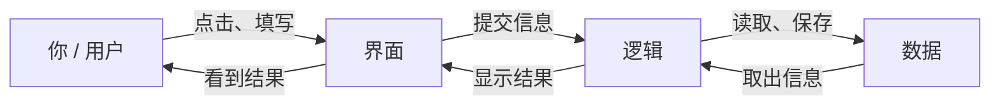
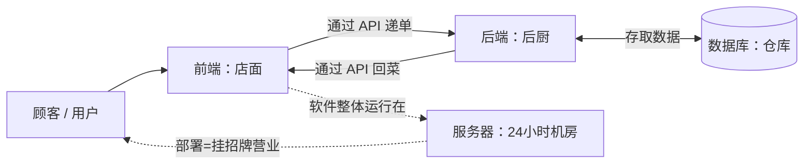

# 第2章 自然语言编程的基本原理

> 上一章我们知道了「人人都能做软件」。这一章要掀开软件的盖子看看：软件到底是个什么东西？AI 又是怎么把你说的话变成它的？懂一点里面是怎么回事，你会用得更踏实。

## 本章你会学到

- 软件到底是什么：它本质上是在「自动化一套流程」
- 软件的三个组成部分：界面、数据、逻辑
- AI 把自然语言变成代码的大致过程
- 前端、后端、数据库分别是什么，用什么比喻理解
- API、服务器、部署是什么意思
- 为什么你不必先掌握这些技术也能开发
- 但又为什么稍微懂一点概念，会让你更厉害

### 引子：屏幕上冒出一堆听不懂的词

林小满照着第1章的方法，对着 AI 说了一通，屏幕上真的出现了一个能记录订花的页面。她正高兴，却看见 AI 回了一句：

> **AI：** 页面做好了，前端已经连上后端，数据会存进数据库，等你确认后我再帮你部署上线。

林小满愣住了：「前端？后端？数据库？部署？这些词我一个都不懂。我刚才到底做出了个什么东西？」

别急，她（还有你）遇到的这种感觉太正常了。这就像你第一次走进一家餐厅的后厨，看见厨师喊「出餐口传菜」「冷链补货」，一头雾水——但餐厅明明好好地开着。这一章我们就用「开店」这个比喻，把这些词一个个变成你能看懂的画面。看完你会发现：软件没那么神秘，它和你每天打交道的店铺，道理几乎一样。

## 2.1 软件到底是什么

先别想「代码」「程序」这些词。想一家店。

一家能正常运转的店，需要三样东西：一个顾客能看见、能走进来的**店面**；一本记着谁买了什么、欠多少账的**账本**；还有一套干活规矩——比如「先收钱再交货」「每天打烊盘点」。

软件其实就是一家「自动运转的小店」：**它把一套原本要人一步步做的流程，变成机器自动帮你做。** 林小满原来用小本子记订花、靠脑子记到期提醒——这是一套「人工流程」。她想做的软件，就是把这套流程交给电脑自动跑：订单自动记、日子到了自动提醒。

所以，软件不等于「一堆看不懂的代码」。代码只是做软件用的材料（就像盖房子的砖和水泥）。软件真正的样子，是「一个能帮你自动做事的工具」。你关心的是「它能不能帮我记账、提醒」，而不是「它是用什么砖盖的」。

记住这句话：**软件 = 把一套流程自动化，让你少操心。**

## 2.2 软件由哪些部分组成：界面、数据、逻辑

把上面那家店拆开看，任何软件都有三个部分。先看这张对照表：

| 软件的组成部分 | 它是什么 | 开店比喻 | 在林小满的工具里 |
|---|---|---|---|
| 界面（UI） | 你看到、能点、能填的那部分 | 店面、橱窗、菜单、柜台 | 订花列表、新增订单的表单 |
| 数据（data） | 软件记住的信息 | 账本、客户名册 | 客户名字、电话、订的花、送达日期 |
| 逻辑（logic） | 软件做事的规则和步骤 | 店里的干活规矩 | 「送达前一天提醒我」「按日期排序」 |

- **界面**，英文叫 interface 或 UI（你可以理解为「人和软件碰面的地方」）。你点按钮、填表单、看列表，都是在跟界面打交道。它就是软件的「脸面」。
- **数据**，就是软件替你记着的信息。把数据想成一本**会自己整理的电子账本**：你不用翻，想找的时候一搜就出来。
- **逻辑**，是软件「动脑子」的部分：什么条件下做什么事。它是看不见的，但决定了软件聪不聪明——比如「如果离送达日只剩一天，就把提醒标红」。

这三部分是怎么配合的？看这张图：



一句话串起来：**你在界面上操作，逻辑来处理，数据被读写，结果再显示回界面。** 记住这个循环，后面所有概念都挂在它上面。

## 2.3 AI 是如何把自然语言变成代码的

现在回答林小满最关心的：她说的那句大白话，怎么就变成了屏幕上的页面？

先说清楚一点：AI 不是魔法，也不会「凭空变出」软件。它做的是一件很像**翻译**的事。你说的是「人的语言」，计算机只认得「计算机语言」（代码）。AI 就像一位同时精通两种语言的翻译官，把你说的需求，翻译成计算机能执行的一行行代码。

打个比方：你对装修队说「我要一个朝南、带阳台、厨房大一点的家」。工头不会照着你的话直接刷墙——他先把你的话变成一张施工图，再按图施工。AI 也一样：它把你「记客户订花、到期提醒」的描述，对应到它学过的无数种代码套路（页面怎么写、表格怎么存、提醒怎么算），拼装出能跑的程序。

我们来看一段真实的对话，你就知道这个过程有多「不说人话→说人话」：

**你：** 我想做个记客户订花的小工具，能记名字、电话、订什么花、送达日期，前一天提醒我。我不懂编程。

**AI：** 好的，我先确认再动手。1）提醒是页面上变红，还是需要弹窗？2)这个工具只在电脑用，还是手机也要看？3）要不要按客户分开看历史订单？

**你：** 变红就行。主要电脑用。历史订单先不用，太复杂。

**AI：** 明白。我会做三样东西：①一个「新增订单」表单；②一个订花列表，显示剩余天数；③一条规则——当某订单离送达只剩 1 天，就把那一行标红。先做这三件，做完给你看。

注意 AI 干的事：它把你模糊的一句话，**拆成了界面、数据、逻辑三块**（正是上一节讲的），而且故意砍掉了「历史订单」这种暂时太复杂的部分。这不是它聪明过头，而是它在按「把需求说清楚、拆小」的路子走——这也是本书后面反复教你的方法。

AI 能把话变代码，靠的是它「见过」海量代码，知道「记订单」通常对应一张数据表，「提醒」通常对应一段判断日期的代码。你不需要懂这些对应规则，但知道有这一步，你就明白：**你说得越清楚，它翻译得越准。**

## 2.4 什么是前端、后端、数据库

现在来拆解 AI 那句话里的三个词。还是用「开一家餐厅」来比喻，一次性讲明白：

- **前端（front end）**：顾客直接看到、直接接触的部分——门面、菜单、服务员、桌椅。在软件里，就是你能看到、能点的页面和按钮。林小满看到的订花列表、新增表单，都是前端。
- **后端（back end）**：顾客看不见、在背后干活的部分——后厨洗菜、炒菜、配菜、算账。在软件里，它负责处理规则：判断日期、算提醒、检查你填的信息对不对。
- **数据库（database）**：存放东西的地方——餐厅的冷藏仓库和货架。在软件里，它就是替你存数据的地方。把数据库想成一张**超级 Excel 表格**：能存很多行记录，还能飞快地查找、排序。

| 概念 | 餐厅比喻 | 在软件中的角色 |
|---|---|---|
| 前端 | 前厅、菜单、服务员 | 用户看到的界面 |
| 后端 | 后厨，负责加工 | 处理规则的看不见部分 |
| 数据库 | 冷藏仓库、账本柜 | 长期保存数据的地方 |

一句话记住：**前端是「看得见的脸」，后端是「看不见的脑」，数据库是「记事情的账本」。** 它们不是三个软件，而是同一个软件的三块分工——就像前厅和后厨都属于同一家餐厅。

## 2.5 什么是 API、服务器、部署

还差三个词。继续用餐厅把这些词讲清楚：

**API（接口）**——想象服务员和后厨之间那个「传菜窗口」。服务员（前端）不能直接冲进后厨（后端）自己炒菜，他把单子从窗口递进去，后厨做好再从窗口递出来。这个「按规矩递单子、取菜的接口」，就是 API。它的好处是：只要按规矩来，前后两端各干各的、互不干扰。你也可以把它想成墙上的**电源插座**——不管什么电器，插头符合规格就能插上通电。

**服务器（server）**——一台 24 小时开机、专门放软件、随时等着别人来访问的电脑。就像餐厅的「总机房」，不管白天黑夜，顾客一进门就能招呼。你的软件做好后不能只待在你自己的电脑里（你一关机别人就打不开了），得放到这台一直开着的电脑上。

**部署（deployment）**——把做好的软件搬到服务器上、让它能通过网址被打开的过程。比喻起来就是**开店营业**：装修好了、货上好了、招牌挂出去了，顾客推门就能进来。

把整条链路串起来看这张图，你会更清楚这些词的位置：



现在再回头看 AI 那句话——「前端连上后端，数据存进数据库，帮你部署上线」——是不是就在说：前厅和后厨用传菜窗口接通了，账本放好了，招牌挂出去开始营业了？是不是没那么吓人了？

## 2.6 为什么我们不必先掌握这些技术才能开发

讲到这里你可能会想：「这些词听起来还是挺多的，是不是得先学明白了才能动手？」

答案是：**完全不用。** 想想看——

你每天开车上班，需要先把发动机制造原理学一遍吗？不需要。你请装修队装修房子，需要自己先学会砌砖、拉电线吗？也不需要。你只需要会「说清楚想要什么」，剩下的交给专业的人（或者现在，交给 AI）。

林小满就是最好的例子。她到现在也说不清「数据库」到底是什么，但她的每一笔订花记录都好好地存着；她不知道「部署」的原理，但她的工具照样能在手机上打开。**AI 已经把这些技术细节接过去了**：它帮你选怎么存数据、怎么写前后端、怎么把代码拼起来。你的活儿，是当好那个「提需求、看效果、说哪里要改」的人。

这正是第1章说的核心转变：瓶颈从「会不会写」变成了「会不会说清楚」。所以别等「学完了再开始」——**先做出来，边做边懂。**

## 2.7 但为什么我们仍然需要了解这些概念

既然不用先学，那这一章岂不是白看了？当然不是。「不用精通」和「完全不懂」是两回事。稍微懂一点，至少给你四个好处：

1. **跟 AI 沟通更准。** 当你知道「前端」是页面、「数据」是要存的信息，你就能说出「在前端列表里加一列剩余天数」这种精确的话，而不是含糊地说「那个地方改一下」。AI 听得懂，返工就少。
2. **能看懂 AI 在干嘛。** 它说「我把数据模型改了一下」，你知道它大概动了账本结构，而不是一脸茫然地点「好」。
3. **出问题知道往哪找。** 页面显示错了，你大致判断是前端问题；数据丢了，你知道该查存储。第五篇讲排错时，这些概念会帮你描述问题。
4. **做决定更有底气。** 当 AI 给出两个方案，懂一点原理的你，才能判断哪个更适合你的小店。

打个比方：你不必学会修车，但懂一点车的基本道理，车出毛病时能跟师傅说清楚「是起步时咔咔响」，也不容易被忽悠。我们学这些概念，不是要你变成工程师，而是让你成为一个**聪明、不被糊弄的"甲方"**。

## 常见坑

- **坑：被术语吓住，觉得必须先学完才能动手。** 为什么：这些词只是给东西起的名字，不是入场考试。怎么做：先照着模板做出一个小东西，用到哪个词再回头查，理解会快得多。
- **坑：把「前端」「后端」当成两个不同的软件。** 为什么：听起来像两样东西，其实是一套软件的两块分工。怎么做：想想同一家餐厅的前厅和后厨，就通了。
- **坑：以为数据库是什么高深莫测的东西。** 为什么：被名字唬住了。怎么做：把它当成一张会飞快查找、能存很多行的「超级 Excel」，就没那么神秘了。
- **坑：觉得不懂技术就只能 AI 说啥是啥。** 为什么：AI 会犯错、会理解偏。怎么做：懂点基本概念，你才有能力检查它的结果——这正是 2.7 讲的道理。

## 本章小结

- 软件本质是「把一套流程自动化」，代码只是材料，不是软件本身。
- 软件由三部分组成：界面（店面）、数据（账本）、逻辑（干活规矩），它们构成一个循环。
- 前端是看得见的脸、后端是看不见的脑、数据库是记事的账本；API 是传菜窗口，服务器是 24 小时机房，部署是挂招牌营业。
- AI 像翻译官，把你的大白话拆成界面、数据、逻辑，再翻译成代码——你说得越清楚，它翻得越准。
- 你不必先精通技术就能开发，但懂一点概念能让你沟通更准、排错更快、决策更稳。

## 动手练习

1. 用「开餐厅」的比喻，说说你想做的小工具的「前厅」「后厨」「仓库」分别是什么。
2. 打开你已有的（或第1章想做的）软件，指一指：哪些是界面、哪些是数据、哪些是逻辑？（想不出来也没关系，先猜。）
3. 试着用大白话向一个不懂技术的朋友解释「部署」，要求必须用到「开店」这个比喻。

## 可复制的指令模板

**模板一：让 AI 用开店比喻，解释它给你做的东西**

```text
我完全不懂技术。针对你刚做好的这个东西，请用「开一家店」来打比方，解释给我听：
1. 它的「店面」（我能看到的部分）是什么？
2. 它的「账本」（保存的数据）记了些什么？
3. 它的「干活规矩」（逻辑）有哪些？
4. 你说前端、后端、数据库，分别对应这家店的什么角色？
请不要用技术术语，全部用开店的说法讲。
```

**模板二：动手前，让 AI 先给你画出结构**

```text
在正式写代码之前，请先用最通俗的话告诉我，这个软件会分成哪几块：
1. 有哪些页面 / 界面？
2. 会保存哪些数据？
3. 有哪些判断规则（比如什么条件下提醒、排序）？
4. 用一张简单的图或表格，把这些部分的关系画出来。
我先确认结构和你想的一样，再请你开始做。
```
