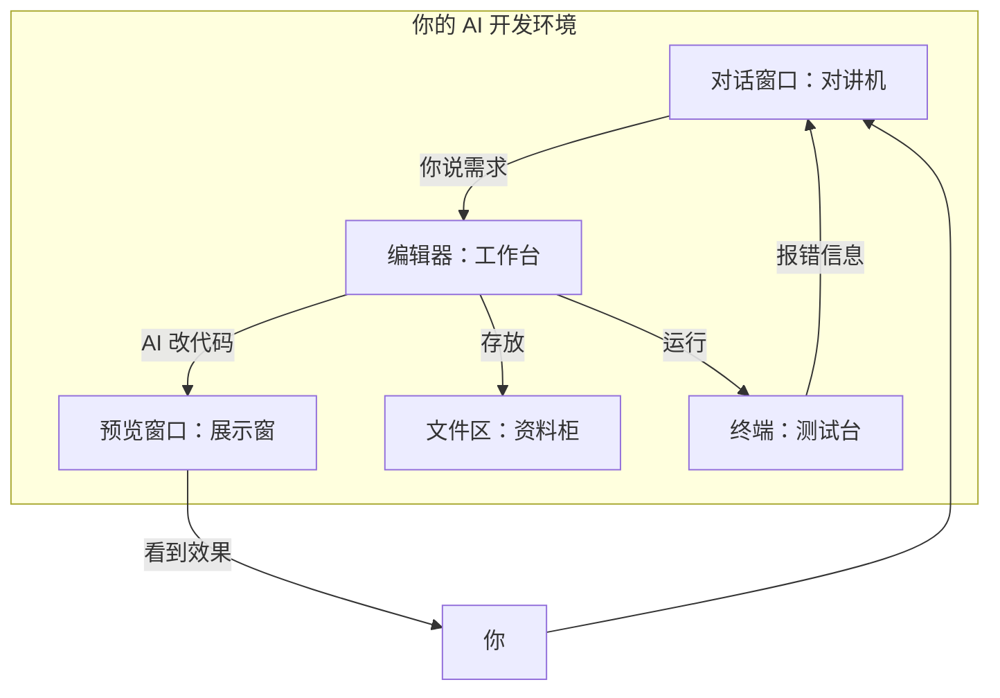
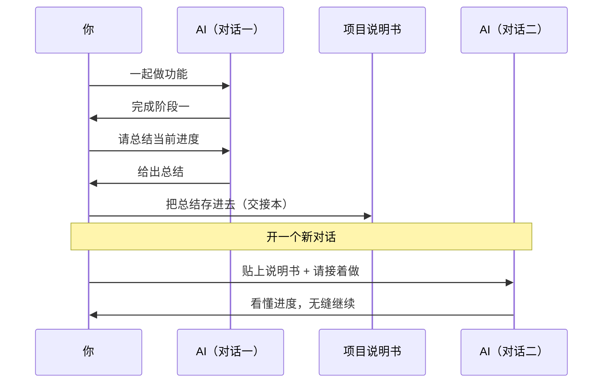

# 第3章 认识你的 AI 软件开发伙伴

> 上一章我们掀开了软件的盖子。这一章来认识真正帮你干活的人（准确说，是「工具」）：有哪些 AI 工具、它们有什么不一样、怎么挑一个适合你的，又怎么把它变成一间你能长期干活的工作室。

## 本章你会学到

- AI 聊天工具和 AI 编程工具的根本区别
- AI 编程工具的几种常见形态，各自适合谁
- 零基础该怎么挑第一个开发工具
- 一个 AI 开发环境由哪几部分组成
- 怎么搭好属于你自己的开发工作空间
- 怎么让一个项目跨多次对话持续做下去
- 怎么开动你的第一个软件项目

### 引子：林小满的工具选择困难症

林小满手上有两个 AI。一个是她平时用来问问题、写朋友圈文案的聊天助手；另一个是朋友推荐的「能直接生成网页」的编程工具。她犯难了：

> **林小满：** 我平时问东西用聊天那个就行，做软件是不是也能用它？这个编程工具又是干嘛的？名字还一大堆——什么应用生成器、代码编辑器、插件……看得我眼花。

她的问题很实在。市面上工具这么多，名字听着都差不多，到底有什么区别？会不会选错了就做不出来？

先给你吃颗定心丸：**工具只是干活的地方，真正决定成败的，还是你会不会把需求说清楚**（这是第2章、也是全书的核心）。工具会不断更新换代，但「说清楚需求、拆小任务、检查把关」这套本事是通用的。这一章帮你把工具这件事看明白，然后选一个用起来——别在挑选上耗太久，动手最重要。

## 3.1 AI 聊天工具与 AI 编程工具的区别

先把最常见的两类分清楚。

**AI 聊天工具**（比如各种通用对话助手）：你问它答，能解释概念、写文案、帮你想点子，有些也能写几段代码给你看。但它通常**不能直接操作你的项目文件、不能替你运行整个软件**。比喻一下：它像一位**什么都知道的顾问**——给建议、出主意很在行，但不动手干活。你要照着它说的自己去做。

**AI 编程工具**：它住在你的「项目」里，能直接读、写、改你的文件，能运行程序、看报错、把页面显示给你。比喻一下：它像一支**带着工具箱的施工队**——你说要什么，它真能把东西搭出来、跑起来给你看。

| 对比项 | AI 聊天工具 | AI 编程工具 |
|---|---|---|
| 主要能做什么 | 问答、解释、出主意、写片段 | 读写文件、生成并运行完整项目 |
| 像什么角色 | 顾问（动嘴） | 施工队（动手） |
| 能不能看到你的软件跑起来 | 通常不能 | 能，有预览 |
| 适不适合从零做出软件 | 适合打辅助、想清楚需求 | 适合真正动手做 |

一个关键判断标准：**它能不能直接操作你的项目、把软件跑给你看？** 能，就是编程工具；不能，就只是聊天顾问。做软件，最终要靠后者。不过两者是搭档关系——你完全可以一边用聊天工具想清楚需求，一边用编程工具把它做出来。

## 3.2 AI 编程工具的几种形态

AI 编程工具长得不太一样，大致有四种形态。用「吃饭」来比喻，一下就懂：

1. **对话式应用生成器**（比如一些「说一句话就生成网页」的平台）：你用大白话描述，它直接产出一个能打开、能运行的网页应用。比喻：**点菜即上菜**——你说想吃什么，厨房直接端上来。对零基础最友好。
2. **AI 代码编辑器 / IDE**（集成开发环境，比如内置 AI 的编辑器）：像一个专业工作台，AI 陪你改整个项目，能看文件、能预览。比喻：**带 AI 助手的工作台**——适合想看得更多、改得更细的人。
3. **插件式编程助手**：装在你已有的编辑器里，你写到哪它补到哪。比喻：**给老扳手加了个智能助手**——更适合已经有点基础的人。
4. **命令行 AI 工具**：在黑底白字的终端窗口里，用对话指挥它操作项目。比喻：**用对讲机指挥施工**——灵活但门槛稍高，偏进阶。

| 形态 | 适合谁 | 一句话比喻 | 零基础推荐度 |
|---|---|---|---|
| 对话式应用生成器 | 完全零基础 | 点菜即上菜 | 最高 |
| AI 代码编辑器 / IDE | 零基础到进阶 | 带 AI 的工作台 | 高 |
| 插件式编程助手 | 有一点基础 | 老工具加助手 | 中 |
| 命令行 AI 工具 | 进阶用户 | 对讲机指挥施工 | 较低 |

对你（和林小满）来说，从「对话式应用生成器」或「带 AI 的编辑器」入手最省心。

## 3.3 选择适合初学者的开发工具

怎么挑？别追「最强」，追「最适合你现在」。给你五条实在的选择标准：

- **能不能用中文好好沟通？** 你描述需求、它解释问题，都用你熟悉的语言，效率最高。
- **有没有预览窗口？** 能立刻看到做出来的样子，是零基础最大的信心来源——改一句，马上看到变化。
- **能不能一键运行 / 发布？** 省去配置环境的麻烦，先跑起来再说。
- **出错时能不能把报错直接贴给它？** 好的工具能读懂报错、帮你改，这对排错（第5篇）太重要了。
- **成本你能接受吗？** 很多工具有免费额度，先用免费的练手，够了再升级。

还要提醒一句：**别陷入「选工具选到地老天荒」。** 工具会变，今天最好的明天可能就改版了。先挑一个符合上面几条的，认认真真用上两周。用着不顺手，再换也不迟——因为你的核心本事（说需求、拆任务、查结果）已经长在身上了，换个工具照样能用。

## 3.4 AI 开发环境的基本组成

选好工具，你会看到一个「开发环境」。别被名字吓到，它就是一间**工作室**，里面有五个常见的位置：

- **编辑器**：你写代码、看文件的地方。比喻：工作室的**工作台**。
- **对话窗口**：你和 AI 聊天、下指令的地方。比喻：跟施工队沟通的**对讲机**。
- **预览窗口**：显示软件效果的地方，你做的页面在这里出现。比喻：给客户看的**展示窗**。
- **文件区**：你的项目文件都列在这里，比如页面文件、数据文件。比喻：存放材料的**资料柜**。
- **终端 / 运行区**：运行程序、显示报错信息的地方。比喻：通电试机的**测试台**。



这五个位置不一定都在同一个界面里，有时候长在不同标签页。但你只要记住「对讲机说需求、工作台改代码、展示窗看效果、资料柜存文件、测试台看报错」，就抓住了开发环境的关键。

## 3.5 如何建立自己的开发工作空间

现在动手搭你的工作室。跟着这几步走：

1. **注册并登录**一个你选好的工具。就像租下工作室，先有钥匙。
2. **新建一个项目**（有的叫「文件夹」「工作区」），给它起个清楚的名字，比如「花店小助手」。别用「新建文件夹1」这种以后自己都认不出的名字。
3. **写一份「项目说明书」**，这是最关键的一步。新建一个文本文件（通常叫 README 或说明.txt），用大白话写下：这个项目要做什么、有哪些功能、做到哪一步了。为什么重要？因为下次你换个新对话，AI 不记得之前聊过什么，这份说明书就是它的「记忆」。
4. **养成保存和备份的习惯**。很多工具会自动存，但你仍要偶尔把重要版本另存一份（第6章会细讲版本和备份）。
5. **保持文件整洁**。别把所有东西堆到一起，按功能分一分，以后好找。

来看林小满怎么让 AI 帮她写第一份项目说明书：

**你：** 我想给这个项目写个说明书，方便以后新开对话时接着做。请你帮我起草。

**AI：** 好的，我先根据我们目前做的写一份草稿，你改改就行：

> # 花店小助手 · 项目说明
> - **目标**：帮花店记录客户订花信息，并在送达日前提醒。
> - **已有功能**：新增订单（名字、电话、花、日期）；订花列表；送达前一天标红提醒。
> - **数据**：每条订单记名字、电话、花材、送达日期。
> - **当前进度**：页面和提醒已完成，还没发布上线。
> - **下一步**：发布后在手机上测试。

**你：** 很好，加上一句——提醒只标红，不要弹窗，我怕打扰客户。

**AI：** 已加进「已有功能」和「下一步」里。以后你每次新开对话，把这份说明发给我，我就能立刻接上进度。

这份说明书，就是你项目的「身份证 + 日记本」。

## 3.6 如何与 AI 保持一个项目的持续对话

做软件很少一轮对话就完成，往往要聊很多次。这里有个麻烦：**AI 会「忘事」。** 对话太长，或者你新开一个对话，之前聊过的它就不记得了。这在技术上叫「上下文」（context）有限——你和用户、和 AI 之间「当下记得的信息」是有容量上限的。

怎么办？靠「交接」。想象工厂三班倒：下班前要写交接本，下一班才知道干到哪了。你也这样做：

1. **每个阶段结束时，让 AI 总结进度**，然后把总结存进项目说明书（就是 3.5 那份）。
2. **开新对话时，先把说明书贴给 AI**，再说「我们接着做，目前进度是这样」。相当于给新来的工人递上交接本。
3. **重要决定写进文件，别只留在聊天里。** 比如「提醒只标红不弹窗」这种，写进说明书才不会丢。
4. **对话明显变长、AI 开始答非所问时，主动开新对话**并交接，别硬撑。



有了这个「交接本」习惯，你的项目就不会因为换对话而断线。这是很多人做着做着就乱掉的关键原因，也是这本书反复强调「把信息落到文件里」的原因。

## 3.7 开始你的第一个软件项目

把前面六节串起来，就是一张「今天就能开动」的清单。我们还用林小满的第一天做例子：

**第1步：选工具。** 她挑了一个能用中文、有预览、一键运行的对话式应用生成器。

**第2步：建空间。** 新建项目「花店小助手」，写好项目说明书。

**第3步：说出第一个小目标。** 注意——她没有一上来就说「我要一整套客户管理系统」，而是先要一个最小的东西：

**你：** 我先要一个最简单的页面：能填名字、电话、订什么花、送达日期，点保存后下面能列出我填过的记录。先不用提醒功能，我们先把这个跑起来。

**AI：** 好的，先做这个最小版本。我会做一个表单和一张列表：你填完点保存，记录就出现在列表里。我现在开始，做完给你预览。

**第4步：看效果、提修改。** 页面出来后，她看到效果，再说哪里要改。

**你：** 出来了！列表里字太小，能不能大一点？另外列顺序改成：名字、电话、花、日期。

**AI：** 已经调好：列表字号加大，列顺序按你说的改。其他没动，你再看看。

**第5步：总结存档。** 一轮结束，她让 AI 总结进度，存进说明书，为下一次接力做准备。

就这么简单。**第一个项目的目标不是「完美」，而是「跑起来」。** 哪怕只是一个能填能列的页面，也是你从零到一的大跨越。软件是慢慢长出来的——这一点，第1章的林小满故事已经验证过，接下来每一篇你都会亲手再验证一次。

## 常见坑

- **坑：在好几个工具之间反复横跳，哪个都没深入。** 为什么：工具只是载体，核心是你会不会说需求。怎么做：先定一个，认真用两周，再决定要不要换。
- **坑：以为换个更厉害的工具，AI 就能听懂你了。** 为什么：问题往往出在需求没说清，不在工具。怎么做：练「把话说清楚、把大任务拆小」，这才是通用的真本事。
- **坑：所有重要信息只留在聊天记录里。** 为什么：对话会丢、AI 会忘。怎么做：每次进步都写进项目说明书，让信息落到文件里。
- **坑：对话已经很长、AI 开始犯糊涂，还硬着头皮继续聊。** 为什么：超出了上下文容量。怎么做：及时开新对话，用说明书做交接。
- **坑：第一个项目就想做大而全。** 为什么：越大越容易跑偏、越容易卡住。怎么做：从「能跑起来的最小版本」开始，再一点点加功能。

## 本章小结

- AI 聊天工具像动嘴的顾问，AI 编程工具像动手的施工队；做软件要靠后者，两者可以搭档。
- 编程工具有四种形态，零基础优先选「对话式生成器」或「带 AI 的编辑器」——点菜即上菜最省心。
- 开发环境是一间工作室：对话是对讲机、编辑器是工作台、预览是展示窗、文件区是资料柜、终端是测试台。
- 建好工作空间、写好「项目说明书」，是长期开发的地基。
- 用「交接本」的办法跨对话接力：阶段结束总结存档，新对话先贴说明书。
- 第一个项目的目标是「跑起来」，从最小版本开始，别贪大。

## 动手练习

1. 挑一个符合 3.3 标准的工具，注册并新建你的第一个项目，给它起个清楚的名字。
2. 用大白话写一份「项目说明书」：你想做什么、要有哪些功能、现在做到哪一步。
3. 让 AI 生成一个最简单的页面（比如一个能填名字、能列出名字的小表单），在预览窗口里看到它。
4. 这一轮结束时，请 AI 总结进度，你把它存进项目说明书，为下次接力做准备。

## 可复制的指令模板

**模板一：让 AI 帮你起草或更新「项目说明书」**

```text
请帮我维护一份「项目说明书」，方便我以后新开对话时能接着做。这份说明要用大白话写，包含：
1. 这个项目的目标是什么；
2. 已经做了哪些功能；
3. 数据保存了哪些内容；
4. 当前做到哪一步、还有什么没做；
5. 下一步计划做什么。
现在是第一次写，我项目的想法是：[用大白话描述]。请起草，之后每次做完一步我都会让你更新它。
```

**模板二：新开对话时的「接力交接」**

```text
我们之前做过一个项目，这是它的「项目说明书」和最新进度：

[在这里粘贴你的项目说明书]

请你先读懂上面的内容，然后我们接着做。我这一步想做的是：[描述这一轮的目标]。
如果你觉得接不上或者有疑问，先问我，确认清楚再动手。
```
