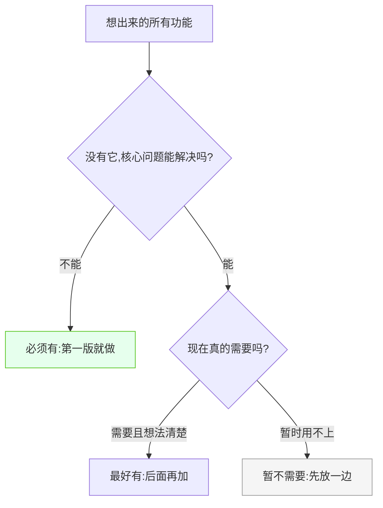

# 第4章 如何把一个想法变成软件需求

> 这一章要解决一个问题：你脑子里有个「想做个软件」的念头，但它模模糊糊、说不清楚，怎么把它变成一份 AI 能听得懂、也能照着做的明确需求？

## 本章你会学到

- 想法和需求到底差在哪里
- 怎么从生活里的「麻烦事」找到值得做的软件创意
- 把一个想法问清楚的三个关键问题：解决什么、给谁用、做什么
- 怎么分清「必须有」和「最好有」的功能
- 怎么让 AI 反过来追问你，帮你把需求补全


*图：从想法到软件的旅程*

### 引子：林小满的一句话，把 AI 问懵了

林小满看过第一篇后，迫不及待地坐到电脑前，想把自己的花店小助手做出来。她想了想，敲下一行字：

> **林小满：** 帮我做个花店用的软件。

AI 很快回了话，可问的全是她没想过的问题：

> **AI：** 好的！为了做得符合你的需要，我想确认一下：
> 1. 这个软件主要用来做什么？是记账、记订单，还是展示花？
> 2. 谁会用它？只有你，还是店员、顾客也要用？
> 3. 你希望它有哪些功能？比如新增、查询、提醒……
> 4. 你打算在电脑上用，还是手机上用？

林小满愣住了。她心里明明有个东西，可一被追问，发现自己其实什么都没想清楚。「我……我就是要那种能记客户订花的，」她想了半天才挤出一句，「具体我也说不上来。」

她这不是个例。几乎每个零基础的人，第一步都会卡在这里：**你有一个感觉，但还没有一份需求。** 这一章，就是教你把这个感觉，一步步打磨成需求。别急，我们会用手把手的方式走一遍。

## 4.1 想法不等于需求

先分清两个词，这是全书最基础、也最重要的一对概念。

**想法**，是你脑子里一个模糊的念头。它常常是一句话，带着「好像」「大概」「差不多」：「我想要个能帮我记花店订单的东西。」想法是可以模糊的——它只是个起点。

**需求**，是把这个念头说清楚之后的结果：它要解决什么问题、给谁用、有哪些功能、输入什么、输出什么。需求是清晰的、具体的、可以照着做的。

打个比方。想法就像是跟家人说「今晚想吃点好的」——这是一份感觉。需求则是一份菜谱：买什么菜、放多少盐、先炒什么后炖什么。厨师（AI）拿着「想吃点好的」没法做菜，但拿着菜谱就能做。

| 对比 | 想法 | 需求 |
|---|---|---|
| 形式 | 一句话、一个感觉 | 一份清单、一段清楚的描述 |
| 模糊程度 | 模糊，「大概」「差不多」 | 具体，能回答「是什么、多少、怎么算」 |
| 能不能直接做 | 不能，AI 只能猜 | 能，AI 可以照着实现 |
| 例子 | 「做个记花的东西」 | 「记录客户姓名、电话、订的花、送达日期；送达前一天提醒我」 |

所以，向 AI 提需求的第一步，不是急着打字，而是先问自己：**我的想法里，哪些地方还是「大概」？** 把这些「大概」一个个变成「确定」，想法就变成了需求。

## 4.2 从生活中的问题寻找软件创意

很多人以为，做软件要先有「技术灵感」。其实完全相反：**好软件几乎都来自生活里真实存在的小麻烦。**

林小满的创意就是从麻烦里长出来的。她的客户订花信息全记在一个本子上，本子越写越厚，翻起来越来越慢；有一次她忘了在母亲节前给老客户送花，对方失望了好几天。正是这个「翻本子翻到头晕 + 忘送花」的麻烦，让她萌生了「要是有个软件就好了」的念头。

你可以用同一个方法找创意。观察你或身边人生活、工作里，那些反复出现的「真麻烦」：

- 是不是总有信息记不全、找不到？（记订单、记客户、记账）
- 是不是总有时间、日子容易忘？（提醒、到期、生日）
- 是不是总有重复劳动，做得手酸？（每天填同样的表、发同样的通知）
- 是不是总有数据算不清？（统计、汇总、算账）

判断一个创意值不值得做，有个简单标准：**这个问题是不是真实、频繁、让你有点烦？** 越是「天天遇到、真让人头疼」的小麻烦，越适合做成一个小软件。反过来，只是「听起来很酷」但没人真的需要的点子，往往做出来就吃灰。

对林小满来说，「忘送花」这个麻烦真实又频繁，所以「花店小助手」是个值得做的好创意。

## 4.3 明确软件要解决什么问题

找到创意后，第一件事是用一句话写清楚：**这个软件，要为谁解决什么麻烦？**

这句话叫「问题陈述」。它的价值在于，逼你把注意力放在「问题」上，而不是一上来就堆功能。林小满一开始写的是「做个花店用的软件」——这不是问题，这是想做的东西。改成问题陈述，就变成了：

> 我是社区花店的老板，客户订花的信息记在本子上，又慢又容易漏，还常常忘记该在哪天送花。我需要一个工具，帮我记清楚每笔订单，并在送达日快到时提醒我。

对比一下，你会发现好的问题陈述有三个特点：

1. **有具体的人**：「社区花店老板」，不是泛泛的「用户」。
2. **有具体的麻烦**：「记在本子上又慢又容易漏、忘记送花日」，不是笼统的「管理不善」。
3. **有期望的改变**：「记清楚订单、按时提醒」，说明做成什么样算成功。

写不出这样一句话，往往说明你还没想清楚。这时候别硬写功能，先回到生活里，把那个让你难受的场景在脑子里过一遍：当时到底哪里不顺？你最想有人帮你做什么？

## 4.4 明确谁是软件的使用者

软件是给人用的。不同人用，软件的差别可能非常大。所以第二个要问清楚的是：**到底谁会用这个软件？**

对林小满的花店小助手来说，使用者其实有好几种可能：

- **她自己**：每天记订单、看提醒，是主要使用者。
- **店员**：帮她录入订单，但可能不需要看全部数据。
- **顾客**：如果想让顾客自己下单，那软件就得变成能对外访问的页面，完全又是另一回事。

你看，光是「谁来用」，就可能把软件引向完全不同的方向。所以这一小节，你要做的是列一张「使用者清单」：谁会用它？每个人用它做什么？谁用得多、谁用得少？

对于零基础的第一版软件，一个很实用的建议是：**先只为最主要的那一个使用者设计。** 林小满第一版就只考虑自己——她一个人记、一个人看。等做出来用顺了，再考虑要不要给店员加个入口。使用者越少，软件越简单，越快做出来。

你还可以简单描述一下主要使用者的特点，比如：「我，花店老板，不懂技术，主要在电脑上用，偶尔用手机看看。」这段话后面描述软件时会非常有用。

## 4.5 明确软件的核心功能

问题清楚了、使用者清楚了，接下来是功能。**核心功能，就是那些直接解决问题、非它不可的功能。**

怎么找核心功能？回到你的问题陈述，问自己：「要解决这个麻烦，最少需要软件帮我做哪几件事？」林小满的麻烦是「记订单 + 别忘了送花日」，那么对应的核心功能就呼之欲出：

| 核心功能 | 解决的问题 |
|---|---|
| 新增订单 | 把客户订花信息记下来，不再写在本子上 |
| 查看订单列表 | 一目了然地看到所有订单，不用翻本子 |
| 到期提醒 | 送达日前提醒，避免忘记送花 |

注意，这三件事每一件都直接对应一个麻烦。这就是核心功能的关键：**每一个核心功能，背后都有一个具体要解决的问题。** 如果一个功能你答不上来「它解决什么问题」，那它多半不是核心功能。

对第一版软件，林小满就锁定这三个核心功能。不要贪多——三个功能做扎实，远比十个功能做半吊子强。这是第7章「拆解功能」会反复强调的原则，这里先记住这个意识。

## 4.6 区分必要功能与可选功能

有了核心功能，你可能又冒出一堆「要是还能……就好了」的点子：按客户查历史订单、打印订单小票、自动算这个月卖了多少钱、给花材拍照片……这些该不该放进第一版？

这时候要给功能分个级。用一组简单的标签就够：

- **必须有（第一版就要）**：没有它，软件就解决不了核心问题。林小满的「新增、查看、提醒」属于这一类。
- **最好有（后面再加）**：有了更好，没有也能用。比如「按客户查历史订单」「统计月销售额」。
- **暂不需要（先不管）**：现在用不上，或想法还不成熟。比如「顾客自己下单」「打印小票」。



为什么要这么分？因为零基础做软件，最大的敌人是「想一步登天」。功能越多，AI 一次要做的事越多，越容易出错、跑偏，你也越难检查。把「必须有」的少数功能先做出来、用起来，再慢慢加「最好有」的，软件才会稳稳地长起来。

林小满的决策很干脆：第一版只做「必须有」的三件事，其余的全部记到一个「以后再说」的清单里。这个清单不是放弃，而是排期。

## 4.7 从模糊想法到明确需求

现在把前面的步骤串起来。把一个模糊想法变成明确需求，其实就是回答一串问题，把每个「大概」都问成「确定」。你可以照着这张清单逐条过：

| 要问清楚的问题 | 林小满的答案 |
|---|---|
| 它要解决什么问题？ | 记订单又慢又易漏、忘记送花日 |
| 谁是主要使用者？ | 花店老板本人，不懂技术，电脑上用为主 |
| 核心功能有哪些？ | 新增订单、查看列表、到期提醒 |
| 每笔订单要记哪些信息？ | 客户姓名、电话、订的花、送达日期 |
| 提醒怎么提醒？ | 送达日前一天，醒目标出来 |
| 第一版哪些功能必须有？ | 上面三个核心功能 |
| 哪些先不做？ | 历史查询、统计、打印等 |

过完这张表，你会发现，最初那句「帮我做个花店用的软件」，已经变成了一段清清楚楚的描述。对比一下：

- 模糊想法：「做个记花的东西。」
- 明确需求：「给花店老板用的工具，记录每笔订单的客户姓名、电话、花材和送达日期；能查看所有订单；送达日前一天醒目标注提醒。第一版先做这三项，历史查询和统计以后再加。」

右边这段话，AI 就能照着做了。**把想法变成需求，本质上就是把这张表填满。** 你不需要懂任何技术，只需要老老实实回答这些问题。

## 4.8 用 AI 帮助自己完善需求

写到这儿你可能会想：「这些问题我要是自己答不全怎么办？」好消息是——**你不必自己想全，可以让 AI 来问你。**

AI 特别擅长一件事：追问。你给它一个模糊想法，让它扮演一个「采访者」，把需要的信息一条条问出来。你只要如实回答，需求就在这个过程中慢慢清晰了。看林小满和 AI 的对话：

> **林小满：** 我想做个花店用的小工具，记客户订花的信息，到日子提醒我。我不懂编程，你别用技术词，像聊天一样问我问题，帮我把想法问清楚。
>
> **AI：** 好，我们来聊。第一个问题：每笔订单你想记哪些信息？比如只要名字，还是也要电话、地址？
>
> **林小满：** 要名字、电话、订什么花、要送到哪天。
>
> **AI：** 明白。第二个：这个「提醒」，你想提前多久提醒？提前一天、三天，还是当天？提醒想以什么形式出现？
>
> **林小满：** 提前一天就行，在页面上用红色标出来。
>
> **AI：** 第三个：这个工具主要谁用、在哪用？只有你自己在电脑上用，还是店员也要用、手机上也要看？
>
> **林小满：** 第一版就我自己在电脑上用，手机偶尔看一眼。
>
> **AI：** 好，我帮你把需求整理成一段话，你看看对不对：……

看出诀窍了吗？林小满只做对了一件事：**开口时明确告诉 AI「请你追问我」。** 这一句，就把 AI 从「等着你下命令的工具」变成了「帮你梳理思路的搭档」。

所以，当你自己想不清楚时，别一个人憋着。把模糊想法丢给 AI，让它问，你只管答。答着答着，需求就有了。

## 常见坑

- **坑：把「做个XX软件」当成需求，直接让 AI 开工。** 为什么：这句话只说了想做什么，没说解决什么、给谁用、有哪些功能，AI 只能瞎猜。怎么做：先花几分钟填一遍 4.7 的清单，再动手。
- **坑：第一版就想做齐所有功能。** 为什么：功能越多越容易出错、越难检查，零基础很容易一次失败就放弃。怎么做：用 4.6 的分级，第一版只做「必须有」的两三个功能。
- **坑：想替「所有可能的用户」设计。** 为什么：使用者越多，需求越发散，软件越复杂。怎么做：第一版只锁定一个最主要的使用者（通常就是你自己）。
- **坑：觉得「我得先想得特别完整才能开始」。** 为什么：需求从来不是一次想全的，它是在和 AI 的来回对话中逐步清晰的。怎么做：先写个大概，让 AI 追问你，边聊边补全。

## 本章小结

- 想法是模糊的念头，需求是清晰、具体、可执行的描述；AI 需要的是后者。
- 好创意来自生活里真实、频繁的小麻烦，而不是「听起来很酷」的点子。
- 把想法变需求，核心是回答一串问题：解决什么问题、给谁用、做什么功能、记什么信息。
- 功能要分级：第一版只做「必须有」的少数核心功能，「最好有」的排到后面。
- 想不清楚时，让 AI 扮演提问者来追问你——这是补全需求的省力办法。

## 动手练习

1. 想一个你生活或工作里反复遇到的「小麻烦」，用一句话写清楚：它为谁解决什么问题（照着 4.3 的问题陈述写）。
2. 针对这个麻烦，列出你能想到的所有功能，然后按 4.6 的方法分成「必须有 / 最好有 / 暂不需要」三类。
3. 打开一个 AI 聊天工具，把你的模糊想法告诉它，并加一句「请你像采访一样追问我，帮我把想法变成明确需求」，把它的追问和你的回答记录下来。
4. 根据记录，填一张 4.7 那样的表，最后写出一段让 AI 能照着做的明确需求。

## 可复制的指令模板

**模板一：让 AI 当提问者，帮你把模糊想法变成需求**

```text
我有一个模糊的想法，想做一个软件，但我自己还没想清楚，也不懂编程。
请你像一个耐心的采访者一样，像聊天一样一步步问我问题，
不要用技术术语，帮我把这个想法变成一份明确的需求。

我的想法是：[用大白话说清你想做什么、解决什么麻烦]

请你一次只问一个问题，等我回答后再问下一个。
等你觉得信息够了，就把完整需求用一段通俗的话总结给我确认。
```

**模板二：把想法整理成需求清单，供自己核对**

```text
请根据我下面的描述，帮我把想法整理成一张需求清单，
用表格列出这几项，空缺的地方用「待确认」标出来，并提示我该怎么补充：
1. 软件要解决什么问题；
2. 主要使用者是谁，在什么场景下用；
3. 核心功能有哪些；
4. 每笔数据要记录哪些信息；
5. 第一版必须有的功能；
6. 可以先不做的功能。

我的描述是：[把你想到的都写在这里，乱一点也没关系]
```
