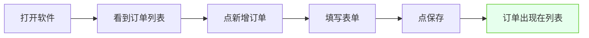
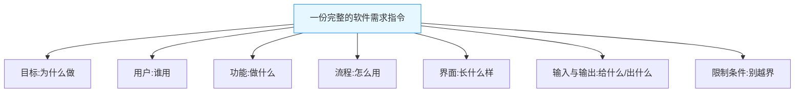

# 第5章 学会向 AI 描述你的软件

> 上一章你把模糊想法变成了明确需求。这一章解决下一步：怎么把这些需求写成一段 AI 真正听得懂、能照着做的描述？

## 本章你会学到

- 为什么「一句话需求」总让 AI 做偏
- 描述软件要说清楚的八个方面
- 怎么描述目标、用户、功能、操作流程
- 怎么描述界面、输入输出和限制条件
- 怎么把这一切拼成一份完整的软件需求指令

### 引子：需求清楚了，做出来的还是不对

林小满按第4章的方法，把需求想清楚了。她信心满满地敲给 AI：

> **林小满：** 帮我做个记客户订花信息的软件，要能新增订单、查看列表、到送达日前一天提醒我。

AI 很快就做出了一个页面。林小满一看，傻眼了：页面是有了，可跟她想的完全不一样——订单信息挤成一团，没有「客户姓名」这一栏，提醒也不知道在哪里看，而且她想用中文界面，出来的却是一堆英文按钮。

她有点泄气：「我明明都说清楚了呀？」其实她只说清了一部分——**功能**。而一个软件长什么样、怎么操作、显示什么、有哪些规矩，她一个字都没提。AI 只能自己猜，结果自然对不上。

这就像你请装修队装修，只说了「我要两室一厅」，却没说风格、颜色、要不要阳台，装出来不合心意，怪不得别人。这一章，就是教你把描述补全——从「说了功能」到「说清全部」。

## 5.1 为什么一句话需求往往不够

AI 有个特点，你已经在第1章见过：**它不会读心。** 你没写出来的东西，它只能靠猜。而它猜的，往往和你想的不一样。

一句话需求，信息量太少。拿林小满那句「帮我做个记客户订花信息的软件」来说，短短一句话里，至少藏着十几个没回答的问题：

- 订单要记哪些信息？姓名、电话、花名、日期……还是要更多？
- 列表按什么顺序排？能不能搜索？
- 「新增订单」点哪里？填完表按什么按钮？
- 提醒长什么样？红字？弹窗？还是单独一个页面？
- 界面用中文还是英文？什么风格？
- 只能在电脑上用，还是手机也要能用？

你没说，AI 就得替你决定——而它的决定，十有八九不是你要的。所以一句话需求做偏，不是 AI 笨，是你给的信息不够。

有个简单的判断方法：**把你的描述念给一个完全不知情的朋友听，如果他听完还有一堆要问的，AI 也会有。** 描述的目标，就是让对方（无论人还是 AI）不用猜就能动手。

## 5.2 如何描述软件的目标

一份完整描述的第一块，是**目标**：为什么要做这个软件，它要为谁解决什么问题。

目标不用长，一两句话就够，但它是整份描述的「定盘星」——AI 理解了目标，后面做各种细节决定时才有依据。林小满可以这么写：

> 这个软件是给社区花店老板用的，帮她把客户订花的信息记清楚，并在送达日快到时提醒她，避免漏记和忘记送花。

对比一下两种写法：

| 写法 | 例子 | 效果 |
|---|---|---|
| 只说做什么 | 「做一个订单管理系统」 | AI 不知道为谁、解决什么，容易做成通用模板 |
| 说清目标 | 「给花店老板用，帮她记订单、按时提醒送花」 | AI 知道重点在「记得全、提醒到位」，细节会往这个方向靠 |

目标里最好带上「为谁」和「解决什么麻烦」。这样，当 AI 在两个方案之间拿不准时，它会选更符合这个目标的那个。比如它就知道，与其做个花哨的展示首页，不如把「提醒」做得醒目——因为目标里强调了「避免忘记送花」。

## 5.3 如何描述用户

第二块是**用户**：谁会用这个软件，他是什么情况。

你已经在第4章想过使用者了，这里要把它写进描述里。要写的是那些会影响软件设计的用户特点：

- **身份**：「花店老板」，而不是笼统的「用户」。
- **技术水平**：「完全不懂技术」——这句很关键，AI 会因此把界面做得简单、把操作做成大白话。
- **使用场景**：「主要在电脑上用，偶尔用手机看一眼」——这决定了 AI 要不要费劲做手机适配。
- **使用频率**：「每天都用」——这决定了它要把常用功能放在顺手的位置。

林小满的写法：

> 使用者就是我，社区花店老板，完全不懂技术。我主要在台式电脑上用，每天都会打开记订单，偶尔在手机上看看提醒。界面和提示请都用大白话，不要出现专业词。

最后那句「界面和提示请都用大白话」特别值得学——**把你自己的使用限制直接写成要求**，AI 就会照顾到。

## 5.4 如何描述功能

第三块是**功能**：软件要做哪些事。这是大家最熟悉的一块，第4章也练过，但写进描述时有几个讲究。

第一，**逐条列，别揉成一句**。用编号一条条写，AI 才不会漏：

> 1. 新增订单：填写客户姓名、电话、订的花、送达日期，保存。
> 2. 查看列表：一屏看到所有订单，按送达日期从近到远排。
> 3. 到期提醒：送达日前一天，在列表里把这笔订单用红色醒目标出。

第二，**每条说清「触发 → 动作 → 结果」**。比如「点『新增订单』按钮 → 弹出填写表单 → 点保存后订单出现在列表里」。这种写法几乎不留猜测空间。

第三，**给功能起清楚的名字**。「新增订单」「查看列表」这种名字，人和 AI 一看就懂；别用「模块一」「功能A」这种含糊叫法。

## 5.5 如何描述操作流程

第四块是**操作流程**：使用者一步一步怎么把一件事做完。

功能和流程不一样。功能说的是「软件能做什么」，流程说的是「人怎么用它把一件事办成」。举个例子，光说「有新增订单功能」不够，AI 不知道填完表之后会发生什么。把流程写出来，软件才顺畅。

林小满描述「新增订单」的流程：

> 我打开软件 → 看到订单列表 → 点右上角的「新增订单」按钮 → 弹出一个表单 → 我填姓名、电话、花、日期 → 点「保存」 → 表单关闭，新订单出现在列表最上面，并显示「已保存」。

你甚至可以用箭头或编号把流程串起来，像上面这样。AI 照着这个流程做，操作就严丝合缝。



为什么流程这么重要？因为软件是「用」出来的，不是「摆」出来的。一个功能再全，如果操作步骤断断续续、点了没反应，用起来也很别扭。把流程写清楚，等于替 AI 把用户体验先想好了一遍。

## 5.6 如何描述界面

第五块是**界面**：软件长什么样、有哪些页面、每页放什么。

零基础的朋友常觉得界面很难描述——「我又不会画画」。其实不用画，用话说明白就行。三个层次就够了：

1. **有哪些页面**：「一共两个页面：订单列表页、新增订单页（点按钮弹出）。」
2. **每页放什么**：「列表页顶部是标题和『新增订单』按钮，下面是订单表格，每行显示姓名、电话、花、送达日期、提醒状态。」
3. **风格和语言**：「界面用中文，风格简单干净，字要大一点，提醒用红色醒目显示。」

林小满加上这段后，AI 做出的页面一下就贴近她的想象了。特别是「字要大一点」这种细节——你不说，AI 就用默认的小字；你说了，它就照顾到你。

有一点要提醒：第一版的界面描述**够用就好，别追求完美**。先把「有哪些页面、放什么、什么风格」说清，具体好不好看，等做出来看着实物再调（那是第4篇「修改」的事）。

## 5.7 如何描述输入与输出

第六块是**输入与输出**：软件接收什么信息，又给出什么结果。

这是最容易被忽略、却最容易造成误解的一块。你说「记订单」，AI 可能记成姓名、电话、花名、日期、备注、地址一大堆；而你其实只想要四项。写清输入输出，就没这个歧义。

| 环节 | 要描述什么 | 林小满的写法 |
|---|---|---|
| 输入 | 使用者填什么、每项叫什么、什么格式 | 「填写四项：客户姓名（文字）、电话（数字，11 位）、订的花（文字）、送达日期（选年月日）」 |
| 输出 | 软件显示什么、存在哪、什么格式 | 「列表显示所有订单；送达日前一天的订单，『提醒』一栏显示红色『明天送』」 |

把输入项的**格式**也写出来很值钱——「电话是 11 位数字」「日期是年月日」——这样 AI 就知道该用什么方式让你填，不会让你填一堆它后来又不认的格式。

输出也是一样：「红色『明天送』」比「提醒一下」清楚得多。AI 做出来的东西，安不安全、合不合用，往往就差在这些具体的小字上。

## 5.8 如何描述限制条件

第七块是**限制条件**：软件必须遵守的规矩、不能做的事。

限制条件像给 AI 划的「围栏」，告诉它别越界。常见的限制有这几类：

- **语言限制**：「所有界面文字和提示都用中文。」
- **平台限制**：「第一版只要能在电脑浏览器里打开就行，不用做手机 App。」
- **技术限制**：「我不懂技术，请用最简单的方式做，别让我装复杂的东西。」
- **范围限制**：「第一版只要新增、查看、提醒三个功能，别的先不要做。」
- **风格限制**：「界面简单一点，字大一点，颜色别太花。」

最后一条「范围限制」尤其重要——它直接防止 AI 自作主张加一堆你没要的功能。林小满那句「第一版只要这三个功能，别的先不要做」，就是一道很有用的围栏。

写限制条件的诀窍是：**把你担心 AI 做偏的地方，提前说出来。** 你怕它做复杂的，就说「简单第一」；你怕它加功能，就说「不要多做」；你怕看不懂，就说「用中文大白话」。

## 5.9 一份完整的软件需求指令

现在把八块拼起来，就是一份完整的软件需求指令。先看它长什么样（这就是林小满最终发给 AI 的那段）：

> **软件目标**：给社区花店老板用的小工具，帮她记清客户订花信息，并在送达日前提醒她，避免漏记和忘送花。
>
> **使用者**：花店老板本人，完全不懂技术；主要在电脑浏览器里用，每天用，偶尔手机看看。界面和提示都用中文大白话。
>
> **功能**：
> 1. 新增订单：填姓名、电话、订的花、送达日期，点保存；
> 2. 查看列表：一屏看所有订单，按送达日期从近到远排；
> 3. 到期提醒：送达日前一天，在列表用红色醒目标出。
>
> **操作流程**：打开 → 看列表 → 点「新增订单」→ 填表 → 点「保存」→ 新订单出现在列表顶部并提示已保存。
>
> **界面**：两个页面（订单列表页、新增订单表单）；列表页顶部有标题和「新增订单」按钮，下面是订单表格。风格简单干净，字大一点，提醒用红色。
>
> **输入**：姓名（文字）、电话（11 位数字）、订的花（文字）、送达日期（选年月日）。
>
> **输出**：列表显示所有订单；送达日前一天显示红色「明天送」。
>
> **限制条件**：第一版只做上述三个功能，不做别的；只要能在电脑浏览器打开即可；不要让我安装复杂的东西。

这八块——目标、用户、功能、流程、界面、输入、输出、限制——合在一起，就把一个软件描述得清清楚楚。AI 拿到它，基本不用再猜。



看到这儿你可能会觉得：「这么多块，记不住怎么办？」别担心——**你不需要背下来**。下一节的模板帮你一次列全，你只要照着填空。写多了，自然就熟了。而且实际使用时，你不必八块都写满；想到什么写什么，写完对照这张图查漏补缺就行。

## 常见坑

- **坑：只描述功能，不描述流程和界面。** 为什么：功能只是「能做什么」，软件和体验是「怎么用、长什么样」，缺了这些 AI 只能瞎猜。怎么做：至少补上流程、界面、限制三块。
- **坑：描述里全是「好看一点」「方便一点」这类形容词。** 为什么：这类词太主观，AI 无法执行。怎么做：换成具体说法——「字大一点」「提醒用红色」「按日期排序」。
- **坑：忘了写语言和平台限制。** 为什么：不写中文，AI 可能给你英文界面；不写电脑浏览器，它可能去做手机 App。怎么做：把「用中文、电脑上用」这类要求明确写进限制条件。
- **坑：怕写得啰嗦，拼命压缩成一句话。** 为什么：省下的字，最后都要靠返工补回来。怎么做：宁可写详细一点，AI 做偏的概率才小。

## 本章小结

- 一句话需求信息太少，AI 只能猜，做偏是必然的——描述越详细，返工越少。
- 一份完整描述包含八块：目标、用户、功能、操作流程、界面、输入、输出、限制条件。
- 目标要写清「为谁解决什么」，它是 AI 做细节决定时的依据。
- 描述要具体：功能逐条列、流程用箭头串、界面说清页面和内容、输入输出写明格式。
- 限制条件是你给 AI 划的围栏，能防止它自作主张加功能、用英文、做复杂。

## 动手练习

1. 拿第4章练习里你写的需求，按本章八块补成一份完整描述。哪一块你最写不出来？那份就是 AI 最容易做偏的地方。
2. 找出你描述里的所有形容词（「好看」「方便」「简单」），把它们逐个换成具体、可执行的说法。
3. 把补好的完整描述发给 AI，看它做出来的结果和你的想象差在哪——差的那部分，就是你下一轮要补的描述。

## 可复制的指令模板

**模板一：一份完整的软件需求描述（照着填空即可）**

```text
【软件目标】为谁做、解决什么问题：
[例如：给社区花店老板用，帮她记清订单并按时提醒送花]

【使用者】谁用、什么水平、在哪用、多久用一次：
[例如：老板本人，不懂技术，电脑上用，每天用]

【功能】逐条列出，每条写清点什么、发生什么：
1. [功能一]
2. [功能二]
3. [功能三]

【操作流程】用箭头把一件事从头到尾串起来：
[打开] → [点哪里] → [填什么] → [点什么按钮] → [看到什么结果]

【界面】有哪些页面、每页放什么、什么风格和语言：
[例如：列表页+新增表单页；中文；简单干净；字大一点]

【输入】填写哪些信息、每项什么格式：
[例如：姓名(文字)、电话(11位数字)、日期(选年月日)]

【输出】软件显示什么、存在哪、什么格式：
[例如：列表显示所有订单；送达前一天显示红色"明天送"]

【限制条件】必须遵守的规矩、不要做的事：
[例如：只用中文；只要能在电脑浏览器打开；第一版只做上面三个功能，不要多做]

请用大白话回复我，不要用技术术语。
```

**模板二：让 AI 帮你检查描述有没有漏项**

```text
下面是我写的软件需求描述。请你对照这八项帮我检查：
目标、用户、功能、操作流程、界面、输入、输出、限制条件。
凡是没写清或缺失的，请列出来，并告诉我该补充什么信息。

我的描述是：
[把你的完整描述粘在这里]
```
