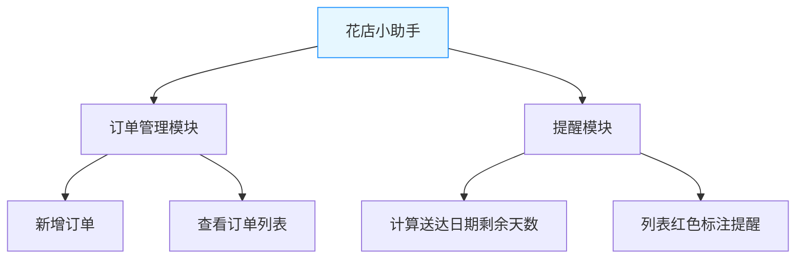
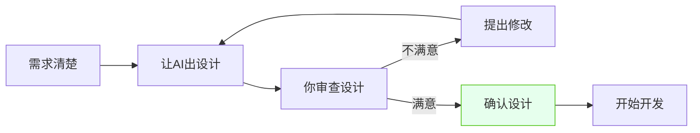

# 第6章 让 AI 帮你设计软件

> 需求说清楚了，是不是马上就能让 AI 开工？且慢。这一章教你先让 AI 出一份「设计」，像盖房子先看图纸一样——确认图纸对了，再动工。

## 本章你会学到

- 软件设计到底设计些什么
- 怎么让 AI 规划功能、拆解模块
- 怎么让 AI 设计页面结构、操作流程和数据
- 怎么让 AI 给出技术方案（还听得懂）
- 怎么审查 AI 的设计，并在开工前确认

### 引子：别急着砌墙，先看图纸

林小满把第5章那份完整需求发给了 AI，正准备说「开始做吧」，转念一想：她连软件最终长什么样、分成几块、数据怎么放都不知道，就这么让它做，万一做歪了怎么办？

这就像盖房子。你跟施工队说「我要两室一厅」，如果直接让他们砌墙，砌到一半你才发现厨房太小、卧室朝向不对，敲掉重来多浪费。聪明的做法是：**先要一张设计图纸**，看看平面怎么布局、水电怎么走，确认满意了再动工。

做软件也一样。在写任何代码之前，先让 AI 把「打算怎么做」讲清楚——有哪些页面、每个页面放什么、要存哪些数据、功能怎么分工。这就是**设计**。林小满对 AI 说：

> **林小满：** 需求我写好了。在我开始前，你先别急着做，先把你的设计方案讲给我听：软件分成哪几部分、有哪些页面、要存什么数据。用大白话说，我确认了你再动手。

这一章，就教你怎么做这件事，以及怎么看懂 AI 给你的方案。

## 6.1 软件设计究竟要设计什么

「设计」听起来很玄，其实说白了就是：**在真正动手做之前，把软件打算做成什么样，先想清楚、写下来。**

一个软件的设计，主要包含这几样东西：

| 设计内容 | 用大白话说 | 类比（盖房子） |
|---|---|---|
| 功能规划 | 软件要做哪些事 | 房子里要有哪些房间 |
| 模块拆解 | 把这些事分成几大块 | 分成卧室区、厨房区、卫生间区 |
| 页面结构 | 有哪些页面、每页放什么 | 每个房间的布局和摆设 |
| 操作流程 | 人怎么一步步用 | 从大门到各房间的动线 |
| 数据结构 | 要存哪些信息、怎么存 | 家具家电放哪、怎么归类 |
| 技术方案 | 用什么工具和方法来做 | 用砖混还是钢结构、水电怎么走 |

你不需要自己会设计——**这些都可以让 AI 来做**。你要做的是：看懂它的设计，判断「这是不是我想要的」，然后确认或提出修改。你扮演的是「验收图纸的业主」，不是「画图的工程师」。

好消息是，AI 特别擅长出方案。你给它一份清楚的需求（第5章的成果），它就能把上面这几样一一列出来。坏消息是，它偶尔也会考虑不周或想偏，所以 6.8、6.9 会教你审查和确认。

## 6.2 让 AI 规划软件功能

设计的第一步，是把需求里的功能整理成一份**功能清单**。

第5章你已经列过功能了，这里让 AI 帮你做得更规整、更完整：按重要程度排好序，标出哪些是第一版要做的。看林小满怎么问：

> **林小满：** 根据我写的需求，帮我列一份功能清单。分成「第一版必须做」和「以后再做」两组，每条功能用一句话说清它做什么。用表格给我。

> **AI：** 好的，根据你的需求，功能规划如下：
>
> | 功能 | 说明 | 阶段 |
> |---|---|---|
> | 新增订单 | 填写客户姓名、电话、花材、送达日期并保存 | 第一版必须 |
> | 查看订单列表 | 一屏显示所有订单，按送达日期排序 | 第一版必须 |
> | 到期提醒 | 送达日前一天在列表红色标注 | 第一版必须 |
> | 按客户查历史订单 | 输入客户姓名，列出其所有过往订单 | 以后再做 |
> | 月度销售统计 | 统计每月订单数和金额 | 以后再做 |

这份清单的价值在于：**一眼看清软件的边界**。第一版做前三行，后两行先放着。AI 有了它，就不容易做着做着突然冒出一个你没要的功能。

## 6.3 让 AI 拆解软件模块

功能清单有了，下一步是把相关功能归成几个**模块**。

模块，就是把功能按「是一类事」打包成几大块。打个比方，一个花店可以分成「接单区」「备货区」「配送区」，每个区管一类事。软件也一样，把功能分组，结构就清楚了。

林小满的软件可以有这几个模块：



为什么要拆模块？因为对 AI 来说，「做一个订单管理模块」比「做一整个软件」更好把握；对你来说，模块让你能一块一块地检查和确认，而不是面对一坨糊在一起的东西。第7章会把这种「拆」的思路用到极致。

你可以直接让 AI 拆：「请把上面的功能按模块分组，告诉我分成几个模块、每个模块管哪些功能、用一张结构图表示。」AI 就会给出类似上面的图。

## 6.4 让 AI 设计页面结构

模块说的是「后台怎么分」，页面结构说的是「用户眼前看到什么」。

对零基础用户来说，这是最值得仔细看的一部分——因为它直接决定了你打开软件看到的样子。你要让 AI 说清楚三件事：

1. **一共有哪些页面**；
2. **每个页面放哪些内容**（标题、按钮、表格、输入框……）；
3. **页面之间怎么跳转**。

林小满让 AI 设计的结果：

> **AI：** 第一版共两个界面：
> 1. **订单列表页**（打开软件看到的第一页）：顶部标题「花店订单」和「新增订单」按钮；下方是订单表格，列为「姓名 | 电话 | 花材 | 送达日期 | 提醒」。按送达日期从近到远排列。
> 2. **新增订单表单**（点「新增订单」后弹出）：四个输入框——姓名、电话、花材、送达日期；底部「保存」和「取消」按钮。
> 跳转：点「新增订单」弹出表单 → 点「保存」→ 表单关闭，回到列表页，新订单出现在最上方。

看到这种描述，你脑子里基本就能「看见」软件了。如果哪里和你想象的不一样——比如你希望提醒那一列放在最前面——现在就提出来，比做出来再改省事得多。

## 6.5 让 AI 设计用户操作流程

6.4 说的是「页面长什么样」，这一节说的是「人怎么在页面间走动，把事办成」。

操作流程像一条路线图，把一个功能从头到尾串起来。你在第5章写过流程，这里让 AI 帮你把它画得更完整，尤其是各种「如果……就……」的分支情况。

以「到期提醒」为例，光说「红色标注」不够，AI 帮你把逻辑理清楚：

> **AI：** 提醒流程如下：
> - 打开软件 → 读取所有订单；
> - 对每笔订单，用「送达日期」减去「今天」得到剩余天数；
> - 如果剩余天数 = 1，在「提醒」列显示红色「明天送」；
> - 如果剩余天数 = 0，显示红色加粗「今天送」；
> - 如果剩余天数 > 1 或为负数，不显示提醒。

这种带「如果……就……」的描述，把软件的判断规则也说清楚了。你审查时重点看：**这些规则合不合你的实际？** 比如林小满发现「过期订单不提醒」这条不太对——她想知道哪些过期了没送，于是让 AI 加上「剩余天数 < 0，显示灰色『已过期』」。这就是设计阶段发现问题的价值：**改一句话，比改做完的代码容易太多。**

## 6.6 让 AI 设计数据结构

数据结构听着技术，其实很好懂：**软件要记住哪些信息，这些信息怎么分类摆放。**

类比一下：你整理书架，会按类别把书分门别类；软件「记订单」，也得把信息分门别类地存好。对林小满的软件来说，核心就是一张「订单表」——每笔订单是一行，每类信息是一列。让 AI 列出来：

> **林小满：** 这个软件要存哪些数据？请用表格列出：每一项信息叫什么、是什么类型（文字/数字/日期）、是不是必填。

> **AI：** 需要一张「订单表」：

| 信息项 | 类型 | 是否必填 | 说明 |
|---|---|---|---|
| 客户姓名 | 文字 | 必填 | — |
| 电话 | 数字（11 位） | 必填 | — |
| 订的花 | 文字 | 必填 | 可填多种，用逗号隔开 |
| 送达日期 | 日期 | 必填 | 年月日 |

这就是「数据结构」的全部——**一张表，列清楚每列叫什么、什么类型、要不要填。** 你不用懂数据库，只要看这张表：「这些信息是不是我都要记？有没有漏的？有没有多余的？」林小满看完发现少了「备注」栏，就加上一行「备注（文字，选填）」。

第一版软件通常就一两张表，非常简单。你能看懂这张表，就足够了。

## 6.7 让 AI 提供技术方案

最后是**技术方案**：AI 打算用什么工具、什么方法来做。

这块最技术，也最让零基础的人头大。但你要做的不是看懂技术细节，而是抓住三件事：

1. **我需不需要装东西？**（越简单越好）
2. **做出来在哪能用？**（电脑浏览器？手机？）
3. **安不安全、以后好不好改？**

你可以这样问 AI，逼它说人话：

> **林小满：** 你打算用什么方法做这个软件？请用完全不懂技术的人能听懂的话回答我，说清楚三点：我需要安装什么东西吗？做出来我在哪里打开它？以后想加功能方便吗？不要说技术名词。

> **AI：** 简单说：你不需要安装任何东西。做出来是一个网页，用电脑浏览器打开一个网址就能用，跟你平时上网看网页一样。数据会存在电脑里。以后想加功能，跟我说一声就行，我来改。

看，技术方案用大白话一讲，就这么简单。如果 AI 的回答里蹦出一堆你听不懂的词，你就追问一句「请用大白话再说一遍」，它就会换种说法。**你有权利要求它说人话。**

## 6.8 如何审查 AI 的设计方案

AI 给出的设计不能照单全收，你得会审查。别怕，审查不要求你懂技术，只要会问自己几个问题。照着这张清单过一遍：

| 检查项 | 要问自己的问题 | 林小满的检查 |
|---|---|---|
| 目标一致 | 这个设计能解决我最初的问题吗？ | 能记订单、能提醒，✔ |
| 功能完整 | 我要的功能都在吗？有没有多出来的？ | 三个功能都在，没多做，✔ |
| 流程顺畅 | 我按它说的步骤，能把事办成吗？ | 新增订单流程通顺，✔ |
| 数据够用 | 要记的信息都记了吗？ | 发现少了「备注」，补上 |
| 界面合适 | 打开看到的样子，是我想的吗？ | 提醒列想放前面，提出修改 |
| 简单可行 | 有没有让我装复杂的东西？ | 不用装，✔ |
| 说得清楚 | 有没有我看不懂的地方？ | 技术那段让 AI 用大白话重说 |

审查时有个特别好用的心态：**把自己当成挑剔的客户。** 哪里别扭、哪里看不懂、哪里和你想象的不一样，直接指出来让 AI 改。AI 不会生气，改设计比改代码便宜得多——这正是先设计后动工的意义。

## 6.9 如何在开发之前确认设计

审查完、改满意了，最后一步是把设计**确认下来**，作为接下来开发的依据。

怎么做？让 AI 把最终设计整理成一份「设计确认单」，你逐条点头。林小满这么做：

> **林小满：** 我们的设计讨论好了。请把最终方案整理成一份简短的确认单，列出：页面有哪些、每页放什么、存哪些数据、第一版做哪些功能。我确认无误后，我们才正式开始做。

AI 给出确认单后，林小满认真读了一遍，确认「备注栏加上了、提醒列放前面了、第一版就三个功能」，然后回复：「确认无误，开始做吧。」

这一步看着简单，却非常关键。它相当于你和 AI 之间定了一份「合同」：

- 对你：开工前有最后一次把关的机会，不满意现在还来得及改。
- 对 AI：有一份明确的依据，后面照着做不容易跑偏；万一做偏了，你也知道该对照哪一条纠正。

记住这个节奏：**需求清楚 → 设计 → 审查 → 确认 → 才开始做。** 跳过设计直接做，是零基础做软件最常见的翻车原因。



## 常见坑

- **坑：跳过设计，直接让 AI 开工。** 为什么：做一半才发现方向不对，返工成本很高。怎么做：坚持先出设计、确认后再做，哪怕只是简单聊一轮。
- **坑：AI 的设计看不懂就将就。** 为什么：没看懂的地方往往就是隐患。怎么做：不懂就追问「请用大白话说」，或有疑问就当场提出。
- **坑：审查时只看功能，不看数据和流程。** 为什么：漏记信息、流程断点这些细节最容易在后期暴露。怎么做：照 6.8 的清单逐项检查。
- **坑：把 AI 的第一版设计当最终版。** 为什么：设计本来就是要反复改的。怎么做：大胆挑刺、要求修改，满意了再确认。

## 本章小结

- 设计就是动手前先把软件做成什么样想清楚，像盖房子先看图纸。
- 设计包含功能规划、模块拆解、页面结构、操作流程、数据结构、技术方案。
- 这些都能让 AI 来做，你的任务是看懂、审查、确认。
- 审查不靠技术，靠「挑剔客户」的心态：照清单检查是否目标一致、功能完整、流程顺畅、数据够用。
- 开工前把设计确认成一份「确认单」，它是你和 AI 之间的合同。

## 动手练习

1. 拿第5章你写的完整需求，让 AI 出一份设计：功能清单、模块、页面结构、要存的数据，各用一段话说明。
2. 照 6.8 的清单当一回「挑剔客户」，逐项检查 AI 的设计，找出至少两处你想修改或追问的地方。
3. 让 AI 用「完全不懂技术的人能听懂的话」解释它的技术方案：你要不要装东西、在哪打开、以后好不好改。
4. 把最终设计整理成一份确认单，逐条确认后，再决定要不要开始做。

## 可复制的指令模板

**模板一：开工前让 AI 出一份完整设计**

```text
我有一份软件需求（见下方）。在我正式开工前，请你先出一份设计方案，
暂时不要写任何代码，也不要开始做。请用大白话、不要技术术语，说明：
1. 功能清单：分「第一版必须做」和「以后再做」两组；
2. 模块拆解：分成哪几大块，每块管什么；
3. 页面结构：有哪些页面，每页放什么，页面间怎么跳转；
4. 操作流程：用户一步步怎么用，包括「如果…就…」的判断；
5. 数据结构：要存哪些信息，每项叫什么、什么类型、是否必填；
6. 技术方案：我需要装东西吗？在哪打开？以后好改吗？
我会审查你的设计并提出修改，确认后才让你开始做。

我的需求是：[把第5章写的完整需求粘在这里]
```

**模板二：让 AI 把设计整理成确认单**

```text
请把我们讨论确定的设计方案，整理成一份简短的「设计确认单」，
列出：①有哪些页面及每页内容；②要存哪些数据；③第一版做哪些功能。
列出后请等我确认，我确认无误后我们才开始开发。

如果我的设计里有任何你觉得不清楚、或需要我做决定的地方，
请在确认单最后单独列出来问我。
```
