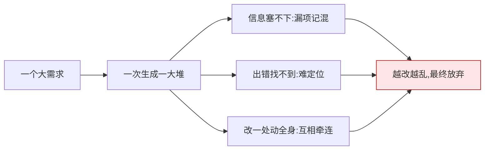
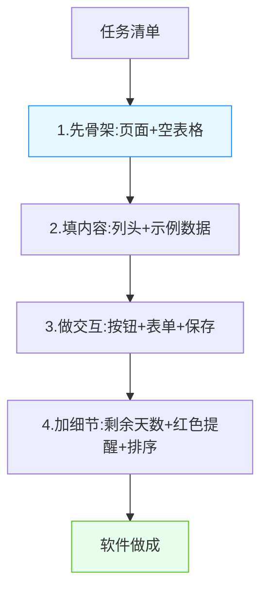

# 第7章 学会拆解功能——不要一次让 AI 做完所有事情

> 这是第二篇最核心的一章。需求清楚了、设计也确认了，但如果你想一口气让 AI 把整个软件做完，多半会失败。这一章教你「拆」——把大目标拆成小任务，一步一步来。

## 本章你会学到

- 为什么一口气做完大需求几乎总会失败
- 什么是模块化开发，为什么它这么重要
- 怎么把软件拆成页面、把页面拆成组件、把组件拆成任务
- 怎么建立一张开发任务清单、排好开发顺序
- 怎么让 AI 一次只做一个任务，稳稳地把软件做出来

### 引子：一口气做完，结果处处是坑

设计确认后，林小满兴奋地对 AI 说：「好，现在把整个花店小助手都做出来吧！」她觉得需求写得那么清楚、设计也确认了，AI 应该能一次搞定。

AI 忙活了一阵，果真吐出一大堆东西。林小满打开一看：页面是出来了，可这里少一栏、那里按钮点不动；她想改个提醒颜色，改完发现订单列表又不显示了；她想补个「备注」栏，结果新增表单乱成一团。问题像打地鼠，按下一个冒出另一个。她折腾了一晚上，越改越乱。

后来她换了法子：不再一口气要全部，而是说「我们先只做订单列表页，别的别动」，做完、检查、确认没问题，再说「现在加新增订单功能」……每做一步都看得清、改得动。结果反而顺顺利利，一两个小时就有了能用的东西。

这个反差，就是本章要讲的道理：**不是 AI 做不了，而是你一次给它的太多，它和你都盯不过来。** 学会拆解，是从「会用 AI」到「用好 AI」的分水岭。

## 7.1 为什么大型需求容易失败

一次给 AI 一个庞大需求，为什么容易翻车？有三个原因。

第一，**信息会「塞不下」**。你把一个软件的所有功能、页面、数据塞进一条指令，AI 要同时记住和处理的东西太多，顾此失彼，漏掉一些、记混一些几乎不可避免。就像你让一个人同时记住二十件事，他总会忘几件。

第二，**出错后「找不到」**。一次性生成一大堆东西，出问题了你很难定位到底是哪一部分坏了——是一开始就错了，还是改 A 的时候碰坏了 B？整个搅在一起，排查像在一团乱麻里找线头。

第三，**改一处「动全身」**。大块代码里各部分互相牵连，你让 AI 改个小地方，它可能不小心改坏别的。林小满改提醒颜色却弄坏了订单列表，就是这个原因。



反过来看，拆开做就避开了这三点：每次只给 AI 一小块，它记得住；出了问题在这一小块里好找；改的时候也不容易波及别处。**拆解不是多做工作，而是让每一步都简单到几乎不会失败。**

## 7.2 什么是模块化开发

「模块化开发」听着像专业词，其实就是你已经在做的事——**把一个大东西，分成一块一块，一块块做、一块块拼起来。**

你生活里到处都是这个思路：

- 拼乐高：不是一次捏出整个城堡，而是一块块积木拼起来。
- 盖房子：先打地基、再砌墙、再水电、再装修，一步一步来。
- 写文章：先列提纲，再一段段写，最后串起来。

软件开发也一样。一个软件再大，也是由一个个小块组成的。模块化，就是有意识地先把这些小块分好，然后一次做一块。每块做好了、确认了，再拼下一块。

它和上一章的「拆模块」是一回事的延伸：第6章你让 AI 把功能归成几个模块（订单管理、提醒……），那是「设计上的分块」；这一章你要做的是「开发上的分块」——把每个模块再细分到一个个小任务，然后按任务一个个做。

记住一句话：**再大的软件，也是一个个小任务堆出来的。你要做的，就是不断把它拆小，直到每一步都简单得一目了然。**

## 7.3 把软件拆成页面

拆解的第一层，是按「页面」拆。

一个软件，用户是分页面（或分屏）使用的。林小满的花店小助手有两页：订单列表页、新增订单表单。那么第一层拆解就是：

- 第 1 步：做出「订单列表页」的骨架；
- 第 2 步：做出「新增订单表单」。

为什么不一次做两页？因为一页的问题只在这一页里，好查好改。你让 AI「先把订单列表页做出来，其他页面先别做」，它就会专注在这一页上，做出来的东西干净，你也看得清楚。

拆页面时，顺序也有讲究：**先做「打开软件第一眼看到的那一页」**（这里是订单列表页）。因为它是软件的门面，也是其他页面的落脚点。先把它立起来，后面加东西就有了依托。

## 7.4 把页面拆成组件

一个页面还是太大，就再拆一层——拆成**组件**。

组件，就是页面上的一块块小零件：一个标题、一个按钮、一个输入框、一张表格、一行提醒文字。就像盖房子，一面墙还能再拆成砖、窗、门。

拿「订单列表页」拆开看：

| 组件 | 是什么 | 作用 |
|---|---|---|
| 页面标题 | 顶部「花店订单」几个字 | 告诉用户这是哪 |
| 新增按钮 | 右上角「新增订单」按钮 | 点击进入新增表单 |
| 订单表格 | 中间的表格 | 显示所有订单 |
| 表格列头 | 姓名/电话/花材/日期/提醒 | 说明每列是什么 |
| 提醒标注 | 红色「明天送」文字 | 到期的醒目标记 |

拆到组件这一层，你就可以非常具体地下指令了：「这一轮我们只做订单列表页的标题和表格，先不要加按钮和提醒。」AI 照做，做出来的东西就那么点，你一眼能看全、一查就查出问题。

对零基础用户，组件这个概念不用背。**你只要知道：页面还能再拆成一小块一小块，拆得越细，每次让 AI 做的事就越简单、越可控。**

## 7.5 把功能拆成任务

组件下面，还能再拆成**任务**——任务是最小的、可以一步做完的动作。

「做订单表格」这个组件，可以拆成一串任务：

1. 画出表格的外框；
2. 加上五列的列头：姓名、电话、花材、送达日期、提醒；
3. 让表格能显示一行示例数据；
4. 让订单按送达日期从近到远排序。

任务的关键特征是：**一句话说清、一步能做完、做完能立刻看到结果。** 如果一个任务你要说一大段话才解释清，说明它还不够小，再拆。

拆到任务这一层，你给 AI 的指令就变成了这种粒度：「请在订单表格里加上五列列头：姓名、电话、花材、送达日期、提醒。这一步先不要做排序和提醒标注。」——清晰、具体、范围明确，AI 极难做偏，做完你也立刻能检查。

## 7.6 如何建立开发任务清单

把软件拆成任务后，把它们写成一张**开发任务清单**，整个开发过程就变成了「照着清单一条条打勾」。

林小满的清单长这样：

| 序号 | 任务 | 所属页面/组件 | 状态 |
|---|---|---|---|
| 1 | 做出订单列表页标题 + 空表格 | 列表页 | 待做 |
| 2 | 表格加五列列头 | 列表页/表格 | 待做 |
| 3 | 做出新增订单表单（四个输入框 + 保存/取消） | 新增页 | 待做 |
| 4 | 点保存后，新订单出现在列表 | 两页联动 | 待做 |
| 5 | 算出每笔订单的剩余天数 | 提醒 | 待做 |
| 6 | 送达前一天显示红色「明天送」 | 提醒 | 待做 |
| 7 | 整体检查、修正细节 | 全部 | 待做 |

这张清单有三个好处：

1. **不遗漏**：所有要做的事都在纸上，不会做着做着忘了某个功能。
2. **有进度**：做完一条打一条勾，你能清楚看到「走到哪了」，很有成就感。
3. **好专注**：任何时候你只看当前一条，不会被后面的任务干扰。

你可以让 AI 帮你生成这张清单（它对拆任务很在行），然后把清单保存到笔记里，开发时一条条推进。

## 7.7 如何安排开发顺序

清单有了，按什么顺序做？乱做会走弯路。有个简单好用的排序原则：**先骨架、后血肉；先看到、后能点；先主干、后细节。**

具体说：

1. **先做能看到的骨架**：先有页面、有标题、有空表格。打开软件能看到东西，是最重要的第一步。
2. **再让静态内容填进去**：列头、示例数据，让页面看起来像个样子。
3. **再做交互**：按钮能点、表单能填、保存后列表会变。
4. **最后做判断和细节**：剩余天数、红色提醒、排序这些「聪明」的功能。

为什么这个顺序？因为每一步都建立在上一步之上：你得先有空表格，才能往里加列头；先有表单，才能谈「点保存」。而且这个顺序让你**每一步做完都能看到东西**——看到的那一刻，你就能判断对不对，心里踏实。

林小满的清单顺序正是按这个来的（看 7.6 的表：先页面骨架，再表单联动，最后提醒）。你也可以让 AI 帮你排：「请按『先骨架后细节、每步都能看到结果』的原则，把这些任务排个顺序。」



## 7.8 让 AI 逐步完成软件开发

最后，把前面的都串起来，形成一个开发节奏：**一次一个任务，做完检查、确认，再进下一个。**

看林小满怎么和 AI 配合：

> **第 1 轮**
> **林小满：** 我们先只做第一步：做出订单列表页，页面顶部放标题「花店订单」，下面放一个空表格。其他都先不要做。做好了告诉我。
> **AI：** 好的，订单列表页已完成：顶部是「花店订单」标题，下方是一个空表格。请打开看看。
> **林小满：**（看了）对了，就是这个。下一步。
>
> **第 2 轮**
> **林小满：** 现在给表格加上五列列头：姓名、电话、花材、送达日期、提醒。这一轮只加列头，先不要填数据、不要做提醒。
> **AI：** 已加上五列列头。列表页现在有：标题、空表格和这五列。
> **林小满：** 好，继续。
>
> **第 3 轮**
> **林小满：** 接下来做新增订单表单……（一次只说这一件事）

看出节奏了吗？每一轮林小满只做三件事：**说清这一轮做什么、限定别做什么、做完检查确认。** AI 每次只处理一小块，几乎不出错；就算出错，也只在当前这一小块里，好找好改。

这个节奏里，有两个习惯特别重要：

- **限定范围**：每轮都要说「这一轮只做 X，别的先不要动」。这是防止 AI 顺手改坏别处的安全绳。
- **每步确认**：做完一定检查、确认没问题再进下一步。别攒着一堆不检查——问题越早发现越好改。

慢吗？看起来一轮一轮的，其实很快。因为每一步几乎不返工，而你返工一次耗掉的时间，往往够做十步。更重要的是，你始终知道软件是什么样、走到哪了，那种「一切尽在掌握」的感觉，是零基础做软件最宝贵的体验。

## 常见坑

- **坑：图省事，一次让 AI 做完整软件。** 为什么：信息塞不下、出错找不到、改一处动全身。怎么做：照清单一次只给一个任务，做完确认再继续。
- **坑：任务拆得太大，比如「把提醒功能做了」。** 为什么：里面还含着算天数、判断、显示好几件事，出错不好查。怎么做：拆到「一句话说清、一步能做完」的粒度。
- **坑：不做任务清单，想到哪做到哪。** 为什么：容易遗漏、不知道进度、越做越乱。怎么做：先列清单，做完一条勾一条。
- **坑：每步做完不检查，攒到最后一起看。** 为什么：小问题会累积成大混乱，且难定位是哪步出的错。怎么做：每步做完立刻检查、确认，再进下一步。

## 本章小结

- 大需求一次做完几乎总会失败：信息塞不下、出错找不到、改一处动全身。
- 模块化开发＝把大软件拆成一块块，一次做一块；再大的软件也是小任务堆出来的。
- 拆解分三层：软件拆成页面，页面拆成组件，组件拆成任务。
- 用开发任务清单管理进度：不遗漏、有进度、好专注。
- 开发顺序：先骨架后细节、先看到后能点、先主干后枝叶；每步做完都能看到结果。
- 开发节奏：一次一个任务，限定范围、做完确认，再进下一步。

## 动手练习

1. 拿你自己的软件设计，先按「页面」拆，再挑一个页面按「组件」拆，最后把一个组件按「任务」拆到一步能做完的粒度。
2. 把拆出来的所有任务写成一张 7.6 那样的清单，含「序号、任务、所属部分、状态」四列。
3. 按 7.7 的原则给你的清单排序，并说出为什么把这个任务排在前面。
4. 照 7.8 的节奏，实际让 AI 做第一步：只做一个任务、限定别做其他、做完检查确认。体会一下「一次一小块」的感觉。

## 可复制的指令模板

**模板一：让 AI 帮你把软件拆成任务清单**

```text
根据下面的软件设计，请帮我做一份「开发任务清单」，
按「软件→页面→组件→任务」拆解，任务要细到「一步能做完、做完能看到结果」。
用表格列出，包含四列：序号、任务、所属页面/组件、状态（先都填「待做」）。
另外请按「先骨架后细节、先看到后能点」的原则，把任务排好顺序。
用大白话，不要技术术语。

我的设计是：[把第6章确认的设计粘在这里]
```

**模板二：逐步开发时，每一轮下发给 AI 的指令**

```text
这一轮我们只做一件事：[用一句话说清这一轮要做的任务]。
除此之外，其他的都先不要做、也不要改（特别说明：[列出你担心它顺手改动的部分]）。
请做完这一件事就停下来，告诉我结果和现在的状态，
等我检查确认后，我们再做下一件事。
请用大白话回复我。
```
