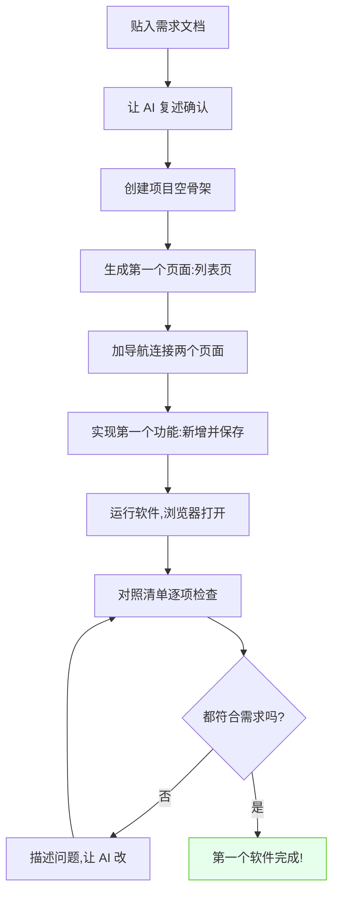

# 第8章 让 AI 创建你的第一个软件

> 这一章要解决一个问题：需求想清楚了、任务也拆好了，可第一步到底怎么开口？这一章带你亲手把第一个软件从"纸上的想法"变成"屏幕上能打开、能点、能用的东西"。

## 本章你会学到

- 如何把确认好的需求文档变成开发的起点
- 什么是"项目"，如何让 AI 搭好软件的空架子
- 如何让 AI 生成第一个页面、加上页面之间的导航
- 如何实现第一个真正能用的功能
- 如何运行软件、查看结果、判断做得对不对
- 从零走完一个简单应用的完整过程


*图：你与 AI 是开发搭档*

### 引子：图纸有了，第一铲子往哪挖

林小满把第二篇整理好的需求文档摊在桌上，旁边是第7章那张开发任务清单。需求很清楚：记客户订花、到期提醒。任务也拆好了：先做订单列表页，再做新增表单，再加提醒。

可她盯着空白的对话框，迟迟没打字。心里有点发怵："道理我都懂，可这第一句话，到底该怎么跟 AI 说？万一它做出来的东西跟我想要的完全不一样呢？"

她深吸一口气，把需求文档贴进对话框，打了第一句话：

> **林小满：** 这是我们确认好的需求。我要做一个花店订单管理的小工具。你先别急着写代码，先把你理解到的需求复述给我听一遍，我来确认对不对。

AI 果然没有立刻吐出一堆看不懂的东西，而是先把需求一条条列出来和她确认。林小满一点点改，确认无误后，才说了第二句话："好，从现在开始，我们按清单，一次做一步。"

十分钟后，屏幕上出现了她的第一个页面。那一刻她明白了：**前面所有的"想清楚"，都是为了这一刻能顺顺利利地"做出来"。**

这一章，我们就陪你把这"第一铲子"挖下去。

## 8.1 从需求文档开始开发

很多人在这一步会犯错：需求明明已经写好了，却凭着自己的记忆随口跟 AI 说"给我做个记订单的东西"。结果 AI 做出来的，跟你真正想要的差了十万八千里。

需求文档就是你开发的**图纸**。盖房子前，工人会把图纸摊开、对着确认一遍再动手，而不是凭印象砌墙。开发软件也一样——把第二篇确认好的需求文档，原原本本贴给 AI，让它先复述、你再确认，然后才动手。

为什么要多这一步"复述确认"？因为 AI 和你之间最容易出问题的，就是"你以为它懂了，其实它理解偏了"。让它先复述，你能第一时间发现偏差，改一句话的成本，远远低于做完一整页再推倒重来。

**你：** 这是我确认好的需求文档：[粘贴需求文档]。开始开发前，请不要写代码。先用你自己的话，把我这个软件要做的事、有哪些页面、要存哪些数据，一条条复述给我确认。

**AI：** 好的，我先把需求复述一遍，你来核对：
1. 这是一个花店订单管理工具，主要给花店老板一个人在电脑上用；
2. 有两个页面：订单列表页、新增订单表单；
3. 要存的数据：客户姓名、电话、订的花材、送达日期；
4. 核心功能：新增订单后出现在列表、算出剩余天数、送达前一天红色提醒。
有哪里理解错了吗？

**你：** 基本对，但提醒是"提前一天"，不是"前一天"——其实一样，你按提前一天算就行。其他没问题。

你看，一次简单的复述，就把一个潜在的小误会当场解决了。

## 8.2 如何让 AI 创建项目

确认完需求，下一步是创建**项目**。

"项目"听着专业，其实就是**一个专门装这个软件所有文件的文件夹**。你可以把它理解成盖房子的"工地"——地基、墙、砖都放在这块地上。软件的代码、图片、页面，也都放进这个项目里。没有项目，你的东西就东一块西一块，没法整理、没法运行。

好消息是：你不需要懂项目里应该有哪些文件、用什么技术——**让 AI 来定，让它帮你建。** 你只管说要做什么。

**你：** 需求确认无误。现在请你帮我创建这个项目。具体用什么技术、建哪些文件，你来定，我不懂这些。你只要告诉我建好了、里面大致有什么就行。

**AI：** 已创建项目。它包含：一个页面文件（显示订单列表）、一个样式文件（控制外观）、一个数据文件（暂时存示例订单）。现在项目是空的骨架，接下来我们按清单一步步往里填。

从需求到项目，整个过程是这样的：


## 8.3 如何让 AI 生成第一个页面

项目建好了，按第7章的排序原则，先做"打开软件第一眼看到的那一页"——订单列表页。这一轮只做骨架：一个标题、一个空表格，别的都不做。

**你：** 现在按清单做第一步：生成订单列表页。页面顶部放标题"花店订单"，下面放一个空表格。这一轮只做这些，不要新增按钮、不要提醒、不要填数据。做好了告诉我。

**AI：** 订单列表页已生成：顶部是标题，下方是一个空表格。请打开看看是不是你想要的样子。

注意你这次指令里的两个关键动作，它们和第7章一模一样：**说清这一轮做什么、限定别做什么**。这个习惯从现在开始要一直保持。

## 8.4 如何让 AI 创建导航

只有一页还不够，你的软件有两个页面。怎么从订单列表页跳到新增订单页？这就需要**导航**。

导航就是软件里的"路牌"。你去商场，会看楼层导览牌知道"一楼卖化妆品、二楼卖衣服，电梯在那边"。软件里的导航菜单、按钮，就是这样的路牌，告诉你"点这里去订单列表，点那里去新增订单"。

**你：** 现在加导航：在页面顶部加两个能点的入口——"订单列表"和"新增订单"。点"订单列表"显示当前这页，点"新增订单"跳到新增表单页。这一轮只做跳转，表单内容先不要做。

**AI：** 已加好导航。顶部现在有"订单列表""新增订单"两个入口，点击可以互相切换。新增订单页目前是空白的。

| 导航元素 | 作用 | 类比 |
|---|---|---|
| "订单列表"入口 | 回到订单列表页 | 商场里的"返回一楼"指示牌 |
| "新增订单"入口 | 跳到新增表单页 | "请上二楼"的指示牌 |
| 当前页高亮 | 告诉你现在在哪一页 | 导览牌上"您在此处"的红点 |

## 8.5 如何让 AI 实现第一个功能

页面有了、导航通了，现在实现第一个真正的**功能**。功能就是"点了之后会发生点什么"——它把静态的页面变活了。

第一个功能，选最简单的那条主线：**点"新增订单"打开表单 → 填好信息点保存 → 新订单出现在列表里。** 这一条串起来，你的软件就从"能看"变成"能用"了。

**你：** 现在实现第一个功能：在新增订单页做一个表单，有姓名、电话、花材、送达日期四个输入框，还有"保存"和"取消"两个按钮。点保存后，填写的内容要能出现在订单列表页里；点取消则回到列表页、不保存。这一轮只做这一件事。

**AI：** 已完成。新增订单页现在有四个输入框和保存、取消按钮。点保存会把订单加入列表，点取消不保存并返回列表。你可以试着填一笔订单看看。

**你：**（试了一下）真出现了！不过我发现填完点保存后，表单还留着刚才的内容，希望它能清空。

**AI：** 明白，我改成：点保存并成功加入列表后，表单自动清空，方便你填下一笔。只改这一点。

看，这就是开发的真实节奏——做出来、试一下、发现小问题、让 AI 改。不需要你懂代码，你只要会"用"和"说"。

## 8.6 如何运行软件

做完了，怎么看它？这一步叫**运行软件**。

你可以把运行理解成"把做好的菜端上桌"。之前 AI 只是把菜做好了放在厨房（项目文件夹里），你得把它端出来（运行起来），才能看到、尝到。运行时，AI 通常会给你一条"启动命令"（一行文字，照着复制粘贴就行）或一个"运行"按钮，然后你在浏览器里打开一个地址，就能看到你的软件了。

**你：** 这个软件现在怎么运行？请告诉我具体怎么做，一步一步写清楚，我不懂命令行。

**AI：** 很简单：1）在项目文件夹里，按 Shift + 鼠标右键，选"在此处打开命令窗口"；2）把我给的这行命令复制进去，回车；3）看到提示后，在浏览器打开 http://localhost:3000 ，就能看到你的花店订单工具了。

这种"http://localhost:..."的地址，意思是"只在你自己这台电脑上打开的软件"，别人看不到，你可以放心地试。localhost 就是"本机"的意思，不用记，知道它是"你电脑上的地址"就行。

## 8.7 如何查看开发结果

软件跑起来了，别急着高兴——**能打开不等于做对了**。你要像验货一样，对照需求一项项检查。

林小满当时的检查清单是这样的：

| 检查项 | 对照需求 | 怎么看 |
|---|---|---|
| 两个页面在不在 | 订单列表页 + 新增表单页 | 点导航，看能否切换 |
| 四个输入框全不全 | 姓名、电话、花材、日期 | 打开新增页数一数 |
| 保存有没有反应 | 新订单要出现在列表 | 填一笔、点保存、看列表 |
| 取消是不是不保存 | 点取消不该有订单 | 填一半点取消再核对 |
| 数据长得对不对 | 填什么显示什么 | 对比你填的和列表显示的 |

逐项检查的好处是"问题早发现"。比如林小满就在检查时发现，电话那一栏填数字会显示错——她马上截图发给 AI：

**你：** 我检查时发现一个问题：电话我填的是 13800001111，列表里显示成了 1380000111，少了一位。你看下是哪里的问题，只改电话这一栏的显示，别动其他。

**AI：** 收到，这是数字被当成整数处理、末尾的零丢了。我会把电话按文本保存和显示，只改电话相关的部分。

## 8.8 从零完成一个简单应用

现在，把前面所有步骤串起来，完整走一遍。这就是你开发第一个软件的全过程：



回头看，你其实只做了几件事：**贴需求、确认、一次下一小步指令、运行、检查、有问题就改。** 没有写一行代码，却实实在在做出了一个能打开、能点、能存订单的软件。

这就是自然语言编程最让人兴奋的地方：**想法到软件之间的距离，被缩短成了几段对话。** 后面几章，我们会继续把这个小助手变得更漂亮（第9章）、功能更强（第10章）、会存数据（第11章）、能连接外部世界（第12章）。

你已经迈出了最难的那一步——第一次。接下来，只会越来越顺。

## 常见坑

- **坑：跳过需求文档，凭记忆随口说。** 为什么：记忆会遗漏和走样，AI 做出来的就容易偏。怎么做：每次开发前把确认好的需求文档贴给 AI，先复述确认再动手。
- **坑：忘了第7章的教训，又想一次做完。** 为什么：信息塞不下、出错找不到。怎么做：照着任务清单，一次只做一步，做完检查确认再继续。
- **坑：软件能打开就以为大功告成。** 为什么："能跑"不等于"做对了"，很多细节会出错。怎么做：对照需求列检查清单，逐项验货。
- **坑：不懂"项目""运行"这些词就不好意思问。** 为什么：这些只是工具概念，不是你必须先学会的知识。怎么做：直接让 AI"用大白话、一步一步告诉我怎么做"。

## 本章小结

- 需求文档是开发的图纸：贴上需求、让 AI 复述确认，是开工第一步。
- 项目就是装软件所有文件的"工地文件夹"，让 AI 来建，你不用懂里面的技术细节。
- 按"先页面、再导航、后功能"的顺序推进，每轮说清做什么、限定别做什么。
- 运行软件就是把做好的东西端上桌；localhost 地址只在你自己的电脑上打开。
- 能打开不等于对：对照需求逐项检查，发现问题就描述现象让 AI 改。
- 你已经能从一个想法，做出一个能打开、能点、能存数据的软件了。

## 动手练习

1. 把你确认好的需求文档贴给 AI，让它复述一遍。对照看看它有没有理解偏，把偏差当场改过来。
2. 让 AI 帮你创建项目并生成第一个页面。用一句话说清这一轮做什么、限定别做什么，做完打开看看。
3. 给你的软件列一张"检查清单"，至少写出 4 个检查项，逐项对照需求验货。
4. 如果检查中发现一个问题，练习"描述现象"而不是"猜原因"：把你怎么操作、看到什么、期望什么说清楚，发给 AI 让它改。

## 可复制的指令模板

**模板一：从需求文档开始，让 AI 带你开发第一个软件**

```text
这是我确认好的需求文档：[粘贴第X章确认的需求文档]。

现在开始开发。请你：
1. 先别写代码，用你自己的话把需求复述一遍，让我确认有没有理解偏；
2. 确认后，帮我创建项目（用什么技术、建哪些文件你来定，我不懂）；
3. 然后严格按开发任务清单，一次只做一步；每做完一步，
   告诉我结果、怎么运行/查看，等我检查确认后再做下一步；
4. 全程用大白话回复我，遇到专业词顺手解释一下。
```

**模板二：运行和检查软件**

```text
这个软件现在怎么运行？请一步一步写清楚：
1. 我需要点哪里、按什么键、复制什么命令；
2. 运行后在哪里能看到它（给我完整的地址）；
3. 运行起来后，请给我一张"检查清单"，列出我该对照需求检查哪些项、
   每项具体怎么看，好让我判断做得对不对。
请用完全不懂电脑的人也能看懂的话来写。
```
