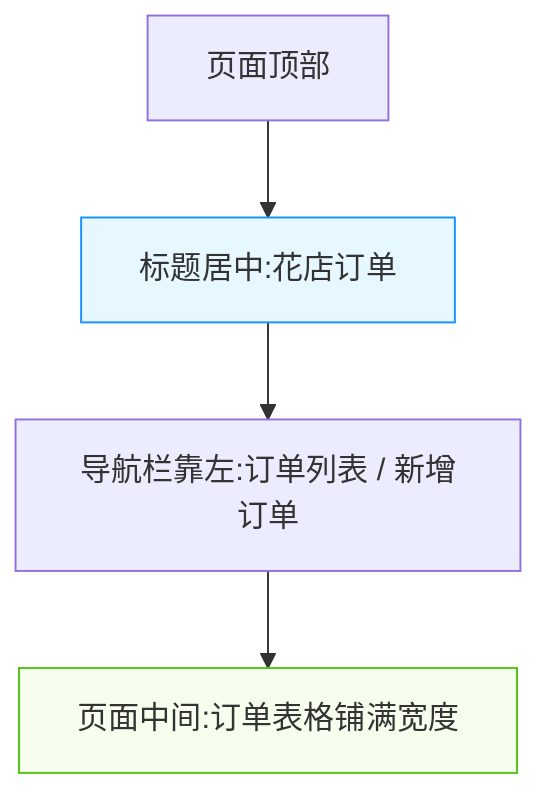
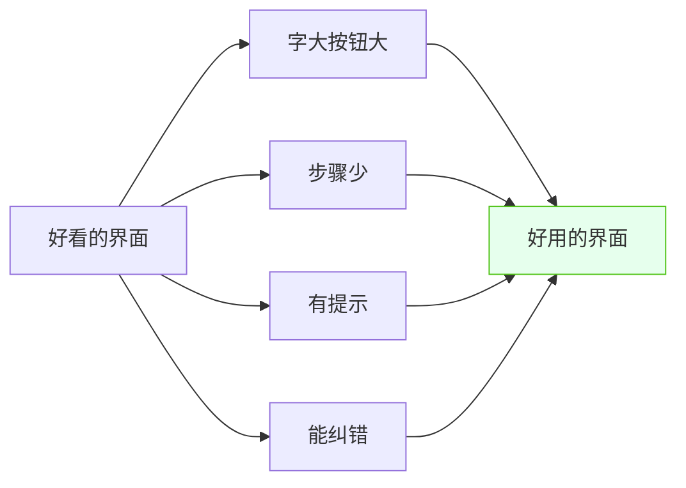
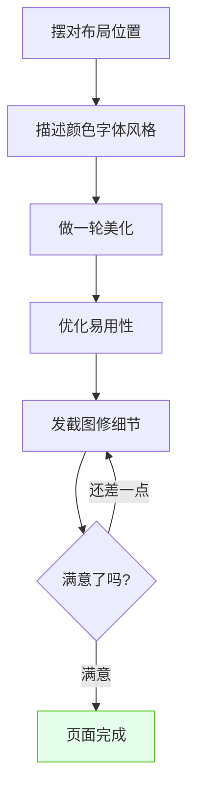

# 第9章 如何与 AI 一起开发软件界面

> 这一章要解决一个问题：软件能用了，可长得灰扑扑、点起来费劲怎么办？这一章教你用大白话描述"长什么样、摆在哪、什么颜色"，把界面做得既好看又好用的。

## 本章你会学到

- 软件界面到底由哪些基本零件组成
- 如何用日常的方位词描述页面布局
- 如何说清楚按钮、输入框、表格这些常见元素
- 如何用生活化的语言描述颜色、字体和视觉风格
- 让界面更美观、更好用的几个简单原则
- 如何让 AI 参考图片、根据截图改界面，一步步把页面打磨到位

### 引子："功能是有了，可这也太丑了"

林小满的花店小助手终于能用了。她兴冲冲地叫女儿过来看。女儿瞄了一眼屏幕，撇撇嘴："妈，这灰扑扑的，字挤成一团，按钮小得我点了三下才点中。还有你说的红色提醒，怎么是灰的？"

林小满凑近一看，可不是嘛。页面能用，可看着别扭：标题小得看不清，"新增订单"按钮缩在角落，订单表格的线密密麻麻，提醒那栏的"明天送"根本不显眼。

她有点泄气："我只会说'记订单、到期提醒'，这'好看'该怎么跟 AI 说啊？我又不懂什么设计。"

其实一点都不难。你不需要懂设计，只需要会**说你看到的感觉**——"字太小了""按钮太小点不着""提醒要红红的、大大的一眼能看到"。AI 听得懂这些大白话，它会把这些感觉变成界面。

这一章，我们就把"说清楚界面"这件事，掰开揉碎讲给你听。

## 9.1 软件界面有哪些基本组成

界面，就是你打开软件后**看到的一切、点到的一切**。别被"界面 design"这个词吓到，你每天都在用它，只是没拆开想过。

任何一个页面，拆开来都是下面这几种零件：

| 零件 | 是什么 | 生活里的例子 |
|---|---|---|
| 文字 | 标题、说明、标签 | 店铺招牌、商品标签 |
| 按钮 | 点一下会做事的小块 | 门铃、遥控器按键 |
| 输入框 | 让你填东西的方框 | 快递单上要填的地址栏 |
| 表格 / 列表 | 一行行展示数据 | 菜单、课程表 |
| 导航 | 页面之间切换的入口 | 商场里的楼层指示牌 |
| 图片 / 图标 | 装饰或表意的图 | 店铺 logo、厕所标志 |

你不需要记住这些名词。你只要知道：**页面就是这些小零件拼起来的，你要做的，就是一件件告诉 AI 每个零件长什么样、放哪里。** 拆得越具体，AI 做得越准。

## 9.2 如何描述页面布局

布局，就是"东西摆在哪"。描述布局最好的工具，就是你天天在用的**方位词**：顶部、底部、左边、右边、中间、从上到下、分两栏……

想象你在指挥人摆家具："沙发靠墙放，茶几放在沙发正前方，电视在茶几对面。"描述页面布局，一模一样。

**你：** 我来描述订单列表页的布局。页面从上到下分三块：最顶部是标题"花店订单"，居中；标题下面一行是导航栏，放"订单列表"和"新增订单"两个入口，靠左排；页面中间占最大地方的是订单表格，铺满宽度。颜色、样式先不用管，这一轮先把位置摆对。

**AI：** 明白。页面从上到下：居中的标题 → 靠左的导航 → 铺满宽度的表格。我先只调整位置，不改颜色和样式。



像上面这样先画个草图（哪怕在纸上），再照着说，AI 就很难摆错位置。

## 9.3 如何描述按钮、输入框、表格

三类最常见的零件，各有各的描述要点。说清它们，页面就基本成型了。

**按钮**——说三件事：上面写什么字、点它做什么、放哪里。
例："在表格上方右侧放一个绿色按钮，写着'＋ 新增订单'，点它跳到新增页。"

**输入框**——说四件事：叫什么、框里灰色的提示文字是什么、是不是必填、填什么格式。
例："姓名输入框，提示文字写'请输入客户姓名'，必填；电话输入框，提示'请输入11位手机号'，只让填数字。"

**表格**——说清楚有哪些列、每列显示什么、按什么排序。
例："订单表格有五列：姓名、电话、花材、送达日期、剩余天数，按送达日期从近到远排。"

| 零件 | 要描述的要点 | 林小满的说法 |
|---|---|---|
| 按钮 | 文字、作用、位置 | "绿色的'新增订单'按钮，放表格上面右边" |
| 输入框 | 名称、提示、必填、格式 | "电话框提示写11位手机号，只让填数字" |
| 表格 | 有哪些列、显示什么 | "五列：姓名、电话、花材、日期、剩余天数" |

## 9.4 如何描述颜色、字体和视觉风格

说到颜色，很多零基础朋友会慌："我不知道什么色号啊。"别怕——**你完全不需要色号，说感觉就行。**

就像装修房子，你跟设计师说"我想要暖暖的、温馨的感觉，像原木和阳光那种"，而不是报一串编号。AI 听得懂感觉。

**你：** 我想让界面有"花店"的感觉：温柔、清爽、带点绿。主色用淡绿色，像嫩叶那种；按钮用稍深一点的绿色，白字；提醒那栏用醒目的红色加粗，让我一眼能看到。字体大一点，我现在看着费劲。整体要干净，别塞太满。

**AI：** 收到。我会把主色调设为淡绿，按钮用深绿配白字，提醒文字改成红色加粗并放大，正文字号整体调大，页面四周留出空白、不挤。只改样式，不动功能。

几个好用的"感觉词"：温暖、清爽、专业、活泼、简约、复古、高端。你也可以直接发一句"参考某花的官网那种感觉"，或者干脆发张图片（见 9.7）。

## 9.5 如何让界面更美观

美观这件事，有四条零基础也能用的简单原则：

1. **留白**：内容别挤在一起，四周和元素之间留点空隙，看着透气。
2. **对齐**：左边对齐、间距一致，别东一块西一块。
3. **统一**：全站用同一套颜色和字体，别一个按钮红一个按钮蓝。
4. **突出重点**：最重要的东西（比如到期提醒）要最显眼。

你不用一次说完所有原则，可以让 AI"做一轮美化"：

**你：** 现在做一轮美化，只改外观不动功能：给页面四周留出空白，元素间距统一对齐，全站颜色字体保持一致，把"到期提醒"做成最醒目的元素。其他的别改。

**AI：** 已美化：页面增加了留白、元素对齐、样式统一，到期提醒现在是最显眼的红色加粗标签。功能未改动。

## 9.6 如何让界面更容易使用

好看之外，更要好用。好用的界面，"闭着眼都能用对"。几个要点：

- **字够大、按钮够大**：别让人眯眼、点半天。
- **步骤少**：能一步做完就别要两步。
- **有提示**：输入框有灰色提示文字，按钮有明确标签，别让人猜。
- **防错、能纠错**：填错了要提示哪里错、怎么改，而不是直接卡住。

**你：** 让界面更好用一点：1）所有按钮加大，方便点击；2）输入框加上灰色提示文字；3）如果电话填的不是11位数字，保存时提示"电话要填11位数字"，不要直接没反应。注意只改这些，功能逻辑别动。

**AI：** 已完成：按钮加大、输入框加了提示文字、电话格式不对时给出提示。新增订单的保存逻辑没变。



## 9.7 如何让 AI 参考一张图片设计界面

有时候，你心里有想法，就是说不出来。这时候**发张图片**最省事——你看到过喜欢的界面，截图或找张图发给 AI，让它参考。

**你：**（发了一张好看的花店网站截图）我喜欢这种感觉：淡雅的背景、大大的产品图、清爽的排版。请你参考这张图的配色和风格来改我的界面，但内容是花店订单，不要照搬图里的文字和商品。

**AI：** 明白，我只借鉴它的配色（米白背景＋绿色点缀）和清爽的排版风格，内容还是你的花店订单。不会照搬图里的文字。

两个小提醒：
- **说清"参考什么"**：是配色、排版、还是风格？说清楚，AI 才不会跑偏。
- **说明"别照搬"**：否则它可能把图里的文字、商品也搬过来。

## 9.8 如何根据截图修改界面

界面哪里不满意，最直接的办法就是**发当前界面的截图，指出要改的地方**。这就像拿着照片跟装修师傅说："这个灯换成暖光，那个墙刷成浅蓝。"

**你：**（发了当前订单页的截图）你看这张截图：1）标题太小，放大到原来的两倍；2）"新增订单"按钮颜色太淡，换成明显的绿色；3）表格的线太密，去掉竖线只留横线。其他保持不动，就改这三处。

**AI：** 收到，只改这三处：标题放大、按钮换绿色、表格去掉竖线。截图里其他部分不动。改完你再看一眼。

**这里最关键的一句话是"其他保持不动，就改这三处"。** 它像一道围栏，防止 AI 顺手改坏别的地方——这和第7章"限定范围"是同一个道理。

## 9.9 如何逐步完善页面

界面不是一次设计到位的，而是**一轮一轮磨出来的**。林小满的页面就是这么一步步变好看的：先摆对位置 → 再定颜色 → 再美化 → 再优化易用性 → 最后对着截图修细节。



每一轮只改一类问题，改完看一眼、确认，再改下一类。这样你始终知道"现在改到哪了"，出问题也好找。别指望一句话把界面说完美——**慢慢磨，反而最快。**

## 常见坑

- **坑：用"好看一点"这种模糊要求。** 为什么：AI 不知道"好看"对你意味着什么，只能瞎猜。怎么做：说具体——"字放大""按钮换绿色""留点空白"，或发张参考图。
- **坑：一次把布局、颜色、字体、功能全说了。** 为什么：混在一起 AI 顾此失彼，也不好查错。怎么做：一次只改一类（这一轮只改布局，下一轮只改颜色）。
- **坑：改界面时不小心改了功能。** 为什么：AI 可能"顺手"动到别处。怎么做：每轮都加一句"只改外观、不动功能，其他保持不动"。
- **坑：照搬参考图的内容。** 为什么：参考图里常有别的文字、商品，搬过来就不伦不类。怎么做：说清"只参考配色和风格，内容用我自己的"。

## 本章小结

- 界面由文字、按钮、输入框、表格、导航、图片这些零件拼成。
- 描述布局用日常方位词：顶部、居中、靠左、铺满宽度。
- 按钮说文字/作用/位置，输入框说名称/提示/必填/格式，表格说有哪些列。
- 颜色和风格不用报色号，说"感觉"（温暖、清爽）或发张参考图就行。
- 美观四原则：留白、对齐、统一、突出重点；好用要点：字大按钮大、步骤少、有提示、能纠错。
- 界面是一轮轮磨出来的：改一点、看一点、确认，再改下一点。

## 动手练习

1. 打开你的软件页面，把它拆成零件：列出至少 4 种你看到的界面零件（文字、按钮、输入框……）。
2. 用方位词描述你某个页面的布局："顶部……中间……底部……"，发给 AI 让它照着摆。
3. 挑一个零件（比如按钮），按"文字、作用、位置"三要素写一句完整指令。
4. 发一张你喜欢的界面截图给 AI，说清"只参考配色和风格，不要照搬内容"，看看它改出来的效果。

## 可复制的指令模板

**模板一：描述界面外观（布局＋颜色＋风格）**

```text
这一轮只改界面外观，不动任何功能，也不要改我提以外的地方。

布局：[用方位词描述，例如"顶部居中放标题，下面一行是导航靠左，中间是铺满宽度的表格"]。
颜色风格：[用感觉词描述，例如"淡绿主色、按钮深绿白字、提醒红色加粗、整体清爽干净"]。
字体：[例如"正文字号再大一点"]。

请用大白话告诉我你改了哪些地方，改完我打开看一眼再决定下一步。
```

**模板二：根据截图修改界面**

```text
我发了一张当前界面的截图。请只改这三处，其他一律不动：
1. [例如：标题放大到两倍]；
2. [例如：新增按钮换成明显的绿色]；
3. [例如：表格去掉竖线，只留横线]。

特别注意：只改外观，不要改动任何功能逻辑，也不要改我没提到的地方。
改完请说明你具体改了哪三处，我对照截图检查。
```
