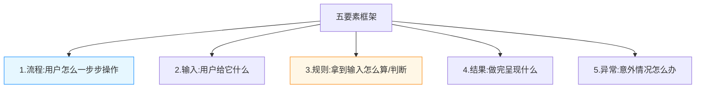

# 第10章 如何让 AI 实现软件功能

> 这一章要解决一个问题：界面好看了，可"聪明的部分"——搜索、筛选、自动算剩余天数——怎么让 AI 做出来？答案是把功能说清楚：按什么步骤操作、给什么输入、按什么规则算、出什么结果、遇到意外怎么办。

## 本章你会学到

- 功能和界面的区别：一个是"长相"，一个是"本领"
- 描述一个功能的五要素：流程、输入、规则、结果、异常
- 如何实现搜索、筛选、排序这三个常用功能
- 如何实现表单、计算和数据处理
- 如何让多个功能互相配合、连成一条流畅的流水线

### 引子："加个搜索"，结果搜出来一堆不相干的

花店小助手用了一阵子，订单攒了几十笔。林小满翻着列表犯愁："我想找'王女士'订的花，得从头翻到尾。要是能搜就好了。"

她对 AI 说："给我加个搜索功能。"AI 很快做好了。林小满一试——在搜索框里输入"王女士"，结果跳出来一堆花材名字：玫瑰、百合、康乃馨……原来 AI 把"搜索"理解成了"搜商品名"。

林小满哭笑不得："我要的是搜客户名字啊！"

她学会了：说"加个搜索"远远不够。你得说清**搜什么、输入什么、按什么规则匹配、结果怎么显示、搜不到怎么办**。这五件事说清楚了，AI 才能做对你想要的功能。这一章，我们就把这"五件事"讲透。

## 10.1 功能与界面的区别

很多人会混淆这两件事。先分清楚，后面才说得准。

**界面**是"长相"——页面长什么样、按钮在哪、什么颜色，是你**看到和点到**的东西。
**功能**是"本领"——点了之后会发生什么、怎么算、出什么结果，是软件**背后做的事**。

打个比方：一个计算器，它长得方方正正、有数字键（界面）；按"2+3"再按"="，跳出"5"（功能）。界面是外壳，功能是内功。

| 对比 | 界面 | 功能 |
|---|---|---|
| 关注什么 | 长什么样、摆在哪 | 做什么、怎么算、出什么结果 |
| 你能感知到 | 看得到、点得到 | 用起来才知道对不对 |
| 例子 | 一个搜索框、一个按钮 | 输入名字后列出匹配的订单 |
| 描述重点 | 位置、颜色、大小 | 流程、输入、规则、结果、异常 |

一个搜索框（界面）本身不会搜索；"输入名字→列出匹配订单"才是功能。第9章我们练的是界面，这一章练的是功能。

## 10.2 如何描述一个功能的操作流程

描述功能，最好用的框架是**五要素**：流程、输入、规则、结果、异常。你把它当成一个填空表格，一项项填，AI 就很难做偏。

先说**流程**——用户一步步怎么操作这件事。像写菜谱一样，第一步、第二步、第三步列出来。

以"按客户名字搜索订单"为例，流程是：
1. 用户在搜索框输入客户名字（比如"王"）；
2. 用户点"搜索"按钮；
3. 系统找出名字里含"王"的订单；
4. 把结果列在订单表格里给用户看。



这五要素不用一次全说得多完美，后面几节逐个拆开讲。你只要养成"按这五项想一遍"的习惯，描述功能就很完整了。

## 10.3 如何描述输入条件

**输入**，就是用户交给这个功能的东西。描述输入要说清四点：有哪些输入、什么格式、是不是必填、有没有默认。

**你：** 我要做"按客户名字搜索订单"的功能。先说输入：页面顶部有一个搜索框，用户在这里输入客户姓名；这是文本输入，可以不填完整名字——比如输入"王"也能匹配到"王女士""王小明"。搜索框可以为空，为空时点搜索就显示全部订单。这一轮先把输入和触发说清楚，别急着做匹配逻辑。

**AI：** 明白。搜索框在页面顶部，接受文本输入，支持部分匹配（输入"王"匹配所有名字含"王"的客户）；输入为空时点搜索显示全部订单。这一轮只做输入部分。

注意"支持部分匹配"这句话——你不说，AI 可能就做成"必须输完整名字才搜得到"。**你以为的常识，AI 不一定知道，说出口才保险。**

## 10.4 如何描述处理规则

**规则**是功能的"大脑"——拿到输入后，到底怎么算、怎么判断。这是最关键、也最容易被你漏掉的一项。

拿林小满最想要的"剩余天数"来说，规则要这样写：

| 情况 | 规则 |
|---|---|
| 送达日期晚于今天 | 剩余天数 = 送达日期 − 今天 |
| 剩余天数 = 1 | 显示"明天送"，红色加粗 |
| 剩余天数 = 0 | 显示"今天送"，红色加粗 |
| 送达日期早于今天 | 显示"已过期"，灰色 |

**你：** 现在实现"剩余天数"的计算规则：用送达日期减去今天的日期，得到剩余天数。如果剩余是1天，在提醒栏显示红色加粗的"明天送"；如果是0天，显示红色加粗的"今天送"；如果日期已经过去，显示灰色的"已过期"。这一步只做计算和显示规则，别动其他列。

**AI：** 收到。我会按送达日期与今天日期的差算出剩余天数，并按你说的三种情况显示不同的文字和颜色。只改提醒这一栏。

规则写得越具体，AI 做得越准。别用"智能判断一下"这种话——把每一种情况的判断标准都列出来。

## 10.5 如何描述结果

**结果**就是功能做完后，用户看到什么。你要说清：正常结果长什么样，以及"没结果"时怎么办。

**你：** 接着把搜索的"结果"说清楚：点搜索后，订单表格只显示名字匹配的订单，其他订单暂时隐藏。如果一笔都没匹配到，就在表格位置显示一行文字"没有找到相关订单"，不要显示空表格让人以为坏了。其他功能不受影响。

**AI：** 明白。搜索后表格只显示匹配的订单；如果没有任何匹配，显示"没有找到相关订单"的提示文字。已记录。

"没找到"的提示很重要——它是用户判断"功能正常工作、只是没结果"还是"功能坏了"的依据。这类细节，一定要你主动说。

## 10.6 如何描述异常情况

**异常**，就是那些"不按常理出牌"的情况。AI 不会自己想到所有意外，得你提醒它。

| 异常情况 | 希望怎么处理 |
|---|---|
| 搜索框为空就点搜索 | 显示全部订单，不报错 |
| 输入了空格 | 自动去掉前后空格再搜 |
| 订单的送达日期是空的 | 剩余天数栏显示"—"，不要显示乱码 |
| 一次搜出几百笔 | 正常全部列出，不要卡住 |

**你：** 补充几个异常情况的处理：1）搜索框空着点搜索，显示全部订单；2）用户只输了空格，去掉空格再搜；3）某个订单没填送达日期，它的剩余天数栏显示一个"—"，别显示乱七八糟的数字；4）一下匹配出很多订单，要能正常全部列出来。请只加这些处理，不要改正常流程。

**AI：** 收到，这四种异常我都按你说的方式处理，正常搜索流程不变。

把异常想在前头，软件才结实。你不用一次想全，想到一条补一条就好。

## 10.7 如何实现搜索、筛选和排序

这三个是最高频的功能，用五要素框架很快能说清。

- **搜索**：按关键字找。输入关键字 → 按"包含"规则匹配 → 显示匹配结果。
- **筛选**：按条件挑。比如"只看本周要送的"——输入是条件（本周），规则是"日期在本周范围内"，结果是只显示这些订单。
- **排序**：按某一列排。比如"按送达日期从近到远"——规则就是比较日期大小、近的排前面。

**你：** 现在加三个功能，一次加一个，做完一个我再确认下一个。
第一个：搜索——顶部搜索框，输入客户名字，按"名字包含输入内容"匹配，结果显示在表格里，搜不到就提示"没有找到相关订单"。
做完这个先停下来告诉我。

**AI：** 搜索功能已完成。顶部搜索框可按客户名字的部分内容匹配，结果显示在表格；无匹配时显示提示文字。等待你确认后再做下一个。

一次一个，还是第7章那条老规矩。搜索、筛选、排序分开做，每个都能立刻验证。

## 10.8 如何实现表单、计算和数据处理

这类功能更"聪明"，核心还是把规则说清楚。

**表单**：用户填信息、点提交。要说清有哪些字段、必填项、提交后做什么。你第8章做的新增订单表单，就是表单功能。

**计算**：按规则算出一个数。比如"剩余天数""本月订单总数""每个客户的订单金额合计"。关键是给出计算公式和边界情况。

**数据处理**：对一批数据批量操作。比如"把所有已过期的订单标灰""统计每个客户订过几次花"。

**你：** 加一个统计功能：在页面顶部显示"本月订单总数"和"本月花材金额合计"两个数。规则是：只统计送达日期在这个月内的订单，金额按每笔订单的花材价格相加。如果本月没有订单，两个数都显示0。只加这个统计，不要改订单表格。

**AI：** 已完成。页面顶部现在显示本月订单总数和金额合计，只统计本月送达的订单，金额按花材价格求和，无数据显示0。订单表格未改动。

## 10.9 如何实现多个功能之间的协作

单个功能会了，还要让它们**配合起来**——就像一条流水线，一环扣一环。

比如这一串：新增订单 → 保存到列表 → 列表按日期排序 → 自动算出剩余天数 → 到期显示红色提醒。这些功能不是各干各的，而是前一步的结果喂给后一步。


**你：** 把几个功能串起来：1）点保存新增一笔订单后，订单要自动出现在列表里；2）列表自动按送达日期从近到远排序；3）新订单也要参与剩余天数计算，到期同样显示红色提醒；4）刷新页面后这笔订单还在。请按这个顺序实现，每步做完告诉我。

**AI：** 已串好：保存后新订单进入列表并自动排序、参与剩余天数计算与到期提醒，刷新后数据保留。整条流程已打通。

功能协作时，最容易出问题的就是"衔接处"。所以你要特别说明"新订单也要参与计算""排序要自动更新"这类话，把接缝补上。

## 常见坑

- **坑：只说功能名字，比如"加个搜索"。** 为什么：AI 只能猜，容易做成别的东西（搜商品而非搜客户）。怎么做：用五要素把流程、输入、规则、结果、异常说清楚。
- **坑：漏掉"规则"这一项。** 为什么：规则是功能的大脑，不说 AI 就按它自己的理解算，结果和你想要的不一样。怎么做：把每种情况的判断标准逐条列出来。
- **坑：忽略"没结果""填错"等异常。** 为什么：AI 想不到所有意外，这些细节不补，软件就显得"坏坏的"。怎么做：主动补几条异常及处理方式。
- **坑：一次让 AI 做好几个功能。** 为什么：混在一起难验证、难定位问题。怎么做：一次一个功能，做完立刻试、确认，再做下一个。

## 本章小结

- 功能≠界面：界面是长相，功能是本领；功能描述看流程、输入、规则、结果、异常。
- 五要素框架是描述功能的万能填空表，逐项填，AI 很难做偏。
- 输入说清格式和匹配方式（如"部分匹配"），规则逐条列出每种情况的判断标准。
- 结果要包含"没找到"的提示，异常要主动补充（空输入、空格、空日期等）。
- 搜索、筛选、排序、表单、计算、数据处理，都可以套用五要素。
- 多个功能要协作：特别说明衔接处（新订单要参与计算、排序要自动更新）。

## 动手练习

1. 挑一个你想加的功能，用五要素框架填空：流程分几步、有哪些输入、按什么规则、出什么结果、有哪些异常。
2. 专门把"规则"一项写成表格，逐条列出每种情况的判断标准，看看有没有遗漏。
3. 让 AI 实现"按客户名字搜索订单"，把"部分匹配"和"搜不到时提示"两条明确写进指令。
4. 设计一条功能协作链（例如：保存 → 排序 → 算天数 → 到期变红），让 AI 按顺序实现并逐项验证。

## 可复制的指令模板

**模板一：用五要素描述一个功能**

```text
请实现这个功能：[功能名称，例如"按客户名字搜索订单"]。我按五项说清楚：

1. 流程：[用户一步步怎么操作，例如"输入名字→点搜索→看结果"]；
2. 输入：[有哪些输入、什么格式、是否必填、是否支持部分匹配]；
3. 规则：[拿到输入后怎么算/判断，每种情况逐条列出]；
4. 结果：[做成后显示什么；没结果时显示什么]；
5. 异常：[空输入、格式错、空数据等意外情况分别怎么处理]。

请只做这一个功能，做完告诉我结果，并说明怎么测试它。不要改其他功能。用大白话回复。
```

**模板二：让多个功能协作**

```text
请把下面几个功能按顺序串成一条流程，每步做完停下来让我确认：
1. [例如：点保存后，新订单自动出现在列表]；
2. [例如：列表自动按送达日期从近到远排序]；
3. [例如：新订单也参与剩余天数计算，到期显示红色提醒]；
4. [例如：刷新页面后数据仍在]。

请特别注意衔接处：[列出容易脱节的地方，例如"排序要自动更新，不用我手动刷新"]。
只做这条流程相关的事，别改其他部分。
```
