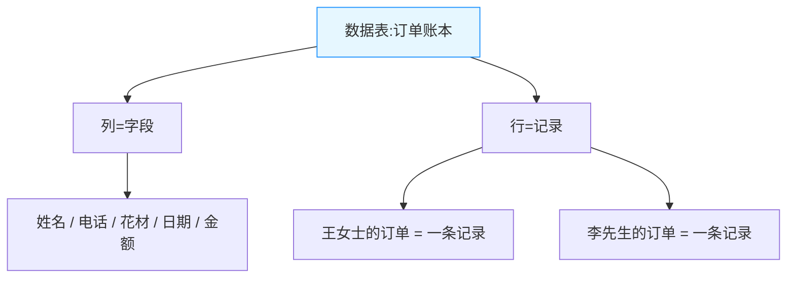
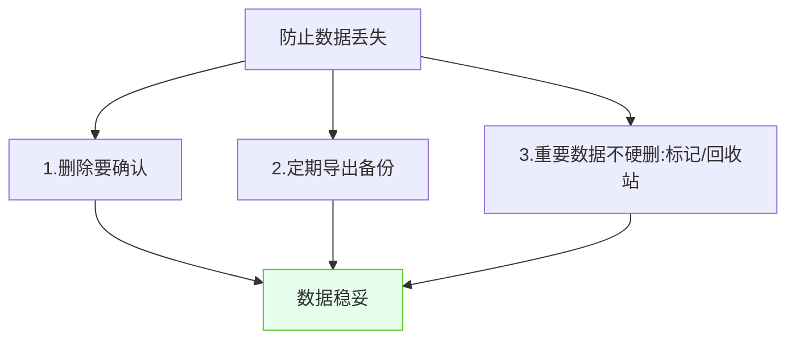

# 第11章 让软件保存和管理数据

> 这一章要解决一个问题：订单存在哪、怎么增删改查、丢了怎么办？这一章教你的软件像一本可靠的账本——把数据稳稳存下来，随时找得到、改得动、丢不了。

## 本章你会学到

- 为什么软件必须保存数据
- 什么是"数据"、什么是"数据表"（用花店账本讲明白）
- 如何告诉 AI 设计数据的结构
- 数据的四件基本事：新增、修改、删除、查询
- 如何导入、导出数据
- 怎么防止数据丢失

### 引子：一笔订单，说没就没了

花店小助手用了几周，林小满攒了一百多笔订单。那天她清理列表，手一滑点到了"删除"，一笔老客户的订单瞬间消失。她翻遍了列表也找不回来，急得直冒汗："我记在本子上，划错了还能看出来、补回来；软件里说没就没，可怎么办？"

她突然意识到：之前她只关心"软件能不能用"，从没想过"数据存在哪、会不会丢"。订单是她生意的命根子，比软件本身还重要。

其实好消息是：**让 AI 把数据存好、管好，一点都不难。** 你不需要懂数据库，只需要把账本的样子说清楚——有哪些格子、怎么记、怎么改、怎么备份。这一章，我们就把"数据"这件事从头讲明白。

## 11.1 为什么软件需要保存数据

数据，就是软件记住的信息。如果软件不存数据，它就像一块黑板——你关掉程序的那一刻，上面写的全被擦掉了，下次打开又是一片空白。

保存数据有三个好处：

1. **留住信息**：今天记的订单，下周打开还在，不用重记。
2. **能管理**：存下来之后，才能修改、删除、查找、统计。
3. **能复用**：有了数据，才能算"本月卖了多少""给谁送过花""谁该到期提醒"。

打个比方：不存数据的软件，像个记性不好的伙计，转头就忘；存了数据的软件，像一本用工整字迹记下来的账本，随时能翻、能改、能核对。林小满想要的，正是这本"靠谱的账本"。

## 11.2 数据是什么

**数据**就是被记录下来的信息。听起来抽象，其实你天天在跟数据打交道：通讯录里的一个联系人、购物车里的一件商品、账本里的一笔账，都是一条数据。

在花店小助手里，**一笔订单就是一条数据**。一条数据里装着好几项信息：

| 订单 | 客户姓名 | 电话 | 花材 | 送达日期 | 金额 |
|---|---|---|---|---|---|
| 第1条 | 王女士 | 13800001111 | 红玫瑰 | 2026-05-10 | 199 |
| 第2条 | 李先生 | 13900002222 | 百合 | 2026-05-12 | 128 |

每一行是一条数据（一笔订单），每一格是一项信息。数据本身不神秘，就是"一行行记录好的信息"。

## 11.3 数据表是什么

把所有订单整齐地排成上面那样一张表，就是**数据表**。你可以把它想成**一本格式统一的账本**：一行记一笔生意，每行的格子都一样——第一格写姓名、第二格写电话……不会这行写姓名、那行写花材地乱来。

数据表有两个基本词，你听听就好，不用背：

- **字段**：每一列叫什么、填什么。比如"姓名"是一个字段，"日期"是一个字段。
- **记录**：每一行是一笔完整的数据，比如"王女士这笔订单"就是一条记录。



你不需要自己建这张表——只要把"账本该有哪些列"告诉 AI，它就会帮你建好。

## 11.4 如何告诉 AI 设计数据结构

数据结构，就是"账本有哪些格子、每个格子填什么"。这是存数据的第一步，也是最重要的一步。设计得好，后面增删改查都顺；设计得乱，后面处处别扭。

告诉 AI 时，说清三件事：**有哪些字段、每个字段填什么类型、哪个字段能唯一标识一条记录。**

**你：** 我要正式地存订单数据了。请你帮我设计一张"订单数据表"，字段如下：
- 订单编号：每笔订单自动生成一个不重复的数字，用来唯一标识这笔订单；
- 客户姓名：文字，必填；
- 电话：文字（不是数字，因为要保留开头的0和全部位数），必填；
- 花材：文字，必填；
- 送达日期：日期格式，必填；
- 金额：数字，可以带小数，必填；
- 备注：文字，可不填。

请用大白话跟我确认这个设计，别急着建。

**AI：** 好的，我理解你要的订单表有7个字段：订单编号（自动生成、唯一）、客户姓名/电话/花材/送达日期/金额都必填，备注可不填；电话按文字存以保留完整号码，金额是数字可带小数。对吗？

**你：** 对，就按这个建。

几个提醒：
- **电话按文字存**：这是经典的坑，按数字存会丢掉开头的0和末尾的0（第8章你遇到过）。
- **订单编号**：给每条数据一个唯一编号，修改、删除时才不会认错人。
- **必填与选填**：说清哪些必须填、哪些可以空着。

## 11.5 如何实现数据新增

新增数据，就是往账本里加一行。其实第8章你做的新增订单表单，就是在做这件事——那里是从"界面"角度看，这里我们从"数据"角度再确认一遍：填完点保存，这笔订单要作为一条新记录写进数据表。

**你：** 现在把新增订单和数据表连起来：在新增表单填好客户姓名、电话、花材、送达日期、金额、备注，点"保存"后，这些要作为一条新记录存进订单数据表，并自动分配一个不重复的订单编号。保存成功后提示"订单已保存"，然后清空表单。只做新增，改动、删除先别做。

**AI：** 已完成。点保存后，表单内容会作为一条新记录写入订单表，系统自动分配订单编号，并提示"订单已保存"、清空表单。

## 11.6 如何实现数据修改

修改数据，就是改账本里的某一行。这里的关键问题是：**怎么准确找到要改的那一条？** 靠名字找容易重名，所以要用第11.4里那个唯一的"订单编号"。

**你：** 实现修改功能：在订单列表每条订单后面加一个"编辑"按钮。点它打开一个和新增一样的表单，里面预先填好这条订单原来的内容；改完点"保存"，就更新这条订单的记录（按订单编号找到它）；点"取消"则不保存、返回列表。注意修改时订单编号不能改。

**AI：** 已完成。每条订单有"编辑"按钮，点开预填原内容的表单，保存后按订单编号更新该记录，取消则放弃修改。订单编号保持不可改。

"先预填原内容"这个细节很重要——不然用户得把整条信息重新填一遍，既费劲又容易填错。

## 11.7 如何实现数据删除

删除数据，就是从账本里划掉一行。这个功能要格外小心——林小满就是误删了订单。所以删除功能必须配一道"确认"防线。

**你：** 实现删除功能：每条订单后面加一个"删除"按钮。点它时先弹出一个提示问"确定要删除订单编号X的这笔订单吗？"，只有点"确定"才真正删除，点"取消"就不删。删除的是订单表里对应的那条记录。这一步只做删除和确认，别动其他功能。

**AI：** 已完成。点删除会先弹确认框，显示订单编号，点"确定"才删除该记录，点"取消"不删。

**这道"确认"关卡，是防止误删最有效的办法。** 另外还有两个更稳妥的选择：把"删除"改成"标记已删除"（数据其实还在，只是不显示），或者做一个"回收站"。你可以让 AI 加上，防患于未然。

## 11.8 如何实现数据查询

查询数据，就是从账本里找出你要的记录。其实第10章的搜索、筛选、排序，本质上都是查询——只不过那次是从"功能"角度看，这次我们从"数据"角度看：它们都是在数据表里找记录、按条件挑记录。

| 查询方式 | 对应第10章 | 在数据层面做了什么 |
|---|---|---|
| 按名字搜索 | 搜索 | 找出姓名包含关键字的记录 |
| 只看本周 | 筛选 | 挑出送达日期在本周的记录 |
| 按日期排 | 排序 | 把记录按日期重新排列显示 |

**你：** 查询这块我们已经做过搜索、筛选、排序了。请你检查一下它们是不是真的从订单数据表里取数——我要确保搜索到的是账本里的真实记录，不是页面上写死的假数据。如果不是，请改成从数据表读取。

**AI：** 我检查了，目前的搜索是从订单数据表读取记录的，不是假数据。列表显示的也是表里的真实内容。

**这句话问得很关键**：很多看起来"能用"的软件，背后是写死的示例数据，一刷新就漏馅。让 AI 确认"数据来自数据表"，才能保证你的软件是真的在用数据。

## 11.9 如何实现数据导入和导出

**导出**，就是把数据表里的记录另存成一个文件（比如 Excel 表格），像把账本复印一份带走；**导入**，就是把外面的文件读进数据表，像把别处的账本搬进来。

这两个功能特别实用：
- **导出**：备份数据、把订单发给别人、用 Excel 做进一步分析。
- **导入**：一次性录入大批订单、从旧工具迁移数据。

**你：** 实现导出功能：加一个"导出到Excel"按钮，点它把订单数据表里的所有记录导出成一个表格文件，列名是订单编号、客户姓名、电话、花材、送达日期、金额、备注。导出前让我确认文件名。只做导出，先不要做导入。

**AI：** 已完成。"导出到Excel"按钮会把订单表全部记录导出成表格文件，含这7列，导出前会让你确认文件名。

导入类似：说清"从哪种文件读、每列对应哪个字段、遇到重复订单编号怎么办"，AI 就能做。

## 11.10 如何避免数据丢失

数据无价。林小满那次误删的教训，值得每个用软件的人记取。防丢失有三道防线：



1. **删除要确认**：像第11.7那样，删之前弹窗问一句。
2. **定期导出备份**：养成习惯，每周点一次"导出"，把文件存到别的地方。真丢了，导回来就行。
3. **重要数据不硬删**：用"标记已删除"代替彻底删除，留个后悔药。

**你：** 我想防数据丢失，请帮我做三件事：1）所有删除都要弹确认框（已有就保持）；2）加一个"记得备份"的提示——如果超过7天没导出过，打开软件时提醒我"该导出备份了"；3）删除改成"标记已删除"，数据仍留在表里只是不显示，并加一个"回收站"页面能恢复。请分步做，每步做完告诉我。

**AI：** 好的，第一步确认框已就位；接下来我会先加备份提醒，做完告诉你；再加回收站。我们一步一步来。

把这三道防线做好，你的数据就比纸账本还可靠了。

## 常见坑

- **坑：数据只存在页面上，没真正写进数据表。** 为什么：刷新或关掉就没了。怎么做：让 AI 确认"数据来自数据表、不是写死的假数据"，新增后能查得到。
- **坑：电话、订单号这类编号按数字存。** 为什么：会丢掉开头的0、末尾的0，或超出位数。怎么做：明确告诉 AI"按文字保存"。
- **坑：删除没有确认，一失手就没了。** 为什么：删除不可逆，误删难找回。怎么做：必须加确认弹窗；重要的用"标记删除＋回收站"。
- **坑：从不备份。** 为什么：软件再稳也怕意外（误删、设备坏）。怎么做：定期导出文件存好；让 AI 加"该备份了"的提醒。

## 本章小结

- 数据是被记录下来的信息；一条订单就是一条数据，整齐排起来就是数据表。
- 数据表像账本：一列是一个字段，一行是一条记录。
- 设计数据结构要说清：有哪些字段、各是什么类型、哪个字段唯一标识（订单编号）。
- 数据四件事：新增（写入并记录）、修改（按编号找到再改）、删除（必须确认）、查询（来自真实数据表）。
- 导出是备份、导入是批量录入；两者都靠说清"列对应关系"。
- 防丢失三道防线：删除确认、定期导出备份、重要数据标记删除＋回收站。

## 动手练习

1. 用"账本"的比喻，向一个不懂电脑的朋友解释什么是数据表、字段和记录。
2. 给你的软件设计一张数据表，列出至少5个字段，标明每个字段的类型和是否必填，并指出哪个字段唯一标识一条记录。
3. 让 AI 实现"编辑"功能，要求点开时预填原内容、按订单编号更新、订单编号不可改。
4. 给你的数据加上防丢失措施：确认删除＋导出备份＋（可选）回收站，并实际导出一次文件保存好。

## 可复制的指令模板

**模板一：设计数据表结构**

```text
我要正式保存数据了。请帮我设计一张"[例如：订单]数据表"，请按下面的字段来：
- [字段名]：[文字/数字/日期]，[必填/可不填]，[其他要求，例如"按文字存以保留开头的0"]；
- ...（逐条列出所有字段）

其中一个字段是"[例如：订单编号]"，用来唯一标识每条记录，请让它自动生成、不重复。
请先用大白话跟我确认这个设计对不对，确认后帮我建好这张表，并把新增表单和它连起来：
填好点保存后，作为一条新记录写进表里，并自动分配编号。别急着做修改和删除。
```

**模板二：给数据加上安全和备份**

```text
请帮我保护数据、防止丢失，分三步做，每步做完停下来告诉我：
1. 所有删除操作都要先弹确认框，显示要删的是哪条记录，点"确定"才删；
2. 加一个备份提醒：如果超过7天没导出过数据，打开软件时提醒我"该导出备份了"；
3. 把"删除"改成"标记已删除"——数据仍留在表里只是不显示，并加一个"回收站"页面能恢复。

只做和数据安全相关的事，不要改动其他功能。用大白话回复我。
```
