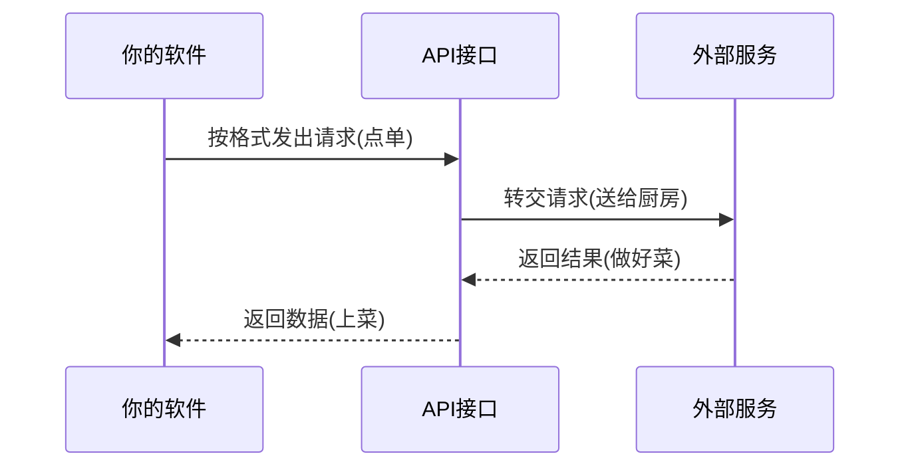
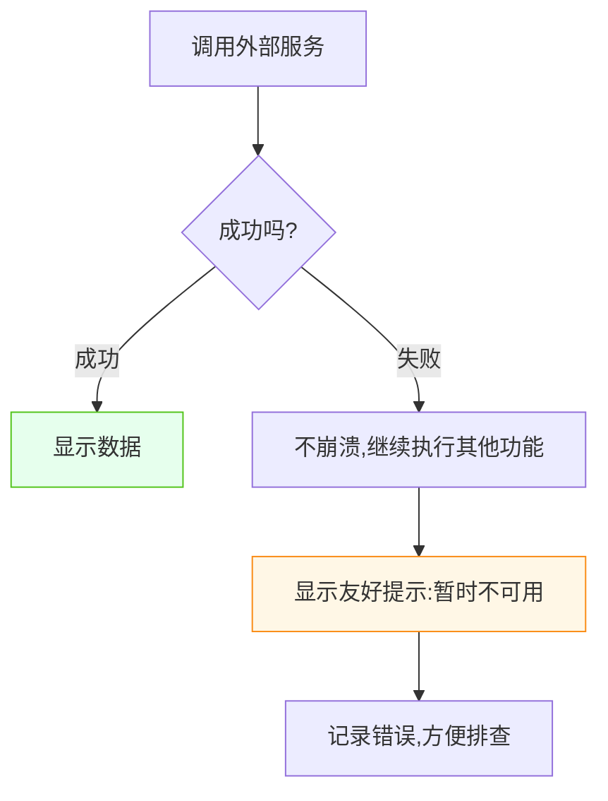

# 第12章 让 AI 为软件接入外部能力

> 这一章要解决一个问题：软件自己会做的事有限，想让它查天气、看地图、推荐花材怎么办？答案是"接入外部能力"——让你的软件借用别人已经做好的服务。这一章讲清楚接口和 API 是什么、怎么接、密钥怎么保护、失败怎么办。

## 本章你会学到

- 软件接口和 API 到底是什么（用点外卖讲明白）
- 让 AI 接入外部服务的通用步骤
- 如何接入 AI 大模型、地图、天气、文件处理、第三方数据
- API 密钥是什么，为什么必须保护好
- 外部服务接入失败时怎么处理

### 引子：软件想"长本事"，得学会借外力

花店小助手记订单、算提醒、存数据，林小满已经用得很顺了。可她又冒出新想法：

"客户订花都要写地址，要是在地图上标出来就好了，我一看就知道送哪个方向。情人节前，要能根据天气推荐花——下雨天推荐暖色系的花。还有，能不能让软件帮我写花束的推荐语？我自己文笔不太好。"

她对 AI 说："加个地图。"AI 回答："地图这个功能软件自己做不了，需要接入外部的地图服务；天气、AI 写推荐语也一样，都要接入外部能力。"

林小满愣了："接入外部能力？听着好玄乎。"

其实一点不玄乎。就像你自己做饭，想吃什么都能做，但要吃北京烤鸭，你会直接去买——因为烤鸭店已经做好了，你不用自己建烤炉。**"接入外部能力"，就是让你的软件去用别人已经做好的服务。** 这一章，我们就把它讲明白。

## 12.1 什么是软件接口

软件想跟外面的服务打交道，得通过一个"窗口"，这个窗口就叫**接口**。

打个比方：你家的插座就是一个"接口"。电器不用自己发电，只要插头插进插座，就能用上电厂的电。插座规定了"插头长什么样、怎么插"，电器照着做，就能接上。

软件接口也是这样：它规定了"怎么问、问什么格式、对方怎么回答"。你的软件按规矩问，地图服务按规矩答，两边就对上了。

再比如点外卖：你不用认识厨师，只要打开 App 点单，厨房收到就做、骑手送到你手上。App 就是餐厅和你之间的"接口"。

| 生活里的接口 | 软件里的接口 |
|---|---|
| 插座：电器接电的窗口 | 软件之间传数据的窗口 |
| 点外卖 App：你向餐厅下单的窗口 | 你的软件向地图服务要数据的窗口 |
| 电话线：你和朋友通话的通道 | 接口：两个软件对话的通道 |

你不用懂接口的技术细节，只要知道：**它是软件对外"借能力"的窗口，让 AI 去对接就行。**

## 12.2 API 究竟是什么

你大概率听过"API"这个词。它就是接口的一种标准叫法，全称很长（Application Programming Interface，应用程序编程接口），你不用记，只要知道 **API ≈ 软件之间对话的规矩**。

用餐厅点餐最能讲清：

- **菜单** = API：告诉你有哪些菜能点、怎么点；
- **你点单** = 请求：按菜单说"我要一份宫保鸡丁"；
- **厨房做菜** = 服务处理：厨房在后台忙，你不用管；
- **上菜** = 响应：服务员把菜端给你。

你不需要进厨房、不需要知道菜怎么做的——**只要按菜单点，菜就会来。** 调用 API 就是这么回事：你的软件按规矩"点单"，外部服务把"菜"（数据）送回来。



这里有个关键点：**你只管"点单"和"收菜"，中间的厨房你碰不到、也不用碰。** 这就是为什么接入外部能力没那么难——复杂的事别人做完了，你只是按规矩点单。

## 12.3 如何让 AI 接入外部服务

接入外部服务的通用步骤，其实就五步，而且大部分由 AI 完成：

1. **选服务**：决定用哪家（地图、天气、AI 大模型……）；
2. **拿密钥**：去服务提供方申请一个"钥匙"（见 12.8）；
3. **说清需求**：告诉 AI 你要什么数据、什么格式、怎么用；
4. **AI 对接**：AI 写出对接代码；
5. **测试**：实际用一下，看数据对不对。

你要做的，主要是第1、3、5步——选、说、验；第2、4步可以让 AI 指导你。

**你：** 我想接入天气服务，让软件能查出某个城市的天气。我不懂这些，请你一步一步带我：
1. 告诉我有哪些常见的天气服务可选，哪个对新手最简单、免费额度够用；
2. 告诉我怎么申请密钥，每一步写清楚；
3. 申请好之后，你帮我写对接代码。我要的功能是：输入一个城市名，返回这个城市今天的天气和温度；
4. 写完教我怎么测试。

**AI：** 好的，我们先从选服务开始。对新手最友好的是 [服务A]，它免费额度足够个人使用。申请密钥的步骤是……（一步一步列出）。你先去申请，拿到密钥告诉我，我再帮你写对接和测试。

注意你这句话里的结构：**让 AI 先指导你选和申请，拿到密钥再写对接**。一步一确认，不着急。

## 12.4 如何接入 AI 大模型

最让人兴奋的，是让你自己的软件也能"用 AI"。比如让软件自动写花束推荐语、根据客户喜好推荐花材——这些都能通过接入 AI 大模型实现。

接入方法和其他服务一样，关键是说清三件事：**输入什么、要 AI 做什么、输出什么格式和语气。**

**你：** 我想让软件接入 AI，帮花店写花束推荐语。需求是这样的：
- 输入：客户姓名、送花场合（比如生日、母亲节）、想送的花材；
- AI 要做的事：根据这些信息，写一段 50 字以内、温暖得体的推荐语；
- 输出：纯文字，语气像花店老板对顾客说话，不要专业术语。
请你帮我实现：在新增订单页加一个"生成推荐语"按钮，点了之后把这三个输入发给 AI，把返回的推荐语显示在输入框里，用户可以改。只做这个功能。

**AI：** 已完成。"生成推荐语"按钮会把客户姓名、场合、花材发给 AI 大模型，按你要求的字数和语气生成推荐语，显示在输入框中供你修改。你可以填一笔试试。

看，你不需要懂"大模型"是什么，只要把"输入—处理—输出"说清楚，AI 就能帮你接好。**这类功能最能体现自然语言编程的威力：你用自然语言描述需求，AI 帮你把自然语言能力接进软件。**

## 12.5 如何接入地图、天气等服务

地图和天气是最常见的两类外部服务：

| 服务 | 能做什么 | 花店场景 |
|---|---|---|
| 地图服务 | 地址变坐标、显示位置、规划路线 | 在地图上标出客户地址，看清送花方向 |
| 天气服务 | 查某地的天气、温度、预报 | 下雨天推荐暖色花，高温天推荐耐放的花 |

**你：** 接两个外部服务，一次一个。
第一个，地图：在订单详情里增加一个"查看位置"功能——把订单里的客户地址发给地图服务，在地图上标出这个位置。如果地址解析不出来，就显示"地址无法定位，请检查地址是否完整"。做完这个先停一下。

**AI：** 地图功能已接入：订单详情里点"查看位置"，会把地址交给地图服务并显示位置；地址无法解析时显示你指定的提示。等待你确认后做下一个。

**你：** 好，继续接天气：加一个"查天气"功能，输入城市名，显示今天的天气和温度。做完告诉我怎么测试。

**AI：** 天气功能已接入。输入城市名即可显示今天天气和温度。你可以在页面输入"北京"测试一下。

一次接一个、接完就试，还是那条老规矩。

## 12.6 如何接入文件处理能力

文件处理也是常见的外部能力：上传图片、生成 PDF、读取 Excel……这些都能通过接入相应能力实现。

**你：** 加两个文件相关的功能：
1. 上传图片：在订单里加一个"上传花的照片"功能，客户可以看到花的样子；支持常见的 jpg、png 格式，其他格式提示"只支持 jpg 和 png 图片"；
2. 生成 PDF：加一个"导出发货单PDF"按钮，把一笔订单的信息导出成一页 PDF，方便打印。
一次做一个，做完我确认再做下一个。

**AI：** 先把上传图片做好：订单里可以上传 jpg/png 照片，其他格式会给出提示。做完你确认后，我再加 PDF 导出。

## 12.7 如何接入第三方数据

除了地图、天气，你还可以接入各种**第三方数据**，让软件更聪明。比如：

- **节假日数据**：提前知道母亲节、情人节是哪天，自动提醒你备货；
- **花材行情数据**：了解花价涨跌，辅助定价；
- **快递数据**：查订单的物流状态。

**你：** 接一个节假日数据，用来提醒我节日备货。需求：
- 软件启动时，读取近期（未来30天）的节日列表，比如母亲节、情人节、七夕；
- 如果有节日在7天内，在首页顶部显示醒目提醒："距离XX节还有N天，记得备货"；
- 如果读取失败，不要影响软件其他功能，只是不显示这个提醒。
请分步做，每步做完告诉我。

**AI：** 好的。我先接入节假日数据源并读取未来30天的节日，做完告诉你；然后加7天内的备货提醒；最后处理读取失败的情况。一步一步来。

## 12.8 API 密钥是什么，如何保护

调用外部服务，通常需要一个**密钥**（有时叫 Key 或 Token）。它就像**调用服务的钥匙，或者账号加密码**——服务靠它认出"是谁在调用、有没有权限、用了多少额度"。

**把密钥想成你家的门钥匙**：你不能随便给别人，更不能挂在门口。密钥泄露了，别人就能用你的账号调用服务，产生的费用算你的，甚至拿它干坏事。

保护密钥的三条铁律：

1. **不要发给别人、不要发到群里**；
2. **不要写进公开发布的代码或网页前端**——网页前端的代码别人看得到，密钥放那里等于公开；
3. **一旦怀疑泄露，立刻去服务方后台"重置/更换"密钥**。

**你：** 我要接入一个需要密钥的外部服务。请你特别提醒我：这个密钥应该怎么保管？哪些地方绝对不能放？如果我不小心泄露了，应该怎么补救？请用大白话说清楚，并帮我在代码里用安全的方式保存密钥，不要把它写在网页前端。

**AI：** 记住三点：第一，密钥不要发给任何人、不要发到群里；第二，不要写进网页前端代码，因为访客能看到；第三，如果怀疑泄露，立刻去服务方后台重置密钥。我会把密钥保存在只有服务器能读到的地方，不会暴露给网页访客。

**这一节值得你反复读。** 密钥安全是新手最容易忽略、后果又最严重的一环。

## 12.9 外部服务接入失败怎么办

外部服务不是永远可靠的：网络会断、密钥会过期、免费额度会用完、服务方会改规则。所以**接入外部能力，必须考虑"失败怎么办"**——就像出门带伞，不是因为一定下雨，而是以防万一。

| 失败原因 | 表现 | 怎么处理 |
|---|---|---|
| 网络断了 | 一直转圈、没反应 | 友好提示"网络异常，请稍后重试" |
| 密钥错或过期 | 提示"未授权/401" | 提示检查密钥，去后台更新 |
| 额度用完 | 提示"配额不足" | 提示升级或换服务 |
| 服务方改了规则 | 突然返回报错 | 让 AI 查看错误信息、更新对接 |

处理的核心原则是：**服务失败不能拖垮整个软件。** 地图连不上，软件的其他功能（记订单、看列表）必须照常能用。



**你：** 外部服务失败时要处理好，别影响我的软件。请做到：1）调用地图、天气、AI 这些外部服务失败时，软件不报错、不卡死，其他功能照常用；2）在原来显示数据的地方，显示友好提示，比如"暂时无法获取天气，请稍后重试"；3）把失败原因记录下来，方便我发给 AI 排查。只做失败处理，不改正常流程。

**AI：** 已完成。所有外部服务调用都加了失败保护：失败时软件继续运行、显示友好提示、记录错误信息。正常的成功流程未改动。

做到这一点，你的软件就"皮实"了——外部服务稳，它好用；外部服务出问题，它也能体面地应付。

## 常见坑

- **坑：以为接入外部能力很难，不敢试。** 为什么：其实你只要选服务、说需求、验结果，复杂的对接让 AI 做。怎么做：从最简单的天气服务开始，一步步让 AI 带。
- **坑：把密钥写进网页前端或发给别人。** 为什么：前端代码访客能看到，密钥会泄露、被盗用、产生费用。怎么做：密钥只放服务器端；不发给别人；怀疑泄露立刻重置。
- **坑：一次接好几个外部服务。** 为什么：出问题难查是哪个服务的。怎么做：一次接一个、接完立刻测试、确认再做下一个。
- **坑：不处理外部服务失败。** 为什么：网络、额度、密钥都会出问题，不处理会让整个软件卡死或崩溃。怎么做：加失败保护——不崩溃、友好提示、记录错误。

## 本章小结

- 接口是软件对外借能力的窗口；API 就是软件之间对话的规矩，像餐厅的菜单——按规矩"点单"，服务把数据"上菜"回来。
- 接入外部服务的五步：选服务、拿密钥、说清需求、AI 对接、测试；你主要负责选、说、验。
- AI 大模型、地图、天气、文件处理、第三方数据都能接入，关键是说清输入、处理、输出。
- 密钥是调用服务的钥匙：不发给人、不写前端、泄露立刻重置。
- 外部服务会失败：加失败保护，不拖垮软件、给友好提示、记录错误。

## 动手练习

1. 用"点外卖"的比喻，向朋友解释什么是 API：菜单、点单、厨房、上菜分别对应什么？
2. 选一个你感兴趣的外部服务（天气、地图、AI 写文案都行），用五步法写出你要接的需求：选哪个、申请什么、要什么数据、怎么用、怎么测。
3. 让 AI 接入一个 AI 大模型功能（比如"生成花束推荐语"），把输入、要做什么、输出格式和语气写清楚。
4. 给你的外部服务加上失败处理和密钥保护：失败时友好提示、密钥不放前端。让 AI 一步步带你做。

## 可复制的指令模板

**模板一：接入一个外部服务**

```text
我想接入一个外部服务：[例如：天气服务，输入城市名返回今天天气和温度]。我不懂技术，请一步一步带我：

1. 推荐一个对新手友好、免费额度够用的服务，并说明为什么；
2. 告诉我怎么申请密钥，每一步写清楚；
3. 拿到密钥后，帮我写对接代码，实现这个需求：[说清输入什么、要什么数据、什么格式]；
4. 教我怎么测试，以及失败时怎么提示。

请一次只做一步，每步做完告诉我结果和下一步，用大白话回复。
```

**模板二：密钥保护和失败处理**

```text
关于外部服务的密钥和失败处理，请帮我做到以下几点：

密钥保护：
1. 密钥不要写在网页前端代码里，只放在安全的地方；
2. 不要用大白话在对话里暴露我的真实密钥（用占位符代替，教我自己填）；
3. 提醒我：密钥不发给人、不发到群里，怀疑泄露立刻去后台重置。

失败处理：
4. 调用外部服务失败时，软件不要崩溃、不要卡死，其他功能照常用；
5. 在显示数据的地方给出友好提示，例如"暂时无法获取，请稍后重试"；
6. 记录失败原因，方便我发给 AI 排查。

只做这些安全和稳定性相关的事，不要改正常流程。用大白话回复我。
```
