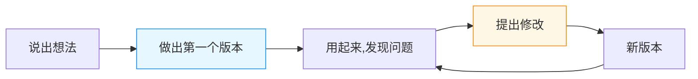
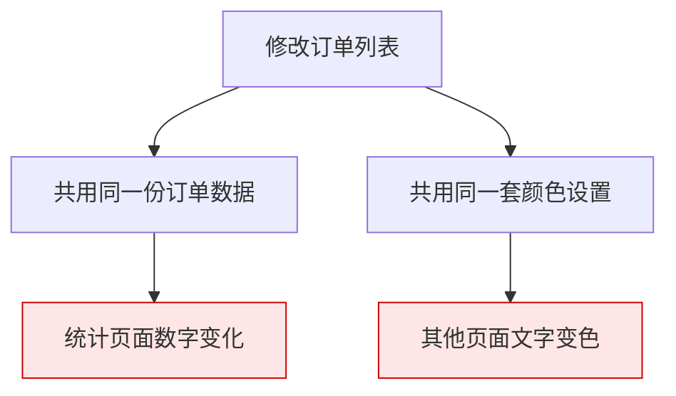
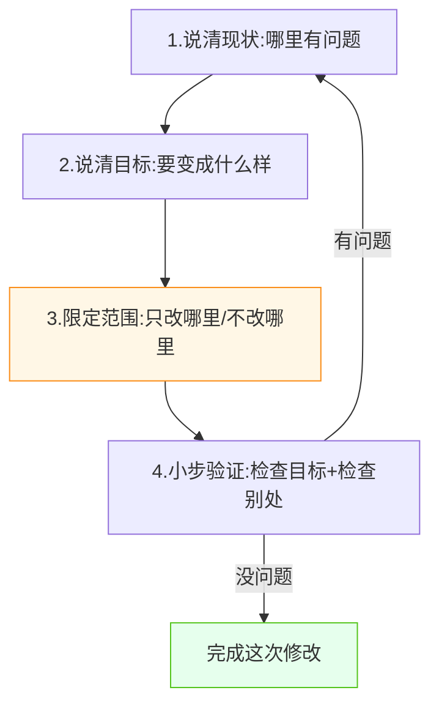

# 第13章 为什么修改软件比第一次开发更难

> 这一章要解决一个让很多初学者困惑的问题：软件明明做出来了，为什么改一下反而比从头做还难？答案不在你笨，而在软件本身"牵一发而动全身"，而且 AI 并不记得你心里想过的所有事。

## 本章你会学到

- 为什么软件不是"一次性生成"的，修改才是常态
- AI 为什么会改错地方、改一个功能为什么会连累其他功能
- 什么是"上下文"，为什么 AI 会"忘记"之前的要求
- 为什么不能动不动就推倒重做
- 修改软件的正确思路：说清现状、说清目标、限定范围、小步验证


*图：软件在反复修改中成型*

### 引子：改一行字，怎么把软件改坏了

林小满的花店小助手做好有一阵子了。记订单、算提醒、看列表，她用得很顺手。这天她觉得提醒的颜色太淡，看不清，就对 AI 说：

**你：** 把提醒的颜色改成红色。

**AI：** 好的，已把所有页面的提醒文字改成红色。

林小满刷新一看，愣住了——不光订单列表，连"新增订单"页的提示、"统计"页的说明，全变成红的了。整块屏幕红彤彤的，像一片警告。她其实只想改列表里那两个字。

她有点沮丧："第一次做的时候挺顺利的，怎么改一下反而乱套了？"

这不是她的问题。第一次开发时，软件是"从无到有"，你可以随便定；修改时，软件已经是一个**互相连着的整体**，你动一个地方，别的地方可能被带着动。再加上 AI 记不住你之前说过的话，就更容易改偏。

这一篇（第四篇）就是专门解决这件事的。它可能是全书**最有价值**的一篇——因为现实中，软件做出来只是开始，真正花时间的，是一次又一次的修改。学会修改，你才算真正会用 AI 开发软件。

## 13.1 软件开发不是一次性生成

很多新手心里有个误会：软件应该像"变魔术"一样，一句话生成一个完美的成品，从此不用再动。

真实情况完全不是这样。

**软件是"长"出来的，不是"一次性生成"的。** 就像你种一棵树，刚种下时是棵小苗，之后要浇水、修枝、扶正，它才慢慢长成你想要的样子。第一次做出来的，只是一个"能用"的版本——林小满的列表能显示订单，但"剩余天数"藏在详情页里要点进去才看得到；提醒颜色是系统默认的淡灰色。这些"不太满意"的地方，都要靠后面的修改来完善。

为什么不能一次到位？

- **你的想法会变**。做之前你以为够用了，用起来才发现"要是还能……就好了"。
- **你一开始说不全**。第一次你很难把所有细节都讲清楚，很多需求是看到成品才想到的。
- **情况会变**。节日换了、业务改了、手机屏幕换了，软件也得跟着变。



所以，把"修改"当成开发的**正常环节**，而不是"失败的补救"。一个软件被修改十次、二十次，都很正常。你要学的，正是怎么让每一次修改都改对地方。

## 13.2 为什么 AI 经常改错地方

回到林小满的例子。她说"把提醒改成红色"，AI 却把全站都改红了。问题出在哪？

**因为"提醒"这个词，在软件里不止一个地方。** 列表页有提醒、详情页有提醒、新增页也有提示文字。AI 看到"提醒"，就把它能找到的"所有提醒"都改了。它没做错——你说的是"提醒"，它改的确实是"提醒"。错在**你说得太宽，而你想得太窄**。

这就像你对装修师傅说"把灯换成暖色的"，他会把全屋的灯都换了；而你其实只想换卧室那盏。**不是师傅不听话，是你没说清"哪一盏"。**

AI 改错地方，通常有三个原因：

| 原因 | 表现 | 你的对策 |
|---|---|---|
| 说法太笼统 | "改一下""优化一下" | 说清具体是哪个页面、哪个元素 |
| 一个词对应多处 | "提醒"在很多页面都有 | 加上限定，如"订单列表页里的提醒" |
| AI 自己"顺手"扩展 | 改一处，连带"优化"相关的地方 | 明确说"只改这里，其他不动" |

看一组对比：

**❌ 错误的改法**

**你：** 把提醒改成红色。

**AI：** 好的，已把全部页面的提醒文字改成红色。（结果：全站变红，超出预期）

**✅ 正确的改法**

**你：** 只改"订花列表"这一页。把这一页里、每个订单那行显示的"还有 N 天提醒"这行文字，改成红色并加粗。其他页面、其他文字一律不要改。

**AI：** 明白。我只修改订花列表页中，每条订单对应的"剩余天数提醒"文字，改为红色加粗；新增页、详情页、统计页和其他所有文字保持不变。

区别在哪？正确的说法里，多了一样东西：**范围**。它告诉 AI"改哪里"和"不改哪里"。这是修改指令最重要的两个零件，后面第14章会专门展开。

## 13.3 为什么改一个功能可能影响其他功能

比"改错地方"更隐蔽的，是"改对了地方，却连累了别处"。

打个比方。软件像一栋房子：房间（页面）之间共用着水电管线（数据、共用代码）。你改造厨房，把水管挪了个位置，结果卫生间的水压变小了——你根本没碰卫生间，但它和厨房共用一根水管。

软件里也是如此。比如"订单列表"和"统计页面"用的是**同一份订单数据**。你为了让列表显示得更快，改了数据的读取方式，没想到统计页面的数字跟着算错了。再比如"提醒颜色"和"普通文字颜色"共用一个设置，你改了提醒颜色，普通文字也变了色。



这说明一件事：**你看着改的是一个功能，其实它可能和别的功能连着。** 所以修改时不能只盯着眼前那一处，还要想着"谁和它共用东西"。

这也是为什么我们反复强调两件事：

1. **改之前先问 AI："这个功能被哪些地方用到？"** 先搞清楚关联，再动手。
2. **改之后要检查："其他地方有没有被影响？"** 别假设它没影响，要实际看一眼。

好消息是：这些"关联"你不需要自己搞懂，你可以让 AI 帮你查。你的责任是**想到要问**——这才是关键。

**你：** 我准备修改订单列表的显示方式。在动手之前，请先帮我查一下：订单列表用到了哪些数据、这些数据和哪些页面或功能是共用的？只做分析，先不要改任何代码。

**AI：** 我查了一下：订单列表、订单详情、统计页共用同一份订单数据；其中统计页的"本月订单数"依赖列表的读取结果。如果改列表的数据读取方式，统计页可能受影响。建议改的时候保留原读取方式，只新增显示逻辑。要我按这个思路改吗？

看，**先分析、再动手**，就能提前避开"连累别处"的坑。第16、17章还会把这种方法讲得更细。

## 13.4 什么是上下文

前面反复提到一个词："AI 记不住"。要理解这件事，先得认识一个概念——**上下文（context）**。

上下文，简单说就是**AI 当前"看得见"的所有信息**。你可以把它想象成 AI 面前的一张桌子：你在这次对话里说过的话、AI 回复过的话、上传的截图、贴的代码，都摆在这张桌子上。AI 只能根据桌上的东西干活，桌上没有的，它就不知道。

打个比方。你请一个装修师傅来改房子，但他是个**只能看到眼前这张桌子**的师傅——桌上摆着什么图纸，他就按什么图纸干。你之前在电话里说过的话，如果没写下来放到桌上，他就不知道。所以你得不断把"重要的要求"重新摆到桌上，他才会照做。

这张"桌子"有两个特点，特别重要：

1. **它有大小限制**。桌子就那么大，东西摆满了，新东西上来，旧的就被挤下去。对话越长，早期的内容越容易被挤掉。
2. **它只装"这次对话"里的东西**。你上次聊天时定的规矩，这次新开一个对话，桌上就没有了。

| 摆在"桌子"上（AI 看得见） | 没摆上（AI 看不见） |
|---|---|
| 本次对话里说过的需求 | 你心里想但没说出口的要求 |
| 刚发的截图、贴的代码 | 上次对话里定的规矩 |
| 前面几轮修改的记录 | "大家都懂"的隐含约定 |

理解上下文，你就明白：**为什么你"以为 AI 知道"，它却偏偏不知道。** 因为它真的没看见。这不是它笨，是它只能看见桌上的东西。

所以有一个好习惯：**每次提出修改时，把关键信息重新说一遍**——哪怕你觉得"前面说过了"。把重要的东西主动摆到桌上，AI 才不会漏掉。

## 13.5 为什么 AI 会忘记之前的要求

理解了上下文，就很容易懂"AI 为什么会忘"。

你第一次做软件时说过："提醒提前一天就好。"当时这句话摆在桌上，AI 照做了。可你们后来又聊了几十轮：改列表、加按钮、接地图、调颜色……桌子上的东西越堆越多，最初那句"提前一天"被挤到了桌子底下，AI 看不见了。于是当你让它"加个节日提醒"时，它自作主张用了"提前三天"——因为它已经忘了你定过的规矩。

**AI 不是故意忘，是那条信息被新内容挤出上下文了。** 就像你同时记太多事，早先的小约定自然会淡忘。

还有一种"忘记"更隐蔽：**新开的对话**。你昨天和 AI 聊了两小时把软件做好，今天新开一个对话让它改东西——在它眼里，这是一个全新的软件，它对你昨天定的所有规矩一无所知。

怎么防？三个办法，从省事到稳妥：

1. **重要要求写进"档案"**。让 AI 把关键规则整理成一份简短清单（比如"本项目固定规则"），以后每次修改都把这份清单贴给它。这就像把约定写在纸上，每次都带上。
2. **修改时重申相关要求**。这次修改涉及提醒，就顺带说一句"提醒仍是提前一天，不变"。
3. **开新对话时先"交班"**。把软件现状、已定规矩、当前要改什么，一次性说清楚，相当于给新来的师傅做交接。

**你：** 我们之前定过几条规矩，我怕忘记了。请你把所有已经确定的规则整理成一份简短清单：包括提醒提前几天、用哪些颜色、哪些页面不能随便改等。以后我每次让你改东西，都会把这份清单发给你，你要严格遵守。先只做整理，不要改代码。

**AI：** 好的，已整理出固定规则清单：1）提醒提前1天，不变；2）提醒颜色仅在订单列表页为红色加粗；3）统计页数据口径不得改动……以后你发来这份清单时，我会先核对它再执行修改。

把这份清单存好，它就是你的"软件说明书"，后面第17章的"修改记录"还会用到它。

## 13.6 为什么不能随意推倒重做

改来改去改乱了，很多人第一反应是："算了，推倒重做吧，反正 AI 做得快。"

**这是一个很诱人、但常常很危险的想法。**

为什么危险？因为你的软件里，藏着大量**看不见的"隐性知识"**——这些是你在一次又一次修改中积累出来的，AI 不知道，甚至你自己都快忘了：

- 你试过好几种提醒时间，最后定下"提前一天"最合适；
- 你发现某个颜色在特定屏幕上不清楚，才改成现在这样；
- 你踩过"统计数字算错"的坑，才定下"统计口径不能动"的规矩。

这些经验，都藏在现在这版软件里。推倒重做，意味着把它们**全部清零**，然后重新踩一遍所有的坑。就像你住了三年的房子，哪里冬天漏风、哪块地板踩上去会响，你都摸清楚了；推倒重建，这些"住出来的经验"全没了，新房又得重新摸索一遍。

而且，软件里还有**真实的数据**：林小满几百笔客户订单、地址、电话，全在里面。推倒重做，这些数据怎么办？搬错了、丢了，都是真金白银的损失。

那什么时候可以重做？只有两种情况：一是软件还处在很早期、几乎没数据、结构也乱到没法改了；二是你有完整的备份和清晰的需求清单，能把重要的东西都带过去。**除此之外，优先考虑"改"，而不是"重做"。**

| 情况 | 建议 |
|---|---|
| 结构清楚、只是有小毛病 | 改，别重做 |
| 有数据、有积累的经验 | 一定要保住，改优于重做 |
| 早期原型、没数据、结构混乱 | 可以考虑重做 |
| 决定重做 | 先备份数据、整理需求清单再动手 |

## 13.7 修改软件的正确思路

把前面所有内容收拢起来，修改软件其实就有一条清晰的思路，四步：

**第一步：说清现状（现在是什么样）**
先描述"现在的问题出在哪"，最好带上位置、现象，能截图就截图。例："订单列表页里，提醒文字是淡灰色，看不清。"

**第二步：说清目标（想要变成什么样）**
明确描述你期望的结果，越具体越好。例："把它改成红色、加粗。"

**第三步：限定范围（哪些能动、哪些不能动）**
这一步最容易被忽略，却最重要。明确说"只改这一页""其他地方不要动"。例："只改订花列表页，其他页面和文字都不动。"

**第四步：小步验证（改完检查、分批进行）**
一次只改一个问题，改完立刻检查：目标达到了吗？别处有没有被影响？确认没问题，再进行下一处。



这四步，就是后面三章的骨架：

- 第14章，把"怎么说清一次修改"拆解到极致——这是第一步到第三步的详细方法；
- 第15章，专讲"改界面"——最容易改坏、也最容易验证的一类修改；
- 第16章，专讲"改功能"——风险最高、最需要防连累的一类修改；
- 第17章，专讲"怎么一步步改、怎么记录和验收"——把第四步落到实处。

记住一句话：**修改软件不是"让 AI 随便改改"，而是"你把现状、目标、范围讲清楚，让 AI 精确执行，再自己验收"。** 你从"提需求的人"，变成了"把关修改的人"。这正是这一篇要练出来的能力。

## 常见坑

- **坑：觉得"改一下"一句话就够了。** 为什么：AI 只能看见你说的，看不见你心里想的，"改一下"太笼统，它只能猜，一猜就偏。怎么做：按"现状—目标—范围"三步说清，宁可多写两句。
- **坑：改完不看，接着提下一个要求。** 为什么：错误会累积，改坏了没发现，越往后越乱。怎么做：一次改一个，改完立刻检查，确认没问题再继续。
- **坑：一动不如一"推倒重做"。** 为什么：会丢掉数据和多次修改积累的隐性经验，还可能重新踩坑。怎么做：除非早期原型且无数据，否则优先改；实在要重做，先备份、先整理清单。
- **坑：以为 AI 记得之前所有的约定。** 为什么：上下文有限，长对话会挤掉旧信息，新对话更是一片空白。怎么做：把关键规则整理成清单，每次修改都贴上；开新对话先"交班"。
- **坑：以为"改对了地方"就没事了。** 为什么：功能之间共用数据和设置，改一处可能连累别处。怎么做：改前问 AI"这个功能被谁共用"，改后检查"别处有没有被影响"。

## 本章小结

- 软件是"长"出来的，修改是开发的正常环节，不是失败的补救。
- AI 改错地方，多是因为你说得太宽、它想得太窄；"范围"是修改指令最重要的零件。
- 功能之间共用数据和设置，所以改一处可能连累别处；改前问关联、改后查影响。
- 上下文是 AI 当前看得见的信息，桌子有限、只装本次对话，所以它会"忘记"早先的要求。
- 别轻易推倒重做——那会丢掉数据和隐性经验；正确思路是：说清现状、说清目标、限定范围、小步验证。

## 动手练习

1. 想一个你曾经"改了 A 却坏了 B"的经历（软件、文档、表格都行），用"共用东西"的角度分析一下：A 和 B 之间可能连着什么？
2. 找一段你和 AI 的旧对话，看看最早提的那条要求，AI 后来还记不记得。如果没有，试着把"固定规则清单"整理出来，看看该列哪几条。
3. 把你花店小助手（或你自己的小项目）里"最不能改错"的三处地方写出来，并说明为什么——这就是你以后每次修改都要重点保护的对象。
4. 把下面这句笼统的修改要求改写成"现状—目标—范围"三段式："把界面弄好看点。"

## 可复制的指令模板

**模板一：修改前先分析关联，别急着动手**

```text
我准备修改软件的某个地方，但怕影响其他功能。在动手之前，请先只做分析，不要改任何代码：

我要改的是：[描述要改的地方，例如：订单列表页的提醒文字颜色]

请帮我查清楚：
1. 这个地方用到了哪些数据、设置或共用代码？
2. 这些数据 / 设置还被哪些页面或功能用到？
3. 如果我按我的想法改，最可能连累到哪些地方？
4. 你建议怎么改，才能既达到目的、又不影响别处？

先只给我分析结论和建议，等我确认后再动手改。用大白话说。
```

**模板二：把已定规矩整理成"固定规则清单"**

```text
我们合作到现在，已经定下了不少规矩。为了避免以后修改时忘记，请你把目前所有已经确定的规则，整理成一份简短清单。

要求：
1. 包括：数据口径、提醒规则、颜色样式、页面约定、明确说过"不能改"的地方等；
2. 每条一行，写得简短、明确、不含糊；
3. 用"[固定规则清单] ……"开头，方便我以后复制粘贴发给你；
4. 只做整理，不要修改任何代码。

以后我每次让你改东西，都会把这份清单贴在指令最前面，请你务必先核对清单，再执行修改。
```
