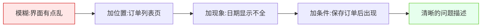
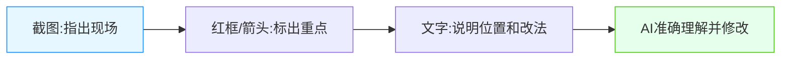

# 第14章 如何准确告诉 AI 修改什么

> 上一章讲的是"为什么改容易改错"，这一章讲的是"怎么改才能改对"。核心只有一句话：把一次修改说成一个**具体的小任务**，而不是一句模糊的感叹。

## 本章你会学到

- 为什么"改一下""优化一下"这类话必然改偏
- 描述一次修改的六个要素：位置、现状、目标、范围、禁区、行为
- 怎么用截图和具体例子，把"说不清"变成"看得见"
- 如何套用一个高质量修改指令模板

### 引子：一句话引发的"灾难"

林小满吸取了教训，知道要说具体点。这天她想调整订单列表，于是说：

**你：** 把订单列表优化一下。

**AI：** 好的。我已经：把列表按客户名排序、字体调大、每行加了删除按钮、把背景换成了蓝色、并新增了搜索框。

林小满眼睛都直了："我……我只是觉得日期那列太窄，想让它宽一点啊。"

她以为"优化一下"是客气话，AI 却把它当成了一张**任务清单**——凡是能"优化"的，它都做了。

问题不在于 AI 不听话，而在于"优化一下"这四个字里，**信息量几乎为零**。AI 只能靠猜，而它一猜，就会往"多做点"的方向猜。

这一章，我们就把"怎么把一次修改说清楚"拆成可以照着填的零件。学会之后，你发出的每一条修改指令，都能像快递单一样精确——地址写到门牌号，而不是写到"大概那个小区"。

## 14.1 不要只说"改一下"

先立一条规矩：**任何不带具体信息的修改要求，都不要发出去。**

"改一下""调一调""弄好看点""优化一下""完善一下"——这些话听起来很自然，但对 AI 来说，它们等于什么都没说。因为：

- 它不知道**改哪里**（哪个页面、哪个元素）；
- 它不知道**改成什么样**（你要的结果）；
- 它不知道**改到哪里为止**（边界在哪）。

于是它只能拿"通用优化方案"来糊弄：字体加大、颜色调整、加个按钮、加个搜索……看起来很勤快，其实全不是你要的。

**❌ 错误的改法**

**你：** 界面不太好看，改一下。

**AI：** 好的，我已把主色调改为蓝色、按钮改为圆角、加大标题字号、并给卡片加了阴影。你看看满意吗？（结果：改了一堆，没一处是林小满想要的）

**✅ 正确的改法**

**你：** 我只想改一件事：把"订花列表"这一页里，"送达日期"这一列太窄、日期显示不全的问题解决。请把这一列加宽到能完整显示"2026年5月10日"这种格式。其他列、其他页面、字体颜色都不要改。

**AI：** 明白。我只加宽订花列表页的"送达日期"列，让它能完整显示完整日期；其他列、其他页面、字体和颜色都不变。

看出规律了吗？正确的说法里，藏着六个信息零件。**只要把这六样凑齐，AI 几乎不会改错。**

| 要素 | 它回答的问题 | 例子 |
|---|---|---|
| 位置 | 改哪里？ | 订花列表页的"送达日期"列 |
| 现状 | 现在有什么问题？ | 列太窄，日期显示不全 |
| 目标 | 想变成什么样？ | 能完整显示"2026年5月10日" |
| 范围 | 哪些能动？ | 只动这一列 |
| 禁区 | 哪些不能动？ | 其他列、其他页面、字体颜色 |
| 行为 | 改前改后分别什么样？ | 改前显示不全，改后完整显示 |

接下来几节，我们一个一个拆开讲。

## 14.2 如何描述当前的问题

描述问题，最忌讳用形容词，要用**现象**。

"太难看了""不太好使""有点乱"——这些是形容词，每个人理解不同。你要说的是**你眼睛看到的具体现象**：哪里、显示成什么样、和期望差在哪。

好用的公式是：**在【位置】，当我【做什么】，就出现【什么现象】。**

**你：** 在"新增订单"页，当我填写送达日期并保存后，列表里这一行的日期显示成"2026/05/10"，但我想显示成"5月10日"这样的中文格式。

**AI：** 明白了：新增订单保存后，列表里日期显示格式不对。我会把列表里的日期统一改成"X月X日"的中文格式。

描述问题时，三个小技巧：

1. **说位置，不说"这个软件"**。"订单列表页第三列"比"这个列表"精确十倍。
2. **说现象，不说"不好"**。"数字显示成 6 月 10 日"比"日期不对"有用得多。
3. **说触发条件**，如果需要特定操作才出现：填了某个值、点了某个按钮、在某个页面。



## 14.3 如何描述期望的结果

说完问题，接着说"你想要什么"。这里的关键是：**用结果说话，不用过程说话。**

你不需要告诉 AI"改哪段代码""用什么方法"，那是它的活。你只要说清**最终看到的样子**。

**❌ 描述过程（不好）**

**你：** 把日期字段格式化一下，用 Date 对象转换后再渲染。

（这是教 AI 怎么做，你其实不必懂这些，说错了反而添乱。）

**✅ 描述结果（好）**

**你：** 我希望列表里每个订单的送达日期，显示成"5月10日"这样的中文格式，不要显示年份，不要显示斜杠。

**AI：** 好的，我会让列表里的日期显示为"X月X日"格式。

描述结果时，注意三点：

- **给出具体的样子**。写"5月10日"，而不是"中文格式"——前者没有歧义。
- **说清几个例外**。比如"如果跨年，显示'明年1月5日'"——想到就说，别等 AI 猜。
- **一次一个目标**。这一条指令只解决日期显示，别顺带说"顺便把颜色也改了"。

## 14.4 如何描述修改范围

范围，就是告诉 AI"你的手可以伸到哪里"。这是防止改错最有效的一招。

三种常用的圈范围方式，按精确度从低到高：

1. **按页面圈**："只改订花列表页。"
2. **按元素圈**："只改这一页里'送达日期'这一列。"
3. **按状态圈**："只改列表里'待送花'状态的订单行，已完成的订单行不动。"

**你：** 请只修改"订花列表"页里"送达日期"这一列的显示格式。范围仅限这一列：不要改表头、不要改其他列、不要改详情页、不要改新增订单页。

**AI：** 收到，修改范围仅限订花列表页的"送达日期"列，其余一律不动。

一个非常实用的句式，建议你背下来：

> **"只改【A】，不要改【B、C、D】。"**

每次修改都用这个句式开头，AI 就很难跑偏。

## 14.5 如何描述不能修改的部分

"禁区"是范围的另一面：范围说"能改哪"，禁区说"绝对不能碰哪"。

为什么禁区要单独强调？因为 AI 有个倾向：改一个东西时，喜欢"顺手"把相关的也优化一下。你越明确地说"这些不能动"，它越不敢乱伸手动你的宝贝功能。

禁区怎么找？想想你的软件里，哪些是"改坏了最心疼"的：

- **数据口径**：统计页的"本月订单数"怎么算的，不能动；
- **已确认的样式**：提醒红色是反复调出来的，不能动；
- **关键流程**：下单保存的流程，最好别碰；
- **已经能用的功能**：客户搜索功能用得好好的，别顺手"优化"。

**你：** 这次修改有一条硬性禁区：统计页的"本月订单数"计算方式绝对不能改，它的口径我们不能动。另外，"新增订单"的保存流程也不要碰。只改列表页日期列的显示。完成后请明确告诉我：统计页和保存流程是否完全没动。

**AI：** 明白。禁区已记录：统计页"本月订单数"口径、新增订单保存流程，均不修改。我只改列表页日期列显示，完成后会逐项确认这两处未受影响。

看最后那句——**要求 AI 完工后逐项确认禁区没动**。这招特别管用，它逼着 AI 在交付前去检查一遍。

## 14.6 如何描述修改前后的行为

有时候，光说"改成什么样"还不够，最好把"改之前"和"改之后"摆在一起对比。这叫**描述前后行为**，能让 AI 百分百理解你的意图。

公式很简单：

> **改之前：【现在的行为】；改之后：【我要的行为】。**

**你：** 改之前：点击订单列表里某一行的"查看位置"，会在新标签页打开地图，还得再点一次才能定位。改之后：点击"查看位置"，直接在同一页面弹出地图并定位到该地址，不再开新标签页。只改这一个按钮的行为，其他按钮不变。

**AI：** 明白。"查看位置"按钮由"新标签页打开地图并需二次点击"改为"当前页面弹窗并直接定位"，其他按钮行为不变。

前后对比特别适合这几类修改：

| 修改类型 | 为什么要给前后对比 |
|---|---|
| 按钮 / 交互行为 | 行为看不见，对比最清楚 |
| 数据格式 | 给出旧格式和新格式的例子 |
| 业务规则 | 规则改了，"旧规则 vs 新规则"一目了然 |
| 提示文案 | 直接给出"原文字 → 新文字" |

一张对比表，胜过十句形容词。

## 14.7 如何使用截图辅助修改

有些问题，"说"一百句不如"指"一下。**截图就是你的手指。**

尤其适合这些情况：界面布局乱了、某个元素位置不对、颜色字体说不清、报错信息看不懂。截图一发，AI 直接看到现场。

发截图时，**一定要配一句话说明"看哪里"**，否则 AI 可能盯着整张图瞎猜：

**你：** （附截图）请看截图里我用红框圈出的地方：订单列表最后一列"操作"下面，"删除"按钮和"编辑"按钮挤在一起、文字重叠了。请让这两个按钮上下排列，中间留出间距。只改这一列的按钮布局，其他列不动。

**AI：** 看到了，红框处两个按钮确实重叠。我会把"编辑"和"删除"按钮改为上下排列并留出间距，只改订单列表最后一列的按钮布局。

截图使用三个技巧：

1. **圈出来**。用红框、箭头标出重点，别让 AI 自己找。
2. **说清截图内容**。告诉它这是哪个页面、哪一步的截图。
3. **截图 + 文字双管齐下**。截图负责"指哪"，文字负责"改啥"，缺一不可。



## 14.8 如何使用具体示例辅助修改

和截图对应，对于**数据和格式类**的修改，"举例子"比"讲规则"更好用。

比如你说"日期要显示成中文格式"，AI 可能给你"2026年5月10日"，也可能给你"五月十日"。但如果你直接给出例子，就没有歧义。

**你：** 日期显示格式我想改成这样，给你三个例子对照：
- 改之前：2026-05-10
- 改之后：5月10日
- 跨年的例子：改之前 2027-01-05，改之后显示"明年1月5日"

请按这个规则改列表里所有订单的送达日期显示。只改显示格式，不改实际存储的数据。

**AI：** 明白，按你给的例子：日期显示为"X月X日"，跨年显示"明年X月X日"。只改显示格式，存储数据不变。

举例子的两个要点：

1. **给"输入 → 输出"的对照**，让 AI 照葫芦画瓢；
2. **覆盖边界情况**，比如空值、跨年、超长文字——这些最容易出岔子，往往举一两个例子就省了后面十分钟的解释。

## 14.9 一个高质量修改指令的模板

把前面所有零件拼起来，就是一条高质量的修改指令。它长这样：

```text
【位置】要改的是哪个页面、哪个元素？
【现状】现在有什么问题？（现象 + 触发条件，最好配截图）
【目标】想改成什么样？（给出具体样子，最好配例子）
【范围】只改哪些？（按页面/元素/状态圈定）
【禁区】绝对不能改哪些？（改完请逐项确认）
【行为】改前 → 改后的对比（涉及交互、规则、格式时）
【验收】改完请告诉我做了什么，并确认禁区没动
```

实战走一遍：

**你：**
- 【位置】订花列表页，"送达日期"这一列。
- 【现状】这一列太窄，日期"2026-05-10"显示不全（见截图红框）。
- 【目标】列加宽，日期显示为"5月10日"，跨年显示"明年1月5日"（见下面例子）。
- 【范围】只改这一列的宽度和日期显示格式。
- 【禁区】表头文字、其他列、详情页、统计页、新增订单页都不改；统计页"本月订单数"口径绝对不能动。
- 【行为】改前：2026-05-10 显示不全；改后：5月10日 完整显示。
- 【验收】改完请说明改了什么，并逐项确认禁区未受影响。

**AI：** 收到。我只加宽订花列表页"送达日期"列，并按示例把日期显示为"X月X日"（跨年显示"明年X月X日"）。表头、其他列、详情页、统计页、新增订单页均不改，统计口径保持不变。完成后我会逐项确认。

这就是一条"快递单式"的修改指令：地址精确到门牌号，AI 想送错都难。

你会发现，写这样一条指令要花一两分钟，但它能省掉来回扯皮的十几分钟。**前期多写几句，后期少改十次。** 这是修改软件最划算的投资。

## 常见坑

- **坑：用"优化一下""弄好看点"当指令。** 为什么：这些词信息量为零，AI 只能靠猜，一猜就多做。怎么做：换成"位置+现状+目标"的具体描述。
- **坑：只说要改成什么，不说不能改什么。** 为什么：AI 爱"顺手"优化相关功能，容易碰到你的宝贝功能。怎么做：明确列出禁区，并要求完工后逐项确认。
- **坑：发截图但不说话。** 为什么：AI 不知道的重点在哪里，会盯着整张图瞎猜。怎么做：截图配红框/箭头，再配文字说明"看哪里、改什么"。
- **坑：用形容词描述问题。** 为什么："有点乱""不太对"每人理解不同。怎么做：用现象和例子，说"显示成什么样"，而不是"好不好"。
- **坑：一条指令塞好几个修改。** 为什么：改错了分不清是哪个出问题，也难验收。怎么做：一次一个目标，改完验收再发下一条（第17章详讲）。

## 本章小结

- "改一下""优化一下"等于没说：AI 只能猜，一猜就跑偏。
- 一条高质量修改指令有六个要素：位置、现状、目标、范围、禁区、行为；最后加一条"验收要求"。
- 描述问题用现象不用形容词；描述目标用结果不用过程；描述范围用"只改A、不改B"。
- 禁区要单独列，并要求 AI 完工后逐项确认"没动"。
- 截图是"手指"（指出现场），例子是"样板"（消除格式歧义），两者配合文字使用效果最好。

## 动手练习

1. 把这三句模糊要求改写成六要素齐全的具体指令：①"把界面改好看点"；②"搜索功能不好使，修一下"；③"提醒时间改改"。
2. 打开你的花店小助手，找一处界面问题，拍一张截图，用红框圈出问题，再写一段"截图 + 文字"的修改指令。
3. 针对"日期显示格式"的修改，写出三组"改前 → 改后"的例子，其中至少一组是边界情况（跨年、空值或超长）。
4. 用 14.9 的模板，把你最近一次想做但还没做的修改，写成一条完整指令，然后发给 AI，看它的回复是否和你预期一致。

## 可复制的指令模板

**模板一：万能修改指令（六要素 + 验收）**

```text
我要修改软件的一个地方，请严格按下面执行：

【位置】要改的是：[哪个页面 / 哪个元素]
【现状】现在的问题是：[描述具体现象；如果需要特定操作才出现，请说明触发步骤]
（如需要，我会附上截图，并用红框圈出重点）
【目标】我想改成：[描述最终看到的样子，给出具体例子]
【范围】只改：[页面 / 元素 / 状态]，不要扩大到其他地方
【禁区】绝对不能改：[列出 1~3 处]
【行为】改之前是……；改之后是……（涉及交互或格式时填写）
【验收】改完请：1）说明你做了什么；2）逐项确认"禁区"里的每一处都没有被改动。

只做这一处修改，不要顺手优化其他东西。用大白话回复我。
```

**模板二：截图 + 例子辅助修改**

```text
我发了一张截图，请你先仔细看红框圈出的地方，那是我要改的位置。

截图说明：这是 [哪个页面] 的截图，问题是 [描述现象]。
我的要求：[描述要改成什么]。

另外，关于格式 / 数据，我给你几个例子，请照着改：
- 改之前：[旧的样子] → 改之后：[新的样子]
- 改之前：[旧的样子] → 改之后：[新的样子]
- 边界情况：[例如跨年 / 空值] → 应该显示为：[具体样子]

只改我指出的这一处，其他地方不要动。改完告诉我结果。
```
