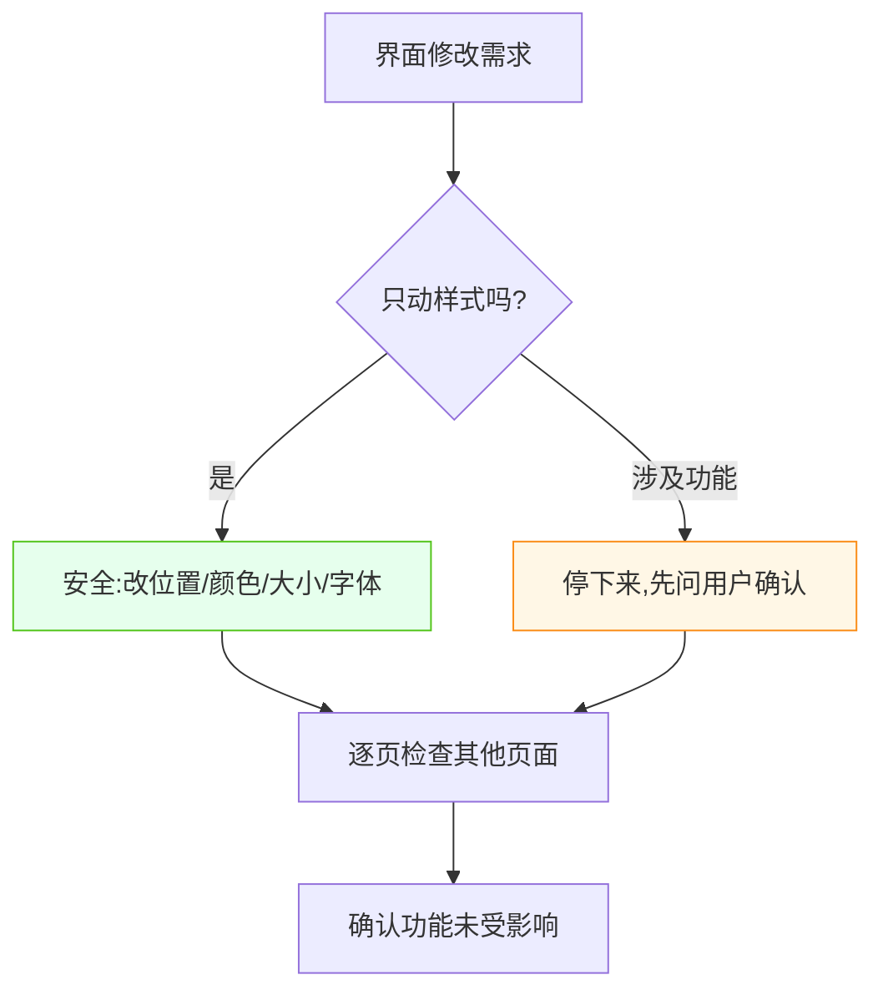
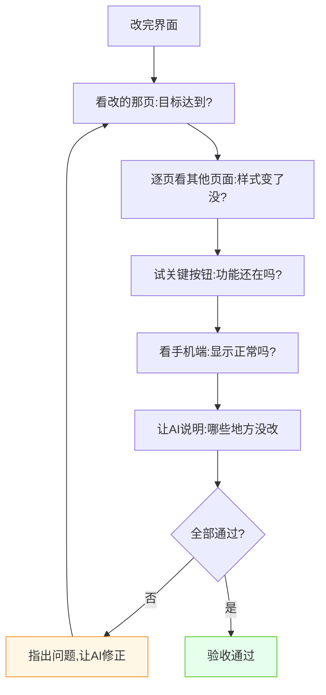

# 第15章 如何修改界面而不影响其他功能

> 界面是软件最容易改、也最容易"顺手改坏"的部分。这一章要让你学会：把界面修改锁在"看得见的样子"这一层，不碰背后看不见的功能，并且改完能一张一张页面检查过来。

## 本章你会学到

- 修改界面的基本原则：只动"样子"，不碰"功能"
- 布局、字体颜色尺寸、按钮交互分别怎么描述
- 手机上界面怎么调
- 怎么让 AI 只改指定页面
- 怎么验证其他页面没被连累

### 引子：改个菜单，结果订单保存不了了

花店小助手用了一段时间，林小满想让界面更好看些。她提了个要求：

**你：** 把侧边菜单改好看点，用大图标。

**AI：** 好的，我重新设计了侧边菜单：换成大图标、调整了菜单结构、并把菜单的显示逻辑重写了一遍。

林小满刷新后发现：菜单确实变好看了，可"新增订单"页面的保存按钮点了没反应。她一头雾水："我只是改个菜单啊，怎么订单都存不了了？"

问题就出在 AI "重写了菜单的显示逻辑"——它以为这是让菜单变好看的必要一步，结果动了控制页面切换的代码，把新增页的保存功能连带搞坏了。

界面修改有个特点：**它看起来只是"改样子"，但界面背后连着页面切换、数据展示、按钮动作这些真功能。** 改的时候如果不画条线，AI 很容易越过线，动到不该动的地方。

这一章就教你画这条线，并且改完怎么验收。

## 15.1 修改界面的基本原则

界面修改，记住一条总原则：

> **只改"看得见的样子"，不碰"背后的逻辑"。**

"样子"指的是：东西放在哪、什么颜色、多大、什么字体、怎么排列。"逻辑"指的是：数据怎么存、按钮点了执行什么、页面怎么跳转。

你要改界面时，就要把这句话写进指令里，给 AI 画好线：

**你：** 我要调整界面外观。原则：只改样式（位置、颜色、大小、字体、间距），不要改任何功能逻辑——不要动数据怎么存、按钮点了做什么、页面怎么跳转。只改指定的页面，其他页面不动。

**AI：** 明白，我只调整外观样式，不碰功能逻辑；只改指定页面，其他页面保持不变。

三条基本原则，展开说说：

1. **样式与功能分离**。你说的是"好看"，AI 就只该动样式。如果它需要动功能才能实现，让它**先问你**，别自己动手。
2. **一次改一类**。这次只改布局，就别顺便改颜色；一次一大堆，改坏了分不清是哪一个的问题。
3. **改完逐页检查**。界面是看得见的，所以验证特别简单——把相关页面挨个打开看一眼就行，别偷懒。



## 15.2 如何修改布局

布局，就是"东西放在哪、怎么排"。描述布局，最好用**相对位置 + 前后对比**，让 AI 像看示意图一样明白。

好用的说法：

- "把 A 从现在的第 2 列，移到最后一列。"
- "把这两个按钮从左右并排，改成上下排列。"
- "把搜索框从页面底部，移到页面顶部、标题的正下方。"
- "把卡片之间的距离加大，现在挤在一起。"

**❌ 错误的改法**

**你：** 列表布局调整一下，好看点。

**AI：** 好的，我把列表重新排版了：改了列的顺序、每列宽度、对齐方式，还调整了行高。（结果：林小满找不到的她要的那列跑哪去了）

**✅ 正确的改法**

**你：** 只调整"订花列表"页的表格布局，具体两点：1）把"送达日期"这一列从现在的第 3 列，移到最后一列（"操作"列之前）；2）把每一行的高度加大一点，让文字不那么挤。只调整这两处布局，列的宽度、字体颜色、其他列的内容都不改。

**AI：** 明白。我只做两处布局调整：把"送达日期"列移到"操作"列之前；行高加大。列的宽度、字体、颜色和其他内容不变。

一个小技巧：布局改动如果比较复杂，可以**用文字画个草图**给 AI：

**你：** 布局我想要这样（从上到下）：
- 顶部：标题"客户订单"
- 第二行：搜索框（占满整行）
- 第三行：一个按钮"新增订花"（靠右）
- 下面：订单表格

现在是搜索框在表格下面。请把搜索框和新增按钮移到表格上方，按上面的顺序排。只调整这几个元素的位置，不改样式和功能。

## 15.3 如何修改字体、颜色和尺寸

这类修改最容易说清楚，也最容易被"顺手全改"。关键是**给出具体值或具体样子**，并说清是"局部"还是"全局"。

**❌ 错误的改法**

**你：** 字体大一点，颜色醒目一点。

**AI：** 好的，我把全站字体加大到 18px，主色调改成红色。（结果：整站字体都变大、全变红，远超预期）

**✅ 正确的改法**

**你：** 只改一处：把"订花列表"页里，提醒文字（"还有 N 天"那几个字）改成红色、加粗，字号比现在大一号。页面其他文字的字体、颜色、大小都不改，其他页面也不改。

**AI：** 明白。只把订花列表页的提醒文字改为红色加粗、字号加大一号；其他文字和其他页面不变。

描述这类修改，三个要点：

1. **给出具体参照**。说"红色加粗"比"醒目"清楚；能给出具体字号（如"比现在大一号"）更好。如果你不懂字号数值，就用"比现在大一点/小一点""和标题一样大"这种相对说法。
2. **说清局部还是全局**。"所有页面的标题"是全局，"这一页的提醒文字"是局部。务必点明。
3. **一次只调一类**。这次调颜色，就别同时调字体和间距。

| 你想改的 | 推荐说法 | 避免的说法 |
|---|---|---|
| 颜色 | "改成红色" / "改成和按钮一样的蓝色" | "醒目一点" |
| 字号 | "比现在大一号" / "和标题一样大" | "大一点" |
| 粗细 | "加粗" / "去掉加粗" | "重点一点" |
| 间距 | "两个按钮之间留出距离" | "别挤在一起"（可作补充，但最好给具体描述） |

## 15.4 如何修改按钮与交互

按钮和交互，是最容易"改坏功能"的界面修改——因为按钮背后就是功能。改它时，一定要用**改前 → 改后的行为对比**把话说死，并强调"功能不变"。

**你：** 只改"新增订花"页上"保存"按钮的样式和位置，不改它的功能：
- 样式：改成绿色背景、白色文字、圆角；
- 位置：从页面中间移到页面底部中间；
- 功能：点击后依然保存订单、依然跳转到列表页——这些行为完全不变。

只改这个按钮的外观和位置，不要改它点击后执行的任何逻辑。

**AI：** 明白。我只调整"保存"按钮的外观（绿色、白字、圆角）和位置（页面底部中间）；点击后保存订单并跳转列表的行为完全不变。

交互类修改常见的几种，和描述要点：

| 交互 | 怎么描述 |
|---|---|
| 按钮位置 / 样式 | 给出新位置、新样式，并说"点击行为不变" |
| 点击效果 | 用"改前：…；改后：…"对比 |
| 禁用状态 | "当没填客户名时，保存按钮置灰、不可点" |
| 加载提示 | "点击保存后，按钮显示'保存中…'，防止重复点击" |
| 提示文案 | 直接给"原文 → 新文" |

**切记**：只要涉及按钮，就在指令里加一句"点击后执行的功能不变"。这句话是保命符。

## 15.5 如何调整移动端界面

同一套软件，在电脑上看和在手机上看，界面往往不一样——手机屏幕窄，表格容易挤成一团。这类修改要特别说明"是针对手机，还是电脑，还是两者"。

**你：** 我要调整手机上的显示，不动电脑端。需求：
1. 在手机上，订单表格改成卡片式显示——每个订单一张卡片，显示客户名、花材、送达日期，不再用横向表格，避免左右滑动；
2. 按钮在手机上加大一点，方便手指点；
3. 字体在手机上适当缩小，避免撑破屏幕。

电脑端的显示完全不变。请改完告诉我怎么在手机上预览确认。

**AI：** 明白，只调整手机端：表格改卡片、按钮加大、字体缩小；电脑端显示不变。做完后我会告诉你在手机上如何预览。

移动端修改的三个要点：

1. **说清针对哪个端**。不说，AI 可能两边都改。
2. **说明手机的特点**。屏幕窄、用手指点、可能看不清——告诉 AI 这些，它才好调整。
3. **要求给预览方法**。手机效果必须亲眼在手机上看，让 AI 告诉你怎么打开预览。

## 15.6 如何要求 AI 只修改指定页面

这是这一章最实用的招数：**动手前，先让 AI 报备它准备改什么。**

你在指令里加一句："在动手之前，请先列出你打算修改哪些地方，等我确认后再改。"这样 AI 会先给你一份"施工清单"，你一看就知道它会不会越界。

**你：** 我要改"订花列表"页的外观：把提醒文字改红色加粗。
在动手之前，请先做两件事，等我确认：
1. 列出你准备修改哪些文件或哪些位置；
2. 说明这些修改会不会影响其他页面。
我确认"只改这一页"之后，你再动手。

**AI：** 收到。我计划只改订花列表页的样式文件，把提醒文字设为红色加粗；不涉及数据逻辑，也不会影响其他页面。等你确认后我再执行。

如果 AI 的清单里出现了你不想让它碰的东西——比如"我会同时调整共用样式文件，因为这会影响所有页面"——你就立刻叫停，换一种只作用在这一页的做法。

**你：** 不行。共用样式会影响所有页面，超出我的要求。请换一种只作用于订花列表页的方式，不要改任何共用文件。先告诉我新方案，还是等我确认再动手。

**AI：** 好的，我改为只在订花列表页内部添加这一段样式，不动共用样式文件，其他页面不受影响。新方案如上，等你确认。

这招的本质，是**把"改之前"变成一道关卡**，由你把关。第17章的"先给计划再执行"也是这个思路。

## 15.7 如何验证修改没有影响其他页面

界面是看得见的，所以验证特别直白：**相关页面挨个打开看一遍。**

别只看你改的那一页——因为最怕的就是"改了 A 坏了 B"。按这份清单过一遍：

1. **看改的那一页**：目标达到了吗？（红了吗？加粗了吗？）和你要的一模一样吗？
2. **看相邻页面**：导航菜单里的其他页面，挨个点开看一眼，样式有没有莫名其妙变了。
3. **试关键功能**：在改过的页面上，点一下主要按钮（保存、新增、删除），确认功能还在。
4. **看手机端**：如果涉及手机，用手机打开确认。
5. **让 AI 自证**：要求 AI 在交付时明确说明"哪些没改"。



**你：** 修改完成请按这个清单自查，并把结果逐条告诉我：
1. 订花列表页的提醒文字是否已改为红色加粗？
2. 新增订单页、详情页、统计页的样式是否完全没变？
3. "保存"按钮功能是否仍然正常？
4. 手机端显示是否正常？
请不要只说"已完成"，要逐条给我确认结果。

**AI：** 自查结果：1）已完成，订花列表页提醒文字为红色加粗；2）新增订单页、详情页、统计页样式未改动；3）保存按钮功能正常；4）手机端显示正常。

养成这个习惯，你就不怕"改个菜单搞坏订单"了。**看得见的东西，就用眼睛验收；看不见的，才需要靠 AI 自查。**

## 常见坑

- **坑：让 AI "把界面改好看点"。** 为什么：范围无限大，AI 会把样式、结构、逻辑全动一遍。怎么做：说清"只改样式、不碰逻辑"，并限定具体页面和元素。
- **坑：改按钮时忘了说"功能不变"。** 为什么：按钮背后就是功能，AI 改样式时可能顺手改了点击行为。怎么做：每次改按钮都加一句"点击后执行的功能完全不变"。
- **坑：不说针对手机还是电脑。** 为什么：AI 可能两边都改，结果电脑端也乱了。怎么做：明确"只改手机端 / 电脑端不变"，并要求给预览方法。
- **坑：只盯着改的那一页看。** 为什么：最怕"改 A 坏 B"，别处变了你没发现。怎么做：按清单逐页检查、试关键按钮、让 AI 逐条自证。
- **坑：直接让 AI 改，不先报备。** 为什么：等它改完才发现动了共用文件，已经晚了。怎么做：动手前让它列出"准备改哪些地方"，确认没有越界再放行。

## 本章小结

- 界面修改的总原则：只改"看得见的样子"，不碰"背后的逻辑"；一次改一类，改完逐页检查。
- 布局用"相对位置 + 前后对比"描述，复杂时可以用文字画草图。
- 字体颜色尺寸要给具体参照、说清局部还是全局；按钮交互一定要强调"点击功能不变"。
- 移动端修改要说清针对哪个端，并要求给手机预览方法。
- 最实用的一招：动手前让 AI 报备"准备改哪些地方"，你确认后再改；改完按清单逐页验收。

## 动手练习

1. 把你花店小助手里"订花列表"页的提醒文字，写成一条"只改这一处、功能不变"的颜色字体修改指令。
2. 找一处按钮，写一条修改指令，要求同时改它的样式和位置，但明确写出"点击后功能不变"的保命句。
3. 针对手机端，写一条"表格改卡片式"的修改指令，明确说明"只改手机、电脑端不变"，并要求给预览方法。
4. 列出一份你自己的"界面修改验收清单"，至少包含：改的那页、相邻页面、关键按钮、手机端、AI 自证五项。

## 可复制的指令模板

**模板一：只改界面、不碰功能的通用指令**

```text
我要调整软件的界面外观，请严格遵守：

原则：只改样式（位置、颜色、大小、字体、间距），不要改任何功能逻辑——不要动数据怎么存、按钮点击后做什么、页面怎么跳转。

要改的是：[页面名] 里的 [具体元素]。
具体改法：[描述位置/颜色/大小等，给出具体样子或前后对比]。
范围：只改这一处。禁区：[列出不能改的其他页面/功能]。

在动手之前，请先列出你准备修改哪些地方，并说明是否会影响其他页面。等我确认后再执行。改完请逐条告诉我：1）目标是否达到；2）其他页面样式是否未变；3）关键功能是否正常。用大白话回复。
```

**模板二：按钮 / 交互修改（带保命句）**

```text
我要改一个按钮，但绝不能改它的功能：

要改的按钮：[页面名] 上的 [按钮名]。
外观改为：[颜色/形状/字号等]。
位置改为：[新位置]。
位置/样式可以这样描述（前后对比）：改之前是……；改之后是……

保命要求（最重要）：这个按钮点击后执行的功能必须完全不变——[说清它原本做什么，例如：保存订单并跳转到列表页]。不要改它的点击逻辑。

范围：只改这一个按钮，页面上其他按钮和功能都不动。改完请明确告诉我：点击功能是否和原来完全一样。
```
