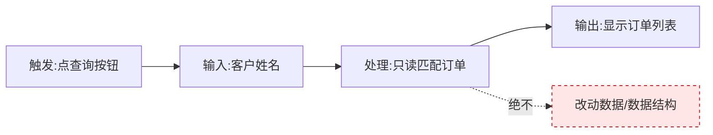
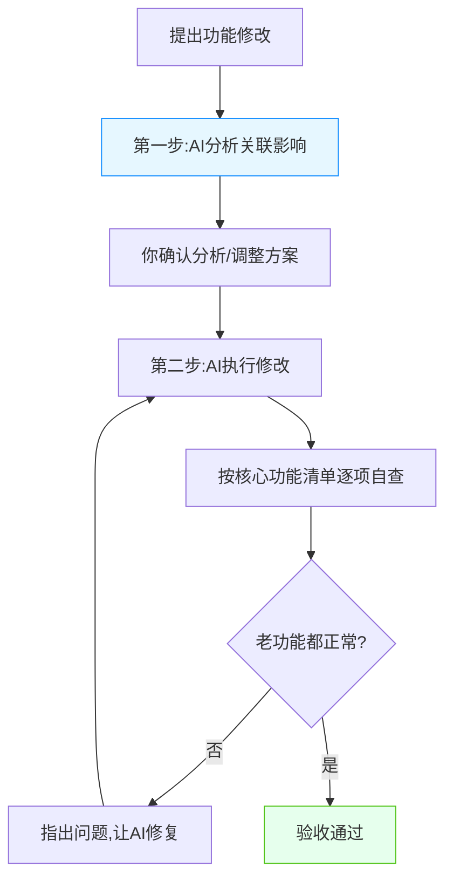

# 第16章 如何修改功能而不破坏原有功能

> 改界面坏了，一眼看得见；改功能坏了，常常要等几天才发现——而且可能已经写错了数据。这一章专讲风险最高的修改：怎么加、改、删功能，怎么改业务规则，还能让老功能一切照旧。

## 本章你会学到

- 为什么功能修改比界面修改风险高得多
- 怎么用"输入—处理—输出—触发"说清一个功能的边界
- 增加、修改、删除功能分别怎么提要求
- 怎么改变业务规则而不出乱子
- 怎么让 AI 检查关联影响、保住老功能

### 引子：加了个新功能，老订单全乱了

林小满的花店小助手越用越顺，她想加个新功能："按客户查历史订单"——输入客户名，列出这个客户所有订花记录。

**你：** 加个功能：输入客户名字，能查出这个客户所有的历史订单。

**AI：** 好的，我加好了，并且在订单数据表里新增了一个字段来加快查询。

林小满试了试，新功能能用。可第二天她发现：老订单的"送达日期"全变成了空！原来 AI 加的那个"新字段"，改动了订单数据的结构，把老数据弄乱了。

她后背一凉："我就加个查询功能，怎么把老数据搞坏了？"

这就是功能修改的可怕之处：**界面改坏了顶多难看，功能改坏了会动到数据，而数据一旦错了，往往很难发现、很难恢复。**

功能修改的原则，和界面修改正好相反：界面是"只动样子、不碰逻辑"，功能是"**只加新能力、保住老数据和老流程**"。这一章就教你做到这一点。

## 16.1 修改功能的风险

为什么功能修改这么危险？因为它碰的是软件的"内脏"，不是"脸面"。

| 风险 | 说明 | 后果 |
|---|---|---|
| 动到数据 | 改了数据表结构、字段含义 | 老数据错乱、丢失 |
| 动到流程 | 改了"下单—保存—提醒"的链条 | 整个业务流程走不通 |
| 隐性依赖 | 你不知道 A 功能依赖 B 功能 | 改 B 时 A 悄悄坏了 |
| 发现滞后 | 功能错误常常不会立刻报错 | 几天后才发现，数据已错 |

界面坏了你马上看见；功能坏了，可能某天客户打电话来问"我上次订的花怎么记录没了"，你才发现。

所以功能修改的铁律是：

> **改之前想清楚会不会动到数据和老流程；改之后必须把老功能挨个试一遍。**

这不是让你害怕改功能，而是让你改的时候多一道保险。下面几节就是这道保险的具体做法。

## 16.2 如何明确功能的边界

提功能需求前，先想清楚"这个功能到底管到哪为止"。一个功能，可以拆成四块说清楚：

- **触发**：什么时候它会运行？（点按钮？打开页面？到某个日期？）
- **输入**：它需要什么信息？（客户名？订单数据？）
- **处理**：它要做什么？（查找？计算？判断？）
- **输出**：它给出什么结果？（列表？提示？保存的数据？）

用这四块描述功能，AI 就不会"自由发挥"到别处去。

**你：** 我要加一个查询功能，边界如下：
- 触发：在订单列表页点"按客户查询"按钮时；
- 输入：用户填写的客户姓名；
- 处理：在现有订单里，找出客户姓名完全匹配的订单（不改任何数据）；
- 输出：在页面下方显示这些订单的列表；如果没有找到，显示"没有找到该客户的订单"。

这个功能只读取现有数据，绝对不要新增、修改、删除数据表的字段，也不要改动任何现有订单。

**AI：** 明白。这个功能是只读查询：点按钮 → 输入客户名 → 查找匹配订单 → 显示结果，找不到就提示。不新增字段、不改数据结构、不动任何现有订单。

看最后那句"只读、不改数据"——这就是给功能画边界，直接堵住了上一节"加字段搞坏老数据"的坑。



## 16.3 如何增加新功能

好消息：**增加新功能，是功能修改里相对最安全的一类**——因为老功能不动，只是"多一样东西"。但前提是你说清楚"新功能是独立的，别碰老的"。

增加新功能的指令模板：

**你：** 我要加一个新功能，要求完全不影响现有功能：
- 新功能是什么：[描述]，触发方式是 [按钮/页面/日期]；
- 它用到的输入：[列出]；
- 它给出的输出：[列出]；
- 重要：请只新增这部分能力，**不要修改任何现有功能的代码，不要改动数据表的结构**。如果新功能需要用到现有数据，就读取它，但不要改动它。
- 加完后告诉我：现有功能有没有被改动。

**AI：** 明白。我只新增这个功能，读取现有数据但不改动它；所有现有功能和数据结构保持不变。

如果新功能确实需要存新数据（比如"给客户打标签"），怎么办？这时一定要说清：**只加新字段、不动老字段**。

**你：** 新功能需要存"客户标签"。请**新增**一个独立的标签数据表（或新字段），只用来存标签。**绝对不要改动现有订单表的任何字段**，尤其是"送达日期"——上次就是改这里出了事。加完后请确认：老订单的送达日期数据完好无损。

**AI：** 明白。我用独立的标签存储，不碰订单表；改完会确认老订单的送达日期数据完好。

## 16.4 如何修改已有功能

这是风险最高的一类。修改已有功能时，最稳的策略是：**保留原来的做法，只在其基础上"加一点点"，而不是推倒重写。**

**❌ 错误的改法**

**你：** 把"按客户查询"改成模糊查询。

**AI：** 好的，我把查询逻辑重写了。（结果：原来的精确查询也失效了，而且新逻辑把"查不到"的情况处理错了。）

**✅ 正确的改法**

**你：** 修改"按客户查询"功能，请注意：
- 现在的做法：输入客户名，精确匹配，找不到的显示"没有找到"；
- 我想改成：除了精确匹配，也支持输入名字的一部分（比如输入"林"能找出"林小满"）；
- **保留原来的精确匹配能力**——输入完整名字时，行为和现在完全一样；
- 找不到时，依然显示"没有找到该客户的订单"，这个提示不要改；
- 只改这个查询功能本身，不要动其他功能和数据结构。

改完请告诉我：输入完整客户名时，是否和原来表现一致。

**AI：** 明白。我在现有精确匹配基础上增加模糊匹配：输入完整名字时行为不变，"没找到"的提示也不变；只改这个查询功能，数据结构和其他功能不动。

两个关键：一是**明确保留旧行为**，二是**给出"旧做法"让 AI 对照**。这样它就不会把原来能用的东西改丢。

修改功能前，还有个保险动作：**先让 AI 说明它打算怎么改，你确认后再动手**（第17章详讲）。如果它说"我要重写整个查询逻辑"，你就要警惕，要求它"基于现有逻辑改，不要重写"。

## 16.5 如何删除功能

删除功能看起来简单，其实暗藏风险：**删了入口，数据还在不在？别的功能还依不依赖它？**

删除前先想清楚三件事：

1. **删的是"入口"还是"连同数据"**？只是不想让用户看到，还是连存的数据一起清掉？
2. **历史数据怎么办**？以前用这个功能产生的数据，保留还是删除？
3. **别的功能依赖它吗**？比如删了"客户标签"，那"按标签筛选"怎么办？

**你：** 我想删掉"按客户查询"这个功能的入口（就是列表页那个查询按钮和查询框）。请注意：
- 只删除这个功能的界面入口，**不要删除订单数据**，所有订单都要保留；
- 不要改动其他任何功能；
- 先别急着删，请先告诉我：有没有其他功能依赖这个查询功能？如果删了，会不会影响别处？等我确认后再删。

**AI：** 我查了一下：目前没有其他功能依赖这个查询功能，删除它不会影响别处。它只用到读取订单，不涉及修改数据。你确认后，我只删除它的界面入口，保留所有订单数据。

看，又是"先分析、后动手"。删除尤其要先问依赖，因为依赖一旦没查清，删掉的就是别的功能的地基。

## 16.6 如何改变业务规则

业务规则，就是"什么条件下做什么事"的规定。比如："提醒提前一天""订单金额满 100 元免配送费""母亲节前一周开始备货提醒"。

改规则时，最容易出错的是**边界情况**——"满 100 元免配送费"，那正好 100 元呢？99.9 元呢？这些不说清，AI 只能猜。

描述规则改动，最好用"如果……就……"的句式，并给出新旧对比和边界。

**你：** 修改配送费规则，请注意：
- 旧规则：订单金额满 100 元免配送费，否则收 10 元；
- 新规则：订单金额**超过** 100 元（也就是严格大于 100，不含 100）免配送费，否则收 10 元；
- 边界要说清：正好 100 元，按"收 10 元"处理；99 元收 10 元；101 元免配送费；
- 只改这个规则的计算，不要改订单金额本身，也不要改其他功能。

改完请用这三个金额测试给我看：100 元、101 元、99 元，分别收多少配送费。

**AI：** 明白。新规则为"金额严格大于 100 元免配送费，否则收 10 元"。测试结果：100 元→收 10 元；101 元→免配送费；99 元→收 10 元。其他功能和订单金额未改动。

**让 AI 用边界值测试给你看**，是改规则时的杀手锏——你不用懂代码，只要看几个数字的测试结果对不对，就能判断规则改对了没有。

## 16.7 如何保持旧功能正常

每次功能修改后，都要做一件事：**把老功能挨个试一遍**。这叫"回归检查"——确认改动没有让原来能用的功能坏掉。

你不需要懂技术，只要有一份**核心功能清单**，每次照着点一遍就行。比如林小满的清单：

| 序号 | 核心功能 | 怎么快速试 |
|---|---|---|
| 1 | 新增订单能保存 | 填一笔，点保存，看列表有没有 |
| 2 | 列表能显示订单 | 打开列表页看一眼 |
| 3 | 提醒日期正确 | 看一笔订单的剩余天数对不对 |
| 4 | 统计数字正确 | 看统计页"本月订单数" |
| 5 | 手机端能用 | 手机打开试一下 |

把这份清单存好，**每次改完功能都照着过一遍**。哪条坏了，立刻让 AI 修，别拖。

你也可以让 AI 帮你把清单写得更全：

**你：** 帮我列出这个软件目前所有"必须保持正常"的核心功能，做成一份简短的回归检查清单，每条写清"怎么快速验证"。以后我每次改完功能，都会照着这份清单检查，请你也按它自查。先只做整理，不改代码。

**AI：** 好的，回归检查清单：1）新增订单能保存——填一笔看列表；2）列表显示订单——打开列表页；3）提醒日期正确——核对剩余天数；4）统计数字正确——看本月订单数；5）手机端可用——手机打开试。以后我会按这份清单自查。

## 16.8 如何要求 AI 检查关联影响

这一节是前面所有招数的总开关：**改功能之前，先让 AI 做"关联影响分析"。**

和问题修改一样，你要把"分析"和"动手"拆成两步：

**你：** 我准备修改软件的某个功能，但担心影响其他功能和老数据。请分两步：

第一步，先分析，不要改任何代码：
1. 这个功能用到了哪些数据、数据表、字段？
2. 这些数据 / 字段还被哪些功能用到？
3. 我的修改（描述如下）可能影响哪些地方？
4. 有没有办法既能达到目的，又不碰老数据和其他功能？

我打算做的修改是：[描述]。

第二步：等我确认分析结果后，你再动手改，并且改完按"核心功能清单"自查。

**AI：** 先做分析。这个功能用到了订单表的"送达日期"字段，该字段还被统计页的"本月订单数"和提醒功能用到。你的修改会影响这两处。建议只新增字段、不改原字段。等你确认后我再执行，并按清单自查。



这一步多花几分钟，却能把"加个查询搞坏老数据"这种事故挡在门外。**分析不是浪费时间，而是最便宜的保险。**

## 常见坑

- **坑：觉得加功能不会坏老功能。** 为什么：新功能常常要动数据结构，一动手就可能碰坏老数据。怎么做：明确说"只读不改""只加新字段不动老字段"，并要求确认老数据完好。
- **坑：让 AI "重写"已有功能。** 为什么：重写容易丢掉原来能用的细节和边界处理。怎么做：要求"基于现有逻辑改、保留旧行为"，并给出旧做法让 AI 对照。
- **坑：改规则不说边界。** 为什么："满 100"到底含不含 100，AI 只能猜。怎么做：用"如果……就……"写清新旧规则和边界值，并要求 AI 用边界值测试。
- **坑：删功能时连数据一起清了。** 为什么：删了入口不代表要删数据，历史订单很宝贵。怎么做：明确"只删入口、保留数据"，删前先查有没有别的功能依赖它。
- **坑：改完不试老功能。** 为什么：功能错误不会立刻报错，等发现时数据可能已经错了。怎么做：备一份"核心功能清单"，每次改完照着点一遍，并让 AI 按清单自查。

## 本章小结

- 功能修改碰的是"内脏"：会动数据、流程，有隐性依赖，而且错误常常发现得晚——所以要比改界面更小心。
- 用"触发—输入—处理—输出"说清功能边界，并明确"只读不改数据"。
- 加功能最安全（但也要说"别碰老的"）；改功能最危险（要"保留旧行为、基于现有逻辑改"）；删功能要先查依赖、只删入口保留数据。
- 改规则用"如果……就……"写清边界，并让 AI 用边界值测试给你看。
- 每次改完按"核心功能清单"逐项回归检查；改之前先让 AI 做关联影响分析——分析是最便宜的保险。

## 动手练习

1. 用"触发—输入—处理—输出"四块，把你花店小助手里"新增订单"功能描述一遍，并写出"哪些数据绝不能改"。
2. 你想把"提醒提前一天"改成"提前两天"，写一条修改指令，要求保留其他行为不变，并让 AI 用"提前天数的边界"测试给你看。
3. 写一条"删除某个功能入口但保留数据"的指令，并要求 AI 在删除前先查依赖。
4. 为你自己的软件列一份"核心功能回归检查清单"，至少 4 条，每条写清"怎么快速验证"。

## 可复制的指令模板

**模板一：增加新功能（不碰老功能）**

```text
我要加一个新功能，必须完全不影响现有功能：

新功能：[描述它做什么]
触发方式：[点按钮 / 打开页面 / 到某日期]
输入：[需要哪些信息]
输出：[给出什么结果]

硬性要求：
1. 只新增这部分能力，不要修改任何现有功能的代码；
2. 不要改动数据表的结构；如果需要存新数据，只新增独立字段/表，绝对不动老字段；
3. 如果需要用到现有数据，只读取、不改动。

改完请明确告诉我：现有功能有没有被改动？现有数据是否完好无损？用大白话回复。
```

**模板二：修改功能前的关联影响分析（两步走）**

```text
我准备修改一个功能，担心影响其他功能和老数据。请分两步，不要跳步：

第一步（只分析，不改代码）：
1. 这个功能用到了哪些数据、数据表、字段？
2. 这些数据和字段还被哪些功能用到？
3. 我打算做的修改是：[描述]，可能影响哪些地方？
4. 有没有办法达到目的，同时不碰老数据和其他功能？

第二步：等我确认分析结果后，你再动手修改。改完请按"核心功能清单"逐项自查，并告诉我每一项的结果。

核心功能清单：[列出必须保持正常的老功能]
用大白话回复我。
```
